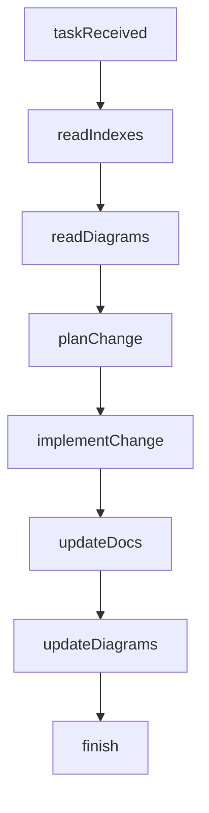

# Protocolo de Precisao de Contexto e Reasoning para IAs

## Objetivo

Estabelecer um protocolo pratico para reduzir alucinacoes, melhorar precisao e
otimizar uso de tokens em tarefas do projeto, alinhado aos relatorios de
contexto, diagramas e prompts hibridos.

## Escopo

- Absorcao de contexto: como selecionar, priorizar e posicionar informacao.
- Geracao de contexto: como registrar decisoes e criar memoria util.
- Reasoning seguro: quando exigir evidencias e como sinalizar incerteza.
- Padrao de prompts hibridos: estrutura e schemas de saida.
- Diagramas como contexto comprimido e persistente.

## Matriz tecnica -> ponto de aplicacao

| Tecnica                              | Entrada | Recuperacao | Compressao | Validacao | Atualizacao | Documentacao |
| ------------------------------------ | ------- | ----------- | ---------- | --------- | ----------- | ------------ |
| Context map + indices                | ✅      | ✅          | -          | -         | ✅          | ✅           |
| Busca contextual (rg)                | -       | ✅          | ✅         | -         | -           | -            |
| Diagramas Mermaid                    | ✅      | ✅          | ✅         | -         | ✅          | ✅           |
| Prompts hibridos (schema)            | ✅      | -           | -          | ✅        | -           | ✅           |
| RAG + chunking semantico             | -       | ✅          | ✅         | ✅        | ✅          | -            |
| Posicionamento anti "lost in middle" | ✅      | -           | ✅         | ✅        | -           | -            |
| Versionamento de docs                | -       | ✅          | -          | ✅        | ✅          | ✅           |
| Validacao automatica                 | -       | -           | -          | ✅        | ✅          | ✅           |

## Protocolo de "contexto util"

### Criterios de selecao

Use estes criterios para decidir o que entra no contexto ativo:

- **Prioridade**: regras obrigatorias e restricoes de negocio.
- **Confiabilidade**: docs oficiais > notas informais > inferencias.
- **Recencia**: informacao mais recente quando ha conflito.
- **Impacto**: afeta arquitetura, seguranca, contratos ou UX critico.

### Score recomendado

```
contexto_util = (prioridade * 0.35) + (confiabilidade * 0.30) +
                (recencia * 0.20) + (impacto * 0.15)
```

Use o score para ordenar e cortar o que excede o orcamento de tokens.

### Regras de posicionamento

- Inicio: objetivo, restricoes, regras criticas, formato de saida.
- Meio: detalhes, exemplos, referencias de apoio.
- Fim: recap do objetivo, checklist de validacao e lembrentres criticos.

### Context capsule

- Use o template em `docs/ai/context-capsule-template.md`.
- Use o checklist em `docs/ai/context-intake-output-checklist.md`.
- Para features novas ou tarefas multi-arquivo, salvar a capsule em
  `docs/ai/context-capsules/`.
- Mantenha o bloco curto e com fontes explicitas.

### Reducao de tokens sem perder fidelidade

- Use indices e mapas antes de abrir arquivos grandes.
- Extraia trechos relevantes ao inves de carregar arquivos inteiros.
- Prefira diagramas para representacoes estruturais extensas.

### Resolucao de conflitos

Quando houver conflito entre fontes:

1. Favor documentos oficiais do projeto.
2. Preferir informacao mais recente.
3. Registrar a decisao em docs internas se recorrente.

## Reasoning seguro e anti-alucinacao

### Gatilhos de validacao

Exigir evidencias quando:

- A mudanca afeta regras de negocio, seguranca ou dados.
- A tarefa envolve integracoes externas ou contratos.
- A resposta depende de uma fonte especifica do projeto.

### Sinalizacao de incerteza

Quando a fonte nao for confirmada, sinalizar:

- "Confianca baixa" e listar o que falta.
- Propor o proximo passo de validacao.

### Checklist de grounding

- A afirmacao esta em docs/codigo existente?
- Existe conflito com regras do AGENTS.md?
- A fonte usada e oficial e recente?
- Ha risco de violar padroes de design ou arquitetura?

## Padrao de prompt hibrido

### Estrutura recomendada

1. Contexto narrativo (objetivo, restricoes, criterios).
2. Schema estruturado (JSON/YAML) com campos obrigatorios.
3. Regras de validacao e fallback.
4. Exemplos positivos e negativos.

### Templates

- Use `docs/ai/prompt-templates/README.md` como ponto de partida.

### Template base (JSON)

```json
{
  "task": {
    "objective": "string",
    "constraints": ["string"],
    "required_sources": ["string"]
  },
  "output": {
    "summary": "string",
    "actions": [
      {
        "action": "string",
        "rationale": "string",
        "source": "string",
        "confidence": 0.0
      }
    ],
    "risks": ["string"],
    "validation": ["string"]
  }
}
```

### Regras de fallback

- Se nao houver fonte: `confidence < 0.5` + `validation` com proximo passo.
- Se nao houver acao necessaria: `actions: []` (nao inventar).

## Diagramas como contexto comprimido

### Quando criar/atualizar

- Novas features com impacto arquitetural.
- Mudancas em fluxos criticos (quote, pagamento, admin).
- Alteracoes em integrações e dependencias entre componentes.

### Onde armazenar

Seguir a hierarquia em `docs/architecture/` e atualizar indices relacionados.

### Fluxo recomendado



## Metricas e checkpoints

### Metricas de precisao

- **Schema compliance**: percentual de outputs validos.
- **Fidelidade ao contexto**: porcentagem de afirmacoes com fonte.
- **Tempo ate primeira mudanca correta**: baseline vs melhoria.
- **Taxa de retrabalho**: numero de correcoes por tarefa.

### Checkpoints de revisao

- Revisao semanal: consistencia de docs e diagramas.
- Revisao mensal: eficiencia de contexto e atualizacao de indices.
- Revisao por release: validacao de processos e template de prompts.

## Atualizacao e governanca

- Atualizar este protocolo quando houver novo padrao ou processo.
- Registrar mudancas em `CHANGELOG.md`.
- Referenciar este documento em tarefas de IA e treinamentos internos.

_Ultima atualizacao: 2026-01-30_
