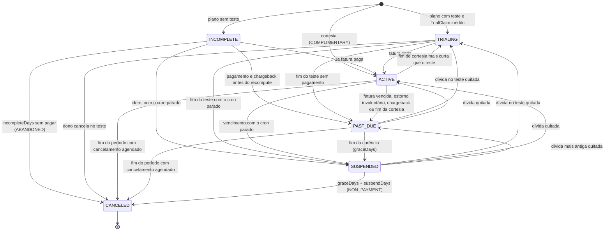
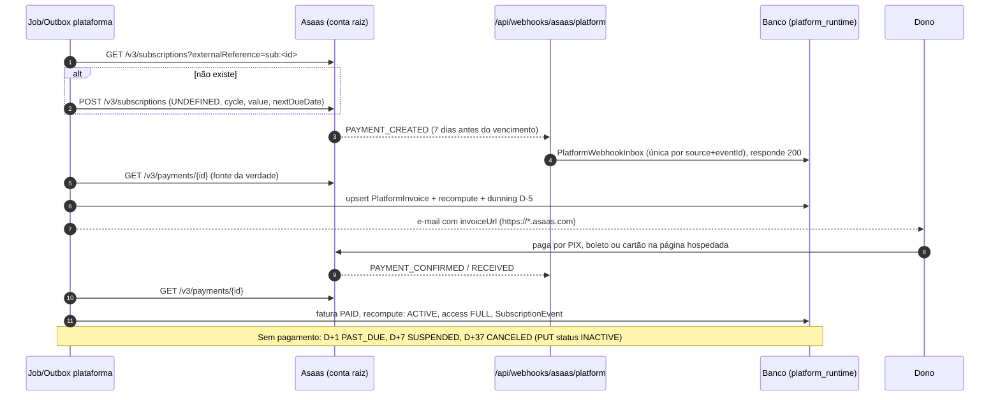
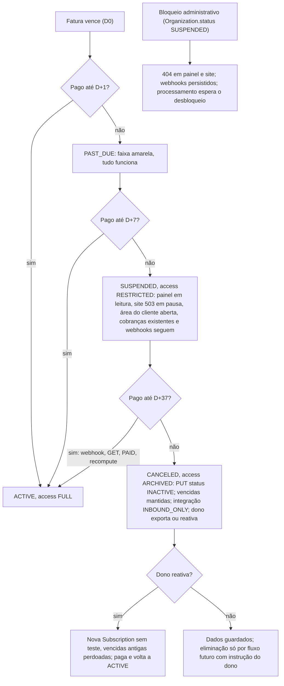
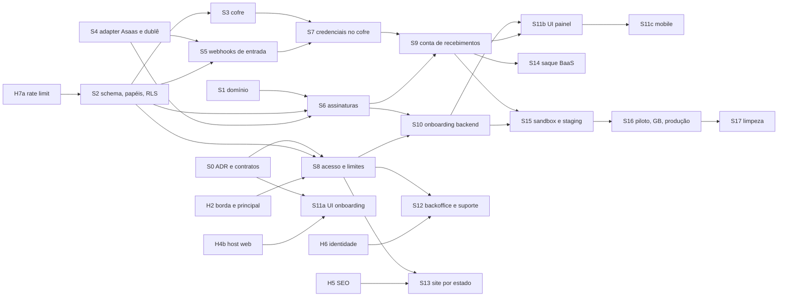

# ADR — Plataforma SaaS por assinatura

Estado local da onda 134, lote S9 (2026-10-07, sem commit): a criação de B.7.2
está instalada nos dois hosts atrás de `PLATFORM_SUBACCOUNT_CREATION=off`
(B.14), com faturamento mensal exato, intenção e inspeção na fila antes do POST,
selagem imediata, aprovação só pela saúde (integração da subconta `ACTIVE` só na
primeira aprovação) e barreira de emissão para subconta (B.7.6). A migration
202610060101 cria a tabela de pedido só da plataforma e retira `incomeRange`. As
respostas do dono de 2026-10-07 (D-1 a D-4) estão em B.18. Documentos (BaaS),
confirmação anual, recuperação assistida de chave, backoffice, barreira da conta
conectada e homologação continuam pendentes. Ver conta-recebimentos.md e
runbook-asaas-subaccount.md, onda 134.

Data da decisão de produto: 2026-09-26 (usuário). As decisões de negócio foram
aceitas; o plano S0–S17 continua uma implantação incremental, com os limites e
estados de cada lote preservados abaixo.

Estado de distribuição em 2026-10-09: primeira etapa publicada no commit
`978ceb9244c81c7cb2888b798fad8ce90edad25e`, `main` do destino independente
`Schlorke/Locadora_de_Equipamentos`, com tag `checkpoint/onda-135-pre-exclusao`.
F ocorre somente no clone de P2: os antigos `app/`, `lib/` e
`middlewares/require-admin.ts` saíram dali. Os owners operacionais de API,
runtime e módulos estão em B.10/B.13; a publicação 978ceb conserva o retorno
pré-exclusão. Provas finais pós-F ainda pendentes: a rodada existente
`p2-validation/test-unit.log` tem 245 passes, duas falhas, 247 casos em sete
arquivos, 56,75s e exit 1. Não é uma certificação integral do clone nem das
correções documentais e de M7 preparadas depois daquela rodada.

O aceite humano da interface e a publicação não ativam cadastro comercial,
fiscalização, crons, conta Asaas ou produção. Banco usado nas provas é local e
descartável; hospedagem, KMS/IP fixo, BaaS e homologação dos provedores ficam
para depois. Credenciais possivelmente compartilhadas com GB-Locações não podem
ser alteradas ou revogadas por esta retirada.

Decisões de negócio do usuário: a locadora **assina** a plataforma; a receita da
plataforma é **só a mensalidade**; **100% dos pagamentos** dos clientes finais
vão para a locadora; gateway **Asaas com uma subconta por locadora** (sem
split); app mobile único; nome provisório em
`packages/contracts/src/platform.json`.

Este documento foi consolidado por um painel de três propostas independentes e
um juiz que verificou as afirmações no código e na documentação oficial do Asaas
(fontes na seção B.19). O parecer do juiz está no apêndice.

**Status:** decisões de produto aceitas; implantação e homologação parciais.
**Depende de:** `adr-tenant-hosts.md` (H2, H4b, H5, H6, H7a), `multiempresa.md`
e `adr-backend-extraction.md`.

**Fotografia da onda 3:** S0, S1 e S4 (e H6/H7a) estavam na árvore de trabalho,
sem commit naquele corte. B.16 conserva o estado de 2026-10-03; as ondas
posteriores registram incrementos, sem promover S0–S17 a entrega total.

Onda 127 (2026-10-05, sem commit): S9 continua parcial. O dono consulta o
progresso sanitizado e confirma nova conferência pelo painel usando a outbox
existente. Estado financeiro completo não libera fila nem pagamentos. Reparo,
reconciliação final, comprovação de novas entregas e homologação continuam
pendentes. Contrato, isolamento e limites em
`../features/conta-recebimentos.md`.

**Premissas do produto** (não se rediscutem):

- a locadora assina a plataforma;
- a receita da plataforma é só a mensalidade;
- 100% dos pagamentos dos clientes vão para a locadora;
- Asaas com uma subconta por CNPJ, sem split;
- app mobile único;
- nome provisório vindo de `platform.json`.

## B.1 Decisões

| ID  | Decisão                                                                                                                                                                                                                                                                                                                                                                                                                 |
| --- | ----------------------------------------------------------------------------------------------------------------------------------------------------------------------------------------------------------------------------------------------------------------------------------------------------------------------------------------------------------------------------------------------------------------------- |
| D1  | **Estado comercial é diferente de bloqueio administrativo.** `Organization.status = SUSPENDED` continua sendo só bloqueio por fraude ou ordem legal (404 D10). A inadimplência fica em `Subscription.status`, e seu efeito vai para a projeção `Organization.access`. Motivo: o principal, a transação de locação e os crons exigem `status = ACTIVE` (A.2).                                                            |
| D2  | **Três classes de dados:** TENANT (RLS atual, sem mudança), PLATAFORMA (RLS FORCE com perfis `public`, `tenant` e `platform`; escrita só em contexto de plataforma; sem DELETE) e GLOBAL (roteamento e identidade).                                                                                                                                                                                                     |
| D3  | **Dois papéis de banco.** `app_runtime` (o atual) só **lê** tabelas de plataforma, e nas de perfil `tenant` só as da própria locadora. `platform_runtime` (novo) escreve nas tabelas de plataforma e **não tem SELECT em nenhuma tabela de negócio**: tem só `INSERT` nas quatro tabelas de semente do onboarding. O "contexto de plataforma" exige a GUC **e** a ausência de privilégio de negócio, verificada em SQL. |
| D4  | **Nenhum estado apaga dados.** Faturas, eventos, auditoria e aceites são só-acréscimo ou sem DELETE (triggers). Eliminação a pedido é um fluxo futuro, fora deste ADR.                                                                                                                                                                                                                                                  |
| D5  | **O estado da assinatura é derivado de fatos** (faturas, datas, cancelamento, cortesia) por uma função pura em `packages/domain`. Webhooks, jobs e ações só atualizam fatos e chamam `recompute`. Todo evento do Asaas leva a um GET do recurso antes de mudar estado local.                                                                                                                                            |
| D6  | **Seis estados:** `INCOMPLETE`, `TRIALING`, `ACTIVE`, `PAST_DUE`, `SUSPENDED`, `CANCELED`. Projeção: SETUP, FULL, FULL, FULL, RESTRICTED, ARCHIVED.                                                                                                                                                                                                                                                                     |
| D7  | **Pagamentos de clientes finais em curso nunca param por causa da mensalidade.** Cobranças já emitidas continuam pagáveis e os webhooks são sempre persistidos. Numa suspensão comercial também são processados; num bloqueio administrativo, o processamento espera.                                                                                                                                                   |
| D8  | **Webhook autenticado é persistido e respondido com 200.** Só 401 (autenticação) e 503 (falha de persistência) fogem disso. O processamento é assíncrono, pela outbox.                                                                                                                                                                                                                                                  |
| D9  | **Recebimentos das locadoras:** subconta Asaas com modelo **BaaS em produção**. O modelo padrão (não-BaaS) é permitido só no piloto, dentro do período de avaliação e com confirmação escrita do Asaas sobre a continuidade das chaves. **Plano B:** conta Asaas própria da locadora, conectada por chave (caminho da GB).                                                                                              |
| D10 | A subconta é criada **a pedido do dono** ("Ativar pagamentos online"), com os dados já coletados no cadastro. Nunca automaticamente no cadastro.                                                                                                                                                                                                                                                                        |
| D11 | **Cofre com criptografia envelope:** AES-256-GCM, uma DEK por segredo, KEK fora do banco. A AAD amarra locadora, integração, finalidade, versão e ambiente. KEK em variável de ambiente é permitida até o piloto; **KMS é obrigatório antes de abrir o self-service**.                                                                                                                                                  |
| D12 | **Token de webhook do Asaas: só o hash SHA-256 é guardado** em `TenantIntegration`, com o anterior aceito por até 24 h na rotação. Segredos HMAC de outros provedores (ZapSign, WhatsApp) vão para o cofre.                                                                                                                                                                                                             |
| D13 | **Mensalidade:** assinatura Asaas na conta raiz com `billingType: UNDEFINED` (PIX, boleto ou cartão na fatura hospedada) e `notificationDisabled: true` (régua própria da plataforma). A plataforma nunca toca em dado de cartão.                                                                                                                                                                                       |
| D14 | **Troca de plano sem pró-rata.** Upgrade: limites novos na hora e preço novo a partir da próxima fatura. Downgrade: no fim do período. Cancelamento: `PUT status INACTIVE` no fim do período, removendo só a fatura futura. **Nunca** `DELETE` da assinatura.                                                                                                                                                           |
| D15 | **Dono = `Organization.ownerUserId`,** com FK composta diferida para `memberships` e trigger que preserva o vínculo ADMIN ativo do dono. O enum `Role` não muda.                                                                                                                                                                                                                                                        |
| D16 | **Equipe da plataforma** = `PlatformStaff`: identidade separada, 2FA TOTP obrigatório, criada só por CLI, sem vínculo com locadora (trigger). Backoffice em `app.<raiz>/backoffice`.                                                                                                                                                                                                                                    |
| D17 | **Suporte:** só com concessão do dono, somente leitura, até 72 h, auditada no `AuditLog` da locadora e no `PlatformAuditLog`. Break-glass com duas aprovações, até 4 h.                                                                                                                                                                                                                                                 |
| D18 | **Limites e módulos verificados no backend,** na transação da escrita, sob lock consultivo. Ao exceder, a criação é bloqueada (402 `PLAN_LIMIT_REACHED`). Nada é apagado nem escondido.                                                                                                                                                                                                                                 |
| D19 | **Onboarding em `app.<raiz>/comecar`:** conta com e-mail verificado → empresa → endereço do site → plano → termos → criação **atômica**. O resto é o checklist "Primeiros passos".                                                                                                                                                                                                                                      |
| D20 | **Unicidade só para CNPJ verificado** (KYC aprovado ou conta conectada com o mesmo CNPJ). O teste grátis é único por HMAC de CNPJ e de e-mail (`TrialClaim`).                                                                                                                                                                                                                                                           |
| D21 | **CNPJ alfanumérico em todo lugar:** validação no domínio e adapter do Asaas sem `replace(/\D/g, '')`. Dinheiro sempre em `Decimal`, que vira `number` só na borda HTTP.                                                                                                                                                                                                                                                |
| D22 | **Saques** (só em BaaS) são feitos pela plataforma, **só para a conta bancária da própria locadora**, com 2FA do dono. O webhook de validação de saque aprova apenas pedidos criados pela plataforma e recusa o resto com alerta de segurança.                                                                                                                                                                          |
| D23 | **Implantação controlada:** `PLATFORM_SUBSCRIPTION_ENFORCEMENT=off                                                                                                                                                                                                                                                                                                                                                      | shadow | on`e`PLATFORM_SELF_SERVICE_SIGNUP=off | on`. O piloto é assistido por CLI ou backoffice. |
| D24 | **Todas as chamadas ao Asaas passam por um único cliente HTTP** (`billing/asaas-http.ts`) com saída configurável por IP fixo, interruptor de emergência e redação de segredos.                                                                                                                                                                                                                                          |
| D25 | **App mobile não vende nem troca plano.** Mostra o estado e leva ao navegador.                                                                                                                                                                                                                                                                                                                                          |

## B.2 Classificação, papéis e RLS

### Classificação

| Modelo                                                                                                                                                                                                | Classe e perfil       | Leitura                                              | Escrita    | Por quê                                                                                                                                                                                                          |
| ----------------------------------------------------------------------------------------------------------------------------------------------------------------------------------------------------- | --------------------- | ---------------------------------------------------- | ---------- | ---------------------------------------------------------------------------------------------------------------------------------------------------------------------------------------------------------------- |
| `Plan`, `PlanVersion`                                                                                                                                                                                 | plataforma `public`   | todos                                                | plataforma | Catálogo lido pela página de preços e pelo guarda de limites. A locadora não consegue alterar preço.                                                                                                             |
| `Subscription`, `SubscriptionEvent`, `PlatformInvoice`, `EntitlementOverride`, `PaymentAccount`, `IntegrationSecret`, `PayoutRequest`, `SupportAccessGrant`, `LegalAcceptance`, `TenantUsageSnapshot` | plataforma `tenant`   | a própria locadora (`app.tenant_id`) ou a plataforma | plataforma | Relação comercial e de recebimentos. A locadora lê o que é seu; o pipeline de cobrança lê a chave da própria subconta. Um defeito numa rota de locadora não consegue "subir o próprio plano" nem trocar a chave. |
| `PlatformWebhookInbox`, `PlatformOutboxEvent`, `PlatformAuditLog`, `PlatformStaff`, `TrialClaim`                                                                                                      | plataforma `platform` | plataforma                                           | plataforma | Operação interna.                                                                                                                                                                                                |
| `Organization`, `Membership`, `TenantIntegration`, `ExternalResourceTenant`, `PlatformRateLimit` (H7a)                                                                                                | global (como hoje)    | —                                                    | —          | Roteamento e identidade. As colunas de acesso de `organizations` são protegidas por trigger.                                                                                                                     |
| As 31 tabelas de negócio                                                                                                                                                                              | tenant (sem mudança)  | —                                                    | —          | `platform_runtime` não tem SELECT, UPDATE nem DELETE nelas.                                                                                                                                                      |

Ações do dono que gravam tabelas de plataforma (trocar plano, cancelar, pedir
subconta, conceder suporte) seguem sempre a mesma ordem:

1. a rota resolve o principal com `app_runtime`;
2. confere se é o dono;
3. chama o caso de uso do módulo de plataforma com `platform_runtime`, passando
   o `tenantId` do principal.

### Papéis de banco

Os scripts ficam em `prisma/sql/roles/*.sql`, são idempotentes e executados pelo
DBA; não entram em migrations.

- **`app_runtime`:** tudo como hoje, mais `SELECT` nas tabelas de plataforma com
  perfil `public` e `tenant`.
- **`platform_runtime`:**
  - `SELECT, INSERT, UPDATE` em todas as tabelas de plataforma;
  - `SELECT, INSERT, UPDATE` em `organizations`, `memberships` e
    `tenant_integrations`;
  - **somente `INSERT`** em `settings`, `financial_settings`, `permissions` e
    `categories` (sementes do onboarding, via `createMany`, que não usa
    RETURNING; o `WITH CHECK` de `tenant_isolation` continua valendo);
  - `SELECT` na view `platform_user_contacts`;
  - `SELECT, INSERT, UPDATE, DELETE` em `platform_rate_limits`;
  - nenhum privilégio em `users` nem nas demais tabelas de negócio;
  - sem `SUPERUSER`, `BYPASSRLS` ou `CREATEROLE`.
- **Conexões:** `DATABASE_URL` para `app_runtime` e `PLATFORM_DATABASE_URL` para
  `platform_runtime`, em `packages/backend/src/runtime/platform-database.ts`. O
  runtime de negócio é `packages/backend/src/runtime/database.ts`; ambos usam
  `PrismaPg`. O pool de plataforma é separado, lazy e sem fallback para
  `DATABASE_URL` ou reutilização da identidade do pool já aberto.

### `tools/tenant-models.json`

```json
{
  "tenantModels": ["... 31 atuais, sem mudança ..."],
  "globalModels": ["... atuais ...", "PlatformRateLimit"],
  "platformModels": [
    { "model": "Plan", "table": "plans", "read": "public" },
    { "model": "PlanVersion", "table": "plan_versions", "read": "public" },
    { "model": "Subscription", "table": "subscriptions", "read": "tenant" },
    {
      "model": "SubscriptionEvent",
      "table": "subscription_events",
      "read": "tenant"
    },
    {
      "model": "PlatformInvoice",
      "table": "platform_invoices",
      "read": "tenant"
    },
    {
      "model": "EntitlementOverride",
      "table": "entitlement_overrides",
      "read": "tenant"
    },
    {
      "model": "PaymentAccount",
      "table": "payment_accounts",
      "read": "tenant"
    },
    {
      "model": "IntegrationSecret",
      "table": "integration_secrets",
      "read": "tenant"
    },
    { "model": "PayoutRequest", "table": "payout_requests", "read": "tenant" },
    {
      "model": "SupportAccessGrant",
      "table": "support_access_grants",
      "read": "tenant"
    },
    {
      "model": "LegalAcceptance",
      "table": "legal_acceptances",
      "read": "tenant"
    },
    {
      "model": "TenantUsageSnapshot",
      "table": "tenant_usage_snapshots",
      "read": "tenant"
    },
    {
      "model": "PlatformWebhookInbox",
      "table": "platform_webhook_inbox",
      "read": "platform"
    },
    {
      "model": "PlatformOutboxEvent",
      "table": "platform_outbox_events",
      "read": "platform"
    },
    {
      "model": "PlatformAuditLog",
      "table": "platform_audit_logs",
      "read": "platform"
    },
    { "model": "PlatformStaff", "table": "platform_staff", "read": "platform" },
    { "model": "TrialClaim", "table": "trial_claims", "read": "platform" }
  ]
}
```

### Ampliação de `tools/tenant-database-check.mjs`

Com `TENANT_RUNTIME_DATABASE_URL`:

1. Para `platformModels`: RLS habilitada e forçada.
2. Exatamente as políticas `platform_select`, `platform_insert` e
   `platform_update`, com as expressões esperadas para cada perfil.
3. Nenhuma política de DELETE.
4. Trigger `*_no_delete` presente.
5. O runtime não é dono da tabela.
6. `app_runtime` sem `INSERT`, `UPDATE` ou `DELETE` nelas.
7. Nenhuma tabela tenant cita `app_is_platform_context` em política.

Com `PLATFORM_RUNTIME_DATABASE_URL`:

1. `has_table_privilege(..., 'SELECT' | 'UPDATE' | 'DELETE')` falso em **todas**
   as `tenantModels`.
2. `INSERT` verdadeiro somente nas 4 tabelas de semente.
3. Papel sem `SUPERUSER`, `BYPASSRLS` ou `CREATEROLE`.

O erro `MODEL_NOT_CLASSIFIED` continua valendo.

## B.3 Modelo de dados (Prisma)

```prisma
// ===================== enums novos =====================
enum BillingInterval { MONTHLY YEARLY }
enum SubscriptionStatus { INCOMPLETE TRIALING ACTIVE PAST_DUE SUSPENDED CANCELED }
enum SubscriptionBillingMode { ASAAS COMPLIMENTARY }
enum ProviderSyncState { NOT_REQUIRED PENDING PROCESSING UNKNOWN SYNCED FAILED }
enum SubscriptionEventSource { WEBHOOK JOB OWNER STAFF SYSTEM RECONCILIATION }
enum PlatformInvoiceKind { CYCLE ADJUSTMENT }
enum PlatformInvoiceStatus { PENDING PAID OVERDUE CANCELED REFUNDED CHARGEBACK }
enum OrganizationAccess { SETUP FULL RESTRICTED ARCHIVED }
enum OrganizationOrigin { LEGACY ONBOARDING }
enum CompanyType { MEI LIMITED INDIVIDUAL ASSOCIATION }
enum PaymentAccountMode { ASAAS_SUBACCOUNT ASAAS_CONNECTED_ACCOUNT }
enum SubaccountModel { STANDARD BAAS }
enum PaymentAccountStatus { DRAFT PROVISIONING UNKNOWN KEY_RECOVERY_REQUIRED AWAITING_OWNER UNDER_REVIEW APPROVED REJECTED RESTRICTED BLOCKED DISCONNECTED }
enum CredentialSource { ENV_REF VAULT }
enum SecretPurpose { ASAAS_API_KEY PROVIDER_API_KEY PROVIDER_SIGNING_SECRET PROVIDER_VERIFY_TOKEN PROVIDER_USER_AGENT }
enum SecretState { PENDING ACTIVE PREVIOUS RETIRED DESTROYED }
enum PayoutStatus { REQUESTED SUBMITTING SUBMITTED DONE REFUSED FAILED }
enum PlatformStaffRole { PLATFORM_ADMIN PLATFORM_FINANCE PLATFORM_SUPPORT PLATFORM_VIEWER }
enum SupportAccessScope { READ_ONLY }                 // READ_WRITE fica fora do MVP
enum LegalDocumentKind { PLATFORM_TERMS PRIVACY_POLICY DATA_PROCESSING_AGREEMENT PAYMENTS_PARTNER_NOTICE MARKETING_OPT_IN }
enum IntegrationStatus { ACTIVE DISABLED PROVISIONING INBOUND_ONLY }   // 2 valores novos, migration isolada

// ===================== alterações =====================
model Organization {
  // ... campos atuais (document, city, state, postalCode, slug, name, status, ...)
  access             OrganizationAccess @default(SETUP)   // projeção; só contexto de plataforma altera (trigger)
  origin             OrganizationOrigin @default(LEGACY)
  ownerUserId        String?            // FK composta DIFERIDA só em SQL -> memberships("tenantId","userId")
  documentNormalized String?            // CNPJ ^[0-9A-Z]{12}[0-9]{2}$
  documentVerifiedAt DateTime?
  legalName          String?
  companyType        CompanyType?
  phone              String?
  billingEmail       String?
  addressLine        String?
  addressNumber      String?
  addressComplement  String?
  district           String?
  sitePublishedAt    DateTime?
  siteIndexable      Boolean            @default(true)
  adminHoldReason    String?
  provisioningKey    String?            @unique            // HMAC(userId + Idempotency-Key)
  subscriptions      Subscription[]
  paymentAccounts    PaymentAccount[]
  supportGrants      SupportAccessGrant[]
}

model TenantIntegration {
  // ... campos atuais
  credentialsRef            String?                        // era obrigatório
  credentialSource          CredentialSource @default(ENV_REF)
  environment               String?                        // sandbox | production
  webhookTokenHash          String?                        // sha256 hex do authToken do Asaas
  webhookTokenPreviousHash  String?
  webhookTokenPreviousUntil DateTime?
  secrets                   IntegrationSecret[]
  paymentAccount            PaymentAccount?
}

// ===================== catálogo =====================
model Plan {
  id         String    @id @default(cuid())
  code       String    @unique                  // CHECK ^[a-z0-9-]{2,32}$
  name       String
  isPublic   Boolean   @default(false)
  sortOrder  Int       @default(0)
  archivedAt DateTime?
  createdAt  DateTime  @default(now())
  updatedAt  DateTime  @updatedAt
  versions   PlanVersion[]
  @@map("plans")
}

model PlanVersion {                             // imutável, exceto sellableUntil (trigger)
  id             String          @id @default(cuid())
  planId         String
  version        Int
  interval       BillingInterval @default(MONTHLY)
  amount         Decimal         @db.Decimal(12, 2)   // CHECK >= 0; 0 só em plano não público
  trialDays      Int             @default(0)          // CHECK 0..30
  graceDays      Int             @default(7)          // CHECK 0..15
  suspendDays    Int             @default(30)         // CHECK 7..90
  incompleteDays Int             @default(30)
  entitlements   Json                                 // EntitlementsV1 (@gb-locacoes/contracts/entitlements)
  sellableFrom   DateTime        @default(now())
  sellableUntil  DateTime?
  createdAt      DateTime        @default(now())
  plan           Plan            @relation(fields: [planId], references: [id], onDelete: Restrict)
  subscriptions  Subscription[]  @relation("CurrentPlanVersion")
  scheduledIn    Subscription[]  @relation("ScheduledPlanVersion")
  @@unique([planId, version])
  @@map("plan_versions")
}

// ===================== assinatura =====================
model Subscription {
  id                     String                  @id @default(cuid())
  tenantId               String
  planVersionId          String
  scheduledPlanVersionId String?
  scheduledChangeAt      DateTime?               @db.Date
  status                 SubscriptionStatus                        // projeção de derivarEstado
  billingMode            SubscriptionBillingMode @default(ASAAS)
  complimentaryUntil     DateTime?               @db.Date
  complimentaryReason    String?
  trialEndsAt            DateTime?               @db.Date
  currentPeriodStart     DateTime?               @db.Date
  currentPeriodEnd       DateTime?               @db.Date
  pastDueSince           DateTime?               @db.Date
  graceEndsAt            DateTime?               @db.Date
  suspendedAt            DateTime?
  cancelAtPeriodEnd      Boolean                 @default(false)
  cancelRequestedAt      DateTime?
  cancelReason           String?   // OWNER_REQUEST | NON_PAYMENT | TRIAL_EXPIRED | ABANDONED | STAFF (CHECK)
  canceledAt             DateTime?
  billingEmail           String?
  providerEnvironment    String?                                   // sandbox | production (CHECK)
  providerCustomerId     String?
  providerSubscriptionId String?                 @unique
  providerSync           ProviderSyncState       @default(NOT_REQUIRED)
  providerAttempts       Int                     @default(0)
  providerNextAttemptAt  DateTime                @default(now())
  providerLastError      String?                                   // só código
  reconciledAt           DateTime?
  revision               Int                     @default(0)
  createdAt              DateTime                @default(now())
  updatedAt              DateTime                @updatedAt
  organization           Organization            @relation(fields: [tenantId], references: [id], onDelete: Restrict)
  planVersion            PlanVersion             @relation("CurrentPlanVersion", fields: [planVersionId], references: [id], onDelete: Restrict)
  scheduledPlanVersion   PlanVersion?            @relation("ScheduledPlanVersion", fields: [scheduledPlanVersionId], references: [id], onDelete: Restrict)
  events                 SubscriptionEvent[]
  invoices               PlatformInvoice[]
  @@unique([id, tenantId])
  @@index([tenantId, status])
  @@index([status, graceEndsAt])
  @@index([providerSync, providerNextAttemptAt])
  @@map("subscriptions")
  // SQL: UNIQUE ("tenantId") WHERE status <> 'CANCELED'
}

model SubscriptionEvent {                         // só acréscimo
  id             String                  @id @default(cuid())
  tenantId       String
  subscriptionId String
  fromStatus     SubscriptionStatus?
  toStatus       SubscriptionStatus
  reason         String                  // TRIAL_STARTED, INVOICE_PAID, GRACE_ELAPSED, NON_PAYMENT, OWNER_CANCEL, PLAN_CHANGED...
  source         SubscriptionEventSource
  dedupeKey      String                  // asaas:<evt> | job:<AAAA-MM-DD>:<regra> | owner:<idempotency>
  actorUserId    String?
  planVersionId  String?
  mrrDelta       Decimal?                @db.Decimal(12, 2)
  occurredAt     DateTime                @default(now())
  subscription   Subscription            @relation(fields: [subscriptionId, tenantId], references: [id, tenantId], onDelete: Restrict)
  @@unique([subscriptionId, dedupeKey])
  @@index([tenantId, occurredAt])
  @@index([occurredAt])
  @@map("subscription_events")
}

model PlatformInvoice {                           // sem DELETE
  id                String                @id @default(cuid())
  tenantId          String
  subscriptionId    String
  kind              PlatformInvoiceKind   @default(CYCLE)
  status            PlatformInvoiceStatus @default(PENDING)
  providerStatus    String?                                  // valor bruto do Asaas
  providerPaymentId String                @unique
  amount            Decimal               @db.Decimal(12, 2)
  dueDate           DateTime              @db.Date
  periodStart       DateTime?             @db.Date
  periodEnd         DateTime?             @db.Date
  billingType       String?                                  // PIX | BOLETO | CREDIT_CARD | UNDEFINED
  invoiceUrl        String?                                  // só https://*.asaas.com (validado)
  paidAt            DateTime?
  chargebackAt      DateTime?
  voluntaryRefund   Boolean               @default(false)
  canceledReason    String?                                  // FUTURE_AFTER_CANCEL | REACTIVATION_WAIVER | PROVIDER_DELETED
  providerCancelState String               @default("NONE")  // NONE | PROCESSING | UNKNOWN | CONFIRMED; CHECK SQL
  syncedAt          DateTime
  createdAt         DateTime              @default(now())
  updatedAt         DateTime              @updatedAt
  subscription      Subscription          @relation(fields: [subscriptionId, tenantId], references: [id, tenantId], onDelete: Restrict)
  @@index([tenantId, status, dueDate])
  @@index([status, dueDate])
  @@map("platform_invoices")
}

model EntitlementOverride {
  id              String    @id @default(cuid())
  tenantId        String
  key             String    // "limits.equipments" | "features.customDomain" ...
  value           Json
  reason          String
  grantedByUserId String
  expiresAt       DateTime?
  revokedAt       DateTime?
  createdAt       DateTime  @default(now())
  @@index([tenantId])
  @@map("entitlement_overrides")
}

model TrialClaim {                                // sobrevive a qualquer eliminação futura
  keyHash   String   @id                          // HMAC(PLATFORM_TRIAL_SECRET, 'cnpj:'|'email:' + valor normalizado)
  kind      String                                // CNPJ | EMAIL
  tenantId  String
  createdAt DateTime @default(now())
  @@map("trial_claims")
}

// ===================== recebimentos e cofre =====================
model PaymentAccount {
  id                      String               @id @default(cuid())
  tenantId                String
  integrationId           String               @unique
  mode                    PaymentAccountMode
  subaccountModel         SubaccountModel?     // obrigatório se ASAAS_SUBACCOUNT (CHECK)
  status                  PaymentAccountStatus @default(DRAFT)
  environment             String               // sandbox | production (CHECK)
  providerAccountId       String?              @unique
  walletId                String?              @unique
  commercialInfoStatus    String?
  bankAccountInfoStatus   String?
  documentationStatus     String?
  generalStatus           String?
  commercialInfoExpiresAt DateTime?
  commercialInfoExpired   Boolean              @default(false)
  keyIdleExpiresAt        DateTime?            // projectedExpirationDateByLackOfUse
  lastKeyUseAt            DateTime?
  healthIssue             String?              // KEY_DISABLED | WEBHOOK_MISSING | WEBHOOK_INTERRUPTED | COMMERCIAL_INFO_EXPIRED
  provisioningAttempts    Int                  @default(0)
  nextAttemptAt           DateTime             @default(now())
  lockedUntil             DateTime?
  lastErrorCode           String?
  requestedByUserId       String?
  approvedAt              DateTime?
  lastSyncedAt            DateTime?
  disconnectedAt          DateTime?
  createdAt               DateTime             @default(now())
  updatedAt               DateTime             @updatedAt
  organization            Organization         @relation(fields: [tenantId], references: [id], onDelete: Restrict)
  integration             TenantIntegration    @relation(fields: [integrationId, tenantId], references: [id, tenantId], onDelete: Restrict)
  payouts                 PayoutRequest[]
  provisioningRequest     PaymentAccountProvisioningRequest?
  @@unique([id, tenantId])
  @@index([status, nextAttemptAt])
  @@map("payment_accounts")
  // SQL: UNIQUE ("tenantId") WHERE "disconnectedAt" IS NULL
}

model PaymentAccountProvisioningRequest {          // só plataforma (FORCE RLS, sem SELECT do papel de negócio, sem DELETE)
  id                 String         @id @default(cuid())
  tenantId           String
  paymentAccountId   String         @unique
  incomeValue        Decimal?       @db.Decimal(12, 2)  // faturamento mensal declarado; NULL depois da purga
  mobilePhone        String?                             // celular declarado; NULL depois da purga
  companyDataVersion String                              // sha256 dos dados da empresa confirmados
  createdAt          DateTime       @default(now())
  purgedAt           DateTime?
  purgeReason        String?        // CREATED | UNCERTAIN | REJECTED | CANCELLED | EXISTING_ACCOUNT | BLOCKED
  paymentAccount     PaymentAccount @relation(fields: [paymentAccountId, tenantId], references: [id, tenantId], onDelete: Restrict)
  @@unique([paymentAccountId, tenantId])
  @@unique([id, tenantId])
  @@map("payment_account_provisioning_requests")
  // SQL: valor e celular só enquanto pode haver POST; a única alteração é a purga (trigger)
}

model IntegrationSecret {
  id                   String        @id @default(cuid())
  tenantId             String
  integrationId        String
  purpose              SecretPurpose
  version              Int
  state                SecretState   @default(PENDING)
  environment          String?
  kekProvider          String        // env | aws-kms
  kekId                String
  wrappedDek           Bytes?        // null = DESTROYED (crypto-shredding)
  iv                   Bytes?
  ciphertext           Bytes?
  authTag              Bytes?
  aadVersion           Int           @default(1)
  fingerprint          String        // HMAC-SHA256(PLATFORM_SECRET_FINGERPRINT_KEY, valor)
  providerCredentialId String?       // accessToken.id no Asaas
  expiresAt            DateTime?
  createdByUserId      String?
  createdAt            DateTime      @default(now())
  activatedAt          DateTime?
  retiredAt            DateTime?
  destroyedAt          DateTime?
  integration          TenantIntegration @relation(fields: [integrationId, tenantId], references: [id, tenantId], onDelete: Restrict)
  @@unique([integrationId, purpose, version])
  @@unique([id, tenantId])
  @@index([tenantId, purpose, state])
  @@index([kekId])
  @@map("integration_secrets")
}

model PayoutRequest {                             // só BaaS
  id                String         @id @default(cuid())
  tenantId          String
  paymentAccountId  String
  amount            Decimal        @db.Decimal(12, 2)
  status            PayoutStatus   @default(REQUESTED)
  idempotencyKey    String         @unique
  providerTransferId String?       @unique
  requestedByUserId String
  bankAccountRef    String         // identificador da conta bancária do próprio titular (sem número completo)
  failureCode       String?
  createdAt         DateTime       @default(now())
  submittedAt       DateTime?
  validatedAt       DateTime?
  completedAt       DateTime?
  paymentAccount    PaymentAccount @relation(fields: [paymentAccountId, tenantId], references: [id, tenantId], onDelete: Restrict)
  @@index([tenantId, createdAt])
  @@index([status, submittedAt])
  @@map("payout_requests")
}

// ===================== operação da plataforma =====================
model PlatformWebhookInbox {
  id              String    @id @default(cuid())
  source          String    // ASAAS_ROOT | ASAAS_ACCOUNT | ASAAS_TRANSFER_VALIDATION
  sourceEnvironment String? // raiz: sandbox | production; imutável; null histórico não presumido
  routeKey        String?   // integrationId quando veio da URL da subconta
  eventId         String    // "id:<evt>" ou "sha256:<hash>"
  eventType       String
  payloadHash     String
  payload         Json      // podado para {} após 90 dias (UPDATE permitido)
  tenantId        String?
  status          String    @default("RECEIVED")   // RECEIVED | PROCESSED | IGNORED | UNROUTED | CONFLICT | FAILED
  attempts        Int       @default(0)
  processingToken String?
  lockedUntil     DateTime?
  lastError       String?
  receivedAt      DateTime  @default(now())
  processedAt     DateTime?
  @@unique([source, eventId])
  @@index([status, receivedAt])
  @@map("platform_webhook_inbox")
}

model PlatformOutboxEvent {                       // mesma forma de OutboxEvent; tenantId informativo
  id          String       @id @default(cuid())
  tenantId    String?
  topic       String
  aggregateId String
  payload     Json
  dedupeKey   String       @unique
  status      OutboxStatus @default(PENDING)
  attempts    Int          @default(0)
  availableAt DateTime     @default(now())
  lockedUntil DateTime?
  lockedBy    String?
  lastError   String?
  createdAt   DateTime     @default(now())
  completedAt DateTime?
  @@index([status, availableAt])
  @@map("platform_outbox_events")
}

model PlatformAuditLog {                          // só acréscimo
  id          String   @id @default(cuid())
  actorKind   String   // STAFF | OWNER | SYSTEM
  actorUserId String?
  action      String   // subscription.suspended, support.grant.created, secret.rotated, payout.refused...
  tenantId    String?
  targetType  String?
  targetId    String?
  reasonCategory String?
  reason      String?
  metadata    Json?    // nunca segredo nem payload de negócio
  ipHash      String?
  createdAt   DateTime @default(now())
  @@index([tenantId, createdAt])
  @@index([action, createdAt])
  @@map("platform_audit_logs")
}

model PlatformStaff {
  id        String            @id @default(cuid())
  userId    String            @unique
  role      PlatformStaffRole
  active    Boolean           @default(true)
  createdBy String?
  createdAt DateTime          @default(now())
  revokedAt DateTime?
  user      User              @relation(fields: [userId], references: [id], onDelete: Restrict)
  @@map("platform_staff")
}

model SupportAccessGrant {
  id               String             @id @default(cuid())
  tenantId         String
  grantedByUserId  String?            // dono (null só em break-glass)
  staffUserId      String?            // null = qualquer PLATFORM_SUPPORT
  scope            SupportAccessScope @default(READ_ONLY)
  reason           String             // 10..500 caracteres (CHECK)
  ticketRef        String?
  breakGlass       Boolean            @default(false)
  approverStaffIds String[]           // break-glass: dois ids distintos (CHECK)
  startsAt         DateTime           @default(now())
  expiresAt        DateTime           // CHECK <= startsAt + 72h (break-glass: 4h)
  revokedAt        DateTime?
  revokedByUserId  String?
  createdAt        DateTime           @default(now())
  organization     Organization       @relation(fields: [tenantId], references: [id], onDelete: Restrict)
  @@index([tenantId, expiresAt])
  @@map("support_access_grants")
}

model LegalAcceptance {                           // só acréscimo
  id          String            @id @default(cuid())
  userId      String
  tenantId    String?
  kind        LegalDocumentKind
  version     String            // ex.: 2026-10-01
  textSha256  String
  acceptedAt  DateTime          @default(now())
  withdrawnAt DateTime?         // só MARKETING_OPT_IN (UPDATE permitido só nesta coluna)
  ipHash      String?           // HMAC(PLATFORM_RATE_LIMIT_SECRET, ip)
  userAgent   String?           // truncado em 200
  @@index([userId, kind])
  @@index([tenantId, kind])
  @@map("legal_acceptances")
}

model TenantUsageSnapshot {                       // só contagens
  tenantId       String   @id
  equipments     Int
  staffSeats     Int
  storageBytes   BigInt   @default(0)
  lastActivityAt DateTime?
  capturedAt     DateTime
  @@map("tenant_usage_snapshots")
}
```

O contrato de limites e módulos (`packages/contracts/src/entitlements.ts`):

```ts
export const ENTITLEMENT_FEATURES = [
  "onlinePayments",
  "customDomain",
  "logistics",
  "maintenance",
  "contractSignature",
  "whatsapp",
  "emailInbox",
  "merchantFeed"
] as const
export const EntitlementsV1 = z
  .object({
    schema: z.literal(1),
    limits: z
      .object({
        equipments: z.number().int().positive().nullable(), // null = ilimitado; conta Equipment (modelo), não unidade
        staffSeats: z.number().int().positive().nullable() // Membership ACTIVE com papel diferente de CLIENT, incluindo o dono
      })
      .strict(),
    features: z
      .object(
        Object.fromEntries(ENTITLEMENT_FEATURES.map((f) => [f, z.boolean()]))
      )
      .strict()
  })
  .strict()
export type Money = string // "199.90": dinheiro trafega como string decimal
export type AccessCode =
  | "SUBSCRIPTION_RESTRICTED"
  | "PLAN_LIMIT_REACHED"
  | "MODULE_NOT_IN_PLAN"
  | "TENANT_ARCHIVED"
  | "OWNER_REQUIRED"
  | "PAYMENT_ACCOUNT_NOT_READY"
  | "FRESH_SESSION_REQUIRED"
```

## B.4 Migrations e preflights

A data real de criação entra no lugar de `<AAAAMMDD>`. As tabelas vêm de
`prisma migrate diff`. RLS, triggers, índices parciais e FKs diferidas são
acrescentados à mão, como já se faz no repositório. Todo bloco de preflight
aborta **sem alterar nada**.

| Migration                              | Conteúdo                                                                                                                                                                |
| -------------------------------------- | ----------------------------------------------------------------------------------------------------------------------------------------------------------------------- |
| `…0101_integration_status_values`      | Isolada: `ALTER TYPE "IntegrationStatus" ADD VALUE IF NOT EXISTS 'PROVISIONING'; … 'INBOUND_ONLY';`                                                                     |
| `…0102_platform_scope_foundation`      | Função sentinela, triggers genéricos e view de contato                                                                                                                  |
| `…0103_platform_catalog_subscriptions` | `plans`, `plan_versions`, `subscriptions`, `subscription_events`, `platform_invoices`, `entitlement_overrides`, `trial_claims`; plano interno e backfill; RLS; triggers |
| `…0104_organization_lifecycle`         | Colunas de `organizations`, FK do dono, triggers de coluna, dono e slug                                                                                                 |
| `…0105_payment_accounts_vault`         | `tenant_integrations` (origem da credencial e hash do token), `payment_accounts`, `integration_secrets`, `payout_requests`                                              |
| `…0106_platform_operations`            | Inbox e outbox de plataforma, auditoria, equipe, concessões, aceites e uso; trigger de equipe sem vínculo                                                               |

```sql
-- …0102_platform_scope_foundation
DO $$ BEGIN
  IF (SELECT relrowsecurity FROM pg_class WHERE oid = '"organizations"'::regclass) THEN
    RAISE EXCEPTION 'Preflight platform_scope: "organizations" tem RLS; o desenho exige tabela global. Nada foi alterado.';
  END IF;
  IF to_regclass('public.equipments') IS NULL OR to_regclass('public.client_profiles') IS NULL
     OR to_regclass('public.payments') IS NULL THEN
    RAISE EXCEPTION 'Preflight platform_scope: tabelas sentinela ausentes. Nada foi alterado.';
  END IF;
END $$;

-- "Contexto de plataforma" só existe para um papel SEM acesso de leitura a dados de negócio.
CREATE FUNCTION app_is_platform_context() RETURNS boolean LANGUAGE sql STABLE AS $$
  SELECT coalesce(current_setting('app.platform_scope', true), '') = 'on'
     AND NOT has_table_privilege(current_user, 'public.equipments', 'SELECT')
     AND NOT has_table_privilege(current_user, 'public.client_profiles', 'SELECT')
     AND NOT has_table_privilege(current_user, 'public.payments', 'SELECT')
$$;
CREATE FUNCTION forbid_delete() RETURNS trigger LANGUAGE plpgsql AS $$
BEGIN RAISE EXCEPTION 'DELETE proibido em %: histórico da plataforma não é apagado', TG_TABLE_NAME USING ERRCODE = '23514'; END $$;
CREATE FUNCTION forbid_update() RETURNS trigger LANGUAGE plpgsql AS $$
BEGIN RAISE EXCEPTION 'UPDATE proibido em %: registro só-acréscimo', TG_TABLE_NAME USING ERRCODE = '23514'; END $$;
-- Contato do dono sem GRANT em "users" (a view roda com os privilégios do dono da view).
CREATE VIEW platform_user_contacts AS SELECT id, name, email, "authEmailVerified" FROM users;
```

```sql
-- …0103_platform_catalog_subscriptions (trechos; DDL das tabelas gerado pelo Prisma)
CREATE UNIQUE INDEX subscriptions_current_per_tenant ON subscriptions("tenantId") WHERE status <> 'CANCELED';
ALTER TABLE plan_versions ADD CONSTRAINT plan_versions_amount CHECK (amount >= 0),
  ADD CONSTRAINT plan_versions_trial CHECK ("trialDays" BETWEEN 0 AND 30),
  ADD CONSTRAINT plan_versions_grace CHECK ("graceDays" BETWEEN 0 AND 15),
  ADD CONSTRAINT plan_versions_suspend CHECK ("suspendDays" BETWEEN 7 AND 90);
ALTER TABLE subscriptions ADD CONSTRAINT subscriptions_canceled CHECK (status <> 'CANCELED' OR "canceledAt" IS NOT NULL);

-- Semente ANTES de FORCE: com FORCE, nem o dono escreve fora do contexto de plataforma.
INSERT INTO plans (id, code, name, "isPublic", "updatedAt")
VALUES ('plan_interno_legado', 'interno-legado', 'Interno (legado, sem limites)', false, CURRENT_TIMESTAMP);
INSERT INTO plan_versions (id, "planId", version, interval, amount, "trialDays", "graceDays", "suspendDays", "incompleteDays", entitlements)
VALUES ('planv_interno_legado_1', 'plan_interno_legado', 1, 'MONTHLY', 0, 0, 7, 30, 30,
 '{"schema":1,"limits":{"equipments":null,"staffSeats":null},"features":{"onlinePayments":true,"customDomain":true,"logistics":true,"maintenance":true,"contractSignature":true,"whatsapp":true,"emailInbox":true,"merchantFeed":true}}');
INSERT INTO subscriptions (id, "tenantId", "planVersionId", status, "billingMode", "complimentaryReason", "providerSync", "updatedAt")
SELECT 'sub_legacy_' || o.id, o.id, 'planv_interno_legado_1', 'ACTIVE', 'COMPLIMENTARY', 'LEGACY_BACKFILL', 'NOT_REQUIRED', CURRENT_TIMESTAMP
FROM organizations o;
DO $$ BEGIN
  IF EXISTS (SELECT 1 FROM organizations o WHERE NOT EXISTS
      (SELECT 1 FROM subscriptions s WHERE s."tenantId" = o.id AND s.status <> 'CANCELED')) THEN
    RAISE EXCEPTION 'Postcheck subscriptions: organização sem assinatura corrente.';
  END IF;
END $$;

-- Modelo de política, perfil "tenant" (repetir por tabela; perfil "public": USING (true); perfil "platform": só a função)
ALTER TABLE subscriptions ENABLE ROW LEVEL SECURITY;
ALTER TABLE subscriptions FORCE ROW LEVEL SECURITY;
CREATE POLICY platform_select ON subscriptions FOR SELECT
  USING ("tenantId" = NULLIF(current_setting('app.tenant_id', true), '') OR app_is_platform_context());
CREATE POLICY platform_insert ON subscriptions FOR INSERT WITH CHECK (app_is_platform_context());
CREATE POLICY platform_update ON subscriptions FOR UPDATE
  USING (app_is_platform_context()) WITH CHECK (app_is_platform_context());
CREATE TRIGGER subscriptions_no_delete BEFORE DELETE ON subscriptions FOR EACH ROW EXECUTE FUNCTION forbid_delete();
CREATE TRIGGER subscription_events_append_only BEFORE UPDATE ON subscription_events FOR EACH ROW EXECUTE FUNCTION forbid_update();

CREATE FUNCTION plan_version_immutable() RETURNS trigger LANGUAGE plpgsql AS $$
BEGIN
  IF (NEW."planId", NEW.version, NEW.interval, NEW.amount, NEW."trialDays", NEW."graceDays", NEW."suspendDays", NEW."incompleteDays", NEW.entitlements, NEW."sellableFrom")
     IS DISTINCT FROM (OLD."planId", OLD.version, OLD.interval, OLD.amount, OLD."trialDays", OLD."graceDays", OLD."suspendDays", OLD."incompleteDays", OLD.entitlements, OLD."sellableFrom")
  THEN RAISE EXCEPTION 'PLAN_VERSION_IMMUTABLE' USING ERRCODE = '23514'; END IF;
  RETURN NEW;
END $$;
CREATE TRIGGER plan_versions_immutable BEFORE UPDATE ON plan_versions FOR EACH ROW EXECUTE FUNCTION plan_version_immutable();

CREATE FUNCTION subscription_history_guard() RETURNS trigger LANGUAGE plpgsql AS $$
BEGIN
  IF NEW."tenantId" IS DISTINCT FROM OLD."tenantId" OR (OLD.status = 'CANCELED' AND NEW.status <> 'CANCELED') THEN
    RAISE EXCEPTION 'SUBSCRIPTION_HISTORY_IMMUTABLE' USING ERRCODE = '23514';
  END IF;
  RETURN NEW;
END $$;
CREATE TRIGGER subscriptions_history BEFORE UPDATE ON subscriptions FOR EACH ROW EXECUTE FUNCTION subscription_history_guard();
-- platform_invoices: trigger análogo proíbe trocar tenantId, subscriptionId e providerPaymentId; sem DELETE.
```

```sql
-- …0104_organization_lifecycle
DO $$ DECLARE n bigint; BEGIN
  SELECT count(*) INTO n FROM organizations WHERE "documentNormalized" IS NOT NULL;   -- só em reexecução
  IF n > 0 AND EXISTS (SELECT 1 FROM organizations WHERE "documentNormalized" !~ '^[0-9A-Z]{12}[0-9]{2}$') THEN
    RAISE EXCEPTION 'Preflight organizations_document: documento fora do formato CNPJ. Nada foi alterado.';
  END IF;
END $$;
-- Organizações existentes ficam FULL; as novas nascem SETUP (falha fechada).
ALTER TABLE organizations ADD COLUMN access "OrganizationAccess" NOT NULL DEFAULT 'FULL';
ALTER TABLE organizations ALTER COLUMN access SET DEFAULT 'SETUP';
-- (demais colunas novas: origin, ownerUserId, documentNormalized, documentVerifiedAt, legalName, companyType, phone,
--  billingEmail, addressLine, addressNumber, addressComplement, district, sitePublishedAt, siteIndexable, adminHoldReason, provisioningKey)
ALTER TABLE organizations ADD CONSTRAINT organizations_owner_required CHECK (origin = 'LEGACY' OR "ownerUserId" IS NOT NULL);
ALTER TABLE organizations ADD CONSTRAINT organizations_document_format
  CHECK ("documentNormalized" IS NULL OR "documentNormalized" ~ '^[0-9A-Z]{12}[0-9]{2}$');
CREATE UNIQUE INDEX organizations_verified_document ON organizations("documentNormalized") WHERE "documentVerifiedAt" IS NOT NULL;
ALTER TABLE organizations ADD CONSTRAINT organizations_owner_membership_fkey
  FOREIGN KEY ("id", "ownerUserId") REFERENCES memberships("tenantId", "userId") DEFERRABLE INITIALLY DEFERRED;
-- Não aceitar o DROP desta FK que o migrate diff gerar (ela não é modelada no Prisma).

-- Preserva o comportamento atual: organizações ativas já são públicas.
UPDATE organizations SET "sitePublishedAt" = "createdAt" WHERE status = 'ACTIVE' AND "sitePublishedAt" IS NULL;

CREATE FUNCTION organizations_platform_columns() RETURNS trigger LANGUAGE plpgsql AS $$
BEGIN
  IF (NEW.access, NEW.status, NEW."ownerUserId", NEW."documentNormalized", NEW."documentVerifiedAt",
      NEW."siteIndexable", NEW."adminHoldReason", NEW.origin)
     IS DISTINCT FROM (OLD.access, OLD.status, OLD."ownerUserId", OLD."documentNormalized", OLD."documentVerifiedAt",
      OLD."siteIndexable", OLD."adminHoldReason", OLD.origin)
     AND NOT app_is_platform_context()
  THEN RAISE EXCEPTION 'ORGANIZATION_PLATFORM_COLUMNS' USING ERRCODE = '42501'; END IF;
  IF NEW.slug IS DISTINCT FROM OLD.slug AND OLD."sitePublishedAt" IS NOT NULL AND NOT app_is_platform_context()
  THEN RAISE EXCEPTION 'SLUG_IMMUTABLE_AFTER_PUBLISH' USING ERRCODE = '42501'; END IF;   -- D15 do ADR de hosts
  RETURN NEW;
END $$;
CREATE TRIGGER organizations_platform_columns BEFORE UPDATE ON organizations FOR EACH ROW EXECUTE FUNCTION organizations_platform_columns();

CREATE FUNCTION preserve_owner_membership() RETURNS trigger LANGUAGE plpgsql AS $$
BEGIN
  IF EXISTS (SELECT 1 FROM organizations o WHERE o.id = OLD."tenantId" AND o."ownerUserId" = OLD."userId")
     AND (TG_OP = 'DELETE' OR NEW.role <> 'ADMIN' OR NEW.status <> 'ACTIVE') THEN
    RAISE EXCEPTION 'OWNER_MEMBERSHIP_REQUIRED' USING ERRCODE = '23514';
  END IF;
  RETURN COALESCE(NEW, OLD);
END $$;
CREATE TRIGGER memberships_preserve_owner BEFORE UPDATE OR DELETE ON memberships FOR EACH ROW EXECUTE FUNCTION preserve_owner_membership();
```

```sql
-- …0105_payment_accounts_vault
DO $$ DECLARE n bigint; s text; BEGIN
  SELECT count(*), string_agg(id, ', ') INTO n, s FROM (
    SELECT id FROM tenant_integrations WHERE "credentialsRef" !~ '^env:LOCADORA_INTEGRATION_[A-Z0-9_]+$' LIMIT 10) x;
  IF n > 0 THEN RAISE EXCEPTION 'Preflight credentialsRef: formato inesperado (%). Nada foi alterado.', s; END IF;
  SELECT count(*), string_agg("tenantId", ', ') INTO n, s FROM (
    SELECT "tenantId" FROM tenant_integrations WHERE provider = 'ASAAS' AND status <> 'DISABLED'
    GROUP BY "tenantId" HAVING count(*) > 1 LIMIT 10) d;
  IF n > 0 THEN RAISE EXCEPTION 'Preflight single_asaas: % locadora(s) com mais de uma integração ASAAS (%). Desative com aprovação; nada foi alterado.', n, s; END IF;
END $$;
ALTER TABLE tenant_integrations ALTER COLUMN "credentialsRef" DROP NOT NULL;
-- (+ credentialSource, environment, webhookTokenHash, webhookTokenPreviousHash, webhookTokenPreviousUntil)
ALTER TABLE tenant_integrations ADD CONSTRAINT tenant_integrations_credential_source
  CHECK (("credentialSource" = 'ENV_REF' AND "credentialsRef" IS NOT NULL) OR ("credentialSource" = 'VAULT' AND "credentialsRef" IS NULL));
CREATE UNIQUE INDEX tenant_integrations_single_asaas ON tenant_integrations("tenantId") WHERE provider = 'ASAAS' AND status <> 'DISABLED';
CREATE UNIQUE INDEX payment_accounts_one_current ON payment_accounts("tenantId") WHERE "disconnectedAt" IS NULL;
ALTER TABLE payment_accounts ADD CONSTRAINT payment_accounts_model
  CHECK ((mode = 'ASAAS_SUBACCOUNT') = ("subaccountModel" IS NOT NULL));
CREATE UNIQUE INDEX integration_secrets_one_active ON integration_secrets("integrationId", purpose) WHERE state = 'ACTIVE';
-- A mesma chave Asaas nunca serve duas locadoras.
CREATE UNIQUE INDEX integration_secrets_api_key_fingerprint ON integration_secrets(fingerprint)
  WHERE purpose = 'ASAAS_API_KEY' AND state IN ('PENDING', 'ACTIVE', 'PREVIOUS');
ALTER TABLE integration_secrets ADD CONSTRAINT integration_secrets_shred
  CHECK ((state = 'DESTROYED') = (ciphertext IS NULL) AND (ciphertext IS NULL) = ("wrappedDek" IS NULL)
     AND (iv IS NULL OR octet_length(iv) = 12) AND ("authTag" IS NULL OR octet_length("authTag") = 16));
-- RLS perfil "tenant" (modelo da 0103) em payment_accounts, integration_secrets e payout_requests; triggers *_no_delete.
```

```sql
-- …0106_platform_operations (trechos)
-- RLS perfil "platform" em platform_webhook_inbox, platform_outbox_events, platform_audit_logs, platform_staff e trial_claims;
-- perfil "tenant" em support_access_grants, legal_acceptances e tenant_usage_snapshots.
CREATE TRIGGER platform_audit_logs_append_only BEFORE UPDATE ON platform_audit_logs FOR EACH ROW EXECUTE FUNCTION forbid_update();
ALTER TABLE support_access_grants ADD CONSTRAINT support_grant_window CHECK (
  "expiresAt" > "startsAt" AND "expiresAt" <= "startsAt" + CASE WHEN "breakGlass" THEN interval '4 hours' ELSE interval '72 hours' END);
ALTER TABLE support_access_grants ADD CONSTRAINT support_break_glass CHECK (
  NOT "breakGlass" OR (cardinality("approverStaffIds") = 2 AND "approverStaffIds"[1] <> "approverStaffIds"[2]));
-- A equipe da plataforma não pode ter vínculo com locadora. A função é SECURITY DEFINER porque
-- app_runtime não lê platform_staff.
CREATE FUNCTION memberships_forbid_platform_staff() RETURNS trigger LANGUAGE plpgsql SECURITY DEFINER SET search_path = public AS $$
BEGIN
  IF EXISTS (SELECT 1 FROM platform_staff s WHERE s."userId" = NEW."userId" AND s.active) THEN
    RAISE EXCEPTION 'PLATFORM_STAFF_CANNOT_HAVE_MEMBERSHIP' USING ERRCODE = '23514';
  END IF;
  RETURN NEW;
END $$;
CREATE TRIGGER memberships_forbid_platform_staff BEFORE INSERT OR UPDATE ON memberships FOR EACH ROW EXECUTE FUNCTION memberships_forbid_platform_staff();
```

`tools/platform-preflight.mjs` é novo e somente leitura. Ele repete os
preflights e lista (só com ids e nomes de variáveis, nunca valores):

- organizações sem assinatura corrente;
- organizações ONBOARDING sem dono;
- integrações `ENV_REF` ativas e variáveis ausentes;
- `PaymentAccount` sem segredo ativo;
- slugs reservados.

Termina com exit 1 se houver bloqueio.

## B.5 Assinatura: estados, derivação e o que cada estado bloqueia



`CANCELED` é terminal. Reativar cria uma **nova** `Subscription`: o índice
parcial permite uma vigente por locadora, e o histórico fica guardado.

A derivação `derivarEstado(fatos, hojeSP, politica)` fica em
`packages/domain/src/assinatura/estado.ts`. É pura, usa o dia civil de
America/Sao_Paulo e avalia as regras nesta ordem:

1. `canceledAt` definido → `CANCELED`.
2. `COMPLIMENTARY` e (`complimentaryUntil` nulo ou ≥ hoje) → `ACTIVE`, com o
   sinal da regra 3.
3. `cancelAtPeriodEnd` e hoje ≥ fim do período em curso → sinal
   `CANCEL_DUE(OWNER_REQUEST)`. O fim do período é o maior entre
   `currentPeriodEnd` e `complimentaryUntil` (este só com `COMPLIMENTARY`).
   Cortesia sem prazo não marca fim. Sem nenhum dos dois, o sinal é imediato.
4. Dívida mais antiga `d0`. Entram na conta:
   - fatura `OVERDUE`;
   - fatura `PENDING` com vencimento passado;
   - `CHARGEBACK` (usa `chargebackAt`) não quitado;
   - `REFUNDED` não voluntário e não quitado;
   - `trialEndsAt` passado sem nenhuma fatura `CYCLE` paga;
   - `complimentaryUntil` passado sem fatura `CYCLE` paga que cubra os dias
     seguintes.

   Depois de uma cortesia vencida, `d0` nunca é anterior a
   `complimentaryUntil + 1`, e nenhuma dívida anterior some da conta. A regra só
   vale se a locadora **já pagou alguma vez, teve teste ou teve cortesia**. Quem
   nunca pagou fica em `INCOMPLETE`. Com `d = hoje − d0`:
   - `d ≤ graceDays` → `PAST_DUE`;
   - `d ≤ graceDays + suspendDays` → `SUSPENDED`;
   - acima disso → sinal `CANCEL_DUE(NON_PAYMENT | TRIAL_EXPIRED)`.

5. `trialEndsAt ≥ hoje` → `TRIALING`.
6. Alguma fatura `CYCLE` quitada (paga, estornada por decisão da plataforma ou
   contestada e quitada) → `ACTIVE`. Depois de uma cortesia, só vale fatura que
   cubra os dias seguintes a ela.
7. Senão → `INCOMPLETE`; depois de `incompleteDays` → sinal
   `CANCEL_DUE(ABANDONED)`.

O resultado passa por `transicaoPermitida(de, para)`, que implementa a tabela do
diagrama. Uma transição ilegal não é aplicada e vira alerta no backoffice.

**Decisões padrão, aguardam aval do dono** (achados 18 e 19 da revisão
adversarial e pendência 3 do S1, em 2026-09-29):

- **Fim da cortesia.** A cortesia é um período de acesso concedido pela equipe.
  Quando termina, `complimentaryUntil + 1` é o novo ponto de partida de toda
  contagem:
  - os dias da cortesia não são atraso: dívida anterior a ela (fatura vencida,
    chargeback, estorno involuntário) conta a partir de
    `complimentaryUntil + 1`, com as mesmas faturas e o mesmo valor em aberto;
  - fato novo depois da cortesia (chargeback, fatura vencida) conta do dia dele;
  - teste que terminou até o fim da cortesia foi coberto por ela; teste que
    termina depois dela continua (`ACTIVE → TRIALING`).
- **A cortesia não apaga dívida** (revisto na segunda rodada de verificação,
  2026-09-29). A primeira versão descartava a dívida anterior de fatura cujo
  período não passava do fim da cortesia. Com isso, a cortesia quitava
  chargeback, estorno involuntário e fatura vencida sem registro, por fora do
  perdão auditado (`debtWaivedAt`). O mesmo chargeback também dava resultados
  diferentes conforme o dia em que era registrado. O domínio não sabe quando a
  cortesia começou, então não sabe o que ela cobriu. Por isso a dívida só some
  por fato auditado:
  - fatura cancelada no provedor;
  - ajuste de quitação pago;
  - perdão da equipe.

  Para o S6 e a B.9: ao conceder uma cortesia, a equipe cancela no provedor as
  faturas do período que ela cobre.

- **Saída da cortesia.** A locadora só fica `ACTIVE` se uma fatura `CYCLE` paga
  cobrir os dias seguintes à cortesia: `periodEnd` depois de
  `complimentaryUntil` ou, sem `periodEnd`, vencimento no último dia da cortesia
  ou depois (a mensalidade é cobrada adiantada), e se não houver dívida (ver o
  item anterior). Sem esse ciclo, segue o caminho do fim do teste sem pagamento,
  com a tolerância contada de `complimentaryUntil + 1`: `ACTIVE → PAST_DUE`,
  pausa no 8º dia e sinal de encerramento no 37º (`NON_PAYMENT` se já pagou
  alguma vez, senão `TRIAL_EXPIRED`). O S6 grava `periodEnd` em toda fatura
  `CYCLE`.
- **Cancelamento pedido na cortesia.** `cancelAtPeriodEnd` gera `OWNER_REQUEST`
  no fim do período que a locadora já tem: o maior entre o período pago
  (`currentPeriodEnd`) e a cortesia (`complimentaryUntil`). Um ciclo pago na
  cortesia que passa do fim dela não é cortado: o sinal sai no último dia desse
  ciclo e, depois de sair, não some. Na cortesia sem prazo vale
  `currentPeriodEnd`. Sem período pago, o sinal é imediato, como na regra 3 sem
  período em curso. A primeira versão usava só o fim da cortesia. O sinal saía
  antes do fim do período pago, sumia e voltava, e o job, que age no primeiro
  sinal, arquivava a locadora com dias pagos por usar.
- **Modo de cobrança.** A cortesia e o seu piso existem só com
  `billingMode = COMPLIMENTARY`, como na regra 2. Ponto aberto para o S6: se a
  ativação paga depois da cortesia trocar o modo para `ASAAS`, o piso deixa de
  valer e os dias da cortesia voltam a contar como atraso das dívidas
  anteriores. O S6 mantém o modo ou cancela essas faturas no provedor.
- **Quitação de chargeback e estorno involuntário.** A dívida de `CHARGEBACK` ou
  de `REFUNDED` involuntário é quitável. Dois fatos a quitam:
  - faturas `ADJUSTMENT` pagas com `settlesInvoiceId` igual ao da fatura
    contestada, somando pelo menos o valor dela;
  - perdão explícito da equipe (`debtWaivedAt`).

  A cortesia não é um deles: só adia o início do atraso. Quitada, a fatura deixa
  de ser dívida e conta como paga (`PAST_DUE`/`SUSPENDED → ACTIVE`). Ajuste pago
  menor abate o valor em aberto e mantém a data do atraso. Ajuste vencido
  vinculado não soma o valor duas vezes. Se o ajuste que quitou for contestado,
  a dívida original volta. Fatura só vencida não se quita assim: paga-se pela
  própria cobrança ou é cancelada no provedor. `voluntaryRefund` continua sem
  efeito em chargeback. Para o S2: colunas `PlatformInvoice.settlesInvoiceId`
  (só em `ADJUSTMENT`) e `PlatformInvoice.debtWaivedAt`, e `periodEnd` passa a
  ser fato de `derivarEstado`. A ação de perdão entra no backoffice (B.9), com
  papel e motivo.

- **Coerência da tabela.** A tabela aceita toda transição que `derivarEstado`
  produz entre dois recomputes a partir de fatos legítimos. Continuam proibidos:
  voltar para `INCOMPLETE`, `INCOMPLETE → TRIALING`, nascer em `PAST_DUE`,
  `SUSPENDED` ou `CANCELED` e sair de `CANCELED`. Um teste dado a quem está em
  `INCOMPLETE` precisaria de nova aresta. Provas:
  `estado.transicoes-legitimas.test.ts` (2500 sequências de 80 fatos com gerador
  determinístico, todas as arestas exercitadas) e `estado.transicoes.test.ts`
  (um cenário por aresta nova).
- **Sinais e dívida.** Sobre os mesmos fatos gerados,
  `estado.transicoes-legitimas.test.ts` prova três propriedades:
  - `OWNER_REQUEST` nunca sai antes do fim do período pago nem do fim da
    cortesia;
  - com os mesmos fatos, um sinal de encerramento não some nos dias seguintes;
  - a cortesia vencida não muda as faturas nem o valor em aberto da dívida, só o
    dia em que o atraso começa.

  Os cenários escritos à mão estão em `estado.cortesia.test.ts`.

| De → para                | Fato legítimo que produz a transição                           |
| ------------------------ | -------------------------------------------------------------- |
| `INCOMPLETE → PAST_DUE`  | Pagamento e chargeback chegam antes do recompute               |
| `INCOMPLETE → SUSPENDED` | O mesmo, com o cron parado por 8 dias ou mais                  |
| `TRIALING → SUSPENDED`   | Fim do teste sem pagamento, com o cron parado                  |
| `ACTIVE → TRIALING`      | Fim de uma cortesia mais curta que o teste                     |
| `ACTIVE → SUSPENDED`     | Vencimento ou fim da cortesia sem pagamento, com o cron parado |
| `PAST_DUE → TRIALING`    | Chargeback no teste, quitado ou perdoado na tolerância         |
| `SUSPENDED → TRIALING`   | Chargeback no teste, quitado ou perdoado já na pausa           |
| `SUSPENDED → PAST_DUE`   | A dívida mais antiga é quitada e a seguinte está na tolerância |

`recompute(subscriptionId)` roda numa única transação de plataforma:

- deriva o estado;
- grava o `SubscriptionEvent` (`dedupeKey` único);
- atualiza `status`, `pastDueSince`, `graceEndsAt` e `revision`;
- atualiza `Organization.access` e `siteIndexable`, este falso até a primeira
  fatura paga;
- enfileira os e-mails.

Os sinais `CANCEL_DUE` são aplicados pelo job, que grava `canceledAt` e
enfileira `subscription.provider-deactivate`.

**Projeção e matriz de efeitos. Nenhum estado apaga dados.**

| Aspecto                                                                                                 | SETUP (INCOMPLETE)                                                       | FULL (TRIALING, ACTIVE, PAST_DUE)                  | RESTRICTED (SUSPENDED)                                                                                                                                                                                                                                                              | ARCHIVED (CANCELED)                                     |
| ------------------------------------------------------------------------------------------------------- | ------------------------------------------------------------------------ | -------------------------------------------------- | ----------------------------------------------------------------------------------------------------------------------------------------------------------------------------------------------------------------------------------------------------------------------------------- | ------------------------------------------------------- |
| Painel do dono                                                                                          | Configuração: catálogo dentro do limite, marca, recebimentos, assinatura | Tudo; faixa amarela em PAST_DUE                    | **Somente leitura**, mais as exceções abaixo                                                                                                                                                                                                                                        | Só faturas, reativar e exportar                         |
| Painel da equipe                                                                                        | Configuração                                                             | Tudo                                               | Somente leitura                                                                                                                                                                                                                                                                     | 403 `TENANT_ARCHIVED`                                   |
| Site público                                                                                            | Desligado (404 neutro, D10)                                              | No ar se publicado. `noindex` até a 1ª fatura paga | **Pausado**: página neutra "temporariamente indisponível" com o contato da locadora e o link da área do cliente; **503** com `Retry-After` e `noindex`; catálogo, carrinho e orçamento desligados; páginas legais publicadas e Cookies no ar (200, `noindex`, `no-store`; onda 134) | Desligado (404 neutro)                                  |
| Área do cliente final                                                                                   | —                                                                        | Sim                                                | **Sim**: ver contratos e pagar cobranças existentes                                                                                                                                                                                                                                 | Não. Os links de fatura do Asaas continuam válidos.     |
| Cobranças novas a clientes                                                                              | Não                                                                      | Sim, com a conta de recebimentos aprovada          | **Só para obrigações em curso** (locação ativa antes de `suspendedAt`), além de reemitir ou cancelar cobrança existente                                                                                                                                                             | Não                                                     |
| Webhooks, inbox e outbox da locadora; crons de obrigação (boletos, multas, conversão de orçamento pago) | Sim                                                                      | Sim                                                | **Sim**                                                                                                                                                                                                                                                                             | Só de entrada e conciliação (integração `INBOUND_ONLY`) |
| Crons de divulgação (Google Merchant, marketing)                                                        | Não                                                                      | Sim                                                | Não                                                                                                                                                                                                                                                                                 | Não                                                     |
| Exportar dados (dono)                                                                                   | Sim                                                                      | Sim                                                | Sim                                                                                                                                                                                                                                                                                 | Sim                                                     |

**Escritas permitidas em RESTRICTED.** A lista fica em
`RESTRICTED_MUTATION_ALLOWLIST`, em `@gb-locacoes/contracts/subscription`, e o
inventário de rotas a verifica:

- pagar, trocar plano, cancelar e reativar a assinatura (troca de plano só
  depois de quitar);
- exportar;
- conta de recebimentos: ler e reconectar;
- conceder ou revogar acesso de suporte;
- registrar devolução, encerrar locação e concluir entrega agendada;
- baixa manual e reemissão ou cancelamento de cobrança existente;
- perfil e senha do próprio usuário;
- corrigir ou despublicar os textos legais da vitrine
  (`STOREFRONT_LEGAL_DOCUMENT`: só `PUT` e `DELETE` de
  `/api/admin/settings/legal-documents/{terms|privacy|return-policy}`), porque
  as páginas legais continuam no ar na pausa (decisão D-D do dono, 2026-10-07;
  onda 134).

Todo o resto responde **402 `SUBSCRIPTION_RESTRICTED`**.

`Organization.status = SUSPENDED` (bloqueio administrativo) continua valendo por
fora: painel e site ficam em 404, como hoje. Os webhooks são **persistidos**, e
o processamento espera a revogação do bloqueio (a outbox só percorre
organizações ACTIVE).

**Fiscalização:** `PLATFORM_SUBSCRIPTION_ENFORCEMENT` controla a aplicação.

- `off`: `access` é sempre tratado como FULL.
- `shadow`: calcula, registra a decisão e não bloqueia.
- `on`: aplica.

A virada para `on` exige `platform-preflight` verde.

**Primeiro corte S8, onda 96 (2026-10-04, sem commit):**
`entitlements/equipment-admission.ts` confere acesso e cota de modelos na
transação de `catalog.createEquipment`, usado pelos dois hosts. Organização e
cota ficam travadas até INSERT; plano atual e exceções válidas são lidos sob
RLS. Off conserva o fluxo anterior; shadow observa com savepoint; on é coberto
por provas locais. Downgrade conserva registros, envelopes HTTP mantêm os campos
publicados. Este corte não instala a matriz geral de principal/ownership,
módulos, equipe, exceções financeiras, jobs promocionais ou site S13. A
fiscalização continua desligada. Provas e pendências: onda 96 de
`docs/features/shared-api-host.md` e `docs/features/limites-plano.md`.

**Segundo corte S8, onda 97 (2026-10-04, sem commit):** principal HTTP comum
aplica acesso/dono atuais, módulos e exceções existentes após CSRF/vínculo.
Adapters encaminham a requisição real; off/shadow conservam compatibilidade.
Esse gate não certifica atomicidade dos demais comandos: módulo e elegibilidade
financeira devem ser revalidados na transação da escrita. Cota de equipe,
divulgação, site e demais superfícies comerciais continuam pendentes. Não ativar
fiscalização antes do aceite completo. Provas: onda 97 dos mesmos docs.

## B.6 Mensalidade na conta raiz

**Estado incremental, ondas 92–95 (2026-10-03, sem commit):** o módulo
subscriptions consome PAYMENT da raiz depois de confirmar fatos atuais pelo
adapter billing, usando chave raiz/ambiente explícitos. Fatura, histórico,
projeção e outbox são transacionais; revisão/locks e CAS preservam conflito e
isolamento. Domínio continua puro. Ciclos mensais guardam periodStart/periodEnd
em dias civis. RECEIVED_IN_CASH passou a ser aceito pelo contrato de
billingType. S6 permanece parcial: criação e saúde diária do webhook ainda
faltam. Reconciliação periódica recupera fatos e UNKNOWN por referência, sem
repetir POST, e avança estados locais por relógio. O consumidor
subscriptions.provider-deactivate confirma PUT INACTIVE; OWNER_REQUEST só
considera DELETE de cobrança futura elegível, com intenção persistida antes da
escrita. Timeout/crash não permitem repetição cega; 404 não confirma efeito.
subscriptions.notify tem consumidor condicional na onda 95, descrito abaixo; sem
transporte configurado fica PENDING. Cancelamento local só é confirmado
externamente após reconsulta. Não há novo scheduler, cutover ou retirada do
legado; testes usam transporte simulado e banco descartável.
[Provas e limites](../features/shared-api-host.md).

SUBSCRIPTION agora persiste handoff para reconciliação/desativação, sem tratar
payload como fato financeiro. PROCESSED significa handoff durável, e o job
seguinte revalida recibo/referências antes dos efeitos. UNKNOWN cancelado pode
recuperar o vínculo por referência e confirmar INACTIVE sem novo POST. Novos
recibos autenticados da raiz têm sourceEnvironment imutável pela
migration 202610030112. Recuperação de UNROUTED comercial exige esse ambiente e
usa o mesmo resolvedor do ingresso; linhas antigas null não são presumidas. 94
casos de banco passaram localmente na onda 94; aceite operacional permanece
pendente.

**Avisos, onda 95:** subscriptions.notify/dunning/mail usam a outbox e o cron
existentes. Seleção por fatos/dia civil fica no domínio; seleção privada de
contatos e coordenação ficam em subscriptions; communications compõe texto/HTML
escapado e runtime injeta Resend. Destinatários são os e-mails de cobrança e
memberships ACTIVE de dono/ADMIN ou FINANCIAL, sempre da mesma organização.
Transição antiga, fatura paga ou contato removido antes do envio são suprimidos.
Ciclo PAID que cobre o fim do teste dispensa seu aviso de expiração.

Régua de lembretes: teste D-7/-3/-1/D0 e fatura D-5/D0/D+1/+3/+6/+14/+21/+30.
Datas de pausa/encerramento vêm do domínio B.18 existente, com a política da
versão do plano. A divergência histórica entre B.5/B.6/B.18 continua registrada
ao fim da ADR; esta onda não decide novos prazos ou altera acesso S8. Avisos de
transição dizem o estado da assinatura sem prometer enforcement ainda pendente.

Um job por destinatário persiste envelope e instante de primeira tentativa;
retry conserva remetente/conteúdo/chave e exige elegibilidade atual. O Resend
documenta retenção da chave por 24h; o runtime adota teto conservador de 23h e
audita conciliação obrigatória após envio incerto, sem novo envio cego. A
confirmação é aceite da requisição pelo provedor, não entrega na caixa postal.
[Fonte oficial](https://resend.com/docs/dashboard/emails/idempotency-keys).

RESEND_API_KEY/FROM_EMAIL existentes, ambiente da raiz e configuração do host
são explícitos; incompletos mantêm avisos PENDING. Não há envio real nos testes.
CTA geral aponta ao painel atual /admin, sem inventar a tela de assinatura ainda
ausente; a fatura usa somente URL https do Asaas validada. Conciliação assistida
de e-mail ambíguo, saúde diária, emissão, tela de assinatura, S8, onboarding e
backoffice permanecem pendentes. Provas locais: onda 95 em shared-api-host.md.

### Configuração da conta raiz

`tools/asaas-root-setup.mjs` roda em dry-run por padrão;
`--apply --confirm=<hash do plano>` aplica. Ele configura:

- o webhook `url = <PLATFORM_WEBHOOK_ORIGIN>/api/webhooks/asaas/platform`,
  `sendType: SEQUENTIALLY`, `apiVersion: 3`, `email: PLATFORM_OPS_EMAIL`, com
  `authToken` aleatório de 43 caracteres mostrado uma única vez (o ambiente
  guarda só o SHA-256);
- os eventos: `PAYMENT_*` (inclusive chargeback, `DELETED`, `RESTORED` e
  `CREDIT_CARD_CAPTURE_REFUSED`), `SUBSCRIPTION_*` e `ACCOUNT_STATUS_*` (aceitos
  se chegarem à raiz);
- **a antecedência de geração das cobranças da assinatura em 7 dias** (confirmar
  no S15 se a configuração é da conta);
- a validação de saque (B.7.6).

### Cliente e assinatura (`subscriptions` com `PlatformAsaasGateway`)

**Cliente**, criado no momento da ativação e não no início do teste:

- `externalReference = org:<tenantId>`, `cpfCnpj = documentNormalized`,
  `name = legalName`, `email = billingEmail ?? e-mail do dono` e
  `notificationDisabled: true`;
- antes de criar, procura por `cpfCnpj` e `externalReference`.

**Assinatura:**

```json
{
  "customer": "cus_…",
  "billingType": "UNDEFINED",
  "value": 149.9,
  "cycle": "MONTHLY",
  "nextDueDate": "<trialEndsAt ou hoje>",
  "externalReference": "sub:<subscriptionId>",
  "description": "<PLATFORM.displayName> · Plano <nome> · <slug>",
  "fine": { "value": 0 },
  "interest": { "value": 0 }
}
```

**Quando criar:**

- sem teste: logo após o cadastro;
- com teste: quando o dono clica em "Assinar agora" ou automaticamente em D-7 do
  fim do teste (`subscription.provider-sync`).

**Algoritmo** (o mesmo de `issuePayment`):

1. `GET ?externalReference=`.
2. Reserva `PENDING → PROCESSING`.
3. `POST`.
4. Timeout ou 5xx: `UNKNOWN`. Um `UNKNOWN` **só concilia pela busca e nunca
   repete o POST**.
5. Valor, ciclo ou referência divergentes: `FAILED` com código e alerta.

O timeout de criação é de 60 s.

**Dinheiro** (`billing/asaas-amount.ts`):

- `toAsaasAmount(d: Decimal) = Number(d.toFixed(2))` recusa mais de 2 casas
  decimais;
- `sameAmount(remote, expected)` compara
  `new Decimal(String(remote)).toFixed(2)` com `expected.toFixed(2)`;
- a mesma função substitui o `!==` de `issue-payment.ts:28`.

### Webhook da raiz

Rota: `POST /api/webhooks/asaas/platform`.

- Autentica só pelo header `asaas-access-token`: `sha256` comparado em tempo
  constante com o hash atual e o `_PREVIOUS`.
- Corpo de até 2 MB.
- `upsert` na `PlatformWebhookInbox (source = ASAAS_ROOT)`. O mesmo id com hash
  diferente fica com status `CONFLICT`, alerta e **200**.
- Responde 200 depois do commit; o processamento vai para a outbox de plataforma
  (`platform.webhook.process`).
- Roteamento, nesta ordem: `payment.subscription` → `providerSubscriptionId`;
  `externalReference` (`sub:`/`inv:`); `account.id` → `PaymentAccount`. Sem
  destino, o evento fica `UNROUTED`, gera alerta e recebe 200.

O consumidor sempre relê `GET /v3/payments/{id}` e faz upsert da
`PlatformInvoice`. Mapeamento de status:

| Asaas                                                                        | Fatura                                  |
| ---------------------------------------------------------------------------- | --------------------------------------- |
| `RECEIVED`, `CONFIRMED`, `RECEIVED_IN_CASH`                                  | `PAID` (`CONFIRMED` já libera o acesso) |
| `OVERDUE`                                                                    | `OVERDUE`                               |
| `REFUNDED`, `REFUND_*`                                                       | `REFUNDED`                              |
| `CHARGEBACK_REQUESTED`, `CHARGEBACK_DISPUTE`, `AWAITING_CHARGEBACK_REVERSAL` | `CHARGEBACK`                            |
| excluída                                                                     | `CANCELED`                              |
| desconhecido                                                                 | `PENDING`, com código registrado        |

O status só avança de forma monotônica: `PAID` só sai para `REFUNDED` ou
`CHARGEBACK`. Depois vem `recompute`. Esse mapeamento é separado de
`mapAsaasStatus`, que continua servindo às cobranças de clientes finais.

### Régua de cobrança

Todos os passos passam pela outbox de plataforma com
`dedupeKey = dunning:<invoiceId>:<passo>`. Destinatários: dono, `billingEmail` e
membros FINANCIAL.

| Quando (D = vencimento)  | Ação                                                                                                                     |
| ------------------------ | ------------------------------------------------------------------------------------------------------------------------ |
| Teste: D-7, D-3, D-1, D0 | "Seu teste termina em N dias", com o botão Assinar                                                                       |
| D-5                      | "Sua fatura de R$ X vence em 5 dias", com o link da fatura                                                               |
| D0                       | "Vence hoje. PIX cai na hora."                                                                                           |
| D+1                      | PAST_DUE: faixa amarela e "tudo continua funcionando até {graceEndsAt}"                                                  |
| D+3, D+6                 | Lembretes; o de D+6 avisa "amanhã sua conta será pausada; seus dados continuam guardados"                                |
| D+7                      | SUSPENDED: faixa vermelha, painel em leitura e site em pausa                                                             |
| D+14, D+21, D+30         | Lembretes; o de D+30 avisa "a assinatura será encerrada em 7 dias"                                                       |
| D+37                     | CANCELED (`NON_PAYMENT`): `PUT /v3/subscriptions/{id} {status: INACTIVE}`. As cobranças vencidas **continuam** no Asaas. |

### Troca de plano, cancelamento e reativação

- **Upgrade**, só em TRIALING ou ACTIVE: os limites novos valem na hora.
  `PUT /v3/subscriptions/{id} {value, updatePendingPayments: true}` atualiza a
  próxima fatura, que já existe por causa da geração antecipada. Sem pró-rata.
- **Downgrade:** grava `scheduledPlanVersionId` e
  `scheduledChangeAt = currentPeriodEnd` e faz o `PUT` do novo valor na fatura
  do próximo período. Se o uso passar do limite novo, nada é apagado e a criação
  fica bloqueada.
- **Troca de intervalo** (mensal e anual): fora do MVP, que vende só mensal.
- **Cancelamento pelo dono** (sessão fresca de até 10 min):
  - grava `cancelAtPeriodEnd` e pode ser desfeito até a data;
  - na data, o job faz `PUT {status: INACTIVE}` e `DELETE /v3/payments/{id}`
    **apenas** das faturas pendentes com vencimento ≥ `currentPeriodEnd`, que
    ficam como `CANCELED` com `FUTURE_AFTER_CANCEL`;
  - um 404 no DELETE não prova exclusão; segue-se a reconciliação, como em
    `cancelAttempt`;
  - **nunca** `DELETE /v3/subscriptions`;
  - no teste, o efeito é imediato.
- **Volta de SUSPENDED para ACTIVE:** basta pagar as faturas vencidas. O ciclo
  não muda no MVP.
- **Reativar depois de CANCELED:**
  - nova `Subscription`, sem teste, e nova assinatura no Asaas
    (`externalReference = sub:<novoId>`);
  - faturas vencidas da assinatura anterior **não são cobradas**: são excluídas
    no Asaas e marcadas `CANCELED` com `REACTIVATION_WAIVER`;
  - pagamento de fatura antiga depois do encerramento gera alerta no backoffice
    para tratamento manual.
- **Reembolso:** só manual, feito pela equipe com papel `PLATFORM_FINANCE` e
  motivo (`voluntaryRefund = true`, que não vira dívida).

### Reconciliação

Onda 93 implementa o lote por portas no cron existente, sem configurar uma nova
agenda. Usa /payments?subscription=<id> com offset/limit documentados, máximo de
dez páginas por leitura; acima disso exige conciliação em vez de projetar lista
parcial. Fatura local ausente é reconsultada pelo ID. UNKNOWN sem
correspondência fica desconhecido; cliente/valor/ciclo divergentes apenas geram
auditoria. Retry-After também adia a outbox. A checagem diária de saúde do
webhook permanece pendente.

O cron `/api/cron/platform` roda a cada 5 min, com orçamento de tempo. A cada
execução pega 20 assinaturas com `reconciledAt` mais antigo e faz:

- `GET /v3/subscriptions/{id}` e `/payments`, com upsert das faturas e
  `recompute`;
- `UNKNOWN` resolvido por `externalReference`;
- divergência (inativa no Asaas e ativa aqui, ou valor diferente da
  `PlanVersion`) gera alerta e **nunca** corrige sozinha;
- 429 causa backoff.

Uma vez por dia, faz `GET /v3/webhooks` na raiz para conferir `interrupted`.



## B.7 Recebimentos da locadora

### B.7.1 Modos

| Modo                            | Quando                                                                                                                                       | KYC                                                                                                                                  | Saldo e saque               | Chave                                                                                                                                                     |
| ------------------------------- | -------------------------------------------------------------------------------------------------------------------------------------------- | ------------------------------------------------------------------------------------------------------------------------------------ | --------------------------- | --------------------------------------------------------------------------------------------------------------------------------------------------------- |
| `ASAAS_SUBACCOUNT` + `BAAS`     | **Padrão de produção**, depois do acordo comercial com o Asaas (U2)                                                                          | Link `onboardingUrl` (documentos e selfie no ambiente do Asaas), buscado na hora, entregue só ao dono com `no-store` e nunca gravado | Telas da plataforma (S14)   | Devolvida na criação e gerida por `/accessTokens` (whitelist e janela de 2 h)                                                                             |
| `ASAAS_SUBACCOUNT` + `STANDARD` | Só no piloto, dentro do período de avaliação e com confirmação escrita do Asaas de que as chaves continuam utilizáveis depois da homologação | O titular recebe e-mail do Asaas e envia os documentos no painel do Asaas                                                            | Painel do próprio Asaas     | Devolvida na criação                                                                                                                                      |
| `ASAAS_CONNECTED_ACCOUNT`       | GB e plano B se o BaaS não for aprovado                                                                                                      | Já feito na conta própria da locadora                                                                                                | Painel do Asaas da locadora | Colada pelo dono numa tela `no-store`. `GET /v3/myAccount` precisa devolver o mesmo CNPJ. O índice de fingerprint impede a mesma chave em duas locadoras. |

`PLATFORM_ASAAS_SUBACCOUNT_MODEL` define o modelo usado nas criações novas. Os
dois modelos compartilham todo o código, exceto a tela de documentos e o saque.

### B.7.2 Provisionamento

Estado local da onda 120 (2026-10-04, sem commit): GET
/api/admin/payment-account e a consulta web /admin/recebimentos estão montados
nos dois hosts HTTP sobre backend/payment-accounts, sem criação/conexão por GET.
Usa a leitura scoped já permitida ao papel de negócio, revalida dono e vínculo e
projeta o contrato sem segredos. S9 continua parcial; o fluxo de provisionamento
abaixo ainda é a decisão de destino. Documentos, confirmação anual, saúde
periódica de subcontas e saque também permanecem pendentes.

Onda 121: POST /api/admin/payment-account/connect compartilha o caso de uso
entre os dois hosts. A conexão inicial verifica o CNPJ pelo GET documentado
/myAccount/commercialInfo/ e consulta /myAccount/status/, substituindo a
suposição de um GET genérico /myAccount na tabela de destino. O id da situação
não vira providerAccountId. Chave cifrada/conta/auditoria têm commit conjunto e
retry não sobrescreve integração anterior. RESTRICTED/WEBHOOK_MISSING e
PROVISIONING impedem emissão até concluir configuração de eventos, identidade
externa e reconciliação. Interface e homologação externas continuam pendentes;
nenhuma criação de subconta BaaS ou chamada externa de escrita foi realizada.

Onda 122, implementação parcial de B.7.2/B.7.3: conta própria conectada usa
`payment-accounts.health` no scheduler existente para configurar e inspecionar o
webhook. Billing projeta os campos não sensíveis; o cofre deriva o token por
HMAC-SHA256 com separação de domínio e contexto de locadora/integração/ambiente
mais o id da chave ativa. A chave mestra de fingerprints já é estável; não deve
ser substituída casualmente. Recriar o processo ou recifrar a mesma credencial
mantém o token. Trocar a identidade da chave muda o token e conserva a
tolerância anterior limitada a 24 horas. Só o SHA-256 do token fica em
TenantIntegration, preservando D12 sem outra cópia em claro ou coluna de
segredo.

GET não comprova o authToken remoto. A rotina reafirma a autenticação por PUT,
exige confirmação e releitura completas, e grava a intenção antes da escrita.
POST incerto nunca se repete com uma lista vazia; a retomada reaproveita o
webhook encontrado por nome e URL próprios. Eventos de saúde preservam essa
intenção. Fila interrompida ou webhook ativo desaparecido exige reconciliação
financeira, ainda não implementada; falhas incidentais não apagam a exigência.
Os quatro estados atuais precisam estar APPROVED, sem bloqueio ou restrição
operacional/anual, para aprovar a conta. Identificadores externos continuam sem
inferência. As provas usam transporte simulado; S9 e homologação permanecem
parciais. Ver onda 122 de [API compartilhada](../features/shared-api-host.md).

Pré-condições:

Onda 123 (2026-10-05, sem commit), etapa financeira de B.7.2: o incidente da
configuração aciona billing sob o papel de negócio com RLS, sem conceder dados
financeiros ao papel de plataforma. Cursor e fotografia temporal usam AuditLog;
consultas pontuais estritas e efeitos transacionais reutilizam o processador
existente. Não há nova rota, tabela, scheduler ou regra nos hosts. Fotografia
completa não comprova correção de WAF, autenticação, rota ou timeout externo.
Revisão de divergências, reconciliação final atualizada, correção e aceite de
entrega precedem a futura reativação. A barreira atual permanece. S9 e
homologação continuam parciais; ver
[recebimentos](../features/conta-recebimentos.md).

Onda 124 (2026-10-05, sem commit): o modo de conta própria aprovado em D9 ganha
formulário na página web de recebimentos, sobre o POST inicial existente. Chave
mascarada e efêmera, CNPJ/dono verificados no servidor e aceite separado de
aprovação conservam o contrato. 228 provas focadas e interface compilada com
fixtures passaram. A sonda HTTP do proxy ainda recusa a origem (403 em vez de
401), portanto não há certificação operacional desse fluxo. Conta BaaS,
documentos/saque, recuperação final e homologação continuam pendentes; Expo
conserva estados/link. Ver entrada 300 e
[recebimentos](../features/conta-recebimentos.md).

Onda 125 (2026-10-05, sem commit): a recusa da sonda anterior foi esclarecida:
fetch substituía Host, mantendo Origin incompatível. Sem mudar regras de D9 ou
segurança, a infraestrutura HTTP existente prova proxy real para os dois
backends nos dois motores, incluindo recusa de CLIENT autenticado. Vinte casos
por motor e dezessete unitários passaram. Não é aceite 202 do dono nem
homologação Asaas; S9, BaaS e recuperação permanecem parciais. Legado/flags
reais preservados. Ver entrada 300 e
[recebimentos](../features/conta-recebimentos.md).

Onda 126 (2026-10-05, sem commit): o aceite 202 do dono passa pelo proxy real
para ambos os backends e motores, com cofre e papéis canônicos em banco
descartável. Provedor sintético local; 38 casos HTTP por motor e 32 unitários
associados passaram. A conta mantém RESTRICTED/WEBHOOK_MISSING e a integração
PROVISIONING; recibo não é aprovação nem habilitação comercial. S9, BaaS,
recuperação final, documentos/saque e homologação permanecem parciais. Nenhuma
decisão de D9, flag real ou operação legada mudou. Ver
[recebimentos](../features/conta-recebimentos.md).

Onda 134 (2026-10-07, sem commit), criação de B.7.2: `GET` e
`POST /api/admin/payment-account/create` nos dois hosts (oferta READ ONLY,
pedido atômico sem chamada ao provedor) e o worker
`payment-accounts.provisioning` nos dois crons, só com a criação ligada; a
manutenção dos pedidos roda sempre. A saúde passa a configurar subconta selada:
o token aleatório gravado antes do POST (só o hash) é trocado pelo token
recuperável no primeiro PUT, e o anterior segue aceito por 24 h. O consumidor de
eventos ignora subconta em criação (recibo `IGNORED`) e, quando projeta
`APPROVED` com a integração ainda `PROVISIONING`, antecipa a saúde, que é a
única a promover a integração. Ver
[recebimentos](../features/conta-recebimentos.md) e o
[runbook da subconta](../operations/runbook-asaas-subaccount.md).

- dono com sessão fresca;
- e-mail verificado;
- CNPJ válido;
- no máximo uma conta por locadora;
- `PLATFORM_SUBACCOUNT_REQUIRES_PAID=true` no piloto: só depois da 1ª
  mensalidade paga, porque cada criação consome uma das 10 vagas do período de
  avaliação e pode ter taxa.

```mermaid
sequenceDiagram
  autonumber
  participant O as Dono (app.raiz/admin/recebimentos)
  participant R as POST /api/admin/payment-account/create
  participant P as payment-accounts (platform_runtime)
  participant A as Asaas (conta raiz)
  participant S as Asaas (subconta)
  O->>R: confirmar dados (pré-preenchidos) + faturamento mensal exato + celular + versão dos dados
  R->>P: TenantIntegration(ASAAS, PROVISIONING, VAULT) + PaymentAccount(PROVISIONING) + pedido só da plataforma + outbox pa:create:<accountId>:<instante>
  R-->>O: 202 "Criando sua conta de recebimentos..."
  P->>A: GET /v3/accounts?cpfCnpj=... (nunca POST às cegas)
  alt já existe e não há chave local
    P->>P: KEY_RECOVERY_REQUIRED + alerta (runbook /accessTokens, janela 2h, IP fixo)
  else não existe
    P->>P: lock do CNPJ; gera authToken, grava só sha256; UNKNOWN; inspeção já na fila (commit)
    P->>A: POST /v3/accounts {dados, site=https://slug.raiz, loginEmail, webhooks:[1 webhook -> /api/webhooks/asaas/<integrationId>]}
    alt timeout, rede, 5xx ou 2xx ilegível
      P->>P: UNKNOWN (só a inspeção da onda 129, com GET; nunca outro POST)
    else 200
      P->>P: seal(apiKey de apiKey ou accessToken.apiKey) ANTES de qualquer outro I/O; 1 transação: segredo ACTIVE, providerAccountId, walletId, AWAITING_OWNER
    end
  end
  P->>S: após 15 s (payment-accounts.health): GET dados comerciais e status, GET /v3/webhooks, PUT do webhook embutido com o token recuperável
  S-->>P: ACCOUNT_STATUS_* (subconta ou raiz) -> projeção; com integração PROVISIONING, só antecipa a saúde
  P->>P: quatro estados APPROVED (só a saúde) -> PaymentAccount APPROVED, integração ACTIVE, Organization.documentVerifiedAt
```

**Regras:**

- Se a gravação falhar depois de um 200, há 3 novas tentativas no processo. Se
  falharem, `KEY_RECOVERY_REQUIRED` e incidente sem o segredo.
- Um token gerado sem que a conta exista no Asaas é regenerado na tentativa
  seguinte.
- Pedido não enviado (interruptor, egress, 429, credencial ou configuração)
  volta a `PROVISIONING` com os mesmos dados; cada nova entrega usa a chave
  `pa:create:<accountId>:<instante>`.
- Recusa da chave raiz (401/404 no POST, qualquer 4xx na busca) não é da
  locadora: o pedido espera 1 h, com auditoria de plataforma, sem bloqueio nem
  purga.
- Recusa definitiva sem conta criada (400/403/422 no POST): o pedido é cancelado
  e devolvido ao dono com o motivo em linguagem simples; os códigos do provedor
  ficam só na auditoria (decisão D-3 de 2026-10-07, B.18).
- `BLOCKED`: só com conta remota envolvida (referência em conflito, dono trocado
  durante o POST, busca ambígua) ou integridade, para revisão.
- Duas locadoras com o mesmo CNPJ: a primeira intenção durável vence; a outra é
  devolvida ao dono (`DOCUMENT_IN_USE`), sem POST.
- `REJECTED` com a tarefa "corrigir no Asaas".
- `COMMERCIAL_INFO_EXPIRING_SOON`: tarefa e e-mail.
- `COMMERCIAL_INFO_EXPIRED` → `RESTRICTED`: a emissão para e aparece a tela de
  confirmação anual (`POST /v3/myAccount/commercialInfo/`).
- `ACCESS_TOKEN_*` → `healthIssue` e alerta.

**Rotinas diárias** (`payment-accounts.health`):

- `GET /v3/myAccount/status`, que também serve de keepalive da chave (confirmar
  no S15 se conta como uso);
- `GET /v3/webhooks`: recria o webhook ausente ou desabilitado e reativa o
  `interrupted`, com reconciliação das cobranças abertas por leitura
  (`readAsaasPayment`, que já existe).

**Tela para leigo** (checklist):

1. "Dados enviados".
2. "Envie seus documentos": no BaaS, botão para o link; no STANDARD, "abra o
   e-mail do Asaas enviado para X".
3. "Em análise (até 48 h)".
4. "Aprovado: você já pode receber por PIX, boleto e cartão".
5. Em caso de recusa: "Precisa de correção", com o texto do status e o contato
   do suporte.

O vocabulário de tela é "conta de recebimentos". Nunca aparecem "subconta",
"KYC" ou "webhook".

### B.7.3 Cofre

Fica em `packages/backend/src/modules/secrets`, com fachada interna `index.ts`.
Na onda 87, os consumidores existentes chegam pela composição em
`@gb-locacoes/backend/runtime`; o subpath público `backend/secrets` continua
previsto para os casos de uso comerciais que precisarem dele. Não há export sem
consumidor real. O módulo não lê `process.env`: a KEK é injetada.

```ts
export type SecretContext = {
  tenantId: string
  integrationId: string
  purpose: SecretPurpose
  version: number
  environment: string | null
}
export interface KeyEncryptionProvider {
  // adapters: env-keyring (dev, teste, piloto) e aws-kms (produção self-service)
  readonly name: "env" | "aws-kms"
  currentKekId(): string
  wrap(
    dek: Uint8Array,
    aad: string
  ): Promise<{ kekId: string; wrapped: Uint8Array }>
  unwrap(kekId: string, wrapped: Uint8Array, aad: string): Promise<Uint8Array>
}
// AAD = `v1|${tenantId}|${integrationId}|${purpose}|${version}|${environment ?? '-'}`; no KMS, EncryptionContext = AAD
// seal: dek = randomBytes(32); iv = randomBytes(12); AES-256-GCM(valor, AAD); wrap(dek); dek.fill(0)
// open: só dentro de transação (app_runtime com app.tenant_id, ou platform_runtime); AAD diferente = falha
export class SecretValue {
  // nunca serializa o valor
  readonly #v: string
  constructor(v: string) {
    this.#v = v
  }
  use<T>(fn: (v: string) => T): T {
    return fn(this.#v)
  }
  toJSON() {
    return "[REDACTED]"
  }
  toString() {
    return "[REDACTED]"
  }
  [Symbol.for("nodejs.util.inspect.custom")]() {
    return "SecretValue([REDACTED])"
  }
}
export interface SecretVault {
  store(
    tx,
    ctx: Omit<SecretContext, "version">,
    plain: string,
    meta?: { providerCredentialId?: string; expiresAt?: Date }
  ): Promise<{ id: string; version: number }>
  reveal(
    tx,
    ref: { tenantId: string; integrationId: string; purpose: SecretPurpose }
  ): Promise<SecretValue> // só ACTIVE
  activate(tx, id: string): Promise<void>
  retire(tx, id: string): Promise<void>
  destroy(tx, id: string): Promise<void>
  rewrap(tx, id: string): Promise<boolean>
}
```

- **KEK:**
  - até o piloto: `PLATFORM_SECRETS_KEK_PROVIDER=env`, com
    `PLATFORM_SECRETS_KEK_CURRENT` e `PLATFORM_SECRETS_KEK_<ID>` (32 bytes em
    base64, variável sensível por ambiente);
  - antes de `PLATFORM_SELF_SERVICE_SIGNUP=on`: `aws-kms` (`sa-east-1`,
    federação OIDC do provedor de deploy, política da chave com
    `kms:EncryptionContextKeys`);
  - a troca é um job `secrets.rewrap` idempotente, que não mexe no ciphertext.
- **Rotação:**
  - da KEK: rewrap;
  - da `apiKey`: runbook assistido (liberação de 2 h e IP fixo):
    `POST /v3/accounts/{id}/accessTokens` → `store(PENDING)` → validar com
    leitura → `ACTIVE` e a antiga vira `PREVIOUS` → `PUT` da antiga com
    `enabled:false` → `DELETE` depois de 7 dias → `destroy`;
  - do token de webhook: automática, com `PUT /v3/webhooks/{id}` usando a chave
    da subconta; o hash anterior vale por 24 h.
- **Nunca aparece:**
  - o redator do logger e do Sentry remove `access_token`, `asaas-access-token`,
    `apiKey`, `accessToken`, `authToken`, `onboardingUrl`, `wrappedDek` e
    `ciphertext`;
  - o cliente HTTP do Asaas não registra corpo nem headers;
  - erros guardam só códigos;
  - nenhuma resposta HTTP expõe `credentialsRef`, ciphertext ou o valor;
  - a regra de arquitetura só permite `integrationSecret` dentro de
    `modules/secrets`;
  - `@gb-locacoes/backend` entra em `serverOnlyPackages`.
- **Interruptor de emergência:** `PLATFORM_ASAAS_OUTBOUND_DISABLED=true` corta
  as chamadas de saída; os webhooks continuam sendo persistidos.

### B.7.4 Webhooks da subconta e da conta conectada

Há **um webhook por conta**, com `PAYMENT_*`, `ACCOUNT_STATUS_*` e
`ACCESS_TOKEN_*`, em `POST /api/webhooks/asaas/[integrationId]`.

1. **Autenticação:**
   - `integrationId` válido;
   - `provider = ASAAS`;
   - status `ACTIVE`, `PROVISIONING` ou `INBOUND_ONLY`, **sem olhar
     `Organization.status`**;
   - `sha256(asaas-access-token)` igual a `webhookTokenHash` ou ao anterior
     dentro do prazo;
   - **só** o header `asaas-access-token`.

   Uma integração `ENV_REF` sem hash usa o segredo atual até a migração.

2. **Classificação na entrada:**
   - `PAYMENT_*` vai para a `WebhookInbox` da locadora (`app_runtime`,
     idempotência atual `integrationId + eventKey`) e para a outbox da locadora;
   - `ACCOUNT_STATUS_*` e `ACCESS_TOKEN_*` vão para a
     `PlatformWebhookInbox (source = ASAAS_ACCOUNT, routeKey = integrationId)`;
   - outros eventos ficam `IGNORED`.
3. **Resposta:** 200 depois do commit. O processamento é só assíncrono;
   `processReceipt` deixa de devolver a resposta do consumidor ao Asaas.
4. **Consumidor de pagamentos** (`webhook-consumers/boleto.ts`):
   - cobrança desconhecida (criada no painel do Asaas): processada como
     `ignored`, sem nova tentativa;
   - divergência de valor: `ReconciliationRequired` registrado, com alerta e sem
     409;
   - conflito de identidade: status `CONFLICT` com alerta, sem 409.

A rota antiga `/api/payments/boleto/webhook/[integrationId]` delega ao mesmo
handler e continua enquanto existir webhook configurado para ela. Só é
aposentada depois de conferir no Asaas que nenhum webhook usa mais essa URL.

Estado incremental da onda 90 (2026-10-03, sem commit): as novas URLs existem
nos dois hosts e persistem antes do 200. Plataforma usa papel/pool separados,
namespace da integração em eventId para ASAAS_ACCOUNT e payload reduzido sem
chaves/dados de cliente. Root usa source + id do evento. S5 ainda é parcial:
consumidores S6/S9 não foram instalados; seu tópico permanece PENDING, e a URL
antiga de boleto mantém o comportamento síncrono até prova própria de mudança.
UNROUTED/conflito geram auditoria durável; despacho externo desses alertas e
recuperação de rota continuam pendentes. No tenant, conflito e reconciliação
usam lastError/processedAt existentes, sem nova coluna de status. JSON
malformado, tamanho e autenticação falham antes de persistir. Provas/limites:
[onda 90 de shared-api-host](../features/shared-api-host.md).

Estado incremental da onda 91 (2026-10-03, sem commit): o consumidor de saúde
existe em backend/payment-accounts e é composto pelo mesmo runtime dos dois
hosts. Conta/chave usam `payment-accounts.webhook`; eventos de mensalidades
continuam PENDING em `platform.webhook.process`, sem consumidor S6. Fatos são
reconsultados pela chave da locadora; expiração anual é lida antes do status
para subcontas. Recibo, projeção e auditoria têm commit conjunto; bloqueio,
conflito e rotação são preservados. O dono dos metadados da chave é secrets. S9
ainda é parcial: provisioning, fiscalização de emissão, saúde periódica,
operação de webhook/chave, telas e provas externas continuam pendentes.
[Provas e limites da onda 91](../features/shared-api-host.md).

### B.7.5 Migração de `env:LOCADORA_INTEGRATION_*` para o cofre

1. `packages/backend/src/runtime/integration-credentials.ts` compõe
   `createIntegrationCredentialResolver`; `integrationCredentialReference` passa
   referência `VAULT` com id, tenant, provider e ambiente confiáveis, ou a
   referência ENV_REF existente. VAULT é lido por
   `runtime/vault-credentials.ts`. ENV_REF exige `env:LOCADORA_INTEGRATION_<ID>`
   e `_SECRET` não vazio; a flag `INTEGRATION_ENV_REFS_ALLOWED` ausente preserva
   compatibilidade, `true` permite, e qualquer outro valor definido recusa. Os
   oito chamadores de A.2 são a contagem histórica da decisão; não o inventário
   atual. O retorno mantém `signingSecret` e `signingSecrets` opcional somente
   leitura.
2. `tools/integration-secrets-import.mjs`, em dry-run por padrão e com
   `--apply --confirm=<hash do plano>`. Para cada integração:
   - lê as variáveis de um arquivo local do operador;
   - sela `API_KEY` como `ASAAS_API_KEY` ou `PROVIDER_API_KEY`;
   - Asaas: `SECRET` vira `webhookTokenHash`;
   - ZapSign e WhatsApp: `PROVIDER_SIGNING_SECRET` e `PROVIDER_VERIFY_TOKEN`;
   - decifra de volta e confere o fingerprint;
   - na mesma transação, troca para `VAULT` com `credentialsRef = NULL` e
     registra no `AuditLog` da locadora;
   - imprime só ids e fingerprints truncados.
3. As linhas de `TenantIntegration` são as mesmas, então
   `ExternalResourceTenant` e `PaymentAttempt.integrationId` continuam válidos.
4. Com `count(ENV_REF ativa) = 0`: `INTEGRATION_ENV_REFS_ALLOWED=false`, remoção
   das variáveis e, depois, do ramo `env:` (S17).

Estado implementado na onda 88 (2026-10-03, sem commit): importação de uma
integração por execução, com arquivo `.env` absoluto e referência explícitos. O
plano vincula o destino real do banco, papel conectado, metadados da integração
e fingerprints dos valores. Após qualquer alteração, inclusive uma importação
bem-sucedida, é necessário obter o novo plano. Se os valores já estiverem no
cofre, a aplicação confirmada apenas verifica a decifragem e retorna NOOP, sem
nova versão ou auditoria.

O `platform_runtime` continua sem SELECT/INSERT gerais em `audit_logs`. A
migration 202610030108 instala `audit_integration_secret_import(text,text)`:
evento fixo, locadora derivada da integração, contexto local restaurado, sem
payload arbitrário ou segredo. EXECUTE é revogado de PUBLIC e concedido apenas
no script DBA do papel de plataforma; o dono da função não é o papel de runtime.
O search_path exclui schemas graváveis e as tabelas são qualificadas, conforme
as recomendações de
[segurança de funções do PostgreSQL](https://www.postgresql.org/docs/18/sql-createfunction.html#SQL-CREATEFUNCTION-SECURITY).
Nenhum privilégio de leitura de negócio foi ampliado. Um dono sem BYPASSRLS
precisa de SELECT nas tabelas de integração/cofre, UPDATE(id) em integração para
o lock e INSERT em auditoria; a prova cobre esse perfil sem LOGIN.

ASAAS, ZAPSIGN, WHATSAPP, PIX e MELHOR_ENVIO têm importação assistida. Na onda
89, o userAgent do Melhor Envio vem do arquivo explícito do operador, com a
validação do adapter existente, e fica cifrado como PROVIDER_USER_AGENT. A
migration 202610030109 acrescenta o propósito isoladamente; a 0110 amplia só a
allowlist da ponte de auditoria, preservando dono/ACL, sem novos privilégios.
ENV_REF permanece funcionando; isso não autoriza desligar variáveis/webhooks
reais. Passos e limites: ondas 88–89 de
[shared-api-host](../features/shared-api-host.md).

A leitura HMAC da onda 89 é separada de reveal: devolve o ACTIVE e somente o
predecessor de assinatura mais recente dentro de 24 horas. Expiração, retirement
futuro, RETIRED/DESTROYED ou ausência de ACTIVE não liberam versões mais
antigas. API keys continuam sem grace/fallback. O resolvedor redige os valores e
empresta a transação existente; ENV retorna uma única chave atual.

Na entrada, ACTIVE/PROVISIONING/INBOUND_ONLY independem do bloqueio
administrativo para autenticar. O recibo é persistido antes da decisão de
processar: Organization.status não ACTIVE retorna 200 accepted/deferred, sem
efeito. O worker também espera desbloqueio, sem marcar falha permanente; o cron
continua percorrendo só organizações ACTIVE, como em B.5. Não confundir isso com
Subscription.status SUSPENDED/access RESTRICTED. A classificação dos eventos de
conta, resposta assíncrona uniforme ao Asaas e fiscalização comercial de
ARCHIVED continuam sendo trabalho de S5/S8/S9, ainda não certificadas.

### B.7.6 Pagamento do cliente final pela subconta (sem split)

```mermaid
sequenceDiagram
  autonumber
  participant C as Cliente final / painel da locadora
  participant API as POST /api/payments/* (app_runtime)
  participant T as Transação da locadora (withRentalTransaction)
  participant W as Worker da outbox da locadora
  participant V as Cofre
  participant S as Asaas (subconta da locadora)
  participant H as /api/webhooks/asaas/{integrationId}
  C->>API: pedir cobrança (PIX/boleto; cartão só por invoiceUrl hospedado)
  API->>T: gates: access (FULL ou obrigação em curso), PaymentAccount APPROVED, commercialInfo válido, feature onlinePayments, 1 integração ASAAS ACTIVE
  T->>T: Payment + PaymentAttempt(QUEUED) + outbox payment.issue
  API-->>C: 202 (ou 409 PAYMENT_ACCOUNT_NOT_READY / 402 SUBSCRIPTION_RESTRICTED)
  W->>V: reveal(ASAAS_API_KEY) da integração da locadora
  W->>S: busca por externalReference -> cria cobrança (sem split, sem walletId da plataforma)
  S-->>W: id, invoiceUrl, QR/boleto (UNKNOWN nunca repete POST)
  C->>S: paga -> dinheiro cai 100% na subconta (CNPJ da locadora)
  S-->>H: PAYMENT_RECEIVED (asaas-access-token)
  H->>H: sha256(token) = webhookTokenHash; WebhookInbox da locadora; 200
  W->>S: GET /v3/payments/{id}; Payment PAID; conversão do orçamento pago
```

- A guarda vale **no pedido**, não na execução: tentativas já na fila são
  concluídas.
- Estado na onda 134 (2026-10-07, sem commit): a barreira
  (`billing/receiving-account-readiness.ts`) está instalada para **subconta**:
  sem `APPROVED`, com dados comerciais vencidos ou com a integração fora de
  `ACTIVE`, `POST /api/payments/pix`, `POST /api/payments/boleto/generate` e o
  boleto manual de orçamento recebem 409 `PAYMENT_ACCOUNT_NOT_READY`, antes da
  escolha da integração. Locadora sem `PaymentAccount` (referência legada) e
  conta conectada seguem as regras anteriores; estender a barreira à conta
  conectada é pendência. O worker `payment.issue` não muda: ele já exige a
  integração `ACTIVE`, que a subconta só tem depois da aprovação.
- As tarifas do meio de pagamento são cobradas pelo Asaas na subconta. A tela
  avisa: "A plataforma não cobra porcentagem; as tarifas do Asaas aparecem no
  seu extrato."
- **Invariante `ROOT-KEY-ISOLATION`:** cobrança de cliente final nunca usa
  `PlatformAsaasGateway`. É garantido por tipos distintos e por regra de
  arquitetura entre `packages/backend/src/modules/billing` e a composição de
  plataforma: os pedidos de cliente em `billing/payment-request.ts` e
  `billing/payment-issuance.ts`, compostos em
  `apps/services/api/src/host/payments.ts`, não recebem a chave ou o gateway da
  conta raiz. D24 continua permitindo o interruptor e a configuração de saída,
  distintos de `PLATFORM_ASAAS_ROOT_*`.

**Validação de saque** (`POST /api/webhooks/asaas/transfer-validation`, token
próprio, configurada na raiz e herdada pelas subcontas):

- **BaaS:** `APPROVED` só se existir um `PayoutRequest` `SUBMITTING` da mesma
  conta, com o mesmo valor e destino igual à conta bancária do próprio titular,
  dentro de 10 min. Os campos de correlação são confirmados no S15.
- **STANDARD:** escopo restrito à API, recusando tudo; os saques do dono pelo
  painel do Asaas não passam pela validação.
- **Qualquer outro caso:** `REFUSED` com `refuseReason` e alerta de segurança de
  alta severidade.
- Falha da rota: três falhas cancelam a operação, ou seja, falha fechada.

### B.7.7 Pagamentos em curso com a assinatura suspensa ou encerrada

- As cobranças emitidas continuam pagáveis e o dinheiro cai na subconta.
- Os webhooks são processados e a conversão de orçamento pago continua.
- Em ARCHIVED: a integração vira `INBOUND_ONLY` (entrada, conciliação e
  leituras, sem cobranças novas). Depois de 90 dias sem cobranças abertas, um
  job em dry-run propõe `DISABLED`.
- **A subconta continua sendo da locadora;** a plataforma nunca a encerra sem
  pedido do dono.
- Nenhuma cobrança de cliente final é cancelada automaticamente.

### B.7.8 Saque (só BaaS, lote S14)

Tela "Saldo e saque": `GET` de saldo e extrato com a chave da subconta. O saque:

- exige dono, 2FA e sessão fresca;
- cria o `PayoutRequest (REQUESTED)`;
- chama `POST /v3/transfers` para a **conta bancária cadastrada no KYC do mesmo
  CNPJ** (nunca um destino digitado);
- é validado pelo webhook acima.

Tudo é auditado.

## B.8 Onboarding self-service

**Onde:** `app.<raiz>/comecar`. `APP_HOST_PATHS` recebe `/comecar/**`. O apex
expõe `/plataforma/planos` e `GET /api/public/plans`.

**Flags:**

- `PLATFORM_SELF_SERVICE_SIGNUP=off` no piloto: a tela mostra "Fale com a gente"
  e o provisionamento é feito por `tools/platform-provision-tenant.mjs` ou pelo
  backoffice, que chamam **o mesmo caso de uso** e funcionam em
  `AUTH_MODE=legacy`;
- `on` depois do H6, da homologação e do KMS.

| Passo | Tela (texto simples)                                                                                                                                                        | Validação no servidor                                                                                                                                                                                            |
| ----- | --------------------------------------------------------------------------------------------------------------------------------------------------------------------------- | ---------------------------------------------------------------------------------------------------------------------------------------------------------------------------------------------------------------- |
| 1     | "Seu acesso": nome, e-mail e senha (ou Google), mais o captcha invisível                                                                                                    | Better Auth com plugins `captcha` (Turnstile) e `haveibeenpwned`; senha de no mínimo 10 caracteres no fluxo do dono; resposta neutra para e-mail existente                                                       |
| 1b    | "Confirme seu e-mail", com reenvio em 60 s                                                                                                                                  | `authEmailVerified` obrigatório antes do passo 2                                                                                                                                                                 |
| 2     | "Sua empresa": CNPJ, razão social, nome fantasia, tipo, celular ou WhatsApp, CEP, endereço e número, e a declaração "tenho poderes para representar a empresa"              | CNPJ numérico **e alfanumérico** (`packages/domain/src/documento/cnpj.ts`, valor ASCII − 48); CEP pelo serviço atual                                                                                             |
| 3     | "Endereço do seu site", com sugestão e prévia `nome.<raiz>`                                                                                                                 | `isTenantSlug` (D15), reservados, `blockedSlugTerms` (bancos, órgãos públicos, "pix", "asaas", "gov", "login"...); `GET /api/onboarding/slug-availability` responde só disponível ou indisponível mais sugestões |
| 4     | "Escolha seu plano": 2 ou 3 cartões com "14 dias grátis"                                                                                                                    | `PlanVersion` vendável e pública                                                                                                                                                                                 |
| 5     | "Termos": Termos de Uso, Política de Privacidade, **Acordo de Tratamento de Dados** e aviso do parceiro de pagamentos, em caixas não marcadas; marketing à parte e opcional | Versão e `textSha256` de cada documento                                                                                                                                                                          |
| 6     | "Criar minha locadora"                                                                                                                                                      | `POST /api/onboarding/organizations` com `Idempotency-Key`                                                                                                                                                       |

O rascunho dos passos 2 a 5 fica só no navegador (`localStorage` em try/catch).
Fechar a aba não cria organização pela metade.

**Criação atômica** (`withProvisioningTransaction`, papel `platform_runtime`,
com `app.platform_scope='on'` e `app.tenant_id=<novo id>`):

1. Revalida: e-mail verificado, rate limit e no máximo 3 organizações com o
   usuário como dono.
2. `Organization`: `origin = ONBOARDING`, `ownerUserId`, `documentNormalized`,
   `access = SETUP|FULL`, `provisioningKey = HMAC(userId + Idempotency-Key)`.
3. `Membership(ADMIN, ACTIVE)`. A FK diferida do dono é validada no commit.
4. `TrialClaim` por CNPJ e por e-mail. Uma colisão não é erro: a assinatura
   nasce `INCOMPLETE`, sem teste, com aviso.
5. `Subscription(TRIALING | INCOMPLETE)` e `SubscriptionEvent`.
6. `LegalAcceptance` (4 ou 5 linhas).
7. Sementes por `createMany` (somente `INSERT`):
   - `Setting` neutro: nome e contato da locadora, cores dos tokens, nunca os
     padrões da GB;
   - `FinancialSetting`;
   - matriz padrão de `Permission` de
     `docs/features/admin-permissions-and-roles.md`;
   - categoria "Geral".
8. `PlatformAuditLog`, mais outbox de plataforma `onboarding.welcome` e, se
   `INCOMPLETE`, `subscriptions.provider-sync`.

Depois do commit:

- o cookie `selected-tenant-id` é definido (D8 do ADR de hosts);
- redirecionamento para `/admin`, com o checklist.

Em caso de repetição e de conflito:

- a mesma `Idempotency-Key` devolve a mesma organização;
- um slug em corrida responde 409 `SLUG_UNAVAILABLE`, com sugestões.

```mermaid
sequenceDiagram
  autonumber
  participant D as Dono
  participant W as app.raiz/comecar
  participant BA as Better Auth (app_runtime)
  participant ON as onboarding (platform_runtime)
  participant PO as Outbox da plataforma
  participant A as Asaas (conta raiz)
  D->>W: passo 1 (captcha invisível)
  W->>BA: sign-up/email -> e-mail de verificação
  D->>BA: confirma o e-mail
  D->>W: passos 2 a 5 (empresa, endereço do site, plano, termos)
  W->>ON: POST /api/onboarding/organizations (Idempotency-Key)
  ON->>ON: 1 transação: Organization, Membership dono, TrialClaim, Subscription, LegalAcceptance, sementes, auditoria, outbox
  ON-->>W: 201 + cookie da locadora selecionada
  W-->>D: painel com "Primeiros passos"
  PO->>A: sem teste: cliente + assinatura (UNDEFINED); com teste: em D-7 ou "Assinar agora"
  D->>W: checklist: 1o equipamento, marca, publicar site, ativar pagamentos online
  Note over D,A: Publicar exige access FULL, e-mail verificado e 1 equipamento ou mais. Pagamentos online seguem B.7.2
```

**Checklist "Primeiros passos"** (`GET /api/onboarding/status`):

1. Conta criada.
2. Primeiro equipamento.
3. Personalizar o site (logo, cor ou WhatsApp, nas telas atuais de
   configurações).
4. Publicar o site (`POST /api/admin/site/publish`): grava `sitePublishedAt`, e
   o slug fica imutável.
5. Ativar pagamentos online.
6. Assinar (no teste).
7. Confirmação anual dos dados de recebimento, quando o evento chegar.

**Anti-abuso:**

| Controle                                          | Limite ou regra                          |
| ------------------------------------------------- | ---------------------------------------- |
| Cadastro (`PlatformRateLimit` do H7a, IP em HMAC) | 5 por hora por IP                        |
| Consulta de slug                                  | 30 por minuto por IP                     |
| Criação de organização                            | 3 por dia por usuário e 5 por dia por IP |
| Organizações `INCOMPLETE`                         | no máximo 3 por usuário                  |

Outras medidas:

- e-mail verificado;
- bloqueio de domínios descartáveis (lista em `platform.json`);
- CNPJ válido;
- teste único por CNPJ e e-mail;
- `noindex` até a 1ª fatura paga;
- link "Denunciar este site" no rodapé das vitrines, que abre uma fila no
  backoffice;
- bloqueio administrativo com 404.

**Posse do CNPJ:**

- só o CNPJ verificado é único;
- tentativas não verificadas com o mesmo CNPJ podem coexistir;
- quando uma é aprovada, as outras vão para revisão no backoffice.

**LGPD:**

| Relação                                         | Papel da plataforma     | Instrumento                                                                                                                                                                                                                                          |
| ----------------------------------------------- | ----------------------- | ---------------------------------------------------------------------------------------------------------------------------------------------------------------------------------------------------------------------------------------------------- |
| Plataforma ↔ dono e equipe (conta, mensalidade) | Controladora            | Termos e Política de Privacidade; base: execução de contrato; marketing só com opt-in                                                                                                                                                                |
| Locadora ↔ seus clientes                        | **Operadora** (art. 39) | DPA com suboperadores (Asaas, Vercel, Supabase, Resend, ZapSign, Meta, Zoho, Melhor Envio, Google e o provedor de KMS), aviso de incidente à locadora em até 24 h (para ela cumprir a Res. CD/ANPD nº 15/2024), devolução e eliminação por instrução |
| Locadora ↔ Asaas                                | Nenhum; relação direta  | `PAYMENTS_PARTNER_NOTICE` antes de criar a conta de recebimentos. A plataforma **nunca recebe documento, selfie nem dado de cartão**.                                                                                                                |
| Vitrine de cada locadora                        | —                       | Política de privacidade da locadora a partir de um modelo com os dados dela (U5 do ADR de hosts)                                                                                                                                                     |

Dados guardados e retenção:

- os dados da empresa ficam em `Organization`;
- o faturamento mensal declarado e o celular da criação da conta de recebimentos
  ficam em `payment_account_provisioning_requests` (só plataforma) até o envio
  ao Asaas e são apagados em todo desfecho sem POST possível: criada, incerta,
  recusada, cancelada, conta já existente ou bloqueada (decisão D-2 de
  2026-10-07). A linha do pedido fica, sem os valores. É a exceção "dado
  financeiro de uso único é apagado depois do uso": o Asaas guarda o valor
  canônico e a confirmação anual pede o valor de novo;
- `LegalAcceptance` guarda versão, hash, data, IP em HMAC e agente de usuário;
- fora a exceção acima, a retenção depois do cancelamento é decisão jurídica
  (U5); até lá, nada é eliminado.

## B.9 Backoffice e acesso de suporte

- **Onde:**
  - páginas em `app.<raiz>/backoffice/**` e API em `/api/backoffice/**`, aceitos
    só com `hostKind = app`; em qualquer outro host o proxy responde 404;
  - membro de locadora que chama a API recebe 404;
  - páginas com `noindex`;
  - `backoffice`, `console`, `ops`, `comecar` e `planos` entram em
    `reservedSubdomains`.
- **Identidade:**
  - `PlatformStaff` ativo com **2FA TOTP obrigatório** (plugin `two-factor`,
    depois do H6);
  - sessão fresca de até 10 min para ações sensíveis;
  - contas dedicadas, criadas só por `tools/platform-staff.mjs` (dry-run e
    `--confirm`);
  - `User.role` e `Membership` não concedem nada;
  - o trigger impede que alguém da equipe tenha vínculo com locadora;
  - a guarda consulta `PlatformStaff` com `platform_runtime`.
- **Vê por padrão**, só em tabelas de plataforma:
  - locadora (nome, slug, status, access, dono em `platform_user_contacts`);
  - plano, assinatura, faturas e eventos;
  - estado da conta de recebimentos e saúde da chave e do webhook (datas, nunca
    valores);
  - `TenantUsageSnapshot` (contagens);
  - inbox e outbox de plataforma e auditoria.
- **Nunca vê:** equipamentos, orçamentos, clientes, cobranças de clientes finais
  nem segredos. `platform_runtime` não tem esses privilégios no banco.

**Ações por papel.** Todas exigem motivo e são auditadas.

| Ação                                                                           | ADMIN                | FINANCE | SUPPORT          | VIEWER |
| ------------------------------------------------------------------------------ | -------------------- | ------- | ---------------- | ------ |
| Ver locadoras e métricas                                                       | ✔                    | ✔       | ✔ (sem métricas) | ✔      |
| Publicar `PlanVersion`                                                         | ✔                    | —       | —                | —      |
| Cortesia, estender teste (até 30 dias somados), `EntitlementOverride`, estorno | ✔                    | ✔       | —                | —      |
| Bloqueio administrativo e desbloqueio                                          | ✔                    | —       | —                | —      |
| Reenfileirar provisionamento, runbooks de chave e webhook, reprocessar inbox   | ✔                    | —       | ✔                | —      |
| Sessão de suporte com concessão                                                | ✔                    | —       | ✔                | —      |
| Break-glass                                                                    | ✔ + um segundo ADMIN | —       | —                | —      |

- **Acesso de suporte:**
  1. O dono concede em `/admin/configuracoes/acesso-suporte` por 1, 24 ou 72 h,
     com motivo e revogação a qualquer momento.
  2. Com concessão vigente, `resolveTenantPrincipal` monta o principal sintético
     `{ role: 'OPERATOR', actor: { kind: 'support', grantId }, membershipId: 'support:<grantId>' }`,
     que nunca corresponde a uma linha de `Membership`.
  3. Somente GET e HEAD; rotas de cofre, recebimentos, assinatura, exportação e
     envio de mensagens são negadas.
  4. Cada requisição grava no `AuditLog` da locadora e no `PlatformAuditLog`.
  5. O painel da locadora mostra a faixa "Suporte com acesso somente leitura até
     HH:MM".
  6. **Break-glass** (incidente, fraude ou ordem legal): dois ADMIN, até 4 h,
     categoria de motivo obrigatória e aviso posterior ao dono, salvo
     impedimento legal.
- **Métricas** (só `subscriptions`, `subscription_events`, `platform_invoices` e
  `plan_versions`, em `Decimal`):

| Métrica            | Definição                                                                                                                                                                                    |
| ------------------ | -------------------------------------------------------------------------------------------------------------------------------------------------------------------------------------------- |
| MRR                | Σ do valor mensalizado (anual/12) das assinaturas ACTIVE e PAST_DUE com `billingMode = ASAAS`. "MRR em teste" e "MRR em risco" (SUSPENDED) aparecem à parte.                                 |
| Churn de logos     | Canceladas no mês ÷ pagantes no início do mês                                                                                                                                                |
| Churn de receita   | Σ `mrrDelta` negativo ÷ MRR inicial                                                                                                                                                          |
| Conversão de teste | Coorte de `TRIAL_STARTED` que chegou a ACTIVE                                                                                                                                                |
| Inadimplência      | Contagem e valor em PAST_DUE e SUSPENDED                                                                                                                                                     |
| Arrecadado         | `PlatformInvoice` PAID                                                                                                                                                                       |
| Uso                | `TenantUsageSnapshot`, gravado por um job que abre uma transação `app_runtime` por locadora e grava só contagens. É o único arquivo do backoffice autorizado a usar `withTenantTransaction`. |

## B.10 Limites do plano no código

| Responsabilidade    | Owner atual                                                                                                                                             | Contrato e limite de implementação                                                                                                                                                                                                                                                                                                   |
| ------------------- | ------------------------------------------------------------------------------------------------------------------------------------------------------- | ------------------------------------------------------------------------------------------------------------------------------------------------------------------------------------------------------------------------------------------------------------------------------------------------------------------------------------ |
| Domínio puro        | `packages/domain/src/assinatura/direitos.ts`                                                                                                            | `avaliarCota`, `permiteEscrita` e `recursoNoPlano`: política de escrita, cotas e recursos; sem Prisma, sessão ou HTTP.                                                                                                                                                                                                               |
| Principal do pedido | `packages/backend/src/modules/identity/tenant-request-principal.ts`, composto por `apps/services/api/src/host/private-identity.ts`                      | Origem de mutação antes da sessão; membership e organização ACTIVE; Origin explícita das leituras após vínculo e antes de admissão/dados. `entitlements/request-access.ts` deriva access, isOwner e actor owner/client/staff e reconhece método, caminho e exceções de obrigações; não aceita privilégio escolhido por header/query. |
| Papel e permissão   | `identity/tenant-permission.ts`, composto por `apps/services/api/src/host/permissions.ts`                                                               | Papel da membership na locadora e permissões granulares. O antigo `middlewares/require-admin.ts` foi retirado em F; as 20 rotas da contagem original não constituem guarda por `User.role` global.                                                                                                                                   |
| Cota de equipamento | `packages/backend/src/modules/entitlements/equipment-admission.ts`, consumido por `modules/catalog/equipments.ts`                                       | Lock consultivo de `tenantId:quota:equipments`, leitura e contagem na mesma transação de locação da escrita. Criação/duplicação respeitam a admissão. Convite/equipe e `staffSeats` continuam pendentes, não há `entitlements/guard.ts` genérico instalado.                                                                          |
| Comandos e recursos | `entitlements/command-admission.ts` e `request-access.ts`                                                                                               | Mutações de módulos indisponíveis recusadas com 402 `MODULE_NOT_IN_PLAN`; leituras continuam. Exceções para obrigações existentes verificadas por contrato. Efeitos duráveis já admitidos não passam por uma nova compra de permissão na entrega.                                                                                    |
| Jobs                | `packages/backend/src/http/tenant-cron.ts`, composto por `apps/services/api/src/host/tenant-cron.ts`                                                    | O catálogo `TENANT_CRON_JOBS` separa obligation e promotion; divulgação exige FULL com enforcement on. Ausência da flag preserva off; shadow observa. O dispatcher externo não é ativado pela presença das rotas.                                                                                                                    |
| Público             | `packages/backend/src/modules/identity/public-tenant.ts` e `packages/domain/src/assinatura/site.ts`, composição `apps/services/api/src/host/runtime.ts` | Superfície storefront diferencia LIVE/PAUSED/OFF por publicação/acesso/indexação. Identity/client-area têm política própria: a pausa comercial não fecha cobranças e área do cliente.                                                                                                                                                |
| Interface           | `packages/frontend/src/entities/assinatura`, pages/widgets/features web/native e contratos públicos explícitos                                          | Estados explicados na UI; o backend é a barreira. Mobile mostra estado e link, sem venda/troca.                                                                                                                                                                                                                                      |

Ao exceder a cota implementada, a resposta é 402
`{ code: 'PLAN_LIMIT_REACHED', resource, limit, used }`: nada é apagado ou
ocultado. A mensagem do exemplo de 30 equipamentos continua válida como exemplo
de oferta, não como limite global. Downgrade bloqueia novas criações, sem apagar
linhas existentes, que continuam visíveis e editáveis. A regra de domínio
próprio fora do plano pertence aos lotes H11/H12; não declarar o
redirecionamento entregue por F.

O alvo `actor` de suporte e suas exceções permanecem em D17/S12. Não atribuir
suporte ou isenção ao principal atual sem o caso de uso, concessão e auditorias
previstos nesses lotes.

## B.11 Impacto no que existe

- **GB-Locações vira locadora** (S16, com aprovação do usuário):
  - organização com o slug decidido;
  - dono definido por script aprovado;
  - assinatura `COMPLIMENTARY` no plano interno "Fundador" (sem assinatura no
    Asaas);
  - `PaymentAccount(ASAAS_CONNECTED_ACCOUNT)` com a conta Asaas atual importada
    para o cofre e o webhook trocado para a URL nova;
  - domínio pelos H11 e H12;
  - **atribuição dos dados sem `tenantId`**: operação separada, com dry-run por
    tabela, aprovação, backup e ensaio de restauração (`multiempresa.md`); nada
    é atribuído automaticamente, e até lá esses dados ficam em quarentena e não
    contam nos limites.
- **Organizações existentes:** o backfill da 0103 e o `sitePublishedAt` da 0104
  mantêm o comportamento idêntico.
- **APIs:**
  - o `TenantContext` ganha os campos opcionais `access`, `isOwner` e
    `subscription {status, trialEndsAt, graceEndsAt}`, o que mantém compatível o
    mobile antigo;
  - códigos novos: 402 `SUBSCRIPTION_RESTRICTED`, `PLAN_LIMIT_REACHED`,
    `MODULE_NOT_IN_PLAN`; 403 `TENANT_ARCHIVED`, `OWNER_REQUIRED`,
    `FRESH_SESSION_REQUIRED`; 409 `PAYMENT_ACCOUNT_NOT_READY` (hoje 503);
  - webhooks do Asaas deixam de responder 4xx a eventos autenticados;
  - rotas novas na seção B.13.
- **Telas:**
  - "Assinatura" e "Recebimentos" no menu admin;
  - faixa de estado no cabeçalho admin;
  - checklist no dashboard;
  - site em pausa;
  - planos no apex;
  - backoffice.

  Tudo com os componentes de `packages/ui`, sem mudar a identidade visual;
  botões conforme o `AGENTS.md` (confirmar = `default`, cancelar = `outline`).

- **Adapter Asaas:**
  - CNPJ sem apagar letras;
  - valores comparados em `Decimal`;
  - `User-Agent` vindo de `platform.json`;
  - aceita os dois formatos de chave.
- **Nome provisório:** vem sempre de `PLATFORM.displayName` (descrição da
  assinatura, e-mails, backoffice, Termos). Os prefixos `org:` e `sub:` são
  neutros. Os boletos da mensalidade mostram a **razão social da conta raiz**.
  Trocar o nome exige reservar o novo nome e rodar o preflight de slugs antes do
  anúncio, e **os Termos não são publicados com o nome provisório**.
- **Mobile:** só estado e faixas, com link para `app.<raiz>/admin/assinatura` no
  navegador. Não registra `comecar`, compra nem backoffice.
- **Pendência registrada, fora do escopo:** `Setting.customJs` e `smtpConfig`
  estão guardados em claro. O `customJs` não é renderizado. SMTP pode ir para o
  cofre num lote próprio.

## B.12 Fluxo de suspensão e reativação



## B.13 Módulos, rotas e telas

**Backend** (`packages/backend/src/modules`, exports explícitos, sem
`export *`):

| Módulo                    | Responsabilidade                                                                                          | Portas                                                                  |
| ------------------------- | --------------------------------------------------------------------------------------------------------- | ----------------------------------------------------------------------- |
| `platform-scope` (novo)   | `withPlatformTransaction`, `withProvisioningTransaction`, repositórios da inbox e da outbox de plataforma | Cliente Prisma de plataforma injetado                                   |
| `secrets` (novo)          | Cofre, `SecretValue`, rewrap                                                                              | `KeyEncryptionProvider`, repositório                                    |
| `subscriptions` (novo)    | Catálogo, casos de uso, derivação, régua, reconciliação, consumidor do webhook da raiz                    | `PlatformAsaasGateway`, `Clock`, `PlatformMailer`                       |
| `payment-accounts` (novo) | Criar, conectar, sincronizar, saúde, keepalive, validação de saque e saque (BaaS)                         | `AsaasRootAccountsGateway`, `AsaasAccountGateway` (credencial do cofre) |
| `entitlements` (novo)     | Política, cotas e módulos                                                                                 | Leitura por RLS da locadora                                             |
| `onboarding` (novo)       | Slug, CNPJ, provisionamento, publicação, aceites, exportação                                              | `RateLimiter` (H7a)                                                     |
| `backoffice` (novo)       | Equipe, métricas, ações, concessões, snapshot de uso                                                      | —                                                                       |
| `billing` (existente)     | Extrai `asaas-http.ts` e `asaas-amount.ts`; cobranças de clientes finais                                  | —                                                                       |
| `identity` (existente)    | Principal com `access`, `isOwner` e `actor`; 2FA da equipe                                                | —                                                                       |
| `outbox` (existente)      | Adaptador `prisma-platform-outbox.ts`; `dispatchOutbox` reaproveitado                                     | —                                                                       |

A composição operacional é `packages/backend/src/runtime/platform-jobs.ts`, com
`platform-database.ts`, `secrets.ts`, `subaccount-creation.ts` e
`onboarding.ts`; os módulos recebem portas/transações, sem ler o ambiente.
`apps/services/api/src/app/api/cron/platform/route.ts` autentica CRON_SECRET e
delega ao runner compartilhado. O pool de plataforma é separado e lazy, sem
fallback para DATABASE_URL; `PLATFORM-PRISMA` limita seu import direto à
composição `runtime/platform-jobs.ts`. As antigas fachadas `lib/platform-*` do
desenho inicial saíram em F; não criar uma segunda composição na raiz.

A onda 86 (2026-10-03) instalou essa responsabilidade compartilhada ainda com
dois adapters. Na árvore pós-F há um adapter canônico; o despacho está em
`.github/workflows/cron-dispatch.yml`, com repositório exato e opt-in literal
`CRON_DISPATCH_ENABLED=true`. Não habilitar cron, mudar destino real ou criar
agenda paralela durante a retirada. Os módulos e rotas de backoffice/suporte,
exportação e saque BaaS abaixo são o contrato alvo de S12/S14, sem alegação de
que estejam instalados no clone.

**Rotas:**

- `GET /api/public/plans`
- `GET /api/onboarding/slug-availability`, `POST /api/onboarding/organizations`,
  `GET /api/onboarding/status`
- `POST|DELETE /api/admin/site/publish`, `POST /api/admin/export`
- `GET /api/admin/subscription`, `GET /api/admin/subscription/invoices`,
  `POST /api/admin/subscription/{activate,change-plan,cancel,undo-cancel,reactivate}`
  (só o dono)
- `GET /api/admin/payment-account`,
  `POST /api/admin/payment-account/{create,connect,documents-link,confirm-commercial-info,payouts}`
  (só o dono)
- `GET|POST|DELETE /api/admin/support-access` (só o dono)
- `POST /api/webhooks/asaas/{platform,[integrationId],transfer-validation}`
- `GET /api/cron/platform` (`CRON_SECRET`)
- `/api/backoffice/{tenants,tenants/[id]/*,plans,metrics,audit,support,payment-accounts/[id]/retry,inbox}`

**Frontend** (FSD em `packages/frontend/src`):

| Camada   | Slices                                                                                                                                                                                                                                                                                                 |
| -------- | ------------------------------------------------------------------------------------------------------------------------------------------------------------------------------------------------------------------------------------------------------------------------------------------------------ |
| entities | `assinatura` (tipos, `useResumoAssinatura`, rótulos de estado), `plano` (`PlanoCard`, preço a partir de string decimal), `conta-recebimentos`                                                                                                                                                          |
| features | `verificar-endereco-site`, `dados-empresa`, `escolher-plano`, `aceitar-termos`, `pagar-fatura`, `trocar-plano`, `cancelar-assinatura`, `ativar-recebimentos`, `conectar-conta-asaas`, `enviar-documentos-recebimentos`, `publicar-site`, `liberar-acesso-suporte`, `exportar-dados`, `solicitar-saque` |
| widgets  | `assistente-comecar`, `aviso-conta` (faixas de assinatura e de suporte), `checklist-primeiros-passos`, `limite-plano`, `site-pausado`, `saldo-recebimentos`, `backoffice-painel`                                                                                                                       |
| pages    | `comecar`, `planos`, `assinatura-admin`, `recebimentos-admin`, `backoffice-locadoras`, `backoffice-locadora`, `backoffice-planos`, `backoffice-metricas`, `backoffice-auditoria`, `backoffice-suporte`                                                                                                 |
| shared   | `shared/api`: tratamento global dos códigos 402, 403 e 409                                                                                                                                                                                                                                             |

**Hosts web** (wrappers finos):

- `(onboarding)/comecar/[[...passo]]/page.tsx`
- `(admin)/admin/{assinatura,recebimentos}/page.tsx`
- `(backoffice)/backoffice/**`
- `(platform)/plataforma/planos/page.tsx`
- modo pausa no layout `[locadora]`

**Mobile:** faixa de estado e link externo.

**Regras e invariantes da decisão** (`tools/arch-check.mjs` e contratos dos
módulos): `PLATFORM-PRISMA` está no gate; a tabela conserva também as restrições
alvo dos lotes, sem declarar todos os nomes como regras implementadas:

| Regra                   | Proíbe                                                                                                                                  |
| ----------------------- | --------------------------------------------------------------------------------------------------------------------------------------- |
| `PLATFORM-PRISMA`       | importar `packages/backend/src/runtime/platform-database.ts` fora de `runtime/platform-jobs.ts`                                         |
| `ROOT-KEY-ISOLATION`    | invariante: cliente final usar gateway/chave da conta raiz (`PLATFORM_ASAAS_ROOT_*`); saída/interruptor de D24 não são credenciais raiz |
| `SECRETS-NO-ENV`        | `process.env` em `modules/secrets`                                                                                                      |
| `SECRET-TABLE-OWNER`    | `integrationSecret` fora de `secrets`                                                                                                   |
| `PLATFORM-READS-TENANT` | `backoffice` usar `withTenantTransaction`, exceto em `usage-snapshot.ts`                                                                |
| `BACKOFFICE-WEB-ONLY`   | o host mobile importar `pages/backoffice-*`                                                                                             |

## B.14 Variáveis de ambiente

| Variável                                                                                                                     | Onde          | Observação                                                                                                                                    |
| ---------------------------------------------------------------------------------------------------------------------------- | ------------- | --------------------------------------------------------------------------------------------------------------------------------------------- |
| `PLATFORM_DATABASE_URL`                                                                                                      | backend       | Papel `platform_runtime`                                                                                                                      |
| `PLATFORM_RUNTIME_DATABASE_URL`                                                                                              | só a checagem | Usada por `tenant:check` para verificar o papel                                                                                               |
| `PLATFORM_ASAAS_ENVIRONMENT`, `PLATFORM_ASAAS_ROOT_API_KEY`, `PLATFORM_ASAAS_ROOT_ACCOUNT_ID`                                | backend       | Só na composição de `subscriptions` e `payment-accounts`                                                                                      |
| `PLATFORM_ASAAS_ROOT_WEBHOOK_TOKEN_SHA256`, `…_PREVIOUS_SHA256`                                                              | backend       | Só hashes                                                                                                                                     |
| `PLATFORM_ASAAS_TRANSFER_VALIDATION_TOKEN_SHA256`                                                                            | backend       | Webhook de validação de saque                                                                                                                 |
| `PLATFORM_SUBACCOUNT_CREATION`                                                                                               | backend       | `off` (padrão) \| `on`; `off` cancela os não enviados                                                                                         |
| `PLATFORM_ASAAS_SUBACCOUNT_MODEL`                                                                                            | backend       | `BAAS` \| `STANDARD`; criação só com `STANDARD`                                                                                               |
| `PLATFORM_SUBACCOUNT_REQUIRES_PAID`                                                                                          | backend       | `true` no piloto; ausente = `true`                                                                                                            |
| `PLATFORM_ASAAS_EGRESS_PROXY_URL`                                                                                            | backend       | Opcional: saída por IP fixo                                                                                                                   |
| `PLATFORM_ASAAS_OUTBOUND_DISABLED`                                                                                           | backend       | Interruptor de emergência                                                                                                                     |
| `PLATFORM_WEBHOOK_ORIGIN`, `PLATFORM_OPS_EMAIL`                                                                              | backend       | Origem do backend (ADR de hosts) e alertas                                                                                                    |
| `PLATFORM_SECRETS_KEK_PROVIDER`, `PLATFORM_SECRETS_KEK_CURRENT`, `PLATFORM_SECRETS_KEK_<ID>`, `PLATFORM_SECRETS_KMS_KEY_ARN` | backend       | `env` até o piloto; `aws-kms` antes do self-service                                                                                           |
| `PLATFORM_SECRET_FINGERPRINT_KEY`, `PLATFORM_TRIAL_SECRET`                                                                   | backend       | HMAC; 32 caracteres ou mais                                                                                                                   |
| `PLATFORM_SUBSCRIPTION_ENFORCEMENT`                                                                                          | backend       | `off` \| `shadow` \| `on`                                                                                                                     |
| `PLATFORM_SELF_SERVICE_SIGNUP`                                                                                               | backend e web | `off` \| `on`                                                                                                                                 |
| `INTEGRATION_ENV_REFS_ALLOWED`                                                                                               | backend       | Ausente preserva compatibilidade; `true` permite ENV_REF; qualquer outro valor definido recusa. `false` só após conferir importação completa. |
| `PLATFORM_CAPTCHA_SITE_KEY`, `PLATFORM_CAPTCHA_SECRET_KEY`                                                                   | web e backend | Turnstile                                                                                                                                     |
| **Remover:** `ASAAS_API_KEY`, `ASAAS_BASE_URL`, `ASAAS_WEBHOOK_SECRET`                                                       | —             | Sem uso no código                                                                                                                             |

## B.15 Testes

| ID   | Prova                                                                                                                                                                                                                                                                                                                                                                                                                                                                                                            | Onde                                                      | Credencial        |
| ---- | ---------------------------------------------------------------------------------------------------------------------------------------------------------------------------------------------------------------------------------------------------------------------------------------------------------------------------------------------------------------------------------------------------------------------------------------------------------------------------------------------------------------- | --------------------------------------------------------- | ----------------- |
| T-D1 | `derivarEstado`: todas as regras e limites (D+1, D+7, D+37), teste sem pagamento, INCOMPLETE que nunca vira PAST_DUE, estorno voluntário e involuntário, chargeback, cortesia com prazo, eventos duplicados ou fora de ordem, virada de dia em São Paulo; `transicaoPermitida` com a tabela completa                                                                                                                                                                                                             | `packages/domain/src/assinatura/*.test.ts`                | não               |
| T-D2 | CNPJ: vetores numéricos e alfanuméricos oficiais, maiúsculas, rejeições; `EntitlementsV1` estrito; `Money` sem `number`                                                                                                                                                                                                                                                                                                                                                                                          | `packages/domain/src/documento`, `packages/contracts`     | não               |
| T-S1 | Cofre: ida e volta; AAD trocada (locadora, integração, finalidade, versão ou ambiente) falha; tag adulterada falha; rewrap preserva; `DESTROYED` não abre; `SecretValue` não vaza em JSON, `inspect` nem template; `env` recusado quando o KMS é exigido                                                                                                                                                                                                                                                         | `tests/security/secrets-*.test.ts`                        | não               |
| T-S2 | **Isolamento entre locadoras** (PostgreSQL descartável, papéis sem BYPASSRLS): A não lê assinatura, faturas, segredos nem conta de recebimentos de B; `app_runtime` não escreve em tabelas de plataforma; `platform_runtime` recebe `permission denied` em `equipments`, `client_profiles` e `payments`, mesmo com `app.platform_scope=on`; `app_runtime` com a GUC ligada não ganha contexto; DELETE bloqueado; colunas de acesso de `organizations` exigem plataforma; `tenant:check` verde com os dois papéis | `tests/identity/platform-scope-database.test.ts`          | não               |
| T-S3 | Vazamento: provisionamento completo com o dublê, a chave emitida, o token do webhook, o faturamento e o celular como marcadores, nos desfechos criada, recusada, incerta, cancelada pelo interruptor e processo morto; varre console, logger do cliente HTTP, respostas HTTP, auditoria, outbox, conta, integração, inbox, cofre e o pedido depois da purga, com o console lido como impresso (objetos e erros em profundidade); nenhuma ocorrência (onda 134)                                                   | `tests/security/secret-leak.test.ts`                      | não               |
| T-W1 | Webhook da subconta: token errado dá 401; `access_token` recusado; token de A na URL de B dá 401; duplicado gera um efeito; conflito dá 200 com `CONFLICT`; cobrança desconhecida dá 200 `ignored`; divergência de valor dá 200 com alerta; organização com bloqueio administrativo dá 200 persistido e não processado; suspensão comercial processada; `PROVISIONING` aceito; `ACCOUNT_STATUS_*` vai para a inbox de plataforma; hash anterior aceito na janela                                                 | `tests/security/asaas-subaccount-webhook.test.ts`         | não               |
| T-W2 | Webhook da raiz: 200 depois do commit; GET como fonte da verdade; `OVERDUE` depois de `RECEIVED` não rebaixa; chargeback reabre; sem destino fica `UNROUTED`                                                                                                                                                                                                                                                                                                                                                     | `tests/platform-billing/root-webhook.test.ts`             | não               |
| T-B1 | Provisionamento da assinatura: busca antes de criar; timeout vira UNKNOWN **sem segundo POST**; divergência vira FAILED; régua gera exatamente um e-mail por passo (relógio injetável); cancelamento remove só a fatura futura; **nunca** chama `DELETE /v3/subscriptions`; reativação perdoa as vencidas; conciliação idempotente                                                                                                                                                                               | `tests/platform-billing/*.test.ts`                        | não               |
| T-P1 | Subconta: caminho feliz; `accessToken.apiKey` e `apiKey` aceitos; timeout leva a UNKNOWN e só GET; conta existente leva a `KEY_RECOVERY_REQUIRED`; `BLOCKED`; webhook conferido antes de ACTIVE; `general=APPROVED` libera; `COMMERCIAL_INFO_EXPIRED` leva a RESTRICTED; conta conectada com CNPJ diferente é recusada; mesma chave em duas locadoras é recusada; barreira de emissão; valor e celular exatos no corpo do POST (onda 134, também em `billing-database` e `api-host`)                             | `tests/identity/subaccount-provisioning-database.test.ts` | não               |
| T-P2 | Validação de saque: STANDARD recusa tudo; BaaS aprova só `PayoutRequest` correspondente para a conta própria; destino diferente recusado com alerta; token inválido dá 401                                                                                                                                                                                                                                                                                                                                       | `tests/security/transfer-validation.test.ts`              | não               |
| T-E1 | Matriz HTTP por acesso: a partir de `tools/modernization-inventory.mjs`, toda mutação da locadora em RESTRICTED dá 402 ou está na lista; ARCHIVED para quem não é dono dá 403; as 20 rotas legadas passam o `request`; flag `shadow` não bloqueia                                                                                                                                                                                                                                                                | `tests/security/subscription-access-matrix.test.ts`       | não               |
| T-E2 | Corrida: 10 criações em paralelo com limite − 1 resultam em exatamente 1 sucesso; downgrade não altera nenhuma linha                                                                                                                                                                                                                                                                                                                                                                                             | `tests/unit/entitlements-database.test.ts`                | não               |
| T-O1 | Onboarding atômico: falha injetada em cada passo não deixa nada; `Idempotency-Key` repetida cria uma organização só; slug reservado, bloqueado ou com `--` dá 409 ou 400; CNPJ inválido dá 422; e-mail não verificado dá 403; captcha ausente dá 400; 429 persiste entre instâncias; teste repetido por CNPJ ou e-mail vira INCOMPLETE; aceites com hash; sementes sem textos da GB                                                                                                                              | `tests/onboarding/*.test.ts`                              | não               |
| T-K1 | Backoffice: membro de locadora dá 404; equipe sem 2FA dá 403; equipe com vínculo é bloqueada por trigger; métricas batem com fixtures (anual/12, Decimal) e não tocam tabela de negócio; suporte sem concessão, expirado ou revogado dá 403; mutação de suporte dá 403; cofre sempre 403; duas auditorias por requisição                                                                                                                                                                                         | `tests/backoffice/*.test.ts`                              | não               |
| T-A1 | Arquitetura: regras da seção B.13; `@gb-locacoes/backend` em `serverOnlyPackages`; varredura sem segredo em `console.*`                                                                                                                                                                                                                                                                                                                                                                                          | `pnpm arch` e teste de busca                              | não               |
| T-F1 | Interface: estados da faixa, cartões de plano, assistente, checklist e recebimentos para cada status (Testing Library); vocabulário da seção B.7.2                                                                                                                                                                                                                                                                                                                                                               | `packages/frontend`                                       | não               |
| T-X1 | Contrato no sandbox (`ASAAS_SANDBOX_CONTRACT=1`, BaaS liberado pelo suporte), com a mesma suíte do dublê: formato da chave; `webhooks[]` na criação; destino dos `ACCOUNT_STATUS_*`; `UNDEFINED` e `invoiceUrl`; `PUT status INACTIVE`; antecedência de 7 dias; `updatePendingPayments`; keepalive como uso; CNPJ alfanumérico em `/customers` e `/accounts`; campos de correlação da validação de saque; cobrança antes da aprovação                                                                            | `tests/contract/asaas-sandbox/**`                         | **sim**           |
| T-X2 | E2E completo em staging: cadastro → e-mail → organização → plano → fatura paga → recebimentos → publicação → site em `*.<raiz>`; linha do tempo D+1, D+7, D+37; reativação; suporte                                                                                                                                                                                                                                                                                                                              | `tests/e2e/saas-onboarding.spec.ts`                       | **sim** (sandbox) |

O dublê fica em `tests/helpers/fake-asaas/**`, é construído a partir do OpenAPI
oficial (`AccountSaveRequestDTO`, `SubscriptionSaveRequestDTO`,
`WebhookConfigSaveRequestDTO`) e é regravado com respostas sanitizadas do
sandbox. Suposições não confirmadas ficam marcadas `// VERIFICAR-SANDBOX`, e um
teste falha se ainda houver marcador quando o S16 começar.

## B.16 Lotes

**Regras comuns:**

- Gate: `pnpm arch`, `pnpm type-check`, `pnpm lint`, as suítes do lote e
  `pnpm tenant:check` quando o lote mexe no banco.
- Processo do `AGENTS.md` antes e depois; `CHANGELOG.md` com a data real do
  `git log`.
- **Dois lotes paralelos nunca editam o mesmo arquivo.**
- Arquivos de fechamento, acrescentados na ordem de merge: `CHANGELOG.md`,
  `docs/issues/known-issues*.md`, `docs/features/INDEX.md`, `pnpm-lock.yaml`,
  `packages/backend/package.json` (exports), `packages/contracts/package.json`
  (exports), exemplos de ambiente dos hosts e
  `.github/workflows/cron-dispatch.yml` (agenda única, opt-in). O antigo
  `vercel.json` da raiz saiu em F; não reinstalar a agenda antiga.
- `prisma/schema.prisma` e `tools/tenant-models.json` são editados por um lote
  de cada vez: H7a, depois S2.



**Ondas paralelas:**

1. S0, S1, S4
2. S2
3. S3, S5, S6
4. S7, S8
5. S9, S10, S11a
6. S11b, S11c, S12, S13
7. S14 (se houver BaaS), S15
8. S16
9. S17

### Localizações de trabalho após a extração (2026-10-09)

O plano de escopo original abaixo preserva os nomes da decisão. Para trabalhar
nos lotes implementados, os owners são:

| Lotes       | Localização operacional                                                                                                                                                                                                                                                                                                              |
| ----------- | ------------------------------------------------------------------------------------------------------------------------------------------------------------------------------------------------------------------------------------------------------------------------------------------------------------------------------------ |
| S2/S3       | `packages/backend/src/runtime/{platform-database,platform-jobs,secrets}.ts`, `modules/platform-scope`, `modules/secrets`, `prisma/sql/roles` e migrations.                                                                                                                                                                           |
| S5/S7       | `modules/identity/tenant-webhook.ts`, `modules/outbox/webhook-inbox.ts`, `modules/billing/{boleto-webhook,pix-webhook}.ts`, `runtime/{integration-credentials,vault-credentials}.ts`; composição `apps/services/api/src/host/{webhook-authentication,asaas-webhook,payment-webhooks,payments,contracts,shipping,whatsapp-write}.ts`. |
| S6          | `modules/subscriptions`, `runtime/platform-jobs.ts` e handlers em `apps/services/api/src/app/api/{admin/subscription,public/plans,webhooks/asaas/platform}`.                                                                                                                                                                         |
| S8          | Owners e lacunas explícitos em B.10; usar o Request real dos adapters canônicos.                                                                                                                                                                                                                                                     |
| S9          | `modules/payment-accounts`, `runtime/{platform-jobs,subaccount-creation}.ts`, handlers `apps/services/api/src/app/api/admin/payment-account`; runbooks por ação.                                                                                                                                                                     |
| S10         | `modules/onboarding`, `runtime/{onboarding,owner-account,owner-password,onboarding-captcha,onboarding-options,platform-jobs}.ts`, host `onboarding-read.ts` e handlers onboarding/site/publish. Exportação ainda é alvo.                                                                                                             |
| S11         | `packages/frontend/src` FSD com código de navegador `.web` e variantes `.native`; hosts web/mobile consomem índices públicos.                                                                                                                                                                                                        |
| S12/S14–S16 | Backoffice/suporte, saque BaaS, sandbox e operação reais continuam sujeitos a implementação/aceite e infraestrutura posteriores; o caminho planejado não prova uma entrega.                                                                                                                                                          |

### Escopo original por lote (decisão de 2026-09-26)

| Lote                            | Escopo concebido em 2026-09-26 (histórico)                                                                                                                                                                                                                                                                                                                                                                                                                                                                                                                                                                                                                                                                                                    | Critério de saída verificável                                                                                                                                                                         | Credencial Asaas                                      |
| ------------------------------- | --------------------------------------------------------------------------------------------------------------------------------------------------------------------------------------------------------------------------------------------------------------------------------------------------------------------------------------------------------------------------------------------------------------------------------------------------------------------------------------------------------------------------------------------------------------------------------------------------------------------------------------------------------------------------------------------------------------------------------------------- | ----------------------------------------------------------------------------------------------------------------------------------------------------------------------------------------------------- | ----------------------------------------------------- |
| **S0** ADR e contratos          | `docs/architecture/adr-saas-subscription.md`; `docs/features/{assinatura-plataforma,onboarding-locadora,conta-recebimentos,backoffice-plataforma,limites-plano}.md`; `packages/contracts/src/{subscription,entitlements,onboarding,payment-account,backoffice}.ts` e testes; `packages/contracts/src/{platform.json,platform.ts,platform.test.ts}` (reservados e `blockedSlugTerms`); `.env.example`                                                                                                                                                                                                                                                                                                                                          | Testes zod verdes; T1 e T2 do ADR de hosts verdes com os novos reservados; `tsc -p packages/contracts`                                                                                                | não                                                   |
| **S1** domínio                  | `packages/domain/src/assinatura/**`, `packages/domain/src/documento/**`, `packages/domain/src/orcamento/documento.ts` (delega o CNPJ), `packages/domain/package.json`                                                                                                                                                                                                                                                                                                                                                                                                                                                                                                                                                                         | T-D1 e T-D2 com 100% dos ramos de `derivarEstado`; suítes de orçamento verdes; sem Prisma nem Next                                                                                                    | não                                                   |
| **S2** schema, papéis e RLS     | `prisma/schema.prisma`; `prisma/migrations/<data>0101…0106_*`; `prisma/sql/roles/{app_runtime,platform_runtime}.sql`; `tools/{tenant-models.json,tenant-database-check.mjs,platform-preflight.mjs,arch-check.mjs}`; `arch.config.json`; `lib/platform-prisma.ts` (caminho antigo); `packages/backend/src/modules/platform-scope/**`; `packages/backend/src/modules/outbox/adapters/prisma-platform-outbox.ts`; `lib/platform-jobs/index.ts` (caminho antigo) e esboços vazios de `{subscriptions,payment-accounts,backoffice}.ts`; `app/api/cron/platform/route.ts` (caminho antigo); T-S2                                                                                                                                                    | Migrations aplicam do zero **e** sobre a base atual em banco descartável; preflights abortam com fixture inválida sem alterar nada; T-S2; `pnpm db:generate`; `tenant:check` verde com os dois papéis | não                                                   |
| **S3** cofre                    | `packages/backend/src/modules/secrets/**`, `lib/secrets.ts` (caminho antigo), `tests/security/secrets-*.test.ts`                                                                                                                                                                                                                                                                                                                                                                                                                                                                                                                                                                                                                              | T-S1; `SECRETS-NO-ENV` verde; rewrap idempotente                                                                                                                                                      | não                                                   |
| **S4** adapter Asaas            | `packages/backend/src/modules/billing/{asaas-http,asaas-amount,asaas,asaas-events,issue-payment,cancel-attempt,index}.ts`; `tests/helpers/fake-asaas/**`; `tests/contract/asaas-fake.test.ts`                                                                                                                                                                                                                                                                                                                                                                                                                                                                                                                                                 | CNPJ alfanumérico preservado; comparação em `Decimal`; os dois formatos de chave; sem log de corpo ou header; suítes de billing atuais verdes                                                         | não                                                   |
| **S5** webhooks de entrada      | `lib/security/{tenant-webhook,webhook-inbox,external-request-auth}.ts` (caminho antigo); `lib/security/webhook-consumers/boleto.ts` (caminho antigo); `app/api/webhooks/asaas/[integrationId]/route.ts` (caminho antigo); `app/api/payments/boleto/webhook/[integrationId]/route.ts` (caminho antigo); T-W1                                                                                                                                                                                                                                                                                                                                                                                                                                   | T-W1; nenhum 4xx para evento autenticado salvo 401; `access_token` recusado                                                                                                                           | não                                                   |
| **S6** assinaturas              | `packages/backend/src/modules/subscriptions/**`; `lib/subscriptions.ts` (caminho antigo); `lib/platform-jobs/subscriptions.ts` (caminho antigo); `app/api/webhooks/asaas/platform/route.ts` (caminho antigo); `app/api/admin/subscription/**` (caminho antigo); `app/api/public/plans/route.ts` (caminho antigo); `tools/{asaas-root-setup,platform-plans-seed}.mjs`; `tests/platform-billing/**`                                                                                                                                                                                                                                                                                                                                             | T-W2 e T-B1; nenhum `number` em cálculo de dinheiro (busca); `ROOT-KEY-ISOLATION` verde                                                                                                               | não (dublê)                                           |
| **S7** credenciais no cofre     | `lib/security/integration-credentials.ts` (caminho antigo) (novo); `lib/security/tenant-webhook.ts` (caminho antigo) (troca do resolvedor); `lib/{payment-issuance,payment-request,payment-reissue,meta-whatsapp,contract-signature-effects}.ts` (caminho antigo); `lib/contracts/service.ts` (caminho antigo); `lib/security/tenant-boleto-verification.ts` (caminho antigo); `app/api/integrations/melhor-envio/calculate/route.ts` (caminho antigo); `tools/integration-secrets-import.mjs`; testes                                                                                                                                                                                                                                        | Importação em dry-run sem imprimir valores; `--apply` confere o fingerprint e é idempotente; cobranças `ENV_REF` continuam com a flag; suítes de pagamento verdes                                     | não                                                   |
| **S8** acesso e limites         | `packages/backend/src/modules/entitlements/**`; `packages/backend/src/modules/identity/{tenant-principal,index}.ts`; `lib/{tenant,tenant-permissions}.ts` (caminho antigo); `middlewares/require-admin.ts` (caminho antigo) e as 20 rotas (lista por `rg` no início); `packages/backend/src/modules/catalog/equipments.ts`; `lib/security/tenant-cron.ts` (caminho antigo); `app/api/auth/organizations/route.ts` (caminho antigo); `app/api/cron/sync-google-merchant/route.ts` (caminho antigo); `packages/contracts/src/tenancy.ts`; T-E1 e T-E2                                                                                                                                                                                           | T-E1 sobre o inventário completo; T-E2; organização com backfill mantém o comportamento (`organization-selection` e `settings-route` verdes); `shadow` só registra                                    | não                                                   |
| **S9** conta de recebimentos    | `packages/backend/src/modules/payment-accounts/**`; `lib/payment-accounts.ts` (caminho antigo); `lib/platform-jobs/payment-accounts.ts` (caminho antigo); `app/api/admin/payment-account/**` (caminho antigo); `app/api/webhooks/asaas/transfer-validation/route.ts` (caminho antigo); `docs/operations/runbook-asaas-{keys,webhooks,subaccount}.md`; T-P1, T-P2, T-S3                                                                                                                                                                                                                                                                                                                                                                        | T-P1, T-P2 e T-S3; runbooks revisados; pré-condições de cobrança por porta injetada em `lib/payment-request.ts` (caminho antigo) (arquivo entregue pelo S7)                                           | não                                                   |
| **S10** onboarding backend      | `packages/backend/src/modules/onboarding/**`; `lib/onboarding.ts` (caminho antigo); `app/api/onboarding/**` (caminho antigo); `app/api/admin/site/publish/route.ts` (caminho antigo); `app/api/admin/export/route.ts` (caminho antigo); `app/api/cron/outbox/route.ts` (caminho antigo) (tópico `tenant.export`); `packages/backend/src/modules/identity/factory.ts` (`captcha` e `haveibeenpwned`, depois do H6); `tools/platform-provision-tenant.mjs`; `docs/legal/platform/*.md` (rascunhos "não publicar"); T-O1                                                                                                                                                                                                                         | T-O1; a CLI funciona em `AUTH_MODE=legacy`; `pnpm test:identity` verde                                                                                                                                | não                                                   |
| **S11a** UI onboarding e planos | `packages/frontend/src/{pages/comecar,pages/planos,widgets/assistente-comecar,features/{verificar-endereco-site,dados-empresa,escolher-plano,aceitar-termos},entities/plano}/**`; `apps/clients/web/src/app/(onboarding)/**`; `apps/clients/web/src/app/(platform)/plataforma/planos/page.tsx`                                                                                                                                                                                                                                                                                                                                                                                                                                                | T-F1; E2E do caminho feliz contra o dublê; revisão de acessibilidade; `pnpm arch`                                                                                                                     | não                                                   |
| **S11b** UI do painel           | `packages/frontend/src/{pages/{assinatura-admin,recebimentos-admin},widgets/{aviso-conta,checklist-primeiros-passos,limite-plano,saldo-recebimentos},features/{pagar-fatura,trocar-plano,cancelar-assinatura,ativar-recebimentos,conectar-conta-asaas,enviar-documentos-recebimentos,publicar-site,liberar-acesso-suporte,exportar-dados},entities/{assinatura,conta-recebimentos}}/**`; `widgets/{cabecalho-admin,menu-admin}/**`; `pages/dashboard/**` (cartão); `shared/api/**`; `apps/clients/web/src/app/(admin)/admin/{assinatura,recebimentos}/page.tsx`                                                                                                                                                                               | T-F1 para os 6 estados e todos os estados de recebimentos; nenhuma mudança visual fora do pedido                                                                                                      | não                                                   |
| **S11c** mobile                 | `apps/clients/mobile/src/**` (faixa, códigos, link externo)                                                                                                                                                                                                                                                                                                                                                                                                                                                                                                                                                                                                                                                                                   | Bundle verde; nenhuma tela de compra                                                                                                                                                                  | não                                                   |
| **S12** backoffice e suporte    | `packages/backend/src/modules/backoffice/**`; `lib/backoffice.ts` (caminho antigo); `lib/platform-jobs/backoffice.ts` (caminho antigo); `app/api/backoffice/**` (caminho antigo); `app/api/admin/support-access/**` (caminho antigo); `packages/backend/src/modules/identity/{factory.ts (two-factor), tenant-principal.ts (actor de suporte)}` (depois do S8 e do S10); `lib/tenant.ts` (caminho antigo) (principal de suporte, depois do S8); `packages/frontend/src/{pages,widgets}/backoffice-*/**`; `features/{publicar-plano,suspender-locadora,iniciar-sessao-suporte}/**`; `apps/clients/web/src/app/(backoffice)/**`; `apps/clients/web/src/proxy.ts` e `host/routing/**` (`/backoffice`, depois do H4b); `tools/platform-staff.mjs` | T-K1; métricas só com `platform_runtime` (o teste troca o papel e prova `permission denied`)                                                                                                          | não                                                   |
| **S13** site por estado         | Layout e página de pausa na árvore `[locadora]` (arquivos do H4b); `packages/frontend/src/{widgets,pages}/site-pausado/**`; robots e sitemap por estado (arquivos do H5)                                                                                                                                                                                                                                                                                                                                                                                                                                                                                                                                                                      | OFF dá 404 idêntico ao D10; PAUSED dá 503 com `Retry-After`, contato e área do cliente; `noindex` no teste; LIVE indexável                                                                            | não                                                   |
| **S14** saque BaaS              | `packages/backend/src/modules/payment-accounts/payouts/**`; `app/api/admin/payment-account/payouts/**` (caminho antigo); `features/solicitar-saque/**`; testes                                                                                                                                                                                                                                                                                                                                                                                                                                                                                                                                                                                | Saque só para a conta própria, com 2FA; a validação aprova só `PayoutRequest` correspondente; auditoria                                                                                               | não (dublê); sandbox BaaS no S15                      |
| **S15** sandbox e staging       | `tests/contract/asaas-sandbox/**`; `tests/helpers/fake-asaas/fixtures/*.json` (sanitizadas); `docs/guides/asaas-sandbox-runbook.md`; configuração de staging                                                                                                                                                                                                                                                                                                                                                                                                                                                                                                                                                                                  | T-X1 e T-X2; todas as marcas `VERIFICAR-SANDBOX` resolvidas                                                                                                                                           | **sim** (raiz sandbox PJ, BaaS liberado pelo suporte) |
| **S16** piloto e produção       | Operação com aprovação do usuário: conta raiz de produção; **acordo BaaS**; homologação; KMS; IP fixo e whitelist; validação de saque; webhook da raiz; antecedência de 7 dias; GB (organização, dono, Fundador, importação para o cofre, webhook novo); atribuição legada (operação separada); piloto com até 10 locadoras assistidas; flags `on`                                                                                                                                                                                                                                                                                                                                                                                            | `platform-preflight` verde; primeira locadora real com R$ 1 de ponta a ponta; fila e reconciliação monitoradas por 14 dias                                                                            | **sim**                                               |
| **S17** limpeza                 | Ramo `env:` do resolvedor; rota antiga de webhook; `ASAAS_*` legados; flags temporárias                                                                                                                                                                                                                                                                                                                                                                                                                                                                                                                                                                                                                                                       | Nenhum `env:LOCADORA_INTEGRATION` em código de produção; suítes verdes                                                                                                                                | não                                                   |

**Sem credencial nenhuma dá para fazer e provar S0 a S14**, com o dublê de
contrato, relógio injetável, PostgreSQL descartável com os dois papéis e o
keyring de ambiente. Só S15 e S16 exigem credenciais.

### Estado dos lotes (2026-10-03)

S0/S1/S4 foram entregues na onda 3. A fundação de dados do S2 está implementada
localmente na onda 85 (2026-10-03): 17 modelos, sete migrations, scripts DBA e
provas de isolamento. A onda 86 instala o pool separado, transações locais,
outbox com leases e runner/cron compartilhados. O primeiro consumidor reutiliza
a limpeza existente de janelas vencidas de rate limit, com dedupe por minuto e
sem nova agenda. Eventos comerciais futuros permanecem PENDING.
Inbox/consumidores comerciais e S3/S5 a S17 continuam pendentes; este incremento
não representa assinatura ou onboarding operantes. Provas em
docs/features/shared-api-host.md, ondas 85 e 86.

| Lote | Estado                               | Provas                                                                                                                                                                                                                                                                                                                                                                                                                         |
| ---- | ------------------------------------ | ------------------------------------------------------------------------------------------------------------------------------------------------------------------------------------------------------------------------------------------------------------------------------------------------------------------------------------------------------------------------------------------------------------------------------ |
| S0   | implementado                         | Contratos `subscription`, `entitlements`, `onboarding`, `payment-account` e `backoffice` em `@gb-locacoes/contracts`; reservados novos e `blockedSlugTerms` (59 termos) em `platform.json`. 401 testes do `packages/contracts`, `tsc`, `pnpm arch` e `pnpm typecheck` verdes; 22 mutações mortas. Docs: `docs/features/{assinatura-plataforma,limites-plano,onboarding-locadora,conta-recebimentos,backoffice-plataforma}.md`. |
| S1   | implementado                         | `@gb-locacoes/domain/assinatura` (`derivarEstado`, política, troca de plano, reativação, direitos) e `@gb-locacoes/domain/documento` (CPF, CNPJ numérico e alfanumérico). 166 casos em 14 arquivos (T-D1 e T-D2), 100% de ramos nos arquivos novos, 15 mutações mortas; vetor oficial `12ABC34501DE35`.                                                                                                                        |
| S4   | implementado                         | Cliente HTTP único `billing/asaas-http.ts`, `asaas-amount.ts` em `Decimal`, CNPJ alfanumérico preservado, parser de subconta nos dois formatos, eventos tipados e dublê em `tests/helpers/fake-asaas/**`. `tests/contract/asaas-fake.test.ts`: 73 testes; 12 de 13 mutações mortas (a sobrevivente é equivalente). Detalhes em `docs/features/modernization-billing.md`.                                                       |
| H7a  | implementado (ADR de hosts, Lote 7a) | `platform_rate_limits` e `Organization.directoryListed` (migration `202609260006`), limitador de autenticação persistente; T13. Ver `docs/features/tenant-directory-search.md`.                                                                                                                                                                                                                                                |
| H6   | implementado com pendências          | Identidade multi-host (T9 e T10) e vínculo do cliente. Pendências na ADR de hosts, seção "Estado da implementação", e na entrada 180 de `docs/issues/known-issues.md`.                                                                                                                                                                                                                                                         |
| S9   | parcial (onda 134, sem commit)       | Criação instalada com `PLATFORM_SUBACCOUNT_CREATION=off` por padrão e barreira de emissão para subconta (critério de saída de B.16 para subconta). T-P1 e T-S3 locais com o dublê, nos dois hosts e nos dois motores. Pendentes: documentos (BaaS), confirmação anual, recuperação assistida de chave, barreira na conta conectada, liberação de `BLOCKED` (S12) e T-P2. Ver `docs/features/conta-recebimentos.md`.            |

**Divergências encontradas na implementação (a decidir pelo dono da ADR; o texto
das seções não foi alterado):**

1. **Prazos da régua.** A B.5 diz `d ≤ graceDays` → PAST_DUE e
   `d ≤ graceDays + suspendDays` → SUSPENDED (pausa em D+8, encerramento em
   D+38); a régua da B.6 diz D+7 SUSPENDED e D+37 CANCELED; a B.18 diz pausa no
   8º dia e encerramento no 37º. O S1 implementou a B.18: dia de atraso 1 é o
   primeiro dia vencido, PAST_DUE de D+1 a D+7, SUSPENDED a partir de D+8 e
   sinal de encerramento quando o atraso chega a `graceDays + suspendDays`
   (D+37). Falta ajustar a linha D+7 da régua e o "≤" da B.5.
2. **Primeiro dia em atraso.** Vencimento + 1 para fatura, o dia de
   `chargebackAt` em São Paulo para chargeback e `trialEndsAt` + 1 para teste
   vencido, para a tolerância ser de 7 dias em todos os casos. Chargeback sem
   `chargebackAt` e estorno involuntário contam de `dueDate` + 1 (não há
   `refundedAt`; vale considerar no S2).
3. **Transições legítimas fora do diagrama.** `derivarEstado` pode saltar
   estados (`ACTIVE → SUSPENDED` e `TRIALING → SUSPENDED` depois de queda do
   cron; `INCOMPLETE → PAST_DUE` com pagamento seguido de chargeback antes do
   recompute). Pela B.5 a transição ilegal vira alerta e a locadora ficaria
   presa em FULL. Opções para o S6: aplicar os passos intermediários com
   eventos, permitir os saltos na tabela ou manter o alerta.
4. **`ROOT-KEY-ISOLATION` x D24.** A regra proíbe `modules/billing` de ler
   `PLATFORM_ASAAS_*`, mas o cliente único `billing/asaas-http.ts` lê
   `PLATFORM_ASAAS_OUTBOUND_DISABLED` e `PLATFORM_ASAAS_EGRESS_PROXY_URL`
   (nenhum `PLATFORM_ASAAS_ROOT_*`). A regra do S2/S6 precisa mirar só as
   variáveis da conta raiz ou abrir exceção para essas duas.
5. **Saída por IP fixo.** O transporte real precisa de `undici` (`ProxyAgent`),
   que não é dependência direta. Até existir `registerAsaasEgressTransport` na
   composição, definir `PLATFORM_ASAAS_EGRESS_PROXY_URL` faz toda chamada ao
   Asaas falhar fechada (`EGRESS_UNAVAILABLE`).
6. **Mutações permitidas em SETUP.** Na fotografia de 2026-10-03, a lista
   "configuração: catálogo dentro do limite, marca, recebimentos, assinatura"
   (B.5 e B.10) ainda precisava ser definida pelo S8. A implementação posterior
   fica em `packages/backend/src/modules/entitlements/request-access.ts`, por
   método/caminho, incluindo leitura/pedido create e conexão de recebimentos;
   não reinstalar uma constante ou guard paralelo nos hosts.
7. **Definições provisórias do S0 a confirmar:** `INCOME_RANGES` (resolvido pela
   decisão de 2026-10-06: valor mensal exato; saiu na onda 134), conteúdo de
   `blockedSlugTerms` e regra de palavra inteira, lista inicial de
   `disposableEmailDomains` (14 domínios), códigos que a ADR não nomeia
   (`ORGANIZATION_LIMIT_REACHED` 409; `STAFF_TWO_FACTOR_REQUIRED`,
   `STAFF_ROLE_FORBIDDEN`, `SUPPORT_GRANT_REQUIRED`, `SUPPORT_READ_ONLY` 403),
   CNPJ em minúsculas convertido para maiúsculas e versão de plano só `MONTHLY`.
8. **Semântica do 429 do Asaas.** Passou de `REJECTED` para
   `UNAVAILABLE`/`RATE_LIMITED` (retentável). Nenhum chamador diferencia os dois
   hoje.
9. **Suíte de contrato fora do CI (lacuna de 2026-10-03, resolvida depois).**
   Naquela fotografia faltavam config, `test:contract` e passo de CI. Hoje
   `vitest.contract.config.ts` e `.github/workflows/ci.yml` executam a suíte
   própria `tests/contract/**`; não incluir de novo na unitária nem declarar
   aprovação pós-F sem a execução correspondente.

## B.17 Riscos

| ID   | Risco                                                                                                      | Mitigação                                                                                                                                                                  |
| ---- | ---------------------------------------------------------------------------------------------------------- | -------------------------------------------------------------------------------------------------------------------------------------------------------------------------- |
| R-1  | Chaves de subconta não-BaaS inutilizáveis depois do período de avaliação                                   | BaaS como alvo (D9), conta própria conectada como plano B, confirmação escrita do Asaas antes de criar subcontas STANDARD em produção                                      |
| R-2  | Período de avaliação: 10 subcontas, R$ 2.000 cada e 60 dias; assinaturas da subconta canceladas ao atingir | Piloto de até 10 locadoras, subconta só depois de pagar, homologação pedida na 1ª subconta, estado `BLOCKED` com alerta                                                    |
| R-3  | A `apiKey` aparece uma única vez; uma criação incerta perde a chave                                        | GET antes do POST, `UNKNOWN` sem nova tentativa, `seal` imediato, recuperação por `/accessTokens` em runbook                                                               |
| R-4  | Whitelist herdada pelas subcontas: ligá-la sem IP fixo quebra todas as cobranças                           | Cliente HTTP único com saída por IP fixo; whitelist só depois da saída fixa validada no staging                                                                            |
| R-5  | Chave desabilitada por falta de uso (3 e 6 meses)                                                          | Keepalive diário (confirmar no S15), eventos `ACCESS_TOKEN_*`, alerta                                                                                                      |
| R-6  | Fila de webhook pausada após 15 falhas e eventos perdidos em 14 dias                                       | D8, verificação de `interrupted` na raiz e nas subcontas, reconciliação por leitura                                                                                        |
| R-7  | Chave de subconta roubada                                                                                  | Envelope com KMS, papéis separados, validação de saque que só aprova saques da plataforma para a conta própria                                                             |
| R-8  | Titular não-BaaS apaga o webhook ou cria cobranças no painel do Asaas                                      | Saúde diária com recriação; cobrança desconhecida ignorada com 200                                                                                                         |
| R-9  | CNPJ alfanumérico não aceito pelo Asaas                                                                    | Validar no S15; enquanto isso, onboarding assistido para esses CNPJs                                                                                                       |
| R-10 | `platform_runtime` e `app_runtime` no mesmo processo                                                       | Separação garantida pelo banco e por regras agora; endurecimento posterior com `ops.<raiz>` e o worker de plataforma em deployment próprio, só com `PLATFORM_DATABASE_URL` |
| R-11 | Self-service depende do corte para o Better Auth (H6)                                                      | Piloto assistido por CLI e backoffice em modo legado                                                                                                                       |
| R-12 | Conflito de arquivos com os lotes de hosts e com outros agentes                                            | Dependências explícitas; S2 corre sozinho; cada lote reconfere o escopo com `rg` na abertura                                                                               |
| R-13 | Compra de assinatura no app contrariar as regras das lojas                                                 | O app não vende nem mostra preço                                                                                                                                           |
| R-14 | Phishing em subdomínios de teste                                                                           | `noindex`, termos bloqueados, denúncia, bloqueio administrativo com 404, KYC exigido para receber                                                                          |
| R-15 | Custo por subconta criada                                                                                  | Criação a pedido; encerramento de STANDARD por engano em até 48 h (com whitelist)                                                                                          |

## B.18 Decisões que dependem do usuário

1. **Empresa e nome da plataforma.** Qual CNPJ (empresa própria, não a GB) vai
   abrir a conta principal no Asaas, aparecer nos boletos da mensalidade e
   assinar os Termos, e qual será o nome definitivo. Recomendação: constituir
   antes dos testes no ambiente de testes do Asaas.
2. **Conversa com o Asaas sobre "recebimentos dentro da plataforma" (BaaS).**
   Pela regra atual do Asaas, para a plataforma continuar emitindo cobranças em
   nome das locadoras depois da fase de avaliação, é preciso esse contrato. Ele
   permite que tudo, inclusive o envio de documentos e o saque, aconteça dentro
   da plataforma. Se o Asaas não aprovar, o caminho é cada locadora abrir a
   própria conta no Asaas e conectá-la, o que é um passo a mais para ela.
   Recomendação: abrir a conversa com o gerente de contas agora.
3. **Planos.** Nomes, preços, quantos equipamentos e usuários cada um permite e
   quais módulos inclui. Recomendação: 3 planos e teste grátis de 14 dias sem
   cartão.
4. **GB-Locações.** Fica como "Fundador", sem mensalidade, e mantém a conta
   Asaas própria. Recomendação: sim.
5. **Textos legais e prazo de guarda.** Revisão por advogado dos Termos,
   Privacidade e Acordo de Tratamento de Dados e do aviso do parceiro de
   pagamentos, além do tempo de guarda dos dados depois do cancelamento.
   Recomendação: 180 dias com exportação disponível, e nada é apagado sem pedido
   do dono.
6. **Nota fiscal da mensalidade.** Inscrição municipal, código de serviço e ISS,
   definidos com o contador antes da primeira cobrança real.
7. **Custos de segurança.** Aprovar um custo mensal extra de infraestrutura para
   o endereço de saída fixo exigido pelo Asaas e para o cofre de chaves
   gerenciado, obrigatórios antes de abrir o cadastro para o público.

**Decididas pelo dono em 2026-10-06:**

- **Faturamento da subconta:** o dono informa o **valor mensal exato** (vira o
  `incomeValue` do Asaas), não faixa. `INCOME_RANGES` e
  `PaymentAccount.incomeRange` são substituídos por um valor em reais com
  centavos exatos (`Decimal(12,2)`, string decimal na borda, como `MoneySchema`)
  no contrato e no esquema, com o mesmo cuidado de dado financeiro sensível (sem
  log, só o necessário). Destrava o provisionamento completo do S9 (B.7.2).
- **Conteúdo institucional da vitrine** (anos de mercado, clientes, números,
  nota de avaliações com fonte, história/Sobre): campos por locadora no painel;
  o site da GB volta igual pelo `tools/gb-site-settings.mjs` no corte.
- **Textos legais da vitrine** (Termos, Privacidade, Devolução): texto de cada
  locadora, configurável no painel; a GB mantém os dela. Os termos da plataforma
  com a locadora (item 5 acima) continuam separados.
- **Pausa (S13):** as páginas legais da vitrine continuam no ar durante a pausa.

**Decididas pelo dono em 2026-10-07 (lote S9, onda 134):**

- **D-1, criação e conexão:** com a criação ligada, a tela mostra as duas
  opções: criar a conta de recebimentos primeiro e "Já tenho conta no Asaas:
  conectar" em seguida (diverge da letra de B.7.1 durante o piloto STANDARD;
  rever no BaaS, S16).
- **D-2, retenção do faturamento e do celular:** apagados em todo desfecho sem
  POST possível (criada, incerta, cancelada, conta existente, recusada,
  bloqueada); a linha do pedido fica, sem os valores (B.8).
- **D-3, recusa definitiva do Asaas sem conta criada:** o pedido é cancelado e
  devolvido ao dono com o motivo (códigos do provedor só na auditoria), para ele
  corrigir e pedir de novo. `BLOCKED` só quando houver conta remota envolvida
  (B.7.2).
- **D-4, módulo do plano:** criar exige `onlinePayments` nos direitos efetivos,
  com o mesmo modo de fiscalização do produto: bloqueio `MODULE_NOT_IN_PLAN` na
  oferta e no POST com `on`; em `shadow` só registra; `off` não exige nada.

**Decididas pelo dono em 2026-10-07 (lote vitrine-conteúdo, onda 134):**

- **D-A, nota de avaliações da GB:** a GB fica sem a linha de nota (a produção
  não tinha fonte). O painel aceita nota, quantidade e link da fonte
  (`siteContent.reviews`); a linha só aparece com a fonte. Nunca
  `aggregateRating` no JSON-LD.
- **D-B, frota:** campo `fleetSize` no painel ("uma opção nas configurações"). O
  `tools/gb-site-settings.mjs` não grava frota; a GB fica sem os selos e o
  número de frota até o dono preencher (nem 200 nem 50 são escolhidos pelo
  script). A diferença visual está aprovada e registrada como D-B: a linha de
  base visual captura a GB como o script a deixa, sem frota
  (`tests/visual/support/fixtures.mjs`), e as diferenças do selo de frota do
  hero e do número de frota do contato estão em
  `tests/visual/approved-changes.json` com o motivo D-B (histórico em
  `tests/visual/README.md`); a Sobre, fora do harness, tem a prova de texto em
  `tests/unit/gb-site-content.textos.test.tsx` (GB no corte: só os números e os
  selos de frota saem).
- **D-C, Termos e Privacidade:** (1) orçamento de locadora sem Termos publicados
  segue sem a caixa de aceite, e o painel avisa; (2) exigir Termos e Privacidade
  para publicar sites **novos** foi aprovado, mas fica para um lote próprio do
  cadastro logo depois desta onda (**decidido, pendente**).
- **D-D, textos legais na pausa:** exceção estreita na admissão do S8: em
  RESTRICTED só o `PUT` e o `DELETE` de `/api/admin/settings/legal-documents/*`
  passam (`RESTRICTED_MUTATION_ALLOWLIST`: `STOREFRONT_LEGAL_DOCUMENT`); o resto
  continua bloqueado. Implementado na onda 134 (parte A), com a matriz do S8 em
  `tests/unit/subscription-request-access.test.ts`.
- **D-E, compromissos comerciais do modelo:** os 11 compromissos (§2.3 do plano:
  certificação, entrega grátis, rápida e no mesmo dia, logística própria,
  rastreamento, suporte 24h, agendamento flexível, consultoria grátis, resposta
  em 24 horas e resposta rápida garantida) viram compromissos por locadora,
  desligados por padrão (`siteContent.commitments`); a GB liga todos pelo
  `tools/gb-site-settings.mjs` (o site dela igual à produção).
- **D-F, versão dos Termos aceita no orçamento:** guardar no pedido de orçamento
  a versão dos Termos aceita foi aprovado para um lote próprio logo depois desta
  onda (**decidido, pendente**). Esta onda grava só o hash de cada publicação em
  `audit_logs` (sem o texto).
- **P-1, frete por locadora** (CEP de origem e o rótulo "Transportadora GB" da
  estimativa do orçamento): fora desta onda, registrado como pendência; o T12
  passa a vigiar os dois, com pendências declaradas.

Estado na onda 134 (2026-10-07, sem commit), itens 2, 3 e 4 das decisões de
2026-10-06 implementados. Parte A: contrato
(`packages/contracts/src/settings.ts`: `SiteContentSchema`,
`parsePublicSiteContent`; `packages/contracts/src/storefront-legal.ts`),
migration `202610060201_settings_site_content_legal` (colunas em `settings`,
CHECK de forma, consistência e tamanho), casos de uso e rotas nos dois hosts
(`GET /api/settings/public` com `siteContent` e `legalDocuments`,
`GET /api/settings/public/legal-documents/{kind}` e
`GET/PUT/DELETE /api/admin/settings/legal-documents/{kind}`, com auditoria), a
exceção D-D, os dados e o script da GB, as entidades do frontend
(`entities/configuracao` e `entities/documento-legal`) e o T12 com o frete
vigiado. Parte B: a vitrine web e o app com o conteúdo e os compromissos da
própria locadora, as páginas legais pelo documento (orçamento sem Termos sem a
caixa de aceite, D-C(1)), as páginas legais no ar na pausa (item 4) e o painel
web e nativo com horário, conteúdo, compromissos e textos legais
(`docs/features/conteudo-da-vitrine.md`). O script da GB confere cada campo uma
vez (linha `GB_SITE_SETTINGS_APPLIED` em `audit_logs`, só nomes): rodar de novo
depois do corte não religa compromisso desligado, não regrava chave apagada e
não republica texto legal que o dono retirou
(`docs/operations/gb-site-settings.md`). Pendentes, fora da onda: a frota (D-B)
e a nota com fonte (D-A) da GB, que o dono preenche no painel; D-C(2) e D-F
(decididas, cada uma em lote próprio); P-1.

**Regras comerciais padrão, que podem ser revistas sem mudar código:**

- 7 dias de tolerância, pausa no 8º dia e encerramento no 37º;
- troca de plano sem cobrança proporcional;
- atrasos perdoados ao reativar;
- sem multa nem juros na mensalidade.

## B.19 Fontes

**Asaas** (documentação oficial, consultada em 2026-09-26 e tratada como dado):

- [Criação de subcontas](https://docs.asaas.com/docs/criacao-de-subcontas)
- [Criar subconta (referência OpenAPI)](https://docs.asaas.com/reference/criar-subconta)
- [Gerenciamento de chaves de subcontas](https://docs.asaas.com/docs/gerenciamento-de-chaves-de-api-de-subcontas)
- [Chaves de API](https://docs.asaas.com/docs/chaves-de-api)
- [Sobre BaaS](https://docs.asaas.com/docs/sobre-baas)
- [Fluxo de aprovação](https://docs.asaas.com/docs/detalhamento-do-fluxo-de-aprova%C3%A7%C3%A3o-de-subcontas)
- [Onboarding via link](https://docs.asaas.com/docs/onboarding-e-envio-de-documentos-via-link)
- [FAQ do período de avaliação](https://docs.asaas.com/docs/faq-periodo-de-avaliacao)
- [Whitelist de IPs](https://docs.asaas.com/docs/whitelist-de-ips)
- [FAQ de assinaturas](https://docs.asaas.com/docs/faq-assinaturas)
- [Criar assinatura](https://docs.asaas.com/reference/criar-nova-assinatura)
- [Eventos de situação da conta](https://docs.asaas.com/docs/webhook-para-verificar-situacao-da-conta)
- [Validação de saque via webhook](https://docs.asaas.com/docs/mecanismo-para-validacao-de-saque-via-webhooks)
- [Sobre os webhooks](https://docs.asaas.com/docs/sobre-os-webhooks)
- [Checkout com assinatura recorrente](https://docs.asaas.com/docs/checkout-com-assinatura-recorrente)
- Encerramento de subcontas não-BaaS: cópia em
  `C:\Users\harry\AppData\Local\Temp\claude\C--Projetos-Locadora-Equipamentos\4ad21d5f-c5f8-406a-a9ff-f4292e9d1296\scratchpad\asaas-doc-encerramento-de-subcontas-n%C3%A3o-baas.md`

**Repositório** (lido):

- `prisma\schema.prisma`
- `prisma\migrations\202609250005_tenant_row_security\migration.sql`
- `prisma\migrations\202609260005_organization_slug_policy\migration.sql`
- `tools\{tenant-models.json,tenant-database-check.mjs}`
- `lib\security\{tenant-webhook.ts,webhook-inbox.ts,tenant-cron.ts,webhook-consumers\boleto.ts}`
- `lib\{tenant.ts,tenant-permissions.ts,payment-request.ts,payment-issuance.ts,prisma.ts}`
- `middlewares\require-admin.ts`
- `app\api\cron\outbox\route.ts`
- `packages\backend\src\modules\{identity\tenant-principal.ts,identity\factory.ts,billing\asaas.ts,billing\issue-payment.ts,rentals\transaction.ts,catalog\equipments.ts}`
- `packages\backend\package.json`
- `packages\contracts\src\{platform.json,platform.ts}`
- `packages\domain\src\orcamento\documento.ts`
- `docs\architecture\{adr-tenant-hosts.md,multiempresa.md}`
- `arch.config.json`
- `.env.example`

---

# Apêndice — parecer do juiz

## A.1 Notas (0 a 10)

| Critério                          | P1 segurança e conformidade | P2 produto e onboarding | P3 arquitetura incremental |
| --------------------------------- | --------------------------- | ----------------------- | -------------------------- |
| Correção técnica (código e Asaas) | 8,5                         | 7,0                     | 7,0                        |
| Segurança e LGPD                  | 9,5                         | 8,0                     | 6,5                        |
| Simplicidade para o dono leigo    | 6,0                         | 9,5                     | 8,0                        |
| Risco de migração                 | 8,0                         | 8,0                     | 8,5                        |
| Clareza                           | 8,0                         | 9,0                     | 8,0                        |
| **Média**                         | **8,0**                     | **8,3**                 | **7,6**                    |

Onde cada proposta acertou e onde errou:

- **P1** foi a mais precisa sobre o Asaas: o formato `accessToken` da resposta,
  a validação de saque, o `status: INACTIVE` e as rotinas de chave. Também foi a
  única a separar a plataforma dos dados de negócio no próprio banco, com papéis
  distintos. Os pontos fracos:
  - a máquina de estados acumula eventos em vez de derivar o estado;
  - o onboarding é uma saga não atômica;
  - a armadilha "recusar toda transferência" é incompatível com BaaS;
  - a vitrine suspensa responde 404, o que prejudica clientes com locação em
    curso;
  - o fluxo tem 7 passos com fricção.
- **P2** tem a melhor experiência para o leigo: vocabulário, checklist e
  projeção `Organization.access`. Também acertou ao derivar o estado das faturas
  e ao guardar só o hash do token de webhook. Os erros:
  - usa `DELETE /v3/subscriptions` em D+37, o que **apaga cobranças vencidas**
    (seção A.3);
  - conta 41 rotas com `requireAdmin*`, quando há 20;
  - afirma que `adr-tenant-hosts.md` não existe, o que já não vale.
- **P3** reaproveita o máximo do que existe e trouxe fatos corretos do Asaas: a
  whitelist herdada pelas subcontas, a geração de cobranças 40 dias antes do
  vencimento e a semântica do DELETE. Os erros:
  - `CHECK "document" ~ '^[0-9]{14}$'` quebra o CNPJ alfanumérico, que é válido
    desde julho de 2026;
  - afirma que o `onboardingUrl` existe para subcontas não-BaaS, o que é falso;
  - deixa as tabelas de plataforma sem RLS;
  - cria a subconta automaticamente no cadastro, o que consome as 10 vagas do
    período de avaliação e gera taxas;
  - descreve as 20 rotas como "papel global legado", mas elas usam o principal
    da locadora.
- **Nenhuma das três** tirou a consequência mais importante da documentação
  atual do Asaas: **depois do período de avaliação, só se continua usando as
  chaves das subcontas em operação BaaS** (ou com filiais de mesmo prefixo de
  CNPJ). O desenho final muda por causa disso (D9).

## A.2 Afirmações verificadas no código da época (2026-09-26)

| Afirmação na fotografia de 2026-09-26                                                                 | Quem afirmou                                   | Veredito                                                                                                                                             | Evidência                                                                                                 |
| ----------------------------------------------------------------------------------------------------- | ---------------------------------------------- | ---------------------------------------------------------------------------------------------------------------------------------------------------- | --------------------------------------------------------------------------------------------------------- |
| O webhook responde 503 quando a organização não está ACTIVE                                           | P1, P2, P3                                     | Confirmado                                                                                                                                           | `lib/security/tenant-webhook.ts:47-52` (caminho antigo) e `:73-81`                                        |
| Na outbox, uma organização suspensa gera `PermanentDeliveryError`, e o evento se perde                | P2, P3                                         | Confirmado                                                                                                                                           | `lib/security/webhook-inbox.ts:147-154` (caminho antigo)                                                  |
| Conflito de identidade do evento responde 409                                                         | P3                                             | Confirmado                                                                                                                                           | `webhook-inbox.ts:60-64`                                                                                  |
| O consumidor devolve 400, 404 e 409 ao Asaas                                                          | P2, P3                                         | Confirmado. O 409 também aparece em divergência de valor                                                                                             | `lib/security/webhook-consumers/boleto.ts:43,61,84,118,147,151` (caminho antigo)                          |
| O token é aceito em `asaas-access-token`, `access_token` e `x-hook-token`                             | P1, P2                                         | Confirmado                                                                                                                                           | `tenant-webhook.ts:91-94`                                                                                 |
| Os crons da outbox e dos tenants só percorrem organizações ACTIVE                                     | P1, P2, P3                                     | Confirmado                                                                                                                                           | `app/api/cron/outbox/route.ts:30` (caminho antigo); `lib/security/tenant-cron.ts` (caminho antigo)        |
| O principal exige organização ACTIVE                                                                  | P2, P3                                         | Confirmado                                                                                                                                           | `packages/backend/src/modules/identity/tenant-principal.ts:49-57`                                         |
| A transação de locação exige ACTIVE e usa lock consultivo por locadora                                | P3                                             | Confirmado                                                                                                                                           | `packages/backend/src/modules/rentals/transaction.ts:22-33`                                               |
| A criação de equipamento já roda sob o lock da locação                                                | P3                                             | Confirmado                                                                                                                                           | `packages/backend/src/modules/catalog/equipments.ts:51`                                                   |
| `requireAdmin*` monta `new Request('http://internal.local')` e perde método e caminho                 | P2                                             | Confirmado                                                                                                                                           | `middlewares/require-admin.ts:20-24` (caminho antigo)                                                     |
| Número de rotas que usam `requireAdmin*`                                                              | P2 diz 41; P3 diz 20 "com papel global legado" | **20 arquivos**, todos em `admin/zoho-mail/**`, `admin/whatsapp/**`, `badges` e `notifications/sync`. Usam o principal da locadora, não papel global | busca em `app/api` (caminho antigo)                                                                       |
| Credenciais só por `env:LOCADORA_INTEGRATION_*`                                                       | todas                                          | Confirmado. `resolveIntegrationCredential` aparece em 9 arquivos (8 chamadores mais a definição)                                                     | `tenant-webhook.ts:20-34`                                                                                 |
| O CNPJ é tratado só como número                                                                       | P1, P2                                         | Confirmado                                                                                                                                           | `packages/domain/src/orcamento/documento.ts:26-27`; `packages/backend/src/modules/billing/asaas.ts:66,69` |
| Valores comparados com `!==` entre `number`                                                           | P1, P2                                         | Confirmado                                                                                                                                           | `billing/issue-payment.ts:28`; `lib/payment-issuance.ts` (caminho antigo) (`toNumber()`)                  |
| O gateway atual cria o cliente com `notificationDisabled: true`                                       | P3                                             | Confirmado                                                                                                                                           | `billing/asaas.ts:72`                                                                                     |
| Better Auth 1.7.6 com `two-factor`, `captcha` e `haveibeenpwned`; `minPasswordLength: 6`; só `expo()` | P1                                             | Confirmado                                                                                                                                           | `node_modules/.pnpm/better-auth@1.7.6*/dist/plugins`; `identity/factory.ts:81,92-93,101`                  |
| `platform.json` existe, sem reservar `backoffice`, `comecar`, `planos`, `console` e `ops`             | P3                                             | Confirmado. `admin`, `suporte`, `billing`, `pagamentos` e `plataforma` já estão reservados                                                           | `packages/contracts/src/platform.json`                                                                    |
| `tenant:check` exige uma única política `tenant_isolation` e aceita tabela global com `tenantId`      | P1, P3                                         | Confirmado                                                                                                                                           | `tools/tenant-database-check.mjs:6,27-50`                                                                 |
| Nenhuma migration contém `GRANT` ou `CREATE ROLE`                                                     | P1                                             | Confirmado                                                                                                                                           | `prisma/migrations/*`                                                                                     |
| `serverOnlyPackages: []`; o backend declara `contextWindow.runtime = server`                          | P1, P2                                         | Confirmado                                                                                                                                           | `arch.config.json:16`; `packages/backend/package.json`                                                    |
| `ASAAS_API_KEY`, `ASAAS_BASE_URL` e `ASAAS_WEBHOOK_SECRET` estão sem uso                              | P1, P3                                         | Confirmado                                                                                                                                           | `.env.example:44-46`; busca no código sem resultado                                                       |
| `Setting` com padrões da GB, `smtpConfig` e `customJs` guardados em claro                             | P1, P3                                         | Confirmado                                                                                                                                           | `prisma/schema.prisma:546,548,560,564`                                                                    |
| `Organization` já tem `document`, `city`, `state` e `postalCode`                                      | —                                              | Confirmado                                                                                                                                           | `schema.prisma:1302-1306`                                                                                 |
| `adr-tenant-hosts.md` não existe                                                                      | P2                                             | **Desatualizado**: o arquivo existe (665 linhas)                                                                                                     | `docs/architecture/`                                                                                      |

As referências e números de linha desta tabela pertencem à leitura do juiz,
antes da extração: as antigas fachadas `lib/` e rotas `app/` (caminho antigo)
saíram no clone F. Não reproduzir o código daquele snapshot como configuração
atual. As mudanças posteriores por responsabilidade são:

- `identity/tenant-webhook.ts` autentica a integração de entrada e não recusa
  pela suspensão administrativa antes de persistir; `http/asaas-webhook.ts`
  classifica e `outbox/webhook-inbox.ts` preserva o evento. A lib antiga citada
  na primeira linha não descreve mais esse contrato (D7/D8, S5 e onda 90).
- A URL Asaas por integração exige `asaas-access-token`; a compatibilidade dos
  três headers da tabela era do resolvedor antigo. VAULT usa hashes e janela de
  rotação, conforme B.7.4. A contagem histórica de oito chamadores não restringe
  o inventário do resolvedor atual em `runtime/integration-credentials.ts`.
- O middleware antigo que fabricava `internal.local` foi substituído pelos
  adapters canônicos que passam Request a `host/private-identity.ts` e
  `host/permissions.ts`. Continuam exigidos membership ACTIVE, papel da
  locadora, origem e entitlements; nenhum `User.role` global concede ADMIN.
- CNPJ numérico e alfanumérico é normalizado pelo domínio atual sem apagar
  letras (D21/S1/S4). A comparação financeira da afirmação antiga deve ser lida
  como motivação de D21, não autorização para substituir Decimal por number.
- `test:contract` e o passo de CI existem agora; a lacuna do item 9 em B.16 é a
  divergência de 2026-10-03. Não remover essa suíte nem duplicá-la para simular
  cobertura. Reservados e `blockedSlugTerms` pertencem ao contrato platform
  atual; a tabela conserva sua fotografia anterior ao S0.

## A.3 Afirmações verificadas na documentação oficial do Asaas

| Fato                                                                                                                                                                                                                                                                                                          | Quem                                                  | Veredito                                                                                                                                                                                   | Consequência no desenho final                                                                                                                                                            |
| ------------------------------------------------------------------------------------------------------------------------------------------------------------------------------------------------------------------------------------------------------------------------------------------------------------- | ----------------------------------------------------- | ------------------------------------------------------------------------------------------------------------------------------------------------------------------------------------------ | ---------------------------------------------------------------------------------------------------------------------------------------------------------------------------------------- |
| A criação da subconta devolve a chave. O guia fala em `apiKey`; o schema da resposta a coloca em `accessToken.apiKey`, junto com `id`, `expirationDate` e `projectedExpirationDateByLackOfUse`                                                                                                                | P1                                                    | Confirmado ([referência](https://docs.asaas.com/reference/criar-subconta))                                                                                                                 | O parser aceita os dois formatos. Grava `accessToken.id` e a data de expiração por falta de uso.                                                                                         |
| "Para continuar utilizando as chaves das subcontas após esse período, a operação deve estar adequada ao BaaS do Asaas ou enquadrada como subcontas de filiais"                                                                                                                                                | **nenhuma**                                           | Confirmado ([criação](https://docs.asaas.com/docs/criacao-de-subcontas), [chaves](https://docs.asaas.com/docs/gerenciamento-de-chaves-de-api-de-subcontas))                                | **BaaS é pré-requisito do lançamento comercial** (D9). O modo não-BaaS vale só no piloto dentro do período de avaliação. A conta própria conectada é o plano B.                          |
| O `onboardingUrl` e o envio de documentos por link são do fluxo BaaS. No não-BaaS, o titular ativa por e-mail e envia os documentos na interface do Asaas                                                                                                                                                     | P1 certo; P3 errado                                   | Confirmado ([link](https://docs.asaas.com/docs/onboarding-e-envio-de-documentos-via-link), [fluxo](https://docs.asaas.com/docs/detalhamento-do-fluxo-de-aprova%C3%A7%C3%A3o-de-subcontas)) | O botão "Enviar documentos" só existe em BaaS. No não-BaaS, a tela orienta a abrir o e-mail do Asaas.                                                                                    |
| No BaaS, o titular não acessa o painel do Asaas; a plataforma oferece a experiência completa                                                                                                                                                                                                                  | P2 citou por alto                                     | Confirmado ([sobre BaaS](https://docs.asaas.com/docs/sobre-baas))                                                                                                                          | É preciso construir saldo, extrato e saque na plataforma (lote S14).                                                                                                                     |
| Whitelist de IP: "A configuração da conta-pai é herdada pelas subcontas"; fora dela a resposta é 403                                                                                                                                                                                                          | P3                                                    | Confirmado ([whitelist](https://docs.asaas.com/docs/whitelist-de-ips))                                                                                                                     | Ligar a whitelist exige que **todas** as chamadas ao Asaas saiam de IP fixo. A gestão de chaves e o encerramento por API também exigem whitelist.                                        |
| Gestão de chaves das subcontas: janela de 2 h, whitelist obrigatória, credencial exibida uma única vez                                                                                                                                                                                                        | P1, P2, P3                                            | Confirmado                                                                                                                                                                                 | Rotação e recuperação de chave são procedimentos assistidos, com runbook.                                                                                                                |
| Chave sem uso é desabilitada em 3 meses e expira em 6. Eventos `ACCESS_TOKEN_DISABLED`, `EXPIRING_SOON` e `EXPIRED`. No máximo 10 chaves por conta. A documentação não define o que conta como "uso"                                                                                                          | P1, P2                                                | Confirmado ([chaves](https://docs.asaas.com/docs/chaves-de-api))                                                                                                                           | Rotina de keepalive, a confirmar no sandbox, mais alertas.                                                                                                                               |
| Período de avaliação: 10 subcontas, R$ 2.000 por subconta e 60 dias. Ao atingir: sem novas subcontas nem novas cobranças, assinaturas da subconta canceladas e links desativados. O saldo não é bloqueado. No sandbox vem ligado e pode ser desligado                                                         | todas                                                 | Confirmado ([FAQ](https://docs.asaas.com/docs/faq-periodo-de-avaliacao))                                                                                                                   | Piloto com até 10 locadoras. Homologação e acordo BaaS pedidos cedo.                                                                                                                     |
| As cobranças da assinatura nascem **40 dias antes** do vencimento, com opção de 14 ou 7 dias                                                                                                                                                                                                                  | P3                                                    | Confirmado ([FAQ assinaturas](https://docs.asaas.com/docs/faq-assinaturas))                                                                                                                | Configurar 7 dias na conta raiz. Cancelamento e troca de plano tratam a fatura futura já gerada.                                                                                         |
| `DELETE` da assinatura remove as cobranças pendentes **e vencidas**. `status: INACTIVE` pausa sem mexer nas existentes                                                                                                                                                                                        | P1 (INACTIVE) e P3 certos; P2 errado (DELETE em D+37) | Confirmado (FAQ assinaturas)                                                                                                                                                               | Nunca usar `DELETE /v3/subscriptions`. Encerrar com `PUT status INACTIVE`.                                                                                                               |
| Não há pró-rata nativo; `updatePendingPayments` estende a mudança às cobranças pendentes                                                                                                                                                                                                                      | P1, P3                                                | Confirmado                                                                                                                                                                                 | Sem pró-rata no MVP (D14).                                                                                                                                                               |
| A validação de saque configurada na raiz vale para subcontas BaaS e não-BaaS. Cobre transferências, pagamento de contas, Pix por QR e recargas; cobre também a interface quando configurado. Três falhas cancelam a operação                                                                                  | P1                                                    | Confirmado ([validação](https://docs.asaas.com/docs/mecanismo-para-validacao-de-saque-via-webhooks))                                                                                       | Aprovar **só** saques criados pela plataforma para a conta bancária da própria locadora, recusar o resto e alertar. "Recusar tudo" vale só no modo não-BaaS e com escopo restrito à API. |
| Eventos `ACCOUNT_STATUS_*`: a documentação **não diz** se chegam ao webhook da subconta ou da raiz. O payload tem `account.id`                                                                                                                                                                                | P3                                                    | Confirmado ([situação da conta](https://docs.asaas.com/docs/webhook-para-verificar-situacao-da-conta))                                                                                     | Aceitar nos dois caminhos, rotear por `account.id` e manter consulta periódica de reserva.                                                                                               |
| Webhooks: até 10 por conta, entrega "pelo menos uma vez", header `asaas-access-token`, `authToken` de 32 a 255 caracteres, fila pausada após 15 falhas, eventos apagados após 14 dias. Campos obrigatórios: `name`, `url`, `email`, `enabled`, `interrupted`, `apiVersion`, `authToken`, `sendType`, `events` | todas                                                 | Confirmado ([sobre webhooks](https://docs.asaas.com/docs/sobre-os-webhooks), referência)                                                                                                   | Responder 200 depois de persistir. Nunca devolver 4xx para evento autenticado, salvo 401.                                                                                                |
| Sandbox: até 20 subcontas por dia, e as comunicações vão para o e-mail da raiz. BaaS no sandbox é liberado pelo suporte                                                                                                                                                                                       | P2, P3                                                | Confirmado                                                                                                                                                                                 | A suíte de sandbox é separada e tem orçamento de uso.                                                                                                                                    |
| Subconta não-BaaS pode ser encerrada por API só se tiver menos de 48 h, nunca ter feito login e com whitelist ligada. A criação pode ter taxa                                                                                                                                                                 | P2                                                    | Confirmado (cópia do scratchpad do doc de encerramento, atualizado em 2026-09-24)                                                                                                          | A subconta é criada só por pedido explícito do dono, nunca automaticamente no cadastro.                                                                                                  |

## A.4 Comparação ponto a ponto e escolha

| Ponto                      | P1                                                      | P2                                                                                    | P3                                                                | Escolha do juiz                                                                                                                                                                                                           |
| -------------------------- | ------------------------------------------------------- | ------------------------------------------------------------------------------------- | ----------------------------------------------------------------- | ------------------------------------------------------------------------------------------------------------------------------------------------------------------------------------------------------------------------- |
| 1. Classes de dados e RLS  | Escopo de plataforma com RLS e **dois papéis de banco** | Escopo de plataforma com RLS por GUC (mesmo papel) e perfis public, tenant e platform | Tabelas globais sem RLS                                           | **Perfis de P2 mais papéis de P1.** Só a separação física de papéis garante que o backoffice e as métricas "não tocam dados de negócio". A RLS por GUC com o mesmo papel protege só contra erro.                          |
| 1. Máquina de estados      | Acumulada, com `sourceEventKey`                         | **Derivada** das faturas; 6 estados                                                   | Derivada; 5 estados                                               | **P2 (6 estados), com "webhook dispara, API confirma" de P3.** Resiste a eventos fora de ordem e perdidos.                                                                                                                |
| 1. Projeção de acesso      | `accessPolicy` calculada                                | `Organization.access` (SETUP, FULL, RESTRICTED, ARCHIVED)                             | FULL, READ_ONLY, LOCKED                                           | **P2**, com a flag `off                                                                                                                                                                                                   | shadow | on` de P1 para implantação segura. |
| 2. Mensalidade             | UNDEFINED, INACTIVE, sem pró-rata                       | UNDEFINED, pró-rata, DELETE em D+37 (erro)                                            | UNDEFINED, `endDate`, sem pró-rata, notificações do Asaas ligadas | **UNDEFINED, sem pró-rata, INACTIVE (P1) e remoção só da fatura futura (P3)**, com régua própria da plataforma.                                                                                                           |
| 3. Subconta                | Não-BaaS no MVP; cofre com KMS; armadilha de saque      | Não-BaaS; hash do token; conta própria conectada                                      | Não-BaaS automático no cadastro                                   | **BaaS como alvo de produção** (fato novo), não-BaaS só no piloto e conta própria como plano B. Criação a pedido do dono. Hash do token (P2). Cofre com KMS obrigatório antes do self-service (P1, faseado).              |
| 3. Webhook da subconta     | Dois webhooks por subconta                              | Um webhook, rota nova                                                                 | Rota antiga reaproveitada                                         | **Um webhook por conta, na rota nova `/api/webhooks/asaas/[integrationId]`, classificado na entrada** (pagamento para o pipeline da locadora; situação e chave para a plataforma). A rota antiga delega ao mesmo handler. |
| 4. Onboarding              | 7 passos, saga                                          | 5 passos com checklist; transação atômica                                             | Transação única com subconta automática                           | **Jornada de P2, atômica** (com o papel de plataforma e `INSERT` restrito às tabelas de semente). Subconta a pedido.                                                                                                      |
| 4. Unicidade do CNPJ       | Só depois do KYC (anti-sequestro)                       | No cadastro                                                                           | No cadastro (regex numérico, erro)                                | **P1**: só o CNPJ verificado é único. `TrialClaim` impede repetir o teste.                                                                                                                                                |
| 5. Backoffice              | `ops.<raiz>`                                            | `console.<raiz>`                                                                      | `app.<raiz>/backoffice`                                           | **`app.<raiz>/backoffice` no MVP (P3)**: reaproveita a identidade D7 sem nova superfície de login. A equipe tem 2FA e contas separadas. `ops.<raiz>` em deployment próprio fica como endurecimento (R-10).                |
| 5. Suporte                 | Concessão do dono, 72 h, leitura/escrita e break-glass  | Ticket com fragmento e cookie próprio                                                 | Concessão, somente leitura, dupla auditoria                       | **P3** (somente leitura no MVP), com o break-glass de P1.                                                                                                                                                                 |
| 6. Limites do plano        | Tabela normalizada                                      | JSON validado por zod, 402                                                            | JSON, 409/403                                                     | **JSON validado por zod** (P2/P3). Envelope com `code`. 402 para o que se resolve pagando ou mudando de plano.                                                                                                            |
| 7. Organizações existentes | Flag de fiscalização                                    | `access = FULL` por padrão                                                            | Backfill de assinatura MANUAL na migration                        | **Backfill explícito de P3** (plano interno) **mais a flag de P1**. Nenhuma organização fica "sem assinatura".                                                                                                            |
| 8. Lotes                   | S0 a S12                                                | S0 a S12, piloto assistido                                                            | S0 a S12, ondas                                                   | Consolidados em S0 a S17 com escopos disjuntos (seção B.16). Piloto assistido de P2.                                                                                                                                      |

---

## Estado incremental S8 — onda 98 (2026-10-04, sem commit)

Logística/manutenção e PIX/boleto revalidam dentro da mutação e conservam lock
da organização até commit. Exceções de entrega concluída e obrigação anterior à
suspensão usam a mesma política HTTP. Escritores futuros de exceções devem
seguir o lock da organização. Off/shadow e jobs aceitos preservados. Fronteira
manual de boleto de orçamento, demais comandos e restante SaaS ainda pendentes;
fiscalização real não ativada. Provas na onda 98 de shared-api-host.md.

## Estado incremental S8 — onda 99 (2026-10-04, sem commit)

Boleto manual de orçamento, reemissão, devolução/fechamento e baixa financeira
agora revalidam dentro do comando. A mesma classificação estrita protege HTTP e
transação; jobs já aceitos continuam separados. RESTRICTED preserva apenas as
obrigações existentes documentadas, sem nova exceção de produto. Ainda faltam
demais comandos, equipe, divulgação/site e aceites SaaS/operacionais.
Fiscalização real permanece off. Provas: onda 99 de shared-api-host.md.

## Estado incremental S8 — onda 100 (2026-10-04, sem commit)

Orçamento, locação e perfil agora revalidam seus comandos manuais na transação.
Conversão paga já aceita continua pelo mesmo núcleo; perfil próprio conserva a
exceção HTTP documentada de SETUP/RESTRICTED. ARCHIVED não admite novo comando.
760 casos distintos, 116 novos, passaram. Cota de equipe ainda depende do
serviço de convite/gestão ausente no inventário atual; CLIENT não consome vaga.
Comunicação, divulgação/site e SaaS/aceites operacionais restantes seguem
pendentes. Fiscalização real off e legado ativo. Provas: onda 100 de
shared-api-host.md.

## Estado incremental S8 — onda 101 (2026-10-04, sem commit)

WhatsApp e assinatura digital revalidam módulos na mesma transação do pedido
durável; rascunho e envio ajustado revalidam acesso sem exigir módulos premium.
Pedidos novos não usam a exceção de efeito já aceito. Atualizações sent/unknown
e workers existentes continuam após restrição comercial. 437 provas distintas,
46 novas, aprovadas, com dois hosts e papéis restritos por RLS.

S8 ainda parcial: mutações externas Zoho sem intenção durável, Merchant em
quarentena, equipe/site e aceites comerciais/operacionais pendentes.
Fiscalização real off, legado ativo. Provas: onda 101 de shared-api-host.md.

## Estado incremental S8 — onda 102 (2026-10-04, sem commit)

Zoho revalida acesso, emailInbox, participação e conexão na aceitação durável;
conclusão de efeito aceito conserva sua fronteira separada. Seis operações, 358
provas aprovadas, 55 novas. Reconciliação/fluxos SaaS e aceites reais ainda
pendentes, S8 parcial. Fiscalização real off, legado ativo.
[Desenho e limites](zoho-command-admission.md).

## Estado incremental S6 — catálogo (onda 103, 2026-10-04, sem commit)

GET /api/public/plans está composto nos dois hosts com o contrato existente.
Apenas ofertas públicas positivas em janela vigente aparecem, mantendo
intervalos/versões distintos. Papel de plataforma separado e READ ONLY são
obrigatórios; vazio é válido e mais de dez ofertas falham fechado. Não foram
criados preços comerciais, novos planos ou cobrança. A criação futura precisa
revalidar a versão na transação. S6/onboarding/backoffice e aceite operacional
continuam parciais; legado ativo e fiscalização off. O bloco passou em 502 casos
distintos, tipos/gates e builds locais; planos comerciais não foram ativados.
[Provas e fronteiras](../features/shared-api-host.md).

## Onda 104 — resumo e faturas do dono (2026-10-04, sem commit)

As duas leituras comerciais de B.13 estão instaladas nos dois hosts. D15 é
revalidada no banco: o dono precisa de ownerUserId e Membership ADMIN ACTIVE,
não basta o papel global ou isOwner no principal. As leituras exatas do dono
seguem disponíveis nos estados restritos e arquivados, sem abrir mutações.
Resumo usa a assinatura viva ou a última cancelada, acesso persistido validado,
direitos efetivos e uso atual; inconsistência dá 503 sem recompute no GET.
Faturas preservam histórico de assinaturas anteriores, com até 100 registros
mais recentes. S6/S8 e S11b permanecem parciais: emissão, ações do dono,
onboarding, telas/backoffice e operação externa ainda exigem implementação e
aceite. Nada foi ativado comercialmente.
[Provas, contratos e limites](../features/shared-api-host.md#onda-104--assinatura-e-faturas-do-dono-2026-10-04-sem-commit).

## Onda 105 — consumidores S11b/S11c (2026-10-04, sem commit)

/admin/assinatura existe como slice compartilhada com rotas finas web/Expo e
adapter legado. S11b consulta plano, estado, uso e faturas; não implementa ações
comerciais. S11c respeita a fronteira mobile desta ADR: só estado/faixa e link
para o painel no navegador, sem consulta de faturas no app ou transporte de
credenciais. Propriedade continua revalidada pelo backend, nunca inferida de
ADMIN. O modelo invalida respostas quando identidade/locadora/vínculo mudam.

Testes/builds/exports e Chromium locais aprovados, sem afirmar aceite de
aparelho/provedor. Paridade global Tailwind tem lacuna anterior explícita no
checkpoint. S6/S8/onboarding/backoffice e ações do dono permanecem parciais;
fiscalização real off e legado ativo.
[Provas e limites](../features/shared-api-host.md#onda-105--consulta-da-assinatura-nos-clientes-2026-10-04-sem-commit).

## Onda 106 — comandos de cancelamento de B.13 (2026-10-04, sem commit)

Cancel/undo-cancel estão nos dois hosts, compostos com o pool isolado atual;
nenhuma regra comercial mora nas rotas. D14 e o limite de sessão recente são
preservados por serviço transacional: owner/vínculo atuais, recibo idempotente,
projeção comum e outbox. Período pago/cortesia é protegido; teste encerra agora;
pedido antigo não volta a agir após desfazimento ou assinatura substituta.

A UI continua só consulta: confirmação/reautenticação no web é o próximo corte.
S6/S8/S11b, ativação, troca, reativação, onboarding/backoffice e operação
externa seguem parciais. Sem planos/preços novos, enforcement, produção ou
retirada do legado.
[Provas e limites](../features/shared-api-host.md#onda-106--cancelamento-pelo-dono-2026-10-04-sem-commit).

## Onda 107 — confirmação web de B.13 (2026-10-04, sem commit)

S11b compõe cancel/undo-cancel com confirmação explícita, reautenticação se o
servidor exigir e releitura do resumo. Retry manual conserva a identificação do
pedido incerto; retorno do login não transmite nem executa comando. Regras
comerciais permanecem no backend da onda 106. S11c mantém só estado/link no
mobile. Tipos/gates/builds e Chromium locais passaram, sem certificar aparelho,
efeito real no Asaas ou cutover. Ativação/troca/reativação, onboarding,
backoffice e aceite operacional permanecem parciais; legado/enforcement não
mudam.
[Provas e limites](../features/shared-api-host.md#onda-107--confirmacao-e-reautenticacao-no-web-2026-10-04-sem-commit).

## Onda 108 — emissão de B.6 e activate de B.13 (2026-10-04, sem commit)

S6 instala subscriptions.provider-sync na composição existente de plataforma:
cliente e recorrência em fases duráveis, 60 segundos por criação, referência
org:/sub:, UNKNOWN somente por GET, divergência FAILED e compensação do
cancelamento concorrente. O cron existente atende cadastro sem teste/D-7 ou
pedido explícito; nenhum scheduler adicional. Criação não prova pagamento.

activate foi instalado nos dois hosts com corpo/DTO existentes e infra comum de
dono, sessão recente, lock order e recibo scoped. O plano vem da assinatura;
perfil e quatro aceites persistidos são exigidos, sem inventar catálogo/preço ou
versão jurídica vigente. Nenhuma assinatura COMPLIMENTARY foi convertida, nenhum
dado histórico removido, nenhum papel/enforcement/ambiente real alterado.

515 casos distintos e verificações HTTP/builds/gates locais passaram. S6/S11b
permanecem parciais: consumidor web de activate, troca/reativação, onboarding,
backoffice e conciliação assistida, aprovação jurídica/comercial e sandbox/
operação reais continuam pendentes.
[Provas e limites](../features/shared-api-host.md#onda-108--ativacao-e-emissao-da-mensalidade-2026-10-04-sem-commit).

## Onda 109 — consumidor web de activate (2026-10-04, sem commit)

S11b confirma explicitamente a ativação do plano já selecionado; não escolhe
preços/termos nem deriva ACTIVE no cliente. Infraestrutura da confirmação de
cancelamento passa a ser comum às três ações. Repetição manual conserva a
intenção incerta; troca de escopo/resumo invalida o pedido. accepted só relê;
cadastro/aceites e sessão recente continuam exigidos no serviço da onda 108.
S11c mantém estado/link no mobile, sem compra/faturas ou comando no app.

180 casos e 18 cenários Chromium, tipos/gates/builds locais passaram. Provedor,
aparelho e fluxo autenticado real não foram homologados. S6/S11b continuam
parciais: troca/reativação, onboarding/backoffice, conciliação assistida e
aceites jurídicos/comerciais/operacionais. Legado/fiscalização permanecem.
[Provas e limites](../features/shared-api-host.md#onda-109--ativacao-confirmada-no-web-2026-10-04-sem-commit).

## Onda 110 — reativação da assinatura no backend (2026-10-04, sem commit)

B.6/B.13 agora têm POST reactivate nos dois hosts. Oferta mensal pública e
vendável cria nova Subscription INCOMPLETE, sem teste, mantendo a antiga
CANCELED. Perfil/aceites, ownerUserId/vínculo, autenticação recente e recibo
imutável scoped são exigidos; replay com outro plano/ação recusa.

O pedido grava o perdão local e ligação imutável com a anterior. Um evento READY
só abre a emissão depois da inativação e conciliação das faturas antigas;
cancelar/reativar de novo não contorna essa dependência. Pagamento antigo
preserva histórico e registra auditoria para backoffice manual ainda pendente.
Não há DELETE de assinatura, pró-rata, reabertura da antiga ou novo teste.

480 casos e dez verificações HTTP, tipos/gates/builds locais passaram. Asaas
real, interface de reativação/onboarding/backoffice continuam parciais. Para
troca de plano, o critério de direção ainda exige decisão comercial: sortOrder é
apresentação, e preço não foi assumido como hierarquia. Legado e fiscalização
permanecem.
[Provas e limites](../features/shared-api-host.md#onda-110--reativacao-duravel-pelo-dono-2026-10-04-sem-commit).

## Onda 111 — confirmação de reativação no web (2026-10-04, sem commit)

O consumidor da onda 110 usa catálogo público mensal persistido, com escolha e
confirmação de preço/ausência de teste; manda só planVersionId. Recibo local
relê resumo/faturas, sem presumir pagamento. Retry incerto conserva versão/chave
e trava troca; login recente requer revisão posterior, sem comando na URL. Expo
mantém estado/link conforme B.13. Não há preço, classificação de plano ou
negócio de emissão copiado para hosts/frontend.

226 provas focadas, 20 Chromium, tipos/gates e builds locais passaram. APIs
sintéticas não homologam Asaas/aparelho ou operação. Troca de plano aguarda a
hierarquia comercial; onboarding/backoffice, conciliação assistida e aceites
externos continuam parciais, com legado/enforcement off preservados.
[Provas e limites](../features/shared-api-host.md#onda-111--reativacao-confirmada-no-web-2026-10-04-sem-commit).

## Onda 112 — S10 assistido parcial (2026-10-04, sem commit)

O caso atômico de B.8 está em modules/onboarding; a CLI prevista usa o mesmo
caso e a composição única de runtime/platform-jobs, com conexão restrita e
encerramento próprio. runtime/onboarding só lê configuração. Não se instala uma
antiga fachada lib/onboarding nem se copiam regras para hosts. S0/S1/S2 e o
catálogo persistido são reutilizados; limites persistem fora do rollback do
agregado. Recibo HMAC imutável revalida identidade; locks/índice único protegem
dono, slug e teste canônico por CNPJ/e-mail. Sementes usam INSERT sem SELECT.

Enquanto não existe armazenamento de publicação jurídica, a operação assistida
injeta os metadados de textos aprovados/publicados por
PLATFORM_LEGAL_DOCUMENTS_FILE, arquivo absoluto externo limitado a 16 KiB. O
servidor nunca confia na publicação escolhida pelo corpo. Isso não aprova textos
ou constitui prova de consentimento humano; o futuro fluxo público deve exibir
os textos reais e conferir sua publicação. Operador nomeado/credenciais locais
também não substituem a autenticação do futuro HTTP.

O recibo cria TRIALING/FULL ou INCOMPLETE/SETUP sem publicar site ou verificar o
CNPJ no provedor. onboarding.welcome é somente durável, ainda sem consumidor;
subscriptions.provider-sync é o tópico plural já instalado. CLI sem --apply só
valida payload, sem testar elegibilidade. Flags reais permanecem inalteradas.

196 casos focados, tipos/gates/builds locais passaram. S10 continua parcial:
rotas onboarding/status, publicação/exportação e consumidor de boas-vindas
pendentes; S11a/UI, backoffice e homologação externa também. Não há API pública
de cadastro nova, efeito Asaas real ou autorização para retirar o legado.
[Provas e limites](../features/shared-api-host.md#onda-112--provisionamento-assistido-atomico-2026-10-04-sem-commit).

## Onda 113 — S10 HTTP e checklist parcial (2026-10-04, sem commit)

B.8/B.13 ganham os três adaptadores autenticados sobre o caso da onda 112, nos
dois hosts. Criação e slug usam a sessão da conta antes da escolha de locadora;
status exige dono atual revalidado em READ ONLY. A origem é a borda confiável do
host app. A criação mantém publicação jurídica externa e configuração segura;
nenhuma flag real foi ativada. O token do desafio segue por X-Platform-Captcha,
com ação onboarding/hostname conferidos no Siteverify. Essa adaptação de
transporte não muda o corpo estrito S0 nem o recibo.

Desafio novo roda fora da transação do agregado após o limite persistido; replay
já confirmado não consome o token novamente. Disponibilidade tem limite próprio
por IP HMAC. Checklist deriva de assinatura, equipamento, personalização,
publicação e saúde da conta reais, sem presumir etapas por sucesso do cadastro.
O GET continua disponível ao dono assistido com signup off. Não há publicação,
conta Asaas, envio de boas-vindas ou tela pública presumidos.

234 provas locais protegem HTTP, guardas e PostgreSQL restrito. Dublês do
captcha/configuração não constituem homologação de Cloudflare/AWS. S11a, textos
aprovados, consumidor welcome, publicação e operação ainda pendentes; legado e
enforcement off preservados.
[Provas e limites](../features/shared-api-host.md#onda-113--http-autenticado-e-checklist-de-onboarding-2026-10-04-sem-commit).

## Onda 114 — boas-vindas S10 duráveis (2026-10-04, sem commit)

O evento onboarding.welcome de B.8 ganhou consumidor no módulo onboarding. Usa a
composição de plataforma existente e o transporte comum de comunicações.
Revalida dono ADMIN ativo, contato verificado/não descartável, origem/status da
organização e equipe ativa. Congela conteúdo e destinatário antes do envio,
conserva a chave no retry e confirma aceite com recibo durável. Mudança de
contexto ou janela incerta de 23 horas exige conciliação; o resultado não afirma
entrega na caixa de entrada, publicação ou ativação de recebimentos.

Nenhuma tabela ou dependência nova, nenhuma regra nos hosts. Configuração vazia
mantém eventos PENDING sem tentativas; Asaas/signup on não são pré-requisitos do
e-mail assistido. 162 casos, tipos/gates/builds locais passaram; transporte
externo foi simulado. S10/S11a, publicação, backoffice e homologação externa
continuam parciais; flags reais, scheduler, legado e ausência de cutover
preservados.
[Provas e limites](../features/shared-api-host.md#onda-114--consumidor-duravel-de-boas-vindas-2026-10-04-sem-commit).

## Onda 115 — publicação explícita B.8 (2026-10-04, sem commit)

O POST de B.13 confirma sitePublishedAt e SITE_PUBLISHED com as condições de
B.8: dono atual, e-mail verificado, FULL e ao menos um equipamento. A operação
nova conserva essas condições mesmo com fiscalização geral off. Não usa uma
projeção do principal como prova de ownership; revalida o vínculo e a
organização sob lock e lê a contagem pelo papel de negócio READ ONLY.

O mesmo lock consultivo de catálogo define a ordem da publicação contra a
exclusão do último equipamento. Data/auditoria compartilham commit; repetição
retorna a data original após revalidar elegibilidade. O trigger existente
conserva a imutabilidade do slug depois da primeira publicação. Nenhuma escrita
em siteIndexable/directoryListed ou chamada de parceiro é introduzida.

277 casos locais protegem o núcleo, os dois adaptadores e papéis reais sem
BYPASSRLS. Isso não encerra B.8/S13: falta UI guiada, DELETE/despublicação com
preservação da primeira publicação e vitrine LIVE/PAUSED/OFF. O resolvedor
público atual ainda considera Organization.status=ACTIVE; não presume os novos
modos. Legado, scheduler, cadastro público off e ausência de cutover
preservados.
[Provas e limites](../features/shared-api-host.md#onda-115--comando-de-publicacao-pelo-dono-2026-10-04-sem-commit).

## Onda 116 — checklist S11b web/Expo (2026-10-04, sem commit)

O dashboard compartilhado apresenta os fatos de onboarding e a confirmação web
de publicação. Não implementa o wizard S11a /comecar. Propriedade e etapas
permanecem no backend; cliente não infere que todo ADMIN seja dono. Sem
assinatura antiga ou propriedade confirmada, não há checklist. Resultado incerto
só permite retry explícito do corpo vazio; recibo aciona releitura.

Expo apresenta o estado e abre o painel configurado sem transportar tokens. A
leitura privada autenticada GET/HEAD pode vir diretamente do aparelho sem
cabeçalhos de navegador/borda. Se qualquer desses cabeçalhos vier, exige
contexto app genuíno e origem exata. Owner/RLS READ ONLY são preservados;
criação, disponibilidade e publicação continuam restritas ao app host.

273 casos locais e 30 verificações de Chrome com componentes/CSS reais e
fixtures passaram, além de tipos/gates/builds e bundles. Não homologam login
autenticado de navegador, aparelho ou parceiro real. S11a, recebimentos,
despublicação, S13 e operação externa continuam pendentes. Flags comerciais e
legado permanecem no estado anterior.
[Provas e limites](../features/shared-api-host.md#onda-116--primeiros-passos-no-dashboard-webexpo-2026-10-04-sem-commit).

## Onda 117 — opções aprovadas anteriores à conta (2026-10-04, sem commit)

Consulta auxiliar GET /api/onboarding/options prepara S11a sem alterar a decisão
de produto. Anônima e limitada ao contexto app genuíno, entrega somente domínio,
chave pública de captcha e textos externos coincidentes com a publicação
aprovada por versão/data/hash. Cadastro off não lê arquivos e devolve só esse
estado. Não concede acesso, cria conta, aceita termos ou escolhe plano.

Validação local dos dois hosts preserva contratos e flags reais; publicação
sintética não substitui aprovação jurídica ou homologação do provedor. A jornada
web /comecar continua pendente; Expo mantém a decisão de estados e link do
painel, sem wizard de cadastro, compra ou backoffice. Legado e operação
preservados.
[Provas e limites](../features/shared-api-host.md#onda-117--opcoes-aprovadas-de-onboarding-2026-10-04-sem-commit).

## Onda 118 — pré-requisito de conta para B.8 (2026-10-04, sem commit)

Conta mínima do dono foi instalada como capacidade do motor existente, com
nome/e-mail/senha e contexto exclusivamente interno do servidor. A exigência de
telefone/documento continua no cadastro comum de clientes. Não concede vínculo,
assinatura, empresa, aceites ou acesso comercial automático. Senha do novo fluxo
segue mínimo dez caracteres, limite de 72 bytes do bcrypt e consulta limitada de
comprometimento; nenhuma política global foi trocada.

Confirmação vem do fato authEmailVerified da conta autenticada; reenvio somente
ao próprio endereço, com orçamento persistente e resposta neutra. Provas locais
incluem envio simulado e consumo real do token. Cadastro real permanece off, e
/comecar ainda não foi entregue. Expo conserva estados/link do painel sem
wizard, compra ou backoffice; não há decisão comercial nova ou homologação de
parceiros, e o legado permanece ativo.
[Provas e limites](../features/shared-api-host.md#onda-118--conta-minima-e-confirmacao-de-e-mail-2026-10-04-sem-commit).

## Onda 119 — implementação web de B.8 (2026-10-04, sem commit)

O assistente /comecar instala as sete etapas de S11a com catálogo mensal vigente
e textos da publicação aprovada. Aceites são explícitos; confirmação do e-mail
vem da conta autenticada. Rascunho em navegador separado por dono e corpo/chave
de pedido incerto seguem a decisão B.8; não persistem senha ou captcha e não
executam criação/publicação automática. Recibo oferece o painel sem ativar
recebimentos. Callback fixo do dono volta ao assistente; cadastro de clientes
permanece intacto.

117 testes e 40 verificações de navegador com fixtures, tipos/gates e três
builds locais passaram. Não aprovam textos jurídicos, ofertas comerciais,
provedores, cookies reais ou lançamento. Cadastro real permanece off, Expo
continua apenas com estados/link e não ganha cadastro, compra ou backoffice.
Recebimentos, S13 e operação permanecem parciais; não houve decisão silenciosa
de hierarquia comercial, alteração de receita ou cutover do legado.
[Provas e limites](../features/shared-api-host.md#onda-119--assistente-web-de-cadastro-2026-10-04-sem-commit).

## Onda 128 — nova fotografia financeira confirmada (2026-10-05, sem commit)

Após uma conferência completa, o pedido confirmado do dono cria um incidente
novo com vínculo ao anterior. Incompletos continuam o cursor; PENDING conserva a
agenda e PROCESSING/lease bloqueiam troca. Incidente, pedido auditado e fila têm
commit conjunto; recibo tardio substituído é recusado. A lógica segue única em
packages/backend e o painel permanece em FSD, sem novos handlers, grants, flags
ou baselines. O legado e o scheduler continuam ativos.

Provas locais e limites em [shared-api-host.md](../features/shared-api-host.md),
onda 128; procedimento de referência em
[runbook de entregas](../operations/runbook-asaas-webhooks.md). Nova fotografia
não autoriza reativação ou aprovação. Retomada/liberação, BaaS, operações
restantes e homologação continuam pendentes.

## Onda 130 — S13 parcial e jobs de divulgação do S8 (2026-10-06, sem commit)

A linha "Público" da B.10 está implementada por `decidirModoDoSite` e
`decidirAreaDoCliente` (`packages/domain/src/assinatura/`), aplicadas pelo
resolvedor público dos dois hosts: LIVE, PAUSED (503 `SITE_PAUSED`, página
neutra com contato e área do cliente, noindex) e OFF (404 do D10), com
`robots.txt` e `sitemap.xml` por estado. A publicação não depende da
fiscalização; off e shadow tratam o acesso como FULL. A linha "Jobs" está no
runner único `packages/backend/src/http/tenant-cron.ts`, com o catálogo
`TENANT_CRON_JOBS` (obrigação ou divulgação). Pendentes do S13: despublicação
com preservação da primeira publicação (modelo de dados não definido),
Retry-After (3600 s) e a exceção ao D2 da ADR de hosts (U6). As páginas legais
em pausa saíram desta lista na onda 134. ARCHIVED nas obrigações (só entrada e
conciliação) continua pendente. Provas em
[shared-api-host.md](../features/shared-api-host.md), onda 130.

Onda 134 (lote vitrine-conteúdo): as páginas legais continuam no ar durante a
pausa (decisão do dono de 2026-10-06). A leitura do documento
(`GET /api/settings/public/legal-documents/{kind}`) usa a superfície `identity`
e responde em PAUSED; a exceção D-D (2026-10-07) deixa a locadora em RESTRICTED
corrigir ou despublicar o texto (`PUT`/`DELETE`). Na parte B, o proxy do host
web deixa passar `/termos`, `/privacidade`, `/politica-devolucao` e `/cookies`
(200, `noindex`, `no-store`), cada página na moldura neutra com os links dos
documentos publicados; o resto da vitrine segue no 503 e o `sitemap.xml` lista
só as legais publicadas. Prova no build de produção do host web sobre os dois
backends: `tests/api-host/storefront-legal-paused.http.test.ts`.
