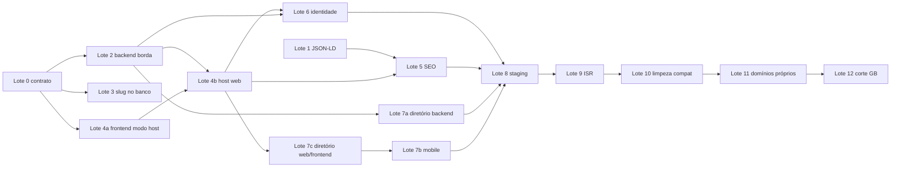

# ADR: locadora resolvida pelo host (subdomínio)

Decisão de produto do usuário de 2026-09-26: aceita. Com o Lote 4b, esta ADR
substitui `docs/architecture/adr-web-route-groups.md` na parte de rotas.

## Situação do clone pós-F — 2026-10-09

A primeira etapa foi publicada na árvore limpa
`978ceb9244c81c7cb2888b798fad8ce90edad25e`. No clone independente pós-F, o
antigo `app/`, as fachadas `lib/`, `proxy.ts`, `next.config.mjs` e `vercel.json`
da raiz foram aposentados. O host web permanece em `apps/clients/web`; o
servidor HTTP é `apps/services/api`, sobre os módulos de `packages/backend`.
Isso não retira o motor de autenticação `legacy`, não ativa infraestrutura e não
corta a produção da GB.

A medição de arquitetura registrada saiu com exit 0 e `oldScopesIntact=true` ao
atualizar a baseline; não é o gate final. Tipos, testes, builds e gates finais
pós-F ainda estão pendentes. A rodada focada existente de
`p2-validation/test-unit.log` tem 245 aprovados e duas falhas de
retired-artifacts; não é certificado de fechamento. Lotes 8, 9, 10, 11 e o corte
operacional 12 têm seus próprios critérios; os registros datados abaixo não
substituem uma validação atual de infraestrutura.

## Contexto

A plataforma atende várias locadoras independentes
(`docs/architecture/multiempresa.md`): recursos de negócio têm `tenantId`, o
PostgreSQL aplica RLS com `FORCE` e o contexto `app.tenant_id` vale só dentro da
transação; o acesso privado depende de membership ativo; nada atravessa
locadoras.

Na configuração anterior à decisão, a locadora pública vinha de
?tenantSlug/sessionStorage na web e tenantSlug/x-tenant-id no mobile; o painel
usava seleção explícita. O antigo `vercel.json` da raiz construía o legado, e a
API passava por rewrites de fallback. Esse arquivo foi aposentado no clone
pós-F; os configs atuais são `apps/clients/web/vercel.json` e
`apps/services/api/vercel.json`. Hoje o proxy web encaminha /api com contexto de
borda para WEB_API_ORIGIN do serviço, sem fallback para a árvore raiz.

Decisões de produto do usuário (2026-09-26):

- cada locadora tem um **subdomínio** da plataforma;
- o painel da equipe fica em **`app.<raiz>`**;
- existe **um único app mobile** para todas as locadoras;
- o nome da plataforma é **provisório** e fica em um único lugar central.

## Fatos levantados na decisão e em suas emendas

Os itens desta seção registram verificações que condicionaram o desenho e as
emendas posteriores nas versões indicadas (Next 16.3.6, Better Auth 1.7.6). Não
são prova de produção nem aprovação automática de um build pós-F.

- **Rotas dinâmicas vêm antes do `fallback`.** Com `(public)/[locadora]`,
  `/api/equipamentos/search` casaria com a rota da locadora antes do rewrite de
  fallback, e `/favicon.ico`, `/manifest.json`, `/openapi.json` e `/sw.js`
  também. Por isso todo `/api/*` passa pelo proxy e os arquivos de `public/` vão
  para `rewrites().beforeFiles`. `apps/clients/web/public` era um link ignorado
  pelo git, ausente no build da Vercel; desde a onda 9b (achado 130) é uma cópia
  real, também fora do git, gerada por `tools/sync-web-public.mjs` no
  predev/prebuild do host web, e os assets continuam indo ao backend pelo
  `beforeFiles`.
- **Curinga em `baseURL.allowedHosts` do Better Auth vira origem confiável com
  curinga.** Um `Origin: https://b.<raiz>` passaria na checagem de origem do
  host `a`. Por isso `baseURL` é estático e `trustedOrigins` é uma função que
  devolve a origem exata da requisição.
- **`useSecureCookies: true` prefixa `__Secure-` em qualquer nome**, gerando
  `__Secure-__Host-...`. O cookie `__Host-` exige `useSecureCookies: false` com
  `secure: true` nos atributos.
- **O `oauth-proxy` cria a sessão no host de origem**, com payload válido por 60
  s; na estratégia `database` o estado é consumido (uso único).
  `/oauth-proxy-callback` está depreciado.
- **`sitemap.ts` de metadata não recebe `params`** e `robots.ts` só existe na
  raiz de `app`, que já conflita com `public/robots.txt`. SEO por locadora usa
  Route Handlers.
- **`usePathname` diverge na hidratação com rewrite** em páginas
  pré-renderizadas.
- **ISR em runtime exige `generateStaticParams` devolvendo `[]`**;
  `revalidateTag(tag, 'max')` substitui a forma de um argumento;
  `next/root-params` não funciona em Route Handlers nem em Server Actions.
- **O dev server aceita `*.localhost`.**
- **Rewrite externo usa `changeOrigin` e `x-forwarded-host`**, e o Better Auth
  só lê `x-forwarded-*` com `trustedProxyHeaders`. A origem pública chega ao
  backend pelo contexto de borda, nunca por `x-forwarded-host`.
- **A Vercel aceita prefixos de preview** no formato `{prefixo}---{url}`.
- No levantamento original, StructuredData.tsx/SEOSchemas.tsx permitiam XSS; a
  decisão D12 exige JSON-LD escapado. A constatação histórica não declara
  vulnerabilidade atual nem dispensa a caracterização de serialização.
- **`/api/drei-proxy` é usado pelo carrossel 3D crítico**
  (`ModelViewer.web.tsx`); negar essa rota em host de locadora quebraria o
  componente.
- **`Setting` é tabela de locadora sob RLS `FORCE`.** Ler logos de várias
  locadoras numa consulta seria leitura cruzada: a busca do diretório não traz
  logo.
- **`/api/auth/organizations` lista todos os vínculos do usuário.** Scripts de
  terceiros configurados por uma locadora veriam os vínculos com outras; o host
  de locadora usa `/api/auth/organizations/current`.

## Decisões

| ID  | Decisão                                                                                                                                                                                                                                                                                            |
| --- | -------------------------------------------------------------------------------------------------------------------------------------------------------------------------------------------------------------------------------------------------------------------------------------------------- |
| D1  | Na web, a locadora vem **somente do Host**. Nenhum header, cookie, query ou corpo do cliente escolhe a locadora quando o host é de locadora. Valor explícito divergente resulta em `400 TENANT_CONFLICT`.                                                                                          |
| D2  | `apps/clients/web/src/proxy.ts` é **puro**: só faz parsing de string, sem banco e sem `fetch`. A existência da locadora é checada pelo layout ou pelo handler.                                                                                                                                     |
| D3  | Hosts: `<raiz>` (landing, diretório, links universais), `app.<raiz>` (painel, login da equipe, callback OAuth, API do mobile) e `{slug}.<raiz>` (vitrine e área do cliente). `www` responde 308 para o apex. `api`, `auth` e demais reservados respondem 404. Domínio próprio fica para o Lote 11. |
| D4  | Isolamento por construção: em host de locadora, **toda** página é reescrita para `/{slug}{caminho}`; no apex, para `/plataforma{caminho}`. O matcher nunca exclui por extensão. Nenhum `headers()` ou `cookies()` na árvore `[locadora]`.                                                          |
| D5  | Todo `/api/*` passa pelo proxy e segue por rewrite externo para `WEB_API_ORIGIN`, com **contexto de borda** (`x-platform-*` mais segredo). A entrada `/api` sai do `fallback`.                                                                                                                     |
| D6  | Cookies de sessão **host-only**, `__Host-` em produção. Sem `crossSubDomainCookies`.                                                                                                                                                                                                               |
| D7  | Better Auth com `baseURL` estático `https://app.<raiz>`, `trustedOrigins` como função (origem exata) e `oAuthProxy` com callback fixo no `app.`.                                                                                                                                                   |
| D8  | O painel fica em `app.<raiz>/admin`, com seleção explícita e membership. Em host de locadora, `/admin` responde 308 para `app.<raiz>/admin?locadora={slug}`; o parâmetro é só sugestão, confirmada quando diverge da seleção atual.                                                                |
| D9  | Área do cliente: a locadora vem do host, via `GET /api/auth/organizations/current`, sem seletor. O vínculo com uma nova locadora é **explícito**, com consentimento.                                                                                                                               |
| D10 | Locadora desconhecida, suspensa ou reservada recebe **404 idêntico**, neutro e `noindex`.                                                                                                                                                                                                          |
| D11 | Fase 1: páginas de locadora dinâmicas, como hoje. Lote 9: ISR por locadora (`generateStaticParams` com `[]`, `revalidate` e tags `t:{slug}:*`). Cache Components continua desligado.                                                                                                               |
| D12 | SEO por host: Route Handlers `robots.txt`, `sitemap.xml` e `manifest.json` sob `[locadora]` e sob `plataforma`. `metadataBase` = `canonicalOrigin`. JSON-LD escapado e sem padrões da GB.                                                                                                          |
| D13 | Mobile: um app só, falando com `https://app.<raiz>`. Busca com opt-in, link universal `https://<raiz>/l/{slug}/...`, scheme vindo de `platform.json`.                                                                                                                                              |
| D14 | Configuração central: `packages/contracts/src/platform.json` (dados) e `platform.ts` (helpers puros). O domínio de cada ambiente vem de `PLATFORM_ROOT_DOMAIN`.                                                                                                                                    |
| D15 | Slug: `^[a-z0-9][a-z0-9-]{0,61}[a-z0-9]$`, sem `--`, fora dos reservados. Imutável depois da ativação (mudar exige operação manual com 308).                                                                                                                                                       |

## Classificação de host

`classifyHost(host, env)` recebe o valor do cabeçalho `Host`, normaliza para
minúsculas, remove a porta e um ponto final. **Nunca** usa `x-forwarded-host`.

| Classe         | Condição                                                                                                                                                                       |
| -------------- | ------------------------------------------------------------------------------------------------------------------------------------------------------------------------------ |
| `apex`         | `host === PLATFORM_ROOT_DOMAIN`. Com `VERCEL_ENV=preview`, também `{deploy}.vercel.app` (sem `---`).                                                                           |
| `www`          | `www.<raiz>` (preview: `www---{deploy}.vercel.app`).                                                                                                                           |
| `app`          | `app.<raiz>` (preview: `app---{deploy}.vercel.app`, só com `VERCEL_ENV=preview`). Em development, também IP literal (app mobile na rede local).                                |
| `tenant(slug)` | Um único rótulo que passa em `isTenantSlug`. Preview: `{slug}---{deploy}.vercel.app`, só com `VERCEL_ENV=preview`.                                                             |
| `reserved`     | Um único rótulo presente em `reservedSubdomains` de `platform.json`.                                                                                                           |
| `invalid`      | Ausente, malformado, multinível, IP literal fora de development, rótulo inválido ou host fora da raiz. A classe `custom` só existe com `PLATFORM_CUSTOM_DOMAINS=on` (Lote 11). |

### Tabela do proxy

Ações avaliadas em ordem (implementação no Lote 4b, em
`apps/clients/web/src/host/routing/decide.ts`, pura e testada sem Next):

| Host                  | Caminho                                                                                                                                                                                                           | Ação                                                                                                                                                         |
| --------------------- | ----------------------------------------------------------------------------------------------------------------------------------------------------------------------------------------------------------------- | ------------------------------------------------------------------------------------------------------------------------------------------------------------ |
| qualquer              | `/api/test-login`, `/api/fix-storage`, `/api/supabase-setup`, `/api/cron/**`, `/api/webhooks/**`, `/api/payments/**/webhook**`, `/api/contracts/zapsign-webhook**`, `/api/internal/**` fora de `LOCAL_API_ROUTES` | 404 JSON, `no-store`. Webhooks e crons continuam apontando direto para a origem do backend.                                                                  |
| `invalid`, `reserved` | qualquer                                                                                                                                                                                                          | 404 neutro com `X-Robots-Tag: noindex`                                                                                                                       |
| `www`                 | qualquer                                                                                                                                                                                                          | 308 para o apex pelo `redirects()` do `next.config`; o proxy repete como rede de segurança.                                                                  |
| `apex`                | `/api/public/tenants`, `/api/public/tenants/{slug}`                                                                                                                                                               | backend (borda `apex`)                                                                                                                                       |
| `apex`                | outro `/api/**`                                                                                                                                                                                                   | 404                                                                                                                                                          |
| `apex`                | página com `?tenantSlug=<válido>`                                                                                                                                                                                 | 308 para `https://<slug>.<raiz><caminho>`, sem o parâmetro (só checagem sintática)                                                                           |
| `apex`                | `/.well-known/{apple-app-site-association,assetlinks.json}`                                                                                                                                                       | rewrite para `/plataforma/well-known/...`                                                                                                                    |
| `apex`                | entrada exata de `public/` (lista gerada)                                                                                                                                                                         | `next` (o `beforeFiles` leva ao backend)                                                                                                                     |
| `apex`                | demais, incluindo `/robots.txt`, `/sitemap.xml` e `/l/**`                                                                                                                                                         | rewrite para `/plataforma{caminho}`                                                                                                                          |
| `app`                 | `/api/**`                                                                                                                                                                                                         | backend (borda `app`)                                                                                                                                        |
| `app`                 | `/admin`, `/admin/**`, `/login` (login da equipe, onda 4), `/recuperar-senha`, `/reset-password`, `/auth/callback`                                                                                                | `next`                                                                                                                                                       |
| `app`                 | caminhos de labs                                                                                                                                                                                                  | `next` só com `PLATFORM_LABS_ENABLED=true` fora de produção; senão 404                                                                                       |
| `app`                 | `/`                                                                                                                                                                                                               | 307 para `/admin`                                                                                                                                            |
| `app`                 | `/robots.txt`                                                                                                                                                                                                     | 200 `User-agent: *` / `Disallow: /`                                                                                                                          |
| `app`                 | entrada de `public/`                                                                                                                                                                                              | `next`                                                                                                                                                       |
| `app`                 | demais                                                                                                                                                                                                            | 404                                                                                                                                                          |
| `tenant(s)`           | `/admin`, `/admin/**`                                                                                                                                                                                             | 308 para `https://app.<raiz>{caminho}?locadora=s`                                                                                                            |
| `tenant(s)`           | `/api/**` não permitido por `isTenantApiAllowed` (lista abaixo)                                                                                                                                                   | 404 JSON                                                                                                                                                     |
| `tenant(s)`           | `/api/**` com `?tenantSlug` diferente de `s`                                                                                                                                                                      | 400 `{ code: 'TENANT_CONFLICT' }`, `no-store`                                                                                                                |
| `tenant(s)`           | `/api/**` permitido                                                                                                                                                                                               | backend com borda `tenant`/`s`; injeta `tenantSlug=s` nas rotas de `PUBLIC_TENANT_QUERY_ROUTES` e remove o cookie `selected-tenant-id` do `Cookie` repassado |
| `tenant(s)`           | página com `?tenantSlug`                                                                                                                                                                                          | igual a `s`: 308 sem o parâmetro; diferente: 404                                                                                                             |
| `tenant(s)`           | entrada de `public/`, exceto `robots.txt`, `sitemap.xml` e `manifest.json`                                                                                                                                        | `next`                                                                                                                                                       |
| `tenant(s)`           | demais                                                                                                                                                                                                            | rewrite para `/{s}{caminho}`                                                                                                                                 |

API permitida no host de locadora (`isTenantApiAllowed` em
`apps/clients/web/src/host/routing/route-table.ts`). A allowlist inicial do Lote
4b liberava `/api/auth/**` inteiro (menos `organizations` e
`organizations/selection`); a onda 4 a trocou por três listas (entrada 189 de
`docs/issues/known-issues.md`), e a denylist vence as outras duas:

- `TENANT_API_ALLOWLIST`, em qualquer modo, cada entrada com chamador real
  (`route-table.tenant-api-allowlist.test.ts`): `/api/auth/session` (NextAuth,
  modo legacy), `/api/categories`, `/api/equipments`, `/api/equipments/{id}`,
  `/api/equipments/{id}/availability`, `/api/equipamentos/search`,
  `/api/settings/public`, `/api/contact`, `/api/quotes/**`, `/api/orcamentos`,
  `/api/cart/**`, `/api/addresses/**`, `/api/client/**`, `/api/user/profile`,
  `/api/contracts/{rentalId}/download`,
  `/api/integrations/melhor-envio/calculate`, `/api/drei-proxy/**` (carrossel 3D
  crítico) e `/api/health`. O detalhe público voltou na onda 74 junto com o
  consumidor compartilhado da slice; GET/HEAD recebem o slug do host também na
  query para separar a chave de cache. Subrotas privadas não são liberadas.
  `/api/contracts/sign` e `/api/payments/boleto/{id}/pdf` continuam fora por
  falta de chamador;
- `TENANT_ACCOUNT_API`, por modo de autenticação e vazia no `legacy`: a API de
  conta mínima das telas `(auth)` e `(account)` da vitrine. `get-session`,
  `sign-in/email`, `sign-in/social`, `callback/*/oauth-proxy` e `sign-out` só no
  `basePath` do Better Auth do modo (`/api/auth` em `better-auth`,
  `/api/auth/v2` em `better-auth-v2`, onde `/api/auth/*` é o NextAuth), mais
  `/api/auth/register`, `forgot-password`, `reset-password`, `verify-email` e
  `organizations/current`;
- `TENANT_API_DENYLIST`, que vence qualquer padrão: `/api/auth/organizations`,
  `/api/auth/organizations/selection` e, nos dois `basePath`, sessões
  (`list-sessions`, `revoke-session(s)`, `revoke-other-sessions`,
  `update-session`), perfil, e-mail, senha e exclusão da conta, contas OAuth e
  tokens, o callback do provedor (`callback/*`), `oauth-proxy-callback` e
  `expo-authorization-proxy`. Isso tudo fica só no host `app`.

### Contexto de borda

Constantes `PLATFORM_EDGE_HEADER` e `PLATFORM_EDGE_HEADERS` em
`@gb-locacoes/contracts/platform`. O proxy remove todos na entrada e só ele os
define:

- `x-platform-edge-auth` = `PLATFORM_EDGE_SECRET`;
- `x-platform-host-kind` = `tenant`, `app` ou `apex`;
- `x-platform-tenant-slug`;
- `x-platform-origin`: origem recalculada pelo classificador, nunca o texto cru
  do `Host`;
- `x-platform-client-ip`: valor de `x-real-ip` definido pela Vercel no projeto
  web.

O backend valida a borda com o segredo atual e o anterior. Chamar o serviço
diretamente pode forjar os headers públicos, mas não o segredo da borda nem o
cookie da vítima. Sem segredo válido, a requisição é tratada como sem host, com
falha fechada. Essa proteção pertence ao backend, não a uma API raiz
remanescente.

## Estrutura do host web

Os caminhos abaixo são relativos a `apps/clients/web/`; não são arquivos da raiz
aposentada do repositório. O antigo `proxy.ts` raiz foi aposentado; o owner
ativo é `apps/clients/web/src/proxy.ts`.

```text
apps/clients/web/
  src/proxy.ts
  src/host/
    routing/decide.ts (+ decide.test.ts)     # tabela do proxy, pura
    routing/route-table.ts                   # TENANT_API_ALLOWLIST, TENANT_ACCOUNT_API, TENANT_API_DENYLIST, PUBLIC_TENANT_QUERY_ROUTES, LOCAL_API_ROUTES, APP_HOST_PATHS, LABS_PATHS
    routing/public-entries.generated.ts      # gerado por tools/generate-public-entries.mjs (+ teste de sincronia)
    server/public-api.ts                     # 'server-only': fetch a WEB_API_ORIGIN com tenantSlug explícito e tags
    providers/TenantSiteProviders.tsx        # 'use client'; slug vem de params; resolveHref = identidade
    providers/AppHostProviders.tsx           # 'use client'; admin, equipe, labs
    providers/PlatformProviders.tsx          # 'use client'; apex
    auth/client.ts                           # basePath relativo (mesma origem)
  src/app/
    layout.tsx                               # <html>/<body>/fontes/CSS; sem providers de área, sem dados
    not-found.tsx                            # 404 neutro, noindex
    (platform)/plataforma/                   # alcançável SÓ via rewrite do apex
      layout.tsx, page.tsx                   # landing/diretório; notFound() até existir design
      api-docs/page.tsx                      # movido de (public)/api-docs
      robots.txt/route.ts, sitemap.xml/route.ts
      l/[slug]/[[...path]]/route.ts          # fallback do link universal → 302 https://{slug}.<raiz>/{caminho permitido}
      well-known/apple-app-site-association/route.ts, well-known/assetlinks.json/route.ts
    (public)/[locadora]/                     # alcançável SÓ via rewrite de host de locadora
      layout.tsx                             # getPublicSite(params.locadora) → notFound(); generateMetadata; TenantSiteProviders
      not-found.tsx                          # 404 com a marca da locadora
      page.tsx, equipamentos/page.tsx, equipamentos/[id]/page.tsx
      contato/ sobre/ orcamento/ termos/ privacidade/ cookies/ politica-devolucao/
      (auth)/layout.tsx                      # noindex
      (auth)/entrar/ login/ cadastro/ recuperar-senha/ reset-password/ auth/callback/ vincular/
      (account)/layout.tsx                   # noindex
      (account)/area-cliente/{page, enderecos, historico, historico/[id], notificacoes, perfil}
      robots.txt/route.ts, sitemap.xml/route.ts, manifest.json/route.ts
    (auth)/layout.tsx                        # AppHostProviders chrome="platform" (casca da plataforma, onda 5): equipe, só no host app
    (auth)/login/                            # login da equipe (onda 4); /admin/login/ só redireciona para /login
    (auth)/admin/login/ recuperar-senha/ reset-password/ auth/callback/
    (admin)/layout.tsx + admin/**            # URLs /admin/** inalteradas, só no host app
    (labs)/layout.tsx + **                   # notFound() sem PLATFORM_LABS_ENABLED=true ou em produção
    api/internal/revalidate/route.ts         # previsto no Lote 9; ainda ausente no clone pós-F
```

- As URLs visíveis não mudam: no host da locadora continuam `/`,
  `/equipamentos`, `/entrar`, `/area-cliente`; no `app.` continua `/admin/**`.
- Os wrappers de `recuperar-senha`, `reset-password` e `auth/callback` existem
  em dois pontos de montagem e importam a **mesma** página de
  `@gb-locacoes/frontend/pages/*`; não há segunda cópia de tela.
- O root layout continua único; a navegação entre grupos continua suave.

Acesso direto ao segmento interno fica bloqueado em cinco camadas:

1. `a.<raiz>/b/equipamentos` é reescrito para `/a/b/equipamentos`, que não
   existe e dá 404.
2. O apex e o `app.` nunca chegam a `[locadora]`, pelo namespace `/plataforma` e
   pela allowlist.
3. O matcher não exclui por extensão; os diretórios de `public/` excluídos são
   slugs reservados.
4. Teste de arquitetura: nenhum arquivo em `(public)/[locadora]/**` importa
   `next/headers`, e nenhum `href`, `redirect` ou `Link` monta
   `` `/${params.locadora}` ``.
5. `useVisiblePathname()` remove o prefixo `/{slug}` de forma determinística,
   contra divergência de hidratação e `callbackUrl` com caminho interno.

## Fluxos

**Web público (catálogo, detalhe e cotação):**

```mermaid
sequenceDiagram
  autonumber
  participant N as Navegador (a.raiz)
  participant P as apps/clients/web/src/proxy.ts
  participant R as App Router
  participant G as apps/clients/web/src/host/server/public-api.ts
  participant L as API (apps/services/api, WEB_API_ORIGIN)
  participant DB as PostgreSQL (RLS FORCE)
  N->>P: GET https://a.raiz/equipamentos/eq1
  P->>P: classifyHost = tenant(a); remove x-platform-* de entrada
  P->>R: rewrite /a/equipamentos/eq1
  R->>G: layout [locadora]=a: getPublicSite("a")
  G->>L: GET /api/public/tenants/a (tags t:a:site)
  L->>DB: organizations (global) slug=a
  L-->>G: 200 cartão, ou 404 idêntico para inexistente/suspensa
  G-->>R: site ou null (notFound → apps/clients/web/src/app/not-found.tsx)
  R->>G: getPublicEquipment("a","eq1")
  G->>L: GET /api/equipments/eq1?tenantSlug=a
  L->>DB: withTenantTransaction(tenantA)
  L-->>G: 200, ou 404 (id de outra locadora)
  R-->>N: HTML (metadataBase https://a.raiz, canonical /equipamentos/eq1)
  N->>P: POST https://a.raiz/api/quotes (corpo pode trazer tenantSlug)
  P->>P: allowlist ok, query sem conflito
  P->>L: rewrite externo + edge-auth, host-kind=tenant, tenant-slug=a, origin=https://a.raiz
  L->>L: readPlatformEdgeContext (segredo); fontes {borda a, corpo} com uma única locadora; Origin igual a https://a.raiz
  L->>DB: withTenantTransaction(tenantA)
  L-->>N: 201, Cache-Control no-store
```

**Login social do cliente (OAuth com redirect URI fixo):**

```mermaid
sequenceDiagram
  autonumber
  participant N as Navegador
  participant A as a.raiz (web proxy + API identity)
  participant C as app.raiz (web proxy + API identity)
  participant G as Google
  N->>A: POST /api/auth/sign-in/social {provider, callbackURL:/area-cliente}
  A->>A: handleIdentityRequest reconstrói URL https://a.raiz; originCheck usa trustedOrigins(req) = [app, https://a.raiz]
  A->>A: oAuthProxy: redirect_uri = https://app.raiz/api/auth/callback/google; estado no banco (estratégia database)
  A-->>N: 302 Google
  N->>G: consentimento
  G-->>N: 302 https://app.raiz/api/auth/callback/google?code&state
  N->>C: callback
  C->>G: troca de code (PKCE)
  C-->>N: 302 https://a.raiz/api/auth/callback/google/oauth-proxy?profile=<cifrado, 60 s>&callbackURL
  N->>A: completion
  A->>A: originCheck(callbackURL em a); decifra; consome o estado (uso único); cria sessão
  A-->>N: Set-Cookie __Host-locadora.session_token (sem Domain) + 302 /area-cliente
```

**Painel (host `app`):**

```mermaid
sequenceDiagram
  autonumber
  participant N as Navegador
  participant P as apps/clients/web/src/proxy.ts
  participant L as API (apps/services/api)
  participant DB as PostgreSQL
  N->>P: GET https://a.raiz/admin/orcamentos
  P-->>N: 308 https://app.raiz/admin/orcamentos?locadora=a
  N->>P: GET https://app.raiz/admin/orcamentos?locadora=a
  P-->>N: casca admin (AppHostProviders)
  N->>P: POST /api/auth/sign-in/email (Origin https://app.raiz)
  P->>L: rewrite externo + borda(app)
  L-->>N: Set-Cookie __Host-locadora.session_token
  N->>P: GET /api/auth/organizations
  L-->>N: vínculos do usuário
  Note over N: locadora=a diverge da seleção atual: pede confirmação
  N->>P: /api/auth/organizations/selection (a)
  L-->>N: Set-Cookie selected-tenant-id (host app)
  N->>P: GET /api/admin/equipments (x-tenant-id: idA)
  P->>L: borda(app) sem tenant-slug
  L->>L: resolveTenantPrincipal: {x-tenant-id, cookie} com um único id; membership ACTIVE e organização ACTIVE
  L->>DB: withTenantTransaction(idA)
  L-->>N: 200 private, no-store
```

**Mobile (descoberta, deep link e equipe):**

```mermaid
sequenceDiagram
  autonumber
  participant U as App Expo
  participant O as iOS/Android
  participant P as proxy (app.raiz)
  participant L as API (apps/services/api)
  O->>U: https://raiz/l/a/equipamentos/eq1 (AASA/assetlinks servidos no apex)
  U->>U: rota l/[slug]/[...path]: isTenantSlug(a) e caminho na allowlist
  U->>P: GET /api/public/tenants/a
  L-->>U: cartão (nome, cidade, UF, logo) ou 404
  U->>U: se diferente da locadora ativa, confirma; limpa carrinho e caches; grava active-tenant
  U->>P: GET /api/equipments?tenantSlug=a
  P->>L: borda(app), sem tenant de host, seleção explícita
  L-->>U: 200
  U->>P: POST /api/auth/sign-in/email (expoClient; sem Origin; scheme confiável)
  L-->>U: Set-Cookie guardado no SecureStore
  U->>P: GET /api/admin/rentals (Cookie + x-tenant-id)
  L-->>U: 200 conforme membership
```

## Resolução de locadora nas APIs (Lote 2)

- `packages/backend/src/modules/identity/platform-edge.ts`:
  `readPlatformEdgeContext(request)` devolve
  `{ hostKind, tenantSlug?, origin, clientIp } | null`. Valida
  `x-platform-edge-auth` contra o segredo atual e o anterior com
  `timingSafeEqual` e revalida `origin` com `classifyHost`.
- `packages/backend/src/modules/identity/public-tenant.ts` contém a política de
  resolvePublicRequestTenant e resolvePublicTenant, composta por
  `apps/services/api/src/host/runtime.ts`. A antiga `lib/tenant.ts` foi
  aposentada no clone pós-F; a tabela abaixo conserva seleção/conflito/erro.
- `packages/backend/src/modules/identity/tenant-principal.ts` combina fontes
  host/header/cookie e recusa mais de um tenantId distinto; o adapter privado
  está em `apps/services/api/src/host/private-identity.ts`.
- A antiga `lib/security/mutation-origin.ts` foi aposentada. A política atual
  está em `packages/backend/src/modules/identity/same-origin-mutation.ts`, com
  adapter em `apps/services/api/src/host/mutation-origin.ts`: a borda válida
  determina a origem; sem ela, usa origem configurada válida ou a origem da
  requisição, mantendo a checagem exata.
- Rotas novas: `GET /api/equipments/[id]`, `GET /api/public/tenants/[slug]`,
  `GET /api/auth/organizations/current` e, no Lote 6, `POST /api/client/enroll`.

| Borda válida             | `tenantSlug` na query ou no corpo            | Resultado                                         |
| ------------------------ | -------------------------------------------- | ------------------------------------------------- |
| `tenant(a)`              | ausente ou `a`                               | `a`                                               |
| `tenant(a)`              | `b`, ou query `a` com corpo `b`              | 400 `TENANT_CONFLICT`, sem gravar nada            |
| `app`, `apex` ou ausente | `b`                                          | `b` (contrato explícito atual, usado pelo mobile) |
| `app`, `apex` ou ausente | ausente                                      | 409 `TENANT_REQUIRED`                             |
| qualquer                 | inválido, reservado, inexistente ou suspenso | 404 `TENANT_NOT_FOUND`, idêntico byte a byte      |

Cache:

| Resposta                                    | Política                                                                                                                                         |
| ------------------------------------------- | ------------------------------------------------------------------------------------------------------------------------------------------------ |
| APIs públicas no host de locadora           | `public, max-age=60` só no navegador. **Proibido** `s-maxage` e `CDN-Cache-Control`. A URL carrega `tenantSlug`; `Vary: Host` como defesa extra. |
| APIs públicas explícitas no `app.` (mobile) | `public, s-maxage=60, stale-while-revalidate=300` (a chave é a URL).                                                                             |
| APIs privadas                               | `private, no-store`, `Vary: Cookie, x-tenant-id`.                                                                                                |
| Rewrite externo                             | **Nunca** ligar `x-vercel-enable-rewrite-caching`.                                                                                               |

## Identidade (Lote 6)

No clone pós-F, `apps/services/api/src/host/session.ts` compõe os motores reais
sobre
`packages/backend/src/modules/identity/{configuration,factory,runtime,application-session}.ts`.
A retirada da raiz não autoriza remover NextAuth, aceitar JWT após falha Better
Auth ou transformar erro em sessão anônima bem-sucedida.

- `baseURL` estático `https://app.<raiz>`; nunca `allowedHosts` com curinga.
- `trustedOrigins(request)` = origens estáticas (`${scheme}://`, `exp://` só em
  dev) mais a origem da borda válida quando o host é `tenant` ou `app`.
- `account.storeStateStrategy: 'database'`;
  `oAuthProxy({ productionURL: platformOrigins(env).app, maxAge: 60 })`.
- Cookie: `useSecureCookies: false`, `cookiePrefix: PLATFORM.name`, nome
  `__Host-${PLATFORM.name}.session_token` com `secure` e `path: '/'` em https;
  `crossSubDomainCookies` desligado; `trustedProxyHeaders: false`.
- `handleIdentityRequest` reconstrói a URL a partir da origem da borda, para o
  `oauth-proxy` enxergar a origem pública. Reset e verificação de e-mail usam a
  origem do host de onde veio a requisição.
- Provedores OAuth registram só
  `https://app.<raiz>/api/auth/callback/{google,facebook}` (mais staging e dev).
  Zoho usa redirect fixo no `app.`; o `state` já vincula `tenantId` e `userId`.
- Na web, uma sessão por host: "Sair" encerra só aquele host; "Sair de todos os
  dispositivos" fica no `app.`. Duas locadoras como cliente significam duas
  sessões. Como equipe, a troca é pelo `TenantSelector` no `app.`.
- Área do cliente em modo `host`: `GET /api/auth/organizations/current`; com
  `404 NO_MEMBERSHIP`, tela de vínculo que chama `POST /api/client/enroll`
  (locadora só da borda; cria `Membership(CLIENT)` e `ClientProfile` em
  `withTenantTransaction`; nunca papel de equipe).
- Com `AUTH_MODE=legacy`, hosts de locadora escondem login e área do cliente;
  vitrine, cotação anônima e contato continuam.
- `AuthSession.tenantId` foi rejeitado por enquanto: com cookie host-only e
  checagem de origem exata, não protege nada a mais e complica Expo e relay.
- Login social do app (plugin `expo`, decisão de 2026-09-29, achado 105 da
  revisão): o `expoClient` inicia o login por `fetch` e abre o navegador do
  sistema em `/api/auth/expo-authorization-proxy?authorizationURL=...`, que
  grava no navegador o cookie assinado de `state` e redireciona ao provedor. Sem
  restrição, esse endpoint plantava no navegador de qualquer pessoa o `state` de
  qualquer login (inclusive um login web do atacante) e redirecionava a qualquer
  https: o callback aberto depois pela vítima criava nela a sessão da conta do
  atacante (login CSRF no `app.`). O plugin `appAuthorization`
  (`packages/backend/src/modules/identity/app-authorization.ts`, depois do
  `expo()` na lista de plugins) aplica duas regras juntas, sem mudar o app:
  1. o proxy só leva à URL do provedor que o servidor emitiu para um login do
     app: no fim de `/sign-in/social`, se `callbackURL`, `newUserCallbackURL` e
     `errorCallbackURL` são deep links de um esquema confiável e não há vínculo
     de conta, o SHA-256 da URL fica registrado com a validade do `state`. Outra
     URL, `state` de login web, `link-social` ou `oauthState` recebem 400, sem
     cookie e sem redirecionamento (o proxy deixa de ser um redirecionador
     aberto). Os três destinos contam: uma conta nova com `newUserCallbackURL`
     numa página web receberia a sessão no navegador, fora do deep link;
  2. a resposta que entrega a sessão ao app pelo deep link (`?cookie=`) não
     deixa sessão no navegador: só saem os `Set-Cookie` que apagam. O app só
     aceita o deep link dentro da sessão de login que ele abriu
     (`openAuthSessionAsync`); a tela `/auth/callback` ignora `?cookie=`.
- Resultado do plugin `appAuthorization`: um login do app levado ao navegador da
  vítima termina sem sessão nela; um login web nunca é plantado. Provas em
  `tests/identity/multi-host.integration.test.ts` (fluxo do app completo e os
  ataques). `Sec-Fetch-Site` e `Origin` no proxy foram descartados: a navegação
  aberta pelo app pode chegar sem eles ou como `cross-site` conforme o
  navegador, e a proteção não depende deles. Risco residual conhecido: um app
  malicioso que registre o mesmo esquema no Android pode receber o deep link; a
  saída é trocar o esquema por App Links/Universal Links (`https`) quando os
  identificadores do app existirem.

## Requisitos de ISR, SEO e mobile

- **ISR (Lote 9, planejado):** o desenho exige `generateStaticParams` com `[]` e
  `revalidate = 3600` no layout `[locadora]`; tags `t:{slug}:site`,
  `t:{slug}:catalog`, `t:{slug}:eq:{id}`. A invalidação prevista é
  `POST /api/internal/revalidate` (Bearer `PLATFORM_REVALIDATE_SECRET`,
  `timingSafeEqual` e gramática de tag validada), só no `app.`, emitida pela
  outbox. Esse handler ainda não existe no clone pós-F; a escrita de settings na
  API não o implementa automaticamente. O preço cobrado deve continuar
  recalculado no servidor com `Decimal.js`.
- **SEO (Lote 5):** `robots.txt` por locadora com `Disallow` das áreas privadas
  e `Sitemap` na origem canônica (fora de produção, `Disallow: /`); sitemap com
  páginas públicas; canonical por página, em caminho relativo; `noindex` em
  `(auth)`, `(account)`, `(labs)` e nos `not-found`; JSON-LD com `<` escapado e
  sem dados padrão da GB. `Setting.publicBaseUrl` deixa de ser fonte: e-mails,
  PDFs e Merchant usam `canonicalOrigin`.
- **Mobile (Lote 7b, desenho aprovado):** prevê `app.config.ts` lendo
  `platform.json` (nome, slug, scheme), `associatedDomains` e `intentFilters` no
  apex com prefixo `/l/`, e `apiUrl` = `https://app.<raiz>`. Prevê rotas
  `l/[slug]/[...path]` (caminhos permitidos: vazio, `equipamentos`,
  `equipamentos/{id}`, `orcamento`, `contato`; nunca token, id ou papel no link)
  e `locadoras`; `?tenantSlug=` no deep link seria aceito por uma versão. No
  clone pós-F, o Expo usa `apps/clients/mobile/app.json`; não há
  `app.config.ts`. A origem real vem de EXPO_PUBLIC_API_URL em
  `apps/clients/mobile/src/host/api-config.ts`, e o modo de autenticação de
  EXPO_PUBLIC_AUTH_MODE em `src/host/auth/client.ts`. A retirada da raiz não
  certifica associação de domínio ou convergência desses identificadores.
- **Diretório (Lotes 7a e 7c):** busca com `q` de 3 caracteres ou mais, no
  máximo 10 resultados, só `ACTIVE` com opt-in, sem CNPJ, telefone, e-mail, CEP,
  paginação ou logo; cartão por slug com logo lido em transação da locadora;
  rate limit persistente.

## Configuração central (Lote 0, implementado)

`packages/contracts/src/platform.json` é a única fonte do nome provisório
(`locadora`, exibido como `Locadora`, scheme `locadora`, bundle e package ainda
`null`) e da lista de subdomínios reservados. A lista não é repetida em outro
lugar: o banco não a guarda, e o preflight do Lote 3 lê o JSON.

`packages/contracts/src/platform.ts` é puro e universal (sem Node, DOM, `URL`,
`fetch` ou `process`) e exporta:

- `PLATFORM` (cópia imutável do JSON) e `isReservedSubdomain`;
- `TENANT_SLUG_RE` (já inclui a proibição de `--`) e `isTenantSlug`;
- `classifyHost(host, env)`, que devolve a classe, a **origem recalculada**
  (usada em `x-platform-origin`) e o rótulo do deploy de preview;
- `resolvePlatformEnv(process.env)`, comum ao web e ao backend: falha fechada
  (sem `PLATFORM_ENV`, `VERCEL_ENV=production` ou `NODE_ENV=production` contam
  como produção e `VERCEL_ENV=preview` como preview); fora de development exige
  `PLATFORM_ROOT_DOMAIN` público, e produção exige `PLATFORM_EDGE_SECRET` com 32
  caracteres ou mais; `PLATFORM_ENV=development` é recusado em deploy da Vercel;
  as mensagens nunca repetem segredos. Não exige nem recusa `WEB_API_ORIGIN`,
  que é só do processo web: devolve `apiOrigin` normalizada ou `null` (onda 4,
  entrada 188 de `docs/issues/known-issues.md`);
- `resolveWebPlatformEnv(process.env)`, só no web
  (`apps/clients/web/src/proxy.ts` e
  `apps/clients/web/src/host/server/public-api.ts`): resolvePlatformEnv mais
  WEB_API_ORIGIN válida (só a origem, https fora de development) e obrigatória
  em produção. O backend nunca usa esta função;
- `platformOrigins(env, via?)` e `tenantOrigin(env, slug, via?)`, que no preview
  montam as origens irmãs do mesmo deploy; `canonicalOrigin(env, alvo)` sempre
  sob o domínio raiz;
- `PLATFORM_EDGE_HEADER`, `PLATFORM_EDGE_HEADERS` e `PlatformEdgeHostKind`.

`packages/contracts/src/directory.ts` define os schemas zod estritos da busca e
do cartão público (qualquer chave extra é rejeitada; logo só em https).

Exports: `@gb-locacoes/contracts/platform`, `/platform.json` e `/directory`. O
escopo npm `@gb-locacoes/*` continua; renomear é outra decisão.

| Consumidor          | Onde usa                                                                                                                                                                                                                                                           |
| ------------------- | ------------------------------------------------------------------------------------------------------------------------------------------------------------------------------------------------------------------------------------------------------------------ |
| Web                 | proxy, layouts, rotas de SEO                                                                                                                                                                                                                                       |
| Backend/API         | `packages/backend/src/modules/identity/{configuration,factory,runtime,public-tenant,same-origin-mutation}.ts` e `apps/services/api/src/host/{session,runtime,mutation-origin}.ts`; as antigas `lib/identity.ts` e `lib/tenant.ts` foram aposentadas no clone pós-F |
| E-mails de negócio  | marca e contatos da locadora vindos de `Setting`, remetente da plataforma                                                                                                                                                                                          |
| Mobile              | `apps/clients/mobile/src/host/auth/client.ts` usa PLATFORM no cookiePrefix; `apps/clients/mobile/app.json` é o config Expo atual. Derivação por `app.config.ts` permanece requisito do Lote 7b.                                                                    |
| `packages/frontend` | recebe o nome por props ou provider, sem ler env                                                                                                                                                                                                                   |

## Modelo de dados

**Migração A (Lote 3):** `CHECK` `organizations_slug_dns_label` com
`"slug" ~ '^[a-z0-9][a-z0-9-]{0,61}[a-z0-9]$' AND position('--' in "slug") = 0`,
precedido de preflight que aborta sem alterar dados se algum slug existente
violar a política. O `CHECK` não é modelado no Prisma. Os reservados ficam fora
do banco; `tools/tenant-slug-preflight.mjs` (somente leitura) lê `platform.json`
e dá exit 1 se alguma organização usar slug reservado.

**Migração B (Lote 7a), aditiva:**

```prisma
model Organization {
  // ... campos atuais
  directoryListed Boolean @default(false)
  @@index([directoryListed, status])
  @@map("organizations")
}

model PlatformRateLimit {
  key       String   @id              // "<rota>:<hmac(ip)>:<índice da janela>"
  count     Int      @default(0)
  expiresAt DateTime
  @@index([expiresAt])
  @@map("platform_rate_limits")
}
```

`PlatformRateLimit` entra em `tools/tenant-models.json#globalModels`; o consumo
é um `upsert` atômico; o IP entra como `HMAC(PLATFORM_RATE_LIMIT_SECRET, ip)`; a
limpeza roda no cron de outbox. A busca usa `name` com `contains` e
`mode: 'insensitive'`.

**Lote 11 (não aplicar agora):** `OrganizationDomain` (`hostname` único,
minúsculo, nunca sob `PLATFORM_ROOT_DOMAIN`; status `PENDING`, `VERIFIED`,
`ACTIVE`, `DISABLED`; um primário por locadora via índice parcial), verificação
por TXT, mapa `hostname → slug` em Edge Config e reverificação periódica contra
takeover.

## Variáveis de ambiente dos hosts atuais

| Variável                                            | Onde                                   | Valor/contrato                            | Observação                                                                                                           |
| --------------------------------------------------- | -------------------------------------- | ----------------------------------------- | -------------------------------------------------------------------------------------------------------------------- |
| PLATFORM_ROOT_DOMAIN                                | web, API; mobile no desenho do Lote 7b | localhost, staging.<raiz>, <raiz>         | Obrigatória fora de development; sem esquema, porta ou caminho.                                                      |
| PLATFORM_ENV                                        | web, API                               | development, preview, staging, production | Produção exige https e proíbe labs.                                                                                  |
| PLATFORM_PUBLIC_PORT                                | web, API                               | 3001                                      | Porta pública só em development; a origem do serviço é configurada separadamente por WEB_API_ORIGIN.                 |
| PLATFORM_EDGE_SECRET, PLATFORM_EDGE_SECRET_PREVIOUS | proxy web e API                        | segredo próprio com 32 caracteres ou mais | Rotação com dois valores aceitos, sem publicar credenciais.                                                          |
| PLATFORM_LABS_ENABLED                               | web                                    | false                                     | Ignorada em produção.                                                                                                |
| PLATFORM_CUSTOM_DOMAINS                             | web                                    | off                                       | Lote 11 mantém critérios próprios.                                                                                   |
| PLATFORM_REVALIDATE_SECRET                          | web/API no plano do Lote 9             | segredo próprio com 32 caracteres ou mais | Revalidação ainda planejada; não há handler interno no clone.                                                        |
| PLATFORM_RATE_LIMIT_SECRET                          | API                                    | segredo próprio com 32 caracteres ou mais | Obrigatória em produção e igual entre instâncias do mesmo produto.                                                   |
| PLATFORM_IOS_TEAM_ID, PLATFORM_ANDROID_CERT_SHA256  | web                                    | configuração futura                       | Associação dos links; não inventar conta, certificado ou publicação.                                                 |
| WEB_API_ORIGIN                                      | web                                    | origem explícita de apps/services/api     | Obrigatória em produção; https fora de development.                                                                  |
| BETTER_AUTH_URL                                     | API                                    | https://app.<raiz>                        | Em produção, igual à origem app.                                                                                     |
| AUTH_TRUSTED_ORIGINS                                | API                                    | locadora://; exp:// só em dev             | Sem curinga de host.                                                                                                 |
| BETTER_AUTH_TRUSTED_ORIGINS                         | API                                    | vazia                                     | Recusada para impedir soma de origens globais à função por requisição.                                               |
| WEB_PUBLIC_ORIGIN                                   | API                                    | origem pública configurada                | Compatibilidade de chamadas sem borda, validada por same-origin-mutation; não é removida automaticamente com a raiz. |
| AUTH_MODE                                           | API/backend                            | legacy ou better-auth                     | Seleção real do motor; não elimina o modo legacy ao aposentar o servidor antigo.                                     |
| NEXT_PUBLIC_AUTH_MODE                               | build do web                           | mesmo modo escolhido para a UI            | Variável pública embutida no bundle; mudança exige reconstrução do web.                                              |
| EXPO_PUBLIC_AUTH_MODE                               | build do mobile                        | legacy ou better-auth                     | Lida pelo cliente Expo; independente do nome usado pelo bundle web.                                                  |

O plano original do Lote 12 previa aposentar PLATFORM_NAME, ZOHO_REDIRECT_URI e
NEXTAUTH_URL. PLATFORM_NAME foi substituída pelo platform.json; a retirada da
árvore raiz não declara eliminadas variáveis ainda usadas pelo motor legacy, SSR
ou callbacks. NEXTAUTH_URL e NEXTAUTH_URL_INTERNAL precisam ser URLs válidas no
runtime que os usa; não neutralizar como string vazia. EXPO_PUBLIC_API_URL é a
origem configurada em `apps/clients/mobile/src/host/api-config.ts`; sua
derivação automática por app.config.ts ainda é desenho do Lote 7b.
Infraestrutura e credenciais de cada ambiente são configuradas depois, sem
reutilizar os serviços da GB.

## Testes de isolamento

| ID  | Prova                                                                                                                                                                                                                      | Onde                                                                                                       |
| --- | -------------------------------------------------------------------------------------------------------------------------------------------------------------------------------------------------------------------------- | ---------------------------------------------------------------------------------------------------------- |
| T1  | Matriz de `classifyHost` e `isTenantSlug`: maiúsculas, porta, ponto final, `xn--`, `--`, 1 e 64 caracteres, multinível, IP em dev e em produção, `localhost`, prefixo `---` com e sem `VERCEL_ENV=preview`, host estranho. | `packages/contracts/src/platform.test.ts` (Lote 0, implementado)                                           |
| T2  | Os reservados cobrem todo primeiro segmento estático de `apps/clients/web/src/app` (ignorando grupos) e toda entrada de primeiro nível de `public/`, por varredura do disco.                                               | idem                                                                                                       |
| T3  | Tabela do proxy com `isRewrite`, `getRewrittenUrl`, `getRedirectUrl` e `unstable_getResponseFromNextConfig`; `x-platform-*` de entrada sobrescrito.                                                                        | `apps/clients/web/src/host/routing/decide.test.ts`                                                         |
| T4  | `unstable_doesMiddlewareMatch` cobre `/`, `/api/x`, `/robots.txt`, `/b/equipamentos/x.png` e `/.well-known/x`; não cobre `/_next/static/x` nem `/models/a.glb`.                                                            | idem                                                                                                       |
| T5  | HTTP em `*.localhost`: `a/b/equipamentos`, `a/plataforma` e apex `/a/equipamentos` dão 404; `a/admin` dá 308 para `app`; `/api/equipamentos/search` no host `a` chega ao backend.                                          | `tests/e2e/tenant-hosts.spec.ts`                                                                           |
| T6  | Duas locadoras com marcadores distintos: catálogo, detalhe, settings e sitemap de A não mostram dados de B; nenhum `href` com `tenantSlug=`; nenhum aviso de hidratação.                                                   | Playwright com Postgres descartável, role sem BYPASSRLS                                                    |
| T7  | Conflitos: query, corpo ou `x-tenant-id` de B no host A dão 400 e nenhuma linha gravada; borda forjada sem segredo é ignorada.                                                                                             | `tests/security/tenant-request.test.ts`, `tenant-principal.test.ts`                                        |
| T8  | Desconhecida e suspensa: status, corpo e headers idênticos, em página e em API.                                                                                                                                            | `tests/security/tenant-not-found.test.ts`                                                                  |
| T9  | `Set-Cookie` `__Host-locadora.session_token` sem `Domain`; sessão de A não vale em B; POST com `Origin: https://b` em A dá 403.                                                                                            | `tests/identity/multi-host.integration.test.ts`                                                            |
| T10 | `oauth-proxy`: `callbackURL` de outro host rejeitado; replay dá `state_mismatch`; payload com mais de 60 s dá `payload_expired`.                                                                                           | idem                                                                                                       |
| T11 | APIs privadas sempre `no-store`; nenhuma resposta derivada de host com `s-maxage`.                                                                                                                                         | `tools/modernization-inventory.mjs`                                                                        |
| T12 | SEO: canonical, `og:url`, `robots` e sitemap por host; `</script>` escapado; sem `locacoesgb.com.br` nem `GB Locações` em `packages/frontend/src` fora de fixtures.                                                        | unit e e2e                                                                                                 |
| T13 | Diretório: `q` curto dá 400; no máximo 10 resultados; só `ACTIVE` e listadas; sem CNPJ, telefone, e-mail ou CEP; 429 persiste entre instâncias.                                                                            | `tests/security/directory.test.ts` (o contrato já é provado em `packages/contracts/src/directory.test.ts`) |
| T14 | Cache: segunda requisição com `x-nextjs-cache: HIT` e B continua diferente de A; editar em A invalida só as tags de A.                                                                                                     | e2e (Lote 9)                                                                                               |
| T15 | Arquitetura: sem Prisma em `apps/clients/web/src/app`; sem `headers()` em `[locadora]`; sem `resolvePublicTenant` direto em handler.                                                                                       | `pnpm arch` e teste de varredura                                                                           |
| T16 | Eco: os headers de borda sobrescritos pelo proxy chegam ao destino externo, em `next start` e em preview da Vercel.                                                                                                        | Lotes 4b e 8                                                                                               |

## Lotes

Regras comuns: gate `pnpm arch`, `pnpm type-check`, `pnpm lint` e as suítes do
lote; processo do `AGENTS.md` antes e depois; `CHANGELOG.md`,
`docs/issues/known-issues*.md` e `pnpm-lock.yaml` são arquivos de fechamento
compartilhados; dois lotes paralelos nunca editam o mesmo arquivo.



Paralelos: Lotes 0 e 1; Lotes 1, 2, 3 e 4a; Lotes 5, 6, 7a e 7c.

| Lote                                              | Escopo                                                                                                                                                                                                                                                                                                                | Critérios de saída                                                                                               |
| ------------------------------------------------- | --------------------------------------------------------------------------------------------------------------------------------------------------------------------------------------------------------------------------------------------------------------------------------------------------------------------- | ---------------------------------------------------------------------------------------------------------------- |
| 0. Contrato e ADR (**implementado**)              | `packages/contracts/src/{platform.json, platform.ts, platform.test.ts, directory.ts, directory.test.ts}`, exports em `packages/contracts/package.json`, `.env.example`, esta ADR, seção em `multiempresa.md`                                                                                                          | T1 e T2 verdes com 40 casos ou mais; `tsc -p packages/contracts`; `pnpm arch` sem regressão                      |
| 1. XSS no JSON-LD (**implementado**)              | `shared/lib/seo/serialize-json-ld.ts`, `StructuredData.tsx`, `SEOSchemas.tsx`, `EquipamentoTrilha.web.tsx` e testes                                                                                                                                                                                                   | Nome com `</script><script>` sai como `</script...`                                                              |
| 2. Borda e endpoints (**implementado na onda 2**) | Na época: módulos identity/directory e antiga `lib/tenant.ts`, aposentada no clone pós-F. Hoje: `packages/backend/src/modules/identity/{platform-edge,tenant-principal,public-tenant,same-origin-mutation}.ts`, directory e `apps/services/api/src/host/runtime.ts`, com adapters em `apps/services/api/src/app/api`. | T7/T8 e guards sem borda; cartão com logo via withTenantTransaction.                                             |
| 3. Slug no banco (**implementado**)               | migração A, `tools/tenant-slug-preflight.mjs`, script `tenant:slug-preflight`, `docs/features/tenant-slug-policy.md`                                                                                                                                                                                                  | Migração aplica em banco descartável; preflight aborta sem alterar dados; `x`, `a--b` e 64 caracteres rejeitados |
| 4a. Modo host (**implementado**)                  | `public-tenant-routing.ts` (modo `host`), `use-visible-pathname.web.ts` e trocas de `usePathname` (inclui só a fonte do pathname em `ScrollRevealInit.web.tsx`, preservando `scrollRevealReady`, `delayBoundsFit`, `maxDuration={0}` e `disableAutoFit`), links por `resolveHref`, regra de lint                      | Modo legado intacto; nenhum `href` com `tenantSlug` no modo host; checklist do primeiro modelo 3D sem zoom       |
| 4b. Host web (**implementado**)                   | `apps/clients/web/src/proxy.ts`, `apps/clients/web/src/host`, rotas em `apps/clients/web/src/app` e `apps/clients/web/next.config.mjs`; tools/generate-public-entries.mjs, vitest.web.config.ts e E2E. Os antigos wrappers `app/` da raiz foram aposentados no clone pós-F.                                           | T3–T6/T15/T16; 47 URLs no registro da onda 2, não contagem atual. Build e allowlist têm validação própria.       |
| 5. SEO por host                                   | seo do frontend, Route Handlers de SEO, `email-branding`, `oficio-data-mapper`, `google-merchant/mapper`                                                                                                                                                                                                              | T12; `robots` diferentes por host; `noindex` em `app.`, preview, `(auth)` e `(account)`                          |
| 6. Identidade (**onda 3 e emendas**)              | `packages/backend/src/modules/identity/{configuration,factory,runtime,application-session}.ts`, customers/enroll e `apps/services/api/src/host/session.ts`; a antiga `lib/identity.ts` foi aposentada no clone pós-F.                                                                                                 | T9/T10, reset no host de origem e papel por superfície; gates pós-F pendentes.                                   |
| 7a. Diretório (**onda 3**)                        | `prisma/schema.prisma`, migrationB, tools/tenant-models.json, `packages/backend/src/modules/directory`, `apps/services/api/src/app/api/public/tenants/route.ts` e limpeza no runtime/outbox.                                                                                                                          | T13 e políticas persistentes; db:generate/tenant:check não substituem as provas de banco.                        |
| 7c. Diretório web e apex                          | `features/buscar-locadora`, `pages/escolher-locadora`, `(platform)/plataforma/{page, l/..., well-known/**}`                                                                                                                                                                                                           | Parser de link e allowlist de caminhos testados; UI só com design aprovado                                       |
| 7b. Mobile                                        | `app.config.ts` (remove `app.json`), rotas `l/[slug]/[...path]` e `locadoras`, `active-tenant.ts`                                                                                                                                                                                                                     | Parser de deep link; troca de locadora limpa estado; bundle; `AUTH_TRUSTED_ORIGINS` com o novo scheme            |
| 8. Staging multi-host                             | Projeto Vercel com root `apps/clients/web`, domínios curinga, certificado, prefixos de preview, OAuth de staging                                                                                                                                                                                                      | T5 a T10, T13 e T16 contra hosts reais                                                                           |
| 9. ISR                                            | layout e páginas `[locadora]`, gateway, `revalidate`, outbox, handlers de admin                                                                                                                                                                                                                                       | T14; LCP igual ou melhor; reversão com `force-dynamic`                                                           |
| 10. Limpeza da compatibilidade                    | `?tenantSlug` de navegação, `sessionStorage`, `?tenantSlug` no deep link                                                                                                                                                                                                                                              | Telemetria de parâmetro legado zerada por N semanas                                                              |
| 11. Domínios próprios                             | `OrganizationDomain`, verificação, Edge Config, classe `custom`                                                                                                                                                                                                                                                       | Domínio `PENDING`/`DISABLED` dá 404; T5 a T12 repetidos                                                          |
| 12. Corte da GB                                   | slug e domínio da GB (atribuição de dados com aprovação), DNS, desligamento do legado em produção; a remoção da raiz no repositório não espera este lote (D0 = b, 2026-10-08, `docs/operations/runbook-corte-raiz-legada.md`)                                                                                         | Conforme o passo 7 de `adr-backend-extraction.md`                                                                |

Emenda de 2026-10-08 (D0 = b): a retirada da raiz no repositório foi separada do
corte de produção da GB. A primeira etapa limpa 978ceb9244 foi publicada com tag
de pré-exclusão; no clone independente pós-F de 2026-10-09, o antigo `app/` e as
fachadas `lib/` foram aposentados, e a validação final ainda está pendente. O
Lote 12 continua sendo corte de produção/dados/DNS pelo
[runbook](../operations/runbook-corte-raiz-legada.md), sem autorização para
tocar serviços da GB. A decisão D2 sobre eventual 308 de locacoesgb.com.br para
gb.<raiz> pertence ao dia desse corte; não foi executada por esta retirada.

## Registro histórico da implementação (ondas 2 a 4)

A tabela conserva commits, testes e pendências do registro original datado
2026-09-26 e de suas emendas; não é o checklist final pós-F.

| Lote   | Onde está                   | Provas                                                                                                                                                                                                                                                                                                                                                                                             | Pendências                                                                                                                                                                                                                                                                                                                                                                                                                 |
| ------ | --------------------------- | -------------------------------------------------------------------------------------------------------------------------------------------------------------------------------------------------------------------------------------------------------------------------------------------------------------------------------------------------------------------------------------------------- | -------------------------------------------------------------------------------------------------------------------------------------------------------------------------------------------------------------------------------------------------------------------------------------------------------------------------------------------------------------------------------------------------------------------------- |
| 0 a 4b | commit `da19f601`           | T1 e T2 (`packages/contracts/src/platform.test.ts`), T3 e T4 (`decide.test.ts`), T7 e T8 (`tests/security/tenant-request.test.ts`, `tenant-not-found.test.ts`), T15 (`architecture.test.ts`); gates do commit: `test:security` 455, `test:web` 109, `test:integration` 81 e `build:web` verdes. Detalhes em `docs/features/tenant-hosts-web.md` e `tenant-request-resolution.md`.                  | T5/T6 só com papel superuser/`BYPASSRLS` (sem prova do RLS); T16 só em `next start`, falta a Vercel (Lote 8); teste visual do primeiro modelo 3D sem zoom não executado.                                                                                                                                                                                                                                                   |
| 6      | commit `be859915` (onda 3)  | T9 e T10 em `tests/identity/multi-host.integration.test.ts` pelo caminho então real da antiga `lib/identity` (aposentada no clone pós-F) → Better Auth → Prisma com borda assinada; `enroll.integration.test.ts`, `configuration.test.ts`, `legacy-credentials.integration.test.ts`, `zoho-oauth.test.ts` e testes de frontend do modo host; 22 mutações mortas, arquivos restaurados byte a byte. | Resolvidas: `/vincular` em `decide.visible-routes.test.ts` antes do commit `be859915`; links de e-mail de `forgot-password` e `register` na origem do host, `?token=` repassado pelas páginas `reset-password` e `cookiePrefix` no `expoClient` na onda 4 (commit `4b02f52f`, entrada 180). Decisões: U3 (tela de vínculo e LGPD), política do `PROFILE_CONFLICT`, rate limit do Better Auth pelo IP real antes do Lote 8. |
| 7a     | árvore de trabalho (onda 3) | T13 em `tests/security/directory.test.ts` e persistência entre instâncias em `tests/security/auth-rate-limit.test.ts` (dois `PrismaClient`, 40 tentativas concorrentes, exatamente 3 permitidas); mutações de escape, opt-in, ACTIVE, `take`, segredo e classificação do modelo mortas.                                                                                                            | Sem tela para ligar `directoryListed`; busca sem ignorar acentos. Decisões: produção sem `PLATFORM_RATE_LIMIT_SECRET` (hoje degrada para janela por instância e registra erro), balde único `unknown` sem IP confiável e o limite de 30 buscas por minuto (a confirmar com o Lote 7c).                                                                                                                                     |

Valores escolhidos no Lote 7a (a ADR não fixava): 30 buscas por minuto por IP;
janelas fixas alinhadas ao relógio (na virada, até o dobro do limite); limpeza
no cron de outbox com folga de 60 s e `rateLimitsPurged` na resposta; 200 com
`public, max-age=60`; 400 `INVALID_QUERY` e 429 `RATE_LIMITED` com `no-store`.

Escolhas do Lote 6: o nome do cookie mudou (`locadora.session_token` em http,
`__Host-locadora.session_token` em https), então sessões Better Auth existentes
terminam no deploy; o link de redefinição é
`<origem do host>/reset-password?token=`; com a plataforma multi-host, o
redirect do Zoho é fixo no `app.` e um `ZOHO_REDIRECT_URI` diferente é erro. Ver
as entradas 172, 176 e 180 de `docs/issues/known-issues.md`.

## Alternativas rejeitadas

- **Preview por cookie ou modo "fixado".** Abriria uma segunda fonte de locadora
  além do Host; os prefixos `---` da Vercel preservam D1.
- **`allowedHosts` com curinga no Better Auth.** Aceita origem de outra locadora
  (ver fatos verificados).
- **Handoff por token de uso único entre hosts.** Compartilha a mesma sessão
  entre hosts e acopla o logout.
- **HMAC por requisição no contexto de borda.** O segredo estático e
  rotacionável já impede a forja; o custo extra não se paga.
- **Hosts `api.` e `auth.` próprios.** Dois hosts a mais sem ganho de
  isolamento; ficam só reservados.
- **Painel no host da locadora.** Scripts de terceiros da locadora conviveriam
  com a sessão da equipe, e o OAuth ficaria espalhado.
- **Checar o Host com `headers()` no layout.** Impediria ISR para sempre; o
  isolamento vem da reescrita pelo proxy.
- **Excluir arquivos por extensão no matcher.** `a.<raiz>/b/equipamentos/x.png`
  chegaria a `[locadora]=b` no host A.
- **Modo de compatibilidade com o fluxo antigo.** Foi rejeitado no desenho;
  *.localhost é ambiente local e não certifica produção.
- **AuthSession.tenantId.** Sem ganho com cookie host-only e origem exata.
- **Prisma e Better Auth dentro do host web.** Continuam responsabilidades de
  servidor. O gateway atual usa a API compartilhada; o transporte para a raiz
  antiga foi aposentado no clone pós-F, preservando a fronteira desta ADR.

## Riscos

| ID  | Risco                                                                                                              | Mitigação                                                                                                                                                                                            |
| --- | ------------------------------------------------------------------------------------------------------------------ | ---------------------------------------------------------------------------------------------------------------------------------------------------------------------------------------------------- |
| R1  | Headers sobrescritos pelo proxy podem não chegar ao destino do rewrite externo na Vercel                           | T16 nos Lotes 4b e 8. Sem eles, a borda ausente vira "sem host" e falha fechada.                                                                                                                     |
| R2  | Login CSRF na janela de 60 s do `oauth-proxy`                                                                      | Estado de uso único na estratégia `database`; registrar em `known-issues`.                                                                                                                           |
| R3  | No modo `legacy`, não há login de cliente em subdomínio                                                            | Aceito até o corte do Better Auth.                                                                                                                                                                   |
| R4  | Todos os subdomínios são o mesmo site: `SameSite` não isola locadoras                                              | Origem exata por requisição, `__Host-`, JSON-LD escapado, nunca injetar `customJs`; `gtmId` e pixel só por allowlist com CSP por host. Avaliar a Public Suffix List depois do lançamento.            |
| R5  | Enumeração de e-mail global no cadastro em outra locadora                                                          | Mensagens neutras e rate limit.                                                                                                                                                                      |
| R6  | O registro original apontava test-login, fix-storage e supabase-setup no domínio legado.                           | No clone, `apps/services/api/src/app/api/{test-login,fix-storage,supabase-setup}/route.ts` preservam 410 Endpoint retired sem integração. Fechamento em produção continua fora desta retirada local. |
| R7  | Custo de renderização dinâmica até o Lote 9                                                                        | Medir; o ISR vem depois.                                                                                                                                                                             |
| R8  | APIs experimentais (`unstable_doesMiddlewareMatch`, `proxyClientMaxBodySize`) e `/oauth-proxy-callback` depreciado | Usar só em testes ou fixar versão; usar `/callback/:id/oauth-proxy`.                                                                                                                                 |
| R9  | O otimizador de imagem busca caminhos internos                                                                     | Restringir `images.localPatterns` a caminhos de `public/`.                                                                                                                                           |
| R10 | Varredura de subdomínios gera uma consulta por slug                                                                | Cache de 60 s no perfil e regra do Vercel Firewall para rajadas de 404.                                                                                                                              |

## Decisões pendentes do usuário

| ID  | Decisão                                                                                                                   | Bloqueia                      | Recomendação                                                                                                                                                                                                                                                                                                                                                                                                                                                                                                                                                                                                                                                                                                                                                                                                                                                                                                                                                                                                                                |
| --- | ------------------------------------------------------------------------------------------------------------------------- | ----------------------------- | ------------------------------------------------------------------------------------------------------------------------------------------------------------------------------------------------------------------------------------------------------------------------------------------------------------------------------------------------------------------------------------------------------------------------------------------------------------------------------------------------------------------------------------------------------------------------------------------------------------------------------------------------------------------------------------------------------------------------------------------------------------------------------------------------------------------------------------------------------------------------------------------------------------------------------------------------------------------------------------------------------------------------------------------- |
| U1  | Domínio definitivo da plataforma e provedor de DNS (nameservers da Vercel ou certificado curinga pré-gerado)              | Lote 8                        | Decidir antes de staging.                                                                                                                                                                                                                                                                                                                                                                                                                                                                                                                                                                                                                                                                                                                                                                                                                                                                                                                                                                                                                   |
| U2  | Confirmar o painel em `app.<raiz>/admin` em vez de `{slug}.<raiz>/admin`                                                  | Nada até o Lote 6             | Manter `app.`: scripts da locadora não convivem com a sessão da equipe, e o OAuth fica num lugar só.                                                                                                                                                                                                                                                                                                                                                                                                                                                                                                                                                                                                                                                                                                                                                                                                                                                                                                                                        |
| U3  | Design da landing e do diretório do apex, da tela "escolher locadora" e da tela de vínculo com consentimento (texto LGPD) | Lotes 6, 7b e 7c (só a UI)    | Até lá, `notFound()` ou fluxo oculto.                                                                                                                                                                                                                                                                                                                                                                                                                                                                                                                                                                                                                                                                                                                                                                                                                                                                                                                                                                                                       |
| U4  | Bundle ID e package do app, Team ID e fingerprint                                                                         | Publicação do app             | Preencher `platform.json` e as variáveis antes da primeira publicação no EAS.                                                                                                                                                                                                                                                                                                                                                                                                                                                                                                                                                                                                                                                                                                                                                                                                                                                                                                                                                               |
| U5  | Conteúdo das páginas legais por locadora (hoje é texto da GB)                                                             | Abrir para a segunda locadora | **Decidido em 2026-10-06:** texto de cada locadora, configurável no painel (`Setting`); a GB mantém os dela. **Onda 134, parte A:** documentos por locadora em `settings` (`termsDocument`, `privacyDocument`, `returnPolicyDocument`, com a data da publicação), contrato `@gb-locacoes/contracts/storefront-legal`, rotas nos dois hosts com publicação registrada em `audit_logs` (hash, sem o texto) e os textos atuais da GB em `tools/gb-site-content.mjs`, gravados pelo `tools/gb-site-settings.mjs`. **Parte B:** as páginas legais (web e app) e o diálogo de Termos do orçamento leem o documento da locadora (sem documento, 404 e link fora; orçamento sem Termos sem a caixa de aceite), as páginas legais seguem no ar na pausa e o painel web e nativo edita e publica os textos. O T12 ficou sem pendência U5 e vigia o frete (P-1). Decisões de 2026-10-07: D-C(2) (exigir Termos e Privacidade para publicar sites novos) e D-F (versão dos Termos aceita no orçamento) decididas e pendentes, cada uma em lote próprio. |
| U6  | Exceção ao D2 (onda 130, S13): o proxy lê o cartão público a cada página da vitrine para entregar o 503 real da pausa     | Ligar a fiscalização `on`     | Aprovar a exceção, com cache curto ou ISR do cartão no Lote 9; a decisão de rota continua pura.                                                                                                                                                                                                                                                                                                                                                                                                                                                                                                                                                                                                                                                                                                                                                                                                                                                                                                                                             |

## Consequências

- O Host passa a ser a única fonte da locadora na web; os caminhos antigos
  (`?tenantSlug=` na navegação, `sessionStorage`) viram compatibilidade com data
  de saída (Lote 10).
- Todo código que monta URLs, cookies, origens confiáveis ou SEO passa a
  depender de `@gb-locacoes/contracts/platform`; mudar o nome provisório é
  editar um único JSON.
- Um novo primeiro segmento de rota no host web ou uma nova entrada em `public/`
  que pareça slug quebra o T2 até ser reservado em `platform.json`.
- Staging multi-host (Lote 8) precisa de domínio definitivo (U1) antes de
  produção.
