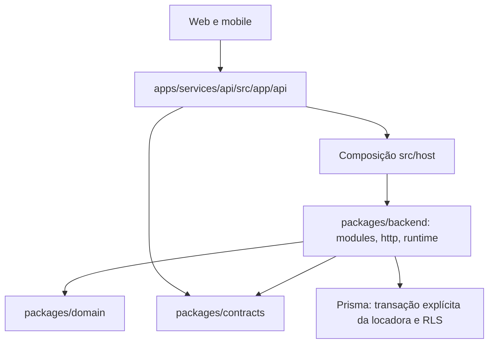

# 🔌 Documentação da API - GB-Locacoes

> **Referência da composição HTTP, contratos e autorização do host
> compartilhado. Exemplos históricos estão identificados em suas seções.**

## 📋 Índice

- [🎯 Visão Geral](#-visão-geral)
- [🔐 Autenticação](#-autenticação)
- [📡 Endpoints](#-endpoints)
- [🛠️ Server Actions](#️-server-actions)
- [📊 Modelos de Dados](#-modelos-de-dados)
- [🔍 Exemplos de Uso](#-exemplos-de-uso)
- [⚠️ Códigos de Erro](#️-códigos-de-erro)
- [📈 Rate Limiting](#-rate-limiting)

---

## 🎯 Visão Geral

A API é composta em `apps/services/api/src/app/api` sobre Next.js App Router. Os
handlers integram os módulos de `packages/backend`, regras puras de
`packages/domain` e contratos de `packages/contracts`. As rotas e auxiliares
`app/` e `lib/` da raiz foram aposentados; o frontend não importa uma Server
Action antiga para atravessar essa fronteira.

### 🏗️ Arquitetura da API



### 📊 Características

- Rotas REST e schemas Zod compartilhados; Next fornece o transporte HTTP.
- Identidade por NextAuth no modo legacy ou Better Auth no modo correspondente;
  sessão não substitui vínculo ativo, seleção de locadora ou permissão granular.
- Origem de mutação, limites, status, headers e corpo pertencem ao contrato da
  rota.
- A página web `/api-docs` consome `/openapi.json`; a especificação gerada é
  parcial e não substitui os guardas reais dos handlers.

---

## 📋 **Documentação da API (Swagger/OpenAPI)**

### **🎯 Implementação Custom**

Nosso projeto usa uma **implementação custom de Swagger/OpenAPI** em vez de
bibliotecas externas como `swagger-ui-react`, devido a incompatibilidades com
React 19.

### **🔧 Como Funciona**

1. `scripts/generate-openapi-zod.ts` converte schemas públicos de contracts.
2. `next-openapi-gen` lê handlers declarados de `apps/services/api/src/app/api`.
3. `next.openapi.json` configura a geração de `public/openapi.json`.
4. O host web copia o asset e a página FSD `ApiDocsPage` o apresenta.

### **📁 Arquivos de Implementação**

> **Estado atual (conferido em 2026-10-08, onda 135, C5)**:
> `lib/openapi-generator.ts` saiu no commit `0cff7b65`, e a especificação não lê
> mais a raiz legada. `pnpm openapi:generate`
> (`scripts/generate-openapi-zod.ts`) faz duas coisas:
>
> 1. Converte os esquemas públicos de `@gb-locacoes/contracts/openapi`
>    (`packages/contracts/src/openapi/schemas.ts`, antes `lib/openapi/`) em
>    `packages/contracts/src/openapi/public-schemas.json`.
> 2. Roda o `next-openapi-gen` sobre as rotas da API compartilhada
>    (`apps/services/api/src/app/api`, configuração em `next.openapi.json`) e
>    grava `public/openapi.json`. O host web copia esse arquivo pelo
>    `tools/sync-web-public.mjs`, e a página `/api-docs` (`ApiDocsPage` de
>    `@gb-locacoes/frontend/pages/api-docs`) lê `/openapi.json`.
>
> A CLI roda com o diretório do serviço como `cwd`, porque ela também varre
> `<cwd>/app/api`, e o cache em disco fica desligado.
> `pnpm openapi:generate --check` gera numa pasta temporária e reprova se os
> arquivos versionados divergirem do código
> (`tests/unit/openapi-generation.test.ts`, em `pnpm test:unit`).
> `pnpm openapi:dev` regenera a cada mudança.
>
> O gerador só lê handlers declarados (`export function GET` ou
> `export const GET`). Por isso as rotas públicas exportam
> `export const GET = <composição de host/runtime>`. Ficam fora da especificação
> as 4 rotas que exportam um handler com dois nomes
> (`export { handle as GET, handle as POST }`): `auth/[...nextauth]`,
> `auth/v2/[...all]`, `admin/payment-account/create` e
> `admin/payment-account/recovery`. Os blocos `@openapi` em YAML das rotas
> administrativas são históricos. O gerador não os interpreta, e os papéis
> citados neles não são a autorização real (`requireTenantPermission` no
> vínculo).
>
> Registro histórico do gerador aposentado: o trecho abaixo não é comando de
> setup nem configuração de destino deste produto.

```typescript
// lib/openapi-generator.ts
export function generateOpenAPISpec() {
  return {
    openapi: "3.0.0",
    info: { title: "GB-Locações API", version: "1.0.0" },
    servers: [
      { url: "http://localhost:3000/api", description: "Development" },
      { url: "https://locacoesgb.com.br/api", description: "Production" }
    ]
    // ... schemas e paths
  }
}
```

### **🚀 Acesso à Documentação**

- **URL local do painel**: `/api-docs` no host web de desenvolvimento (porta
  3001).
- **Destino hospedado**: será configurado para este produto; não use a origem
  GB.
- **Especificação**: `/openapi.json` (OpenAPI 3.0)

### **✅ Vantagens da Implementação Custom**

- **🎨 Branding**: Interface personalizada com identidade visual GB-Locações
- **🔧 Controle Total**: Sem dependências externas problemáticas
- **📱 React 19**: Compatibilidade total com versão mais recente
- **⚡ Performance**: Sem overhead de bibliotecas desnecessárias
- **🎯 Integração**: Perfeitamente integrado com nosso design system

---

## 🔐 Autenticação

### 🎫 Sessão e motor de identidade

O modo legacy usa NextAuth; o modo Better Auth tem sua configuração em
`packages/backend/src/modules/identity/factory.ts`. A composição de sessão da
API fica em `apps/services/api/src/host/session.ts`. Não trate o antigo exemplo
de `Authorization: Bearer <jwt_token>` como contrato universal das rotas:
cookies, credenciais e proteções variam conforme o fluxo/motor.

`NEXT_PUBLIC_AUTH_MODE` é embutido no build do cliente web. Alternar o motor
servidor em runtime não prova um browser reconstruído para Better Auth; siga
[testing.md](../guides/testing.md) para as provas adequadas.

### 🔑 Seleção de locadora e permissões

`apps/services/api/src/host/private-identity.ts` compõe
`createTenantPrincipalResolver`, e `host/permissions.ts` compõe
`createTenantPermissionResolver`. O principal exige identidade, seleção coerente
e vínculo/locadora ativos. A ação privada requer módulo/permissão explícitos; o
papel global `ADMIN` não concede acesso total a toda locadora.

Em settings, GET exige `SETTINGS/READ` e PUT exige `SETTINGS/WRITE`. A escrita
também verifica a origem e o `SettingsSchema`. As consultas com contexto da
locadora executam sob `withTenantTransaction` e RLS.

### 🛡️ Proxy do host web

`apps/clients/web/src/proxy.ts` instancia a decisão de host/rota em
`src/host/routing/platform-proxy.ts`: páginas da vitrine são reescritas para o
slug do Host, o apex para a plataforma e `/api/*` para `WEB_API_ORIGIN` com o
contexto validado da borda. Autorização de uma operação continua no
handler/backend; o proxy não é um atalho RBAC. O `proxy.ts` da raiz antiga foi
aposentado.

---

## 📡 Endpoints

### 🏠 Base URL

A API local usa `http://127.0.0.1:3002/api`; o web encaminha `/api/*` para
`WEB_API_ORIGIN`. O mobile usa a origem explícita do seu template. Não existe
destino de produção aprovado por este documento.

### 📋 Rotas verificadas e seus donos

| Método    | Caminho HTTP            | Fonte no host API                       | Contrato/guarda                                                                            |
| --------- | ----------------------- | --------------------------------------- | ------------------------------------------------------------------------------------------ |
| GET       | `/api/equipments`       | `src/app/api/equipments/route.ts`       | Catálogo público com `tenantSlug` obrigatório.                                             |
| GET       | `/api/categories`       | `src/app/api/categories/route.ts`       | Categorias públicas da locadora selecionada.                                               |
| GET       | `/api/health`           | `src/app/api/health/route.ts`           | Health da API; não prova configuração dos provedores.                                      |
| GET, POST | `/api/admin/equipments` | `src/app/api/admin/equipments/route.ts` | Permissão `EQUIPMENTS/READ` ou `WRITE`, limites e validação do módulo.                     |
| GET, PUT  | `/api/admin/settings`   | `src/app/api/admin/settings/route.ts`   | `SETTINGS/READ` ou `WRITE`; PUT verifica origem e schema.                                  |
| GET, POST | `/api/quotes`           | `src/app/api/quotes/route.ts`           | GET privado da locadora; POST valida `QuoteRequestSchema` e o fluxo de sessão/solicitante. |
| POST      | `/api/orcamentos`       | `src/app/api/orcamentos/route.ts`       | Adapter do POST de quotes; conserva seu contrato de resposta.                              |

Esta tabela é uma seleção, não um inventário exaustivo nem uma autorização por
papel. A lista completa de fontes fica em `apps/services/api/src/app/api`;
consulte o handler e seu contrato, além da especificação OpenAPI com os limites
de geração acima. A antiga tabela com `/equipment`, CRUD genérico de `/users` e
papéis globais não era um contrato fiel e foi substituída.

---

## 🛠️ Server Actions

### Registro histórico e substituição concreta

`app/api/admin/equipments/actions.ts` e `app/api/quotes/actions.ts` nunca
existiram. Os exemplos antigos com `equipmentSchema`, `CreateEquipmentInput`,
acesso Prisma global e somas diretas de preços eram ilustrações; as validações
de equipamento sem importador foram aposentadas na limpeza anterior. Não
reintroduza essas APIs.

O antigo `app/api/admin/settings/actions.ts` pertence à raiz aposentada. O dono
atual é `apps/services/api/src/app/api/admin/settings/route.ts` (GET/PUT), com
schema em `@gb-locacoes/contracts/settings` e composição
`apps/services/api/src/host/branding.ts`. Equipamentos e orçamentos usam os
handlers REST da tabela anterior e os módulos catalog/quotations/rentals. Um
componente cliente consome o transporte da sua fatia; não importa
`@/app/api/**/actions`.

---

## 📊 Modelos de Dados

### Registro histórico de tipos ilustrativos

Os tipos abaixo preservam o desenho simplificado antigo, não representam todos
os campos do Prisma nem os DTOs atuais. O esquema é `prisma/schema.prisma`; os
contratos públicos são exportados por `packages/contracts`. Não recrie
`CreateEquipmentInput` ou um enum global de acesso a partir destas ilustrações;
identidade/vínculo e operações monetárias têm contratos próprios.

### 🔧 Equipment

```typescript
interface Equipment {
  id: string
  name: string
  description?: string
  pricePerDay: number
  images: string[]
  available: boolean
  categoryId: string
  createdAt: Date
  updatedAt: Date
  category: Category
}

interface CreateEquipmentInput {
  name: string
  description?: string
  pricePerDay: number
  categoryId: string
  images?: string[]
  available?: boolean
}

interface UpdateEquipmentInput {
  name?: string
  description?: string
  pricePerDay?: number
  categoryId?: string
  images?: string[]
  available?: boolean
}
```

### 📂 Category

```typescript
interface Category {
  id: string
  name: string
  description?: string
  icon?: string
  iconColor: string
  bgColor: string
  fontColor: string
  slug: string
  createdAt: Date
  updatedAt: Date
  equipments: Equipment[]
}

interface CreateCategoryInput {
  name: string
  description?: string
  icon?: string
  iconColor?: string
  bgColor?: string
  fontColor?: string
  slug: string
}
```

### 💰 Quote

```typescript
interface Quote {
  id: string
  userId: string
  status: QuoteStatus
  totalAmount: number
  deliveryType: DeliveryType
  deliveryAddress?: string
  startDate: Date
  endDate: Date
  createdAt: Date
  updatedAt: Date
  user: User
  items: QuoteItem[]
  payments: Payment[]
  rentals: Rental[]
}

interface CreateQuoteInput {
  userId: string
  deliveryType: DeliveryType
  deliveryAddress?: string
  startDate: Date
  endDate: Date
  items: CreateQuoteItemInput[]
}

interface QuoteItem {
  id: string
  quoteId: string
  equipmentId: string
  quantity: number
  days: number
  pricePerDay: number
  totalPrice: number
  createdAt: Date
  equipment: Equipment
}
```

### 👥 User

```typescript
interface User {
  id: string
  name?: string
  email: string
  role: Role
  emailVerified?: Date
  image?: string
  createdAt: Date
  updatedAt: Date
  quotes: Quote[]
  rentals: Rental[]
}

enum Role {
  ADMIN = "ADMIN",
  CLIENT = "CLIENT"
}
```

### 🏠 Rental

```typescript
interface Rental {
  id: string
  quoteId: string
  userId: string
  status: RentalStatus
  startDate: Date
  endDate: Date
  totalAmount: number
  createdAt: Date
  updatedAt: Date
  quote: Quote
  user: User
  items: RentalItem[]
  payments: Payment[]
}

interface RentalItem {
  id: string
  rentalId: string
  equipmentId: string
  quantity: number
  days: number
  pricePerDay: number
  totalPrice: number
  status: RentalItemStatus
  createdAt: Date
  equipment: Equipment
}
```

---

## 🔍 Exemplos de Uso

### 📡 REST API

#### **Listar equipamentos da locadora**

```bash
curl "http://127.0.0.1:3002/api/equipments?tenantSlug=[SLUG_LOCAL]"
```

Use um slug publicado do banco local. Não há locadora padrão: ausente ou
incoerente não deve virar catálogo global. O DTO é o contrato público do
handler/módulo; os antigos envelopes com paginação eram demonstrativos.

#### **Escritas de orçamento e de painel**

Use os contratos `QuoteRequestSchema` e `SettingsSchema` com o transporte
configurado em `packages/frontend/src/shared/api`, mantendo sessão, locadora e
origem de mutação. O servidor valida preços/obrigações; não aceite uma soma do
cliente ou um papel global como autorização. Os casos HTTP em `tests/api-host`
documentam os status e DTOs literais dos fixtures; consulte
[quote-system.md](../features/quote-system.md) para a regra comercial.

### 🛠️ Componentes clientes

Os forms vivem na fatia FSD dona, sobre `useApiClient`/`useScopedApiClient`. O
host só configura transporte/origem. As importações de ações da raiz nos antigos
exemplos foram aposentadas junto com esse host, sem criar uma segunda cópia dos
forms ou expor Prisma no bundle cliente.

---

## ⚠️ Códigos de Erro

### 📊 Códigos HTTP

| Código | Descrição             | Exemplo                        |
| ------ | --------------------- | ------------------------------ |
| `200`  | Sucesso               | Operação realizada com sucesso |
| `201`  | Criado                | Recurso criado com sucesso     |
| `400`  | Bad Request           | Dados inválidos ou malformados |
| `401`  | Unauthorized          | Token inválido ou ausente      |
| `403`  | Forbidden             | Sem permissão para acessar     |
| `404`  | Not Found             | Recurso não encontrado         |
| `409`  | Conflict              | Conflito de dados              |
| `422`  | Unprocessable Entity  | Validação falhou               |
| `429`  | Too Many Requests     | Rate limit excedido            |
| `500`  | Internal Server Error | Erro interno do servidor       |

### 🔍 Estrutura de Erro

O envelope abaixo é ilustrativo. Respostas reais variam por contrato de rota e
integração; confira status, headers e corpo do handler. Não transforme a
ilustração em um normalizador que esconda erros reais.

```json
{
  "success": false,
  "error": {
    "code": "VALIDATION_ERROR",
    "message": "Dados inválidos",
    "details": [
      {
        "field": "email",
        "message": "Email inválido"
      },
      {
        "field": "pricePerDay",
        "message": "Preço deve ser positivo"
      }
    ]
  }
}
```

### 📋 Registro ilustrativo de códigos antigos

| Código                     | Descrição                  | Solução                   |
| -------------------------- | -------------------------- | ------------------------- |
| `INVALID_TOKEN`            | Token JWT inválido         | Renovar token             |
| `INSUFFICIENT_PERMISSIONS` | Permissões insuficientes   | Verificar role            |
| `RESOURCE_NOT_FOUND`       | Recurso não encontrado     | Verificar ID              |
| `VALIDATION_ERROR`         | Erro de validação          | Verificar dados           |
| `DUPLICATE_ENTRY`          | Entrada duplicada          | Usar dados únicos         |
| `DEPENDENCY_ERROR`         | Dependência não satisfeita | Verificar relacionamentos |

---

## 📈 Rate Limiting

### 🛡️ Políticas com donos distintos

- `packages/backend/src/http/memory-rate-limit.ts` implementa os limites
  genéricos por processo; o host API compõe seus consumidores em
  `apps/services/api/src/host/rate-limit.ts`. Os limites predefinidos
  API/admin/strict usam 100/200/10 solicitações por 60 segundos; nem toda rota
  usa todos esses limiters.
- `packages/backend/src/modules/identity/rate-limit.ts` usa janelas persistidas
  em `platform_rate_limits`, com chaves HMAC e política própria dos fluxos de
  credenciais legacy. Não se confunde com memória.
- Better Auth está em `packages/backend/src/modules/identity/factory.ts`:
  limiter ligado, storage database, modelo `AuthRateLimit`, janela padrão de 60
  segundos com máximo 100, regras de sign-in/email 10/60 e
  request-password-reset 3/60. Os caminhos de leitura de sessão também contam
  conforme a política do motor.

Os limiters não devem ser desligados para um teste passar. Polling de sessão
precisa respeitar a janela e falhar explicitamente em resposta não-200; testes
do setup/J7 preservam os contadores em vez de zerá-los. O antigo exemplo de
`lib/rate-limit.ts` com uma tabela universal de 15 minutos foi aposentado e não
descreve a política atual.

Status 429, `Retry-After`, headers e envelope são os do handler/política
exercitados. Não deduza um contrato universal de header da implementação
genérica nem acrescente retries que escondam uma recusa.

---

## 📚 Conclusão

Use o handler atual, sua composição de host, o contrato compartilhado e os
testes HTTP para avaliar uma operação. Sessão, vínculo, permissão, RLS e origem
são responsabilidades explícitas; uma página Swagger ou um build verde não
certifica uma implantação nem provedores reais.

Para mais informações sobre implementação específica, consulte os arquivos de
código fonte e a documentação técnica do projeto.
