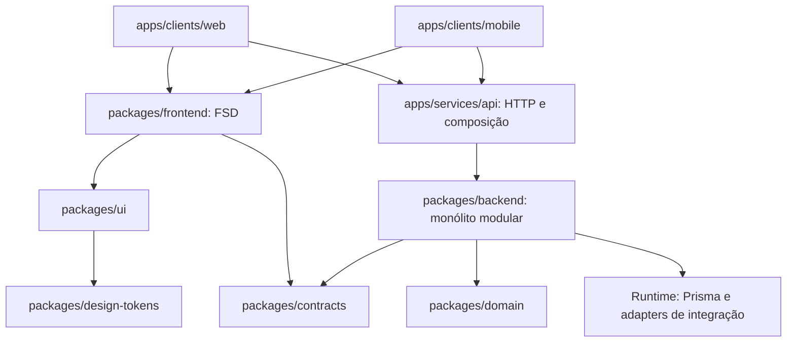
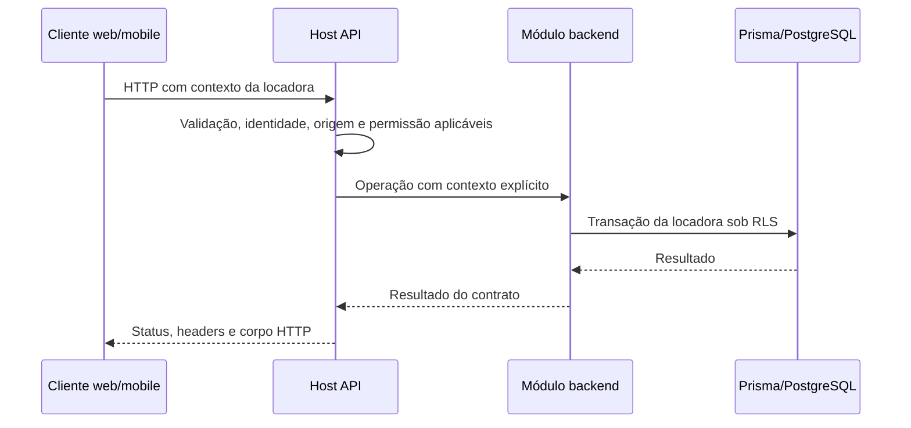
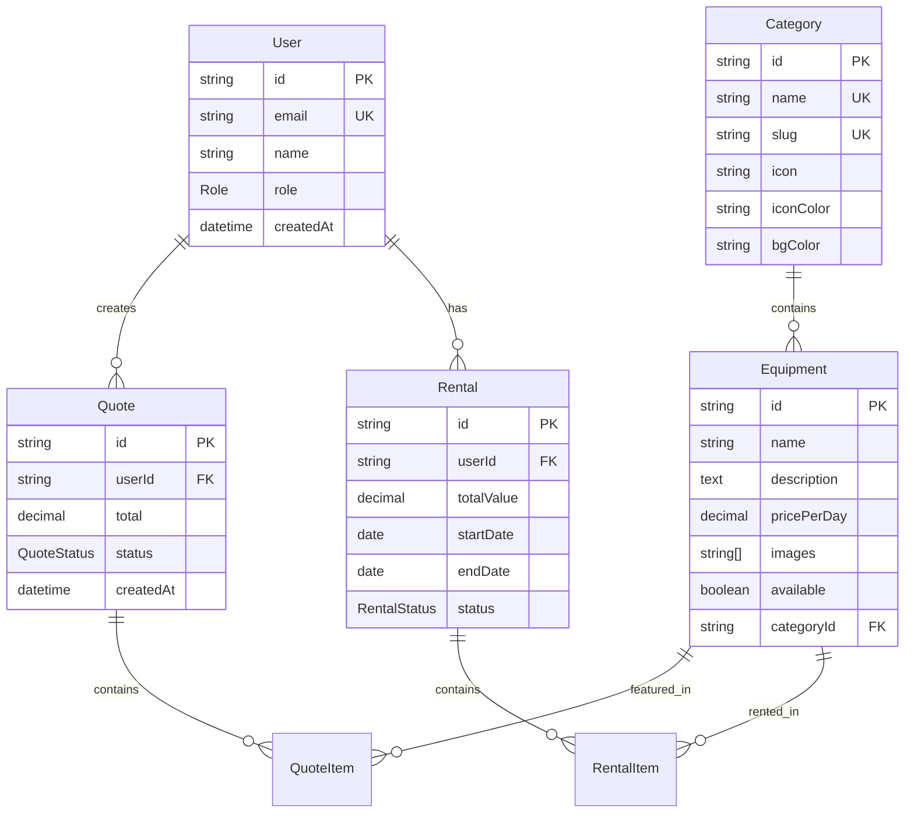

# 🏗️ Visão Geral da Arquitetura - GB Locações

> **Documentação técnica completa da arquitetura do sistema GB-Locações**

> **Estrutura após a retirada local da raiz**: três hosts finos — web Next
> (`apps/clients/web`), mobile Expo (`apps/clients/mobile`) e API Next
> (`apps/services/api`). O frontend do produto está em `packages/frontend`
> (FSD), com UI e tokens compartilhados. O backend é um monólito modular em
> `packages/backend/src/modules`, com transporte em `http` e composição em
> `runtime` e no host. Regras puras e contratos ficam em `packages/domain` e
> `packages/contracts`.

As árvores `app/` e `lib/` da raiz foram aposentadas localmente. Os clientes
consomem o host API; não importam handlers ou Prisma. Essa topologia não
certifica hospedagem, banco cloud, ativação de integração ou corte do projeto
GB. A sequência e as provas de retirada ficam em
[modernization.md](modernization.md) e
[shared-api-host.md](../features/shared-api-host.md). O namespace
`@gb-locacoes/*` continua sendo a API dos packages, não uma conexão com um
provedor ou ambiente antigo.

## 📋 Índice

- [🎯 Visão Geral](#-visão-geral)
- [🏛️ Arquitetura do Sistema](#️-arquitetura-do-sistema)
- [🔄 Fluxo de Dados](#-fluxo-de-dados)
- [📊 Tecnologias Principais](#-tecnologias-principais)
- [🗄️ Modelo de Dados](#️-modelo-de-dados)
- [🔌 Integrações Externas](#-integrações-externas)
- [📦 Estrutura de Módulos](#-estrutura-de-módulos)

---

## 🎯 Visão Geral

O **GB-Locações** é uma plataforma moderna de locação de equipamentos construída
com arquitetura **full-stack TypeScript**, seguindo os padrões mais atuais de
desenvolvimento web.

### 🎯 **Princípios Arquiteturais**

- **🏗️ Arquitetura Limpa** - Separação clara de responsabilidades
- **⚡ Performance First** - Otimizado para Core Web Vitals
- **🔐 Seguro por Design** - Segurança em todas as camadas
- **📱 Mobile First** - Experiência mobile prioritária
- **♿ Acessível** - WCAG 2.1 AA compliance
- **🧪 Testável** - Cobertura de testes abrangente

---

## 🏛️ Arquitetura do Sistema

### **Topologia corrente**



O diagrama representa responsabilidades; não significa que uma integração está
configurada ou autorizada a executar.

### **Registro histórico do stack anterior**

O desenho anterior está preservado no checkpoint Git
`checkpoint/onda-135-pre-exclusao`, no mesmo arquivo. A topologia corrente acima
substitui esse desenho; as versões atuais ficam em
[dependencies.md](../references/dependencies.md).

### **Camadas da Aplicação**

- **Hosts clientes:** rotas, bootstrap, ambiente e integração de plataforma.
- **Frontend FSD:** `app → pages → widgets → features → entities → shared`. Uma
  fatia importa somente camadas inferiores por suas APIs públicas.
- **Fundação:** `packages/ui` e `packages/design-tokens` não importam frontend,
  clientes, Prisma ou módulos de servidor.
- **Servidor:** o host API compõe `packages/backend`; FSD não se aplica ao
  backend. Domínio puro e contratos não dependem de Next ou Prisma.
- **Dados e integrações:** runtime injeta Prisma e adapters nos módulos.
  Transações de locadora recebem contexto explícito e RLS; o cliente nunca
  recebe uma credencial do provedor ou acesso direto ao banco.

---

## 🔄 Fluxo de Dados

### **Request/Response Flow**



### **Data Flow Patterns**

#### **📖 Read Operations (Queries)**

```typescript
// apps/services/api/src/app/api/equipments/route.ts (composição existente)
import { publicEquipments } from "../../../host/runtime"

export const dynamic = "force-dynamic"
export const runtime = "nodejs"
export const revalidate = 0
export const GET = publicEquipments
```

O catálogo público seleciona a locadora explicitamente; o módulo
`packages/backend/src/modules/catalog/public.ts` usa `withTenantTransaction`. O
web SSR lê essa API pela composição
`apps/clients/web/src/host/server/public-api.ts`, não por uma consulta global do
antigo `@/lib/prisma`.

#### **✏️ Write Operations (Mutations)**

A rota administrativa de settings em
`apps/services/api/src/app/api/admin/settings/route.ts` exige `SETTINGS/WRITE`,
origem confiável e `SettingsSchema` antes de delegar a `host/branding`.
Contratos ficam em `packages/contracts`, regras de negócio em domain/backend e
composição no host. Os snippets antigos de `equipmentSchema` e Server Actions
não são uma implementação a copiar.

---

## 📊 Tecnologias Principais

### **🎯 Versões e validação**

A versão instalada é fixada pelos manifests, `.node-version`, `packageManager` e
`pnpm-lock.yaml`; consulte [dependencies.md](../references/dependencies.md)
antes de alterá-la. A presença da versão não equivale à execução de todos os
gates ou à compatibilidade com todo navegador/dispositivo.

### **Registro histórico da tabela de versões**

A tabela e as incompatibilidades abaixo preservam o estado anterior à migração.
A trava de Tailwind 3 e o bloqueio antigo de Prisma 6 foram substituídos pela
configuração corrente; não são recomendações de upgrade.

| Categoria         | Tecnologia      | Versão      | Status       | Notas               |
| ----------------- | --------------- | ----------- | ------------ | ------------------- |
| **Framework**     | Next.js         | 16.0.3      | ✅ Estável   | App Router completo |
| **UI Library**    | React           | 19.1.1      | ✅ Estável   | Server Components   |
| **Language**      | TypeScript      | 5.9.2       | ✅ Estável   | Strict mode         |
| **Database**      | PostgreSQL      | 15+         | ✅ Estável   | JSON, Indexes       |
| **ORM**           | Prisma          | **Estável** | ✅ Funcional | Versão atual        |
| **Styling**       | Tailwind CSS    | **3.4.17**  | ⚠️ Travado   | NÃO atualizar       |
| **UI Components** | Radix UI        | Latest      | ✅ Estável   | Atualizável         |
| **State**         | Zustand         | 5.0.7       | ✅ Estável   | Global state        |
| **Forms**         | React Hook Form | 7.62.0      | ✅ Estável   | Performance         |
| **Validation**    | Zod             | 4.0.17      | ✅ Estável   | Type inference      |
| **Auth**          | NextAuth.js     | 4.24.11     | ✅ Estável   | JWT + Database      |
| **Testing**       | Vitest          | 3.2.4       | ✅ Estável   | Fast testing        |
| **E2E**           | Playwright      | 1.54.2      | ✅ Estável   | Cross-browser       |

### **⚠️ Incompatibilidades registradas no stack anterior**

```bash
# ❌ BLOQUEADORES - NÃO ATUALIZAR
Prisma 6.14.0+ → Erro "did not initialize yet"
Tailwind CSS 4.x → Quebra design system

# ✅ SEGURO ATUALIZAR
@radix-ui/react-* → Sempre compatível
@testing-library/* → Sempre compatível
date-fns → Sempre compatível
lucide-react → Sempre compatível
```

---

## 🗄️ Modelo de Dados

### **📊 Entidades Principais**

O esquema autoritativo é `prisma/schema.prisma`, com suas migrations. O diagrama
abaixo resume as entidades comerciais; não representa todos os vínculos,
permissões, assinaturas, credenciais ou políticas multiempresa. Identidade e
seleção de locadora seguem [adr-tenant-hosts.md](adr-tenant-hosts.md).



### **🔗 Relacionamentos**

#### **User Relations**

- `User → Quote` (1:N) - Um usuário pode criar múltiplos orçamentos
- `User → Rental` (1:N) - Um usuário pode ter múltiplas locações

#### **Equipment Relations**

- `Category → Equipment` (1:N) - Uma categoria tem múltiplos equipamentos
- `Equipment → QuoteItem` (1:N) - Um equipamento pode estar em múltiplos
  orçamentos
- `Equipment → RentalItem` (1:N) - Um equipamento pode ser locado múltiplas
  vezes

#### **Business Relations**

- `Quote → QuoteItem` (1:N) - Um orçamento contém múltiplos itens
- `Rental → RentalItem` (1:N) - Uma locação contém múltiplos itens

### **📝 Registro histórico de schemas demonstrativos**

Os schemas abaixo são ilustrações antigas, não contratos HTTP atuais.
`equipmentSchema` da implementação antiga foi aposentado sem consumidor. Schemas
atuais são exportados por `packages/contracts`; não copie estes objetos para
criar uma segunda validação ou ignorar tenant/permissão.

```typescript
// User Schema
export const userSchema = z.object({
  name: z.string().min(2, "Nome deve ter pelo menos 2 caracteres"),
  email: z.string().email("Email inválido"),
  role: z.enum(["ADMIN", "CLIENT"]).default("CLIENT")
})

// Equipment Schema
export const equipmentSchema = z.object({
  name: z.string().min(1, "Nome é obrigatório"),
  description: z.string().optional(),
  pricePerDay: z.number().positive("Preço deve ser positivo"),
  categoryId: z.string().uuid("Categoria inválida"),
  images: z.array(z.string().url()).default([]),
  available: z.boolean().default(true)
})

// Quote Schema
export const quoteSchema = z.object({
  items: z
    .array(
      z.object({
        equipmentId: z.string().uuid(),
        quantity: z.number().int().positive(),
        days: z.number().int().positive()
      })
    )
    .min(1, "Pelo menos um item é obrigatório")
})
```

---

## 🔌 Integrações Externas

### **💳 Payments - Asaas**

Cobranças do cliente final pelo Asaas, numa subconta de cada locadora, e a
assinatura da plataforma pela conta raiz
(`docs/architecture/adr-saas-subscription.md` e
`docs/features/modernization-billing.md`). A seção anterior descrevia uma
integração com Stripe que não existe mais.

### **📄 Contracts - ZapSign**

O módulo é `packages/backend/src/modules/documents`; o adapter ZapSign está em
`zapsign.ts`, e a composição HTTP em `apps/services/api/src/host/contracts.ts`.
Assinatura, arquivo e callback têm contratos próprios; não crie um cliente
global com uma credencial de outra locadora.

### **📧 Email - Resend**

O runtime exporta `createResendClient` em
`packages/backend/src/runtime/mail.ts`, consumido pela composição de
communications. Remetente e credencial pertencem ao ambiente/locadora
configurados, não a uma constante empresarial deste guia.

### **🚚 Logistics**

Frete é regra do contrato de domínio em
`packages/domain/src/orcamento/frete.ts`; veículos e entregas são compostos por
`apps/services/api/src/host/operations.ts` e pelo módulo backend `operations`. O
exemplo antigo de Melhor Envio não certificava um adapter corrente; não
configure um novo serviço para reproduzir esse desenho.

### **☁️ Storage**

Os adapters de imagem/documento estão em
`packages/backend/src/runtime/document-storage.ts` e são exportados por
`@gb-locacoes/backend/runtime`. O antigo exemplo que dividia uploads entre
Vercel Blob e Supabase por tamanho não é a política atual. Infraestrutura
hospedada e credenciais próprias serão definidas depois; a existência do adapter
não prova integração configurada.

---

## 📦 Estrutura de Módulos

### **🗂️ Organização de Diretórios**

```text
Locadora_de_Equipamentos/
├── apps/clients/web/        # Next: rotas, bootstrap, proxy e integração de plataforma
├── apps/clients/mobile/     # Expo: bootstrap e integração nativa
├── apps/services/api/       # Next: src/app/api e composição em src/host
├── packages/frontend/src/  # FSD: app → pages → widgets → features → entities → shared
├── packages/ui/            # Contratos e implementações web/native do design system
├── packages/design-tokens/ # Tokens e temas canônicos
├── packages/backend/src/   # modules/, http/ e runtime/; somente servidor
├── packages/domain/        # Regras puras, sem dependências dos hosts
├── packages/contracts/     # Schemas e contratos compartilhados
├── types/                  # Inclui next-auth.d.ts; não é apagada com a raiz antiga
├── public/                 # Assets compartilhados e OpenAPI
├── prisma/                 # Schema e migrations com RLS
├── tools/                  # Gates e geração do Prisma
├── scripts/                # Ferramentas conservadas; operações exigem runbook
├── tests/                  # Suítes e ferramentas de prova
├── stories/                # Storybook
└── docs/                   # Guias, decisões e runbooks
```

### **🔧 Padrões de Módulos**

O padrão de módulo do frontend é o Feature-Sliced Design do contrato do
`AGENTS.md` (seção "Context Window"): uma fatia só importa camadas abaixo dela,
nunca uma irmã, e sempre pelo `index.ts` da outra; `shared` não tem regra de
negócio e `shared/ui` só delega ao `packages/ui`. `pnpm arch` confere. Os
padrões "Feature Module" e "Shared Module" com `components/`/`hooks/` que
ficavam aqui eram anteriores à migração.

---

## 🔗 Próximos Passos

Para entender aspectos específicos da arquitetura:

- **[Modelo de dados](#️-modelo-de-dados)** - Estrutura do banco (fonte:
  `prisma/schema.prisma` e `prisma/migrations/`)
- **[api.md](./api.md)** - Documentação completa das APIs
- **[security.md](./security.md)** - Aspectos de segurança
- **[../features/design-system.md](../features/design-system.md)** - Sistema de
  design

---

_A topologia corrente acima descreve a retirada local; as provas do clone e o
corte de produção são registrados separadamente._

## Registro histórico — extração parcial de 2026-10-02

Os saldos, fachadas e origens legadas abaixo pertencem a essa data e foram
superados pela extração posterior. A raiz `app/`/`lib/` citada nesses registros
foi aposentada localmente; preserve os números como cronologia, não como
instrução para reconstruir o host antigo.

Atualização local de 2026-10-02, ondas 38–40: consultas/mutações financeiras,
pedidos de PIX/boleto e leitura privada do documento compostos em
apps/services/api. Consulta, obrigação, pedido, confirmação, emissão,
reconciliação e reemissão em backend/billing; renderers em backend/documents;
credenciais env em backend/runtime. Serviço parcial 73 rotas/99 métodos; legado
149/193, 46 páginas ativo, 94 métodos pendentes. Clientes não mudaram de origem
e jobs ainda executam pelo legado. Evidências e limites na onda 40 de
[API compartilhada](../features/shared-api-host.md).

Atualização local de 2026-10-02, onda 41: verificação de boleto e recepção
durável PIX/Asaas no host compartilhado, incluindo respostas 410 antigas.
Implementação em backend/identity, outbox e billing; schemas em
contracts/payments; composição nos hosts. Serviço parcial 78 rotas/104 métodos,
legado 149/193 e 46 páginas preservados, 89 métodos declarados restantes.
Scheduler e origem dos clientes continuam legados. Provas e limites na onda 41
de [API compartilhada](../features/shared-api-host.md).

Atualização local de 2026-10-02, onda 42: geração, leitura, pedido de
assinatura, download e callback ZapSign compostos nos dois hosts. Regras em
backend/documents, resposta de download em backend/http, storage em
backend/runtime e schemas em contracts/rental-contracts. Serviço parcial 84
rotas/111 métodos; legado 149/193 e 46 páginas preservados, 82 métodos
declarados restantes. Efeitos de assinatura/arquivo e scheduler ainda legados.
Paridade local e limites na onda 42 de
[API compartilhada](../features/shared-api-host.md); retirada de app/ depende de
paridade e cutover operacional, ainda não realizados.

Atualização local de 2026-10-02, onda 43: efeitos de assinatura/reconciliação/
arquivo e adapter ZapSign em backend/documents; scheduler permanece único no
legado. Upload privado compartilhado em backend/http e tipo em contracts;
listagem customers já existente composta no novo host. Serviço parcial 86
rotas/113 métodos; legado 149/193 e 46 páginas preservados, 80 métodos
declarados restantes. Provas e limites na onda 43 de
[API compartilhada](../features/shared-api-host.md). Reconciliação UNKNOWN sem
consumidor operacional e provedores reais/cutover ainda não certificados.

Atualização local de 2026-10-02, sem commit:

A onda 44 move imagens/settings para backend/catalog, upload para backend/http e
storage para runtime; schemas idênticos unificados em contracts/settings. POST
upload e GET/PUT admin/settings nos dois hosts, com fachadas legadas, quota SQL,
segredos e locks preservados. Serviço parcial: 88 rotas/116 métodos; legado
149/193 ativo e 77 métodos declarados restantes. HTTP 58/58 por motor, regressão
privada 44/44, gates 183/183. Provas e riscos na onda 44 de
[API compartilhada](../features/shared-api-host.md). Cache entre hosts continua
requisito de cutover; scheduler/origem continuam legados. Mobile sem inclusão
TypeScript que carregava o backend, mantendo sessão e tipos servidores.
