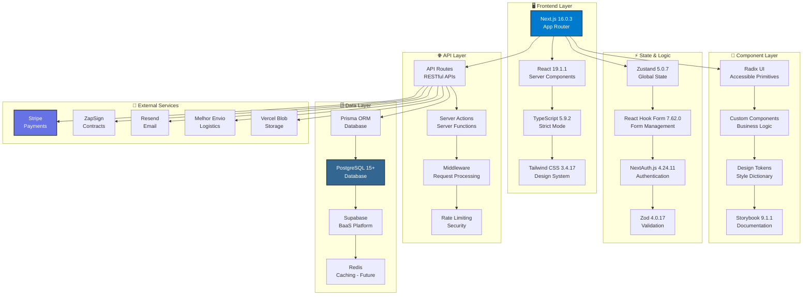
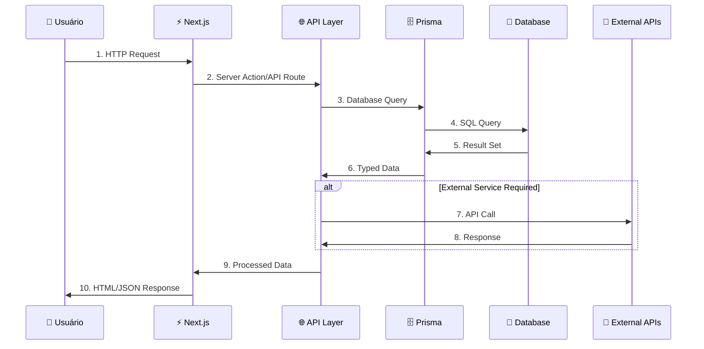
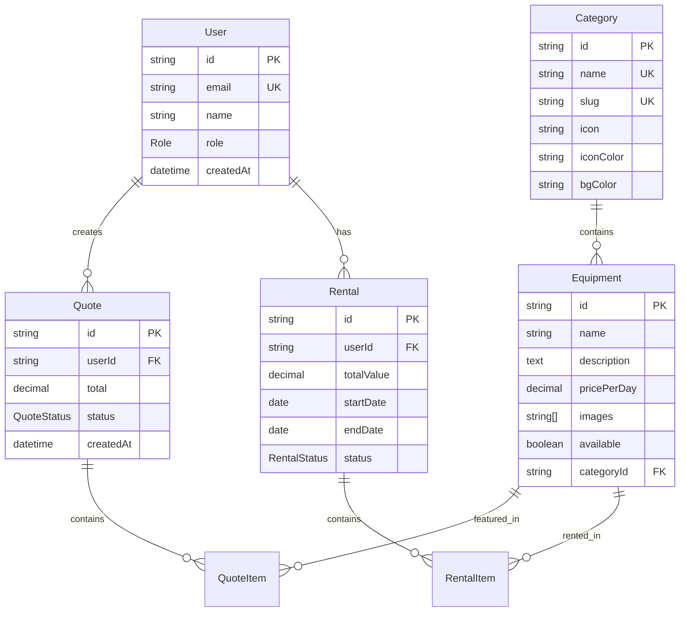

# 🏗️ Visão Geral da Arquitetura - GB Locações

> **Documentação técnica completa da arquitetura do sistema GB-Locações**

> **Estado atual (conferido em 2026-09-30)**: a estrutura e as versões reais
> estão no `AGENTS.md` (seção 7) e no `CLAUDE.md` ("Project Structure"):
> monorepo pnpm com hosts finos (`apps/clients/web`, `apps/clients/mobile`)
> sobre `packages/frontend` (Feature-Sliced Design), `packages/ui` e
> `packages/design-tokens`, servidor em `packages/backend` e a raiz legada
> (`app/`, `lib/`) como backend das rotas `/api`. Pagamentos pelo Asaas, uma
> subconta por locadora (`docs/architecture/adr-saas-subscription.md`); não há
> Stripe (o `lib/stripe.ts` e a dependência saíram). Tailwind 4.3.3 com a paleta
> e as escalas da produção (3.4.17). Os diagramas, a tabela de versões e os
> exemplos de código abaixo que citam Stripe, Style Dictionary, `components/`,
> `hooks/` ou `equipmentSchema` são históricos. A pipeline do Style Dictionary
> saiu em 2026-09-30; os tokens canônicos ficam em `packages/design-tokens/src`
> (entrada 227 de `docs/issues/known-issues.md`).

Host HTTP compartilhado parcial: `apps/services/api` atende categories/health,
equipamentos, busca, configurações públicas, disponibilidade, detalhe, cartão da
locadora, busca do diretório e leituras autenticadas de vínculos/seleção e do
vínculo da locadora do host (`/current`), além dos GETs privados de motoristas e
endereços do cliente, categorias administrativas e unidades físicas (lista e
detalhe), lista/detalhe administrativo de equipamento, permissões
administrativas, perfil comercial, listagem e estatísticas de notificações do
usuário na locadora, além de marcação/exclusão e mark-all-read e das escritas de
endereços, leitura/sincronização/mesclagem do carrinho e atualização do perfil
comercial, vínculo explícito com a locadora e criação administrativa de
motoristas, categorias, unidades físicas e equipamentos e edição/exclusão de
categorias, unidades e equipamentos por id, veículos, logística, portal de
locações, pedidos locais, consultas de orçamentos, atividades e ciclo
administrativo de locação, mutações de orçamento e PDFs/ofícios (41 GETs e 43
mutações em 59 rotas), composto por `packages/backend`. Cobranças do ciclo e
outbox usam as mesmas transações; emissão externa e consumidores permanecem
legados. A política granular de permissão também é compartilhada. A raiz
continua ativa e os clientes ainda usam sua origem; ver
[ADR de extração](adr-backend-extraction.md) e
[API compartilhada](../features/shared-api-host.md).

## 📋 Índice

- [🎯 Visão Geral](#-visão-geral)
- [🏛️ Arquitetura do Sistema](#️-arquitetura-do-sistema)
- [🔄 Fluxo de Dados](#-fluxo-de-dados)
- [📊 Tecnologias Principais](#-tecnologias-principais)
- [🗄️ Modelo de Dados](#️-modelo-de-dados)
- [🔌 Integrações Externas](#-integrações-externas)
- [📦 Estrutura de Módulos](#-estrutura-de-módulos)

---

## 🎯 Visão Geral

O **GB-Locações** é uma plataforma moderna de locação de equipamentos construída
com arquitetura **full-stack TypeScript**, seguindo os padrões mais atuais de
desenvolvimento web.

### 🎯 **Princípios Arquiteturais**

- **🏗️ Arquitetura Limpa** - Separação clara de responsabilidades
- **⚡ Performance First** - Otimizado para Core Web Vitals
- **🔐 Seguro por Design** - Segurança em todas as camadas
- **📱 Mobile First** - Experiência mobile prioritária
- **♿ Acessível** - WCAG 2.1 AA compliance
- **🧪 Testável** - Cobertura de testes abrangente

---

## 🏛️ Arquitetura do Sistema

### **Stack Tecnológico Moderno**



### **Camadas da Aplicação**

#### **1. 🖥️ Presentation Layer**

- **Next.js App Router** - Roteamento file-based e Server Components
- **React 19** - Biblioteca de UI com concurrent features
- **TypeScript** - Tipagem estática e IntelliSense
- **Tailwind CSS** - Framework CSS utility-first

#### **2. 🧩 Component Layer**

- **Radix UI** - Componentes primitivos acessíveis
- **Custom Components** - Componentes específicos do negócio
- **Design System** - Sistema de design tokens consistente
- **Storybook** - Documentação visual de componentes

#### **3. ⚡ Business Logic Layer**

- **Server Actions** - Funções server-side para mutations
- **API Routes** - Endpoints RESTful para dados
- **Custom Hooks** - Lógica de estado reutilizável
- **Validation** - Schemas Zod para validação de dados

#### **4. 🗄️ Data Access Layer**

- **Prisma ORM** - Type-safe database client
- **PostgreSQL** - Banco relacional principal
- **Supabase** - Backend-as-a-Service
- **Caching Strategy** - Redis para cache (futuro)

#### **5. 🔌 Integration Layer**

- **Payment Gateway** - Stripe para pagamentos
- **Document Signing** - ZapSign para contratos
- **Email Service** - Resend para transacional
- **Logistics** - Melhor Envio para cálculo de frete
- **File Storage** - Vercel Blob e Supabase Storage

---

## 🔄 Fluxo de Dados

### **Request/Response Flow**



### **Data Flow Patterns**

#### **📖 Read Operations (Queries)**

```typescript
// 1. Component Request
const equipments = await getEquipments()

// 2. Server Action/API Route
export async function getEquipments() {
  const { prisma } = await import("@/lib/prisma")
  return prisma.equipment.findMany({
    include: { category: true }
  })
}

// 3. Prisma Query → Database
// 4. Typed Response
```

#### **✏️ Write Operations (Mutations)**

```typescript
// 1. Form Submission
const result = await createEquipment(formData)

// 2. Validation
const validated = equipmentSchema.parse(formData)

// 3. Database Transaction
await prisma.$transaction([
  prisma.equipment.create(data),
  prisma.auditLog.create(audit)
])

// 4. Response/Redirect
```

---

## 📊 Tecnologias Principais

### **🎯 Versões Estáveis (Testadas)**

| Categoria         | Tecnologia      | Versão      | Status       | Notas               |
| ----------------- | --------------- | ----------- | ------------ | ------------------- |
| **Framework**     | Next.js         | 16.0.3      | ✅ Estável   | App Router completo |
| **UI Library**    | React           | 19.1.1      | ✅ Estável   | Server Components   |
| **Language**      | TypeScript      | 5.9.2       | ✅ Estável   | Strict mode         |
| **Database**      | PostgreSQL      | 15+         | ✅ Estável   | JSON, Indexes       |
| **ORM**           | Prisma          | **Estável** | ✅ Funcional | Versão atual        |
| **Styling**       | Tailwind CSS    | **3.4.17**  | ⚠️ Travado   | NÃO atualizar       |
| **UI Components** | Radix UI        | Latest      | ✅ Estável   | Atualizável         |
| **State**         | Zustand         | 5.0.7       | ✅ Estável   | Global state        |
| **Forms**         | React Hook Form | 7.62.0      | ✅ Estável   | Performance         |
| **Validation**    | Zod             | 4.0.17      | ✅ Estável   | Type inference      |
| **Auth**          | NextAuth.js     | 4.24.11     | ✅ Estável   | JWT + Database      |
| **Testing**       | Vitest          | 3.2.4       | ✅ Estável   | Fast testing        |
| **E2E**           | Playwright      | 1.54.2      | ✅ Estável   | Cross-browser       |

### **⚠️ Incompatibilidades Críticas**

```bash
# ❌ BLOQUEADORES - NÃO ATUALIZAR
Prisma 6.14.0+ → Erro "did not initialize yet"
Tailwind CSS 4.x → Quebra design system

# ✅ SEGURO ATUALIZAR
@radix-ui/react-* → Sempre compatível
@testing-library/* → Sempre compatível
date-fns → Sempre compatível
lucide-react → Sempre compatível
```

---

## 🗄️ Modelo de Dados

### **📊 Entidades Principais**



### **🔗 Relacionamentos**

#### **User Relations**

- `User → Quote` (1:N) - Um usuário pode criar múltiplos orçamentos
- `User → Rental` (1:N) - Um usuário pode ter múltiplas locações

#### **Equipment Relations**

- `Category → Equipment` (1:N) - Uma categoria tem múltiplos equipamentos
- `Equipment → QuoteItem` (1:N) - Um equipamento pode estar em múltiplos
  orçamentos
- `Equipment → RentalItem` (1:N) - Um equipamento pode ser locado múltiplas
  vezes

#### **Business Relations**

- `Quote → QuoteItem` (1:N) - Um orçamento contém múltiplos itens
- `Rental → RentalItem` (1:N) - Uma locação contém múltiplos itens

### **📝 Schemas Principais**

```typescript
// User Schema
export const userSchema = z.object({
  name: z.string().min(2, "Nome deve ter pelo menos 2 caracteres"),
  email: z.string().email("Email inválido"),
  role: z.enum(["ADMIN", "CLIENT"]).default("CLIENT")
})

// Equipment Schema
export const equipmentSchema = z.object({
  name: z.string().min(1, "Nome é obrigatório"),
  description: z.string().optional(),
  pricePerDay: z.number().positive("Preço deve ser positivo"),
  categoryId: z.string().uuid("Categoria inválida"),
  images: z.array(z.string().url()).default([]),
  available: z.boolean().default(true)
})

// Quote Schema
export const quoteSchema = z.object({
  items: z
    .array(
      z.object({
        equipmentId: z.string().uuid(),
        quantity: z.number().int().positive(),
        days: z.number().int().positive()
      })
    )
    .min(1, "Pelo menos um item é obrigatório")
})
```

---

## 🔌 Integrações Externas

### **💳 Payments - Asaas**

Cobranças do cliente final pelo Asaas, numa subconta de cada locadora, e a
assinatura da plataforma pela conta raiz
(`docs/architecture/adr-saas-subscription.md` e
`docs/features/modernization-billing.md`). A seção anterior descrevia uma
integração com Stripe que não existe mais.

### **📄 Contracts - ZapSign**

```typescript
// Document Signing
export const zapSign = new ZapSign({
  apiKey: process.env.ZAPSIGN_TOKEN!,
  sandbox: process.env.NODE_ENV !== "production"
})

// Contract Creation
const contract = await zapSign.createDocument({
  templateId: "rental-contract",
  variables: { customerName, equipmentList, total }
})
```

### **📧 Email - Resend**

```typescript
// Transactional Email
export const resend = new Resend(process.env.RESEND_API_KEY!)

// Send Quote Email
await resend.emails.send({
  from: "noreply@gblocacoes.com.br",
  to: customer.email,
  subject: "Seu orçamento GB Locações",
  react: QuoteEmailTemplate({ quote, customer })
})
```

### **🚚 Logistics - Melhor Envio**

```typescript
// Shipping Calculation
export const melhorEnvio = new MelhorEnvio({
  token: process.env.MELHOR_ENVIO_TOKEN!,
  sandbox: process.env.NODE_ENV !== "production"
})

// Calculate Shipping
const shipping = await melhorEnvio.calculate({
  from: { postal_code: "01310-100" },
  to: { postal_code: customer.postalCode },
  dimensions: equipmentDimensions
})
```

### **☁️ Storage - Supabase + Vercel Blob**

```typescript
// File Upload Strategy
export async function uploadFile(file: File) {
  // Small files → Vercel Blob (fast)
  if (file.size < 4.5 * 1024 * 1024) {
    return await put(file.name, file, {
      access: "public",
      token: process.env.BLOB_READ_WRITE_TOKEN
    })
  }

  // Large files → Supabase Storage (cost-effective)
  return await supabase.storage.from("equipment-images").upload(file.name, file)
}
```

---

## 📦 Estrutura de Módulos

### **🗂️ Organização de Diretórios**

```
apps/clients/web/        # Host Next.js fino: rotas, bootstrap, proxy para a API
apps/clients/mobile/     # Host Expo fino
apps/services/api/       # Host HTTP parcial: catálogo público e health
packages/frontend/src/   # Produto em FSD: app → pages → widgets → features →
                         #   entities → shared (cada fatia com index.ts público)
packages/ui/src/         # Design system: contrato + variantes .web/.native
packages/design-tokens/  # Tokens e temas canônicos (theme.css, tokens.css,
                         #   palette.css, scales.css)
packages/backend/        # Módulos de servidor (identidade, cobrança, locação...)
packages/domain/         # Regras puras (dinheiro em Decimal.js)
packages/contracts/      # Contratos compartilhados (zod)
app/api/                 # Raiz legada: rotas REST (o backend do host web)
lib/                     # Servidor e utilitários da raiz legada
prisma/                  # Schema e migrations (RLS por locadora)
```

### **🔧 Padrões de Módulos**

O padrão de módulo é o Feature-Sliced Design do contrato do `AGENTS.md` (seção
"Context Window"): uma fatia só importa camadas abaixo dela, nunca uma irmã, e
sempre pelo `index.ts` da outra; `shared` não tem regra de negócio e `shared/ui`
só delega ao `packages/ui`. `pnpm arch` confere. Os padrões "Feature Module" e
"Shared Module" com `components/`/`hooks/` que ficavam aqui eram anteriores à
migração.

---

## 🔗 Próximos Passos

Para entender aspectos específicos da arquitetura:

- **[Modelo de dados](#️-modelo-de-dados)** - Estrutura do banco (fonte:
  `prisma/schema.prisma` e `prisma/migrations/`)
- **[api.md](./api.md)** - Documentação completa das APIs
- **[security.md](./security.md)** - Aspectos de segurança
- **[../features/design-system.md](../features/design-system.md)** - Sistema de
  design

---

_Última atualização: dezembro 2024_

Atualização local de 2026-10-02, ondas 38–40: consultas/mutações financeiras,
pedidos de PIX/boleto e leitura privada do documento compostos em
apps/services/api. Consulta, obrigação, pedido, confirmação, emissão,
reconciliação e reemissão em backend/billing; renderers em backend/documents;
credenciais env em backend/runtime. Serviço parcial 73 rotas/99 métodos; legado
149/193, 46 páginas ativo, 94 métodos pendentes. Clientes não mudaram de origem
e jobs ainda executam pelo legado. Evidências e limites na onda 40 de
[API compartilhada](../features/shared-api-host.md).

Atualização local de 2026-10-02, onda 41: verificação de boleto e recepção
durável PIX/Asaas no host compartilhado, incluindo respostas 410 antigas.
Implementação em backend/identity, outbox e billing; schemas em
contracts/payments; composição nos hosts. Serviço parcial 78 rotas/104 métodos,
legado 149/193 e 46 páginas preservados, 89 métodos declarados restantes.
Scheduler e origem dos clientes continuam legados. Provas e limites na onda 41
de [API compartilhada](../features/shared-api-host.md).

Atualização local de 2026-10-02, onda 42: geração, leitura, pedido de
assinatura, download e callback ZapSign compostos nos dois hosts. Regras em
backend/documents, resposta de download em backend/http, storage em
backend/runtime e schemas em contracts/rental-contracts. Serviço parcial 84
rotas/111 métodos; legado 149/193 e 46 páginas preservados, 82 métodos
declarados restantes. Efeitos de assinatura/arquivo e scheduler ainda legados.
Paridade local e limites na onda 42 de
[API compartilhada](../features/shared-api-host.md); retirada de app/ depende de
paridade e cutover operacional, ainda não realizados.

Atualização local de 2026-10-02, onda 43: efeitos de assinatura/reconciliação/
arquivo e adapter ZapSign em backend/documents; scheduler permanece único no
legado. Upload privado compartilhado em backend/http e tipo em contracts;
listagem customers já existente composta no novo host. Serviço parcial 86
rotas/113 métodos; legado 149/193 e 46 páginas preservados, 80 métodos
declarados restantes. Provas e limites na onda 43 de
[API compartilhada](../features/shared-api-host.md). Reconciliação UNKNOWN sem
consumidor operacional e provedores reais/cutover ainda não certificados.

Atualização local de 2026-10-02, sem commit:

A onda 44 move imagens/settings para backend/catalog, upload para backend/http e
storage para runtime; schemas idênticos unificados em contracts/settings. POST
upload e GET/PUT admin/settings nos dois hosts, com fachadas legadas, quota SQL,
segredos e locks preservados. Serviço parcial: 88 rotas/116 métodos; legado
149/193 ativo e 77 métodos declarados restantes. HTTP 58/58 por motor, regressão
privada 44/44, gates 183/183. Provas e riscos na onda 44 de
[API compartilhada](../features/shared-api-host.md). Cache entre hosts continua
requisito de cutover; scheduler/origem continuam legados. Mobile sem inclusão
TypeScript que carregava o backend, mantendo sessão e tipos servidores.
