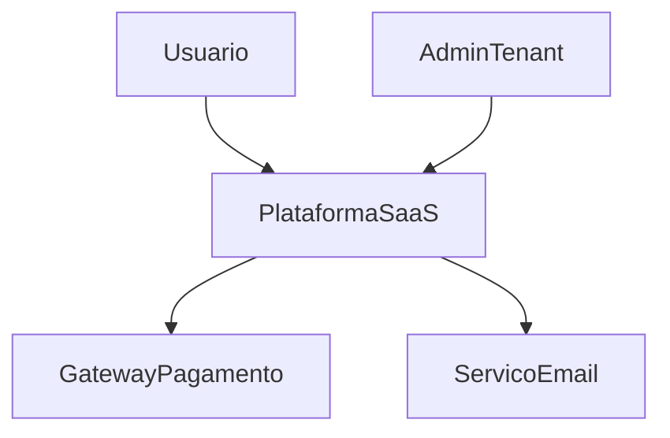
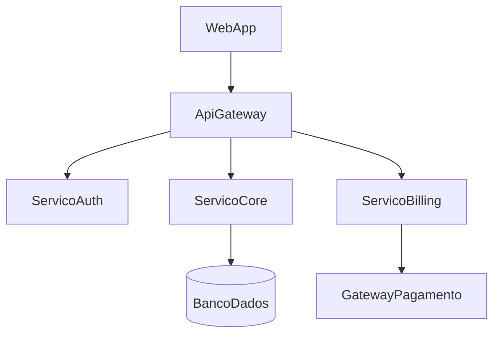
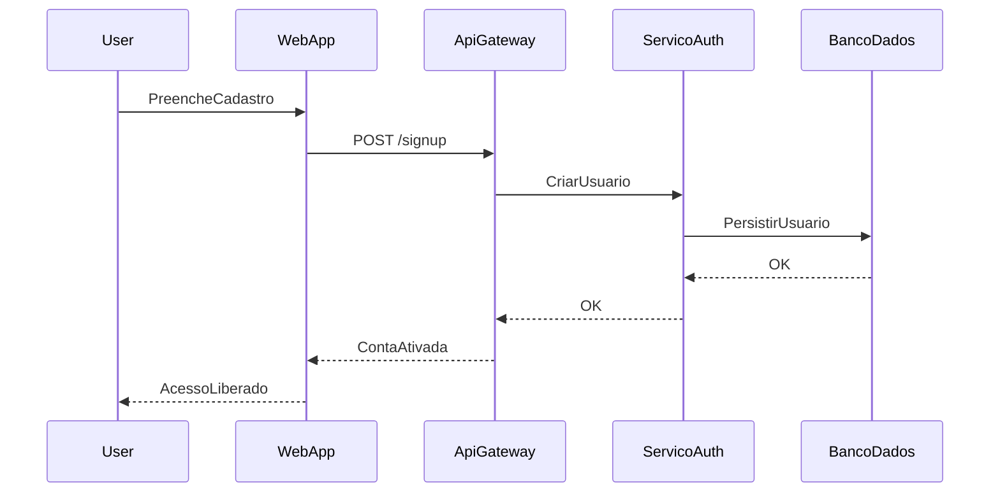
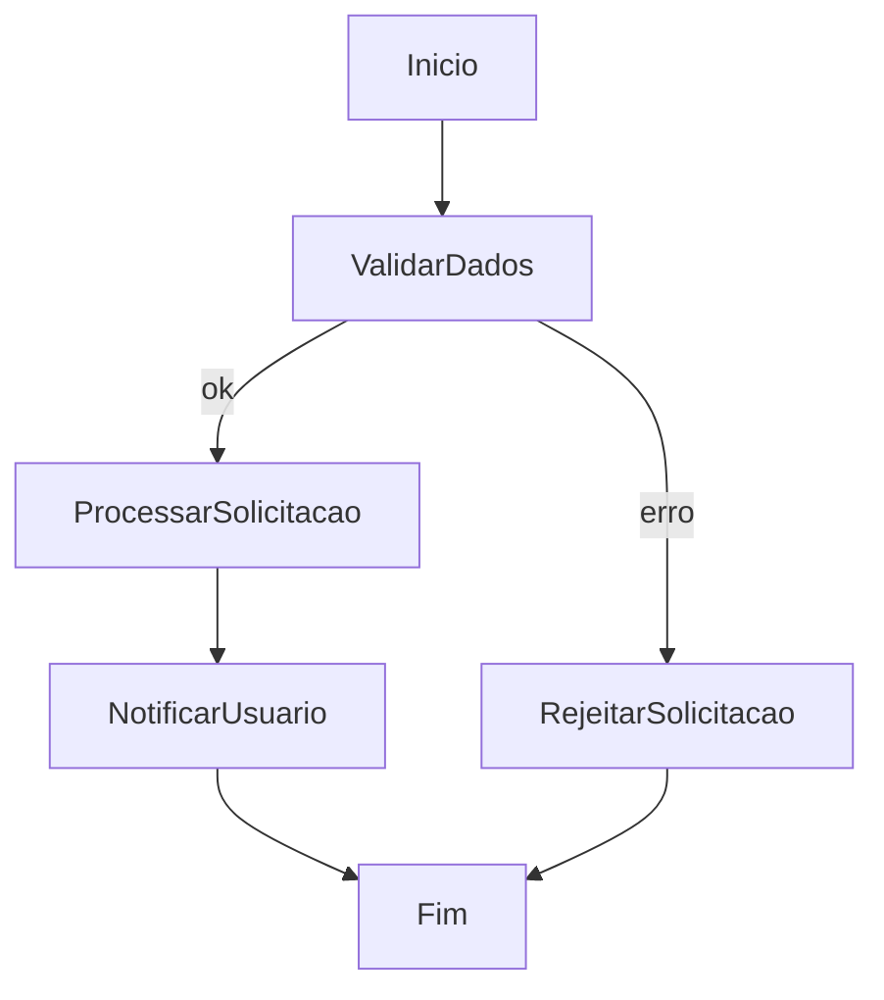
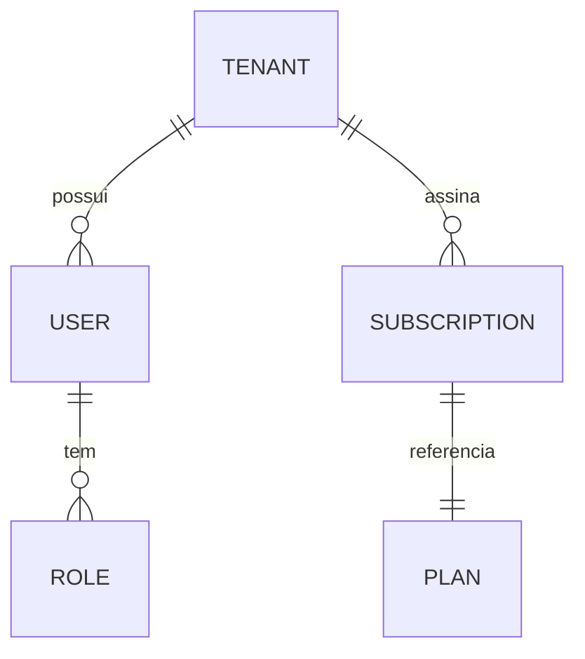

# Relatorio Completo de Analista de Sistemas em Projetos SaaS

## 0. Capa e dados do documento

- Titulo: Relatorio Completo de Analise de Sistemas para Projeto SaaS (modelo)
- Autor: [Nome do analista]
- Cliente/Organizacao: [Nome]
- Versao: [vX.Y]
- Data: [DD/MM/AAAA]
- Status: Rascunho | Em revisao | Aprovado
- Distribuicao: [Stakeholders]

## 1. Sumario executivo

Este documento fornece um modelo completo e detalhado para orientar o trabalho
do analista de sistemas em projetos SaaS B2B. O foco e definir requisitos,
arquitetura logica, dados, processos, regras de negocio, experiencia do usuario,
qualidade e governanca, de forma que equipes de engenharia tenham instrucao
clara e rastreavel para construir um SaaS robusto, escalavel e seguro.

## 2. Papel do analista de sistemas no SaaS

O analista de sistemas atua como arquiteto funcional e de requisitos, traduzindo
objetivos de negocio em especificacoes tecnicas verificaveis. As principais
responsabilidades:

- Descoberta e alinhamento: entender objetivos, personas, jornadas e restricoes.
- Elicitacao e analise: transformar necessidades em requisitos funcionais e nao
  funcionais (NFR).
- Modelagem e arquitetura logica: representar processos, dados, componentes e
  integracoes.
- Documentacao e rastreabilidade: manter SRS/PRD/BRD, backlog e matriz de
  rastreabilidade.
- Validacao com stakeholders: garantir entendimento comum e aprovacoes.
- Suporte a engenharia: esclarecer requisitos, priorizar backlog, revisar
  mudancas.

## 3. Principios e referencias globais

Este relatorio segue boas praticas reconhecidas, como:

- IEEE 29148 (System/Software Requirements)
- ISO/IEC 25010 (Qualidade de software)
- IIBA BABOK (Analise de negocios)
- PMI PMBOK (Gestao de projetos)
- TOGAF e Zachman (Arquitetura corporativa)
- UML e BPMN (OMG)
- C4 Model (Simon Brown)
- Domain-Driven Design (Eric Evans)
- 12-Factor App (Heroku)
- OWASP ASVS/SAMM (seguranca)
- NIST (seguranca e risco)
- GDPR/LGPD, SOC 2 (conformidade)

## 4. Visao geral do SaaS (modelo)

### 4.1 Proposta de valor

- Problema principal: [descrever]
- Solucao SaaS: [descrever]
- Diferenciais: [descrever]

### 4.2 Personas e stakeholders

- Persona primaria: [nome, objetivos, dores]
- Persona secundaria: [nome, objetivos, dores]
- Stakeholders: Negocio, TI, Compliance, Operacoes, Financeiro

### 4.3 Escopo de alto nivel

- In-scope: [lista]
- Out-of-scope: [lista]

## 5. Ciclo de vida do trabalho do analista

1. Descoberta e alinhamento
2. Elicitacao e analise de requisitos
3. Modelagem de processos e dados
4. Definicao de arquitetura logica
5. Especificacao de UX (wireframes e fluxos)
6. Validacao e aprovacao
7. Apoio a engenharia (refinamento, mudancas, UAT)
8. Entrega e operacao (SLA, monitoramento, evolucao)

## 6. Artefatos essenciais do relatorio

### 6.1 BRD (Business Requirements Document)

- Objetivos de negocio
- KPIs de sucesso
- Stakeholders e governanca
- Beneficios esperados

### 6.2 PRD (Product Requirements Document)

- Visao do produto
- Roadmap macro
- Funcionalidades e MVP
- Metricas de produto

### 6.3 SRS (Software Requirements Specification - IEEE 29148)

- Introducao, escopo, definicoes
- Requisitos funcionais
- Requisitos nao funcionais
- Interfaces e integracoes
- Regras de negocio
- Criterios de aceitacao

### 6.4 Backlog e user stories

- Epics, features e historias
- Criterios de aceite (Gherkin quando aplicavel)
- Priorizacao (MoSCoW, WSJF)

### 6.5 Matriz de rastreabilidade

Relaciona objetivos -> requisitos -> testes -> entregas

### 6.6 ADRs (Architecture Decision Records)

Registra decisoes arquiteturais e trade-offs

## 7. Requisitos funcionais (modelo)

### 7.1 Contas e acesso

- RF-01: Cadastro e ativacao de organizacoes (tenant)
- RF-02: Gestao de usuarios e papeis (RBAC)
- RF-03: Autenticacao (SSO, MFA opcional)

### 7.2 Core do produto

- RF-10: [fluxo principal]
- RF-11: [funcionalidade secundaria]

### 7.3 Billing e plano

- RF-20: Planos e precos
- RF-21: Upgrade/downgrade
- RF-22: Faturamento e notas

### 7.4 Suporte e administracao

- RF-30: Central de ajuda
- RF-31: Auditoria de acoes (logs)

## 8. Requisitos nao funcionais (NFR)

### 8.1 Qualidade (ISO/IEC 25010)

- Confiabilidade: disponibilidade >= 99.9%
- Desempenho: p95 < 300 ms para chamadas criticas
- Escalabilidade: suportar N tenants e M usuarios simultaneos
- Usabilidade: tempo medio de onboarding < X minutos
- Manutenibilidade: cobertura minima de testes >= X%

### 8.2 Seguranca e compliance

- OWASP ASVS nivel 2 como baseline
- Criptografia em transito (TLS 1.2+) e em repouso
- Auditoria e logs imutaveis
- LGPD/GDPR: base legal, consentimento, direito ao esquecimento
- SOC 2: controles organizacionais

### 8.3 Operacao e confiabilidade

- Observabilidade: logs, metrics, traces
- SLOs e SLAs definidos
- Backup e recovery (RPO/RTO)

## 9. Regras de negocio

Listar regras de negocio numeradas com exemplos:

- RB-01: Apenas administradores podem alterar plano
- RB-02: Dados de tenant nao podem ser acessados por outro tenant

## 10. Modelagem e diagramas (exemplos)

### 10.1 C4 - Contexto

### 10.2 C4 - Containers

### 10.3 Sequencia - onboarding

### 10.4 BPMN - fluxo principal

### 10.5 ERD - entidades essenciais

## 11. Wireframes e UX

### 11.1 Diretrizes

- Priorizar fluxo principal em ate 3 passos
- Consistencia visual e feedback imediato
- Acessibilidade (WCAG 2.1)

### 11.2 Template de wireframe

- Tela: [Nome]
- Objetivo: [Objetivo]
- Componentes chave: [Lista]
- Estados: vazio, erro, carregando

## 12. MVP e roadmap

### 12.1 Definicao de MVP

- Problema critico resolvido
- Fluxo principal operacional
- Metricas de sucesso definidas

### 12.2 Fases

- MVP: funcionalidades basicas e onboarding
- MLP: melhoria de UX e automacoes
- MMP: funcionalidades avancadas e integracoes

## 13. Dados e integracoes

### 13.1 Estrategia de dados

- Multitenancy: schema por tenant ou coluna tenant_id
- Politicas de retencao e backup

### 13.2 Integracoes

- Pagamento, CRM, BI, Webhooks
- Contratos de API e versionamento

## 14. Observabilidade e operacao

- Logs estruturados (correlation id)
- Metrics: latencia, erro, throughput
- Tracing distribuido
- Runbooks e playbooks

## 15. Testes e qualidade

- Testes unitarios, integracao, e2e
- Testes de carga e resiliencia
- UAT com stakeholders

## 16. Riscos e mitigacoes

- Risco: escalabilidade insuficiente -> mitigacao: arquitetura modulada
- Risco: compliance -> mitigacao: controles e auditorias

## 17. Governanca e comunicacao

- RACI: definicao de responsabilidades
- Plano de comunicacao e cadencia de reunioes
- Gestao de mudancas (Change Control)

## 18. Checklists finais

### 18.1 Checklist de requisitos

- [ ] Objetivos e KPIs definidos
- [ ] Requisitos funcionais completos
- [ ] NFRs definidos e mensuraveis
- [ ] Regras de negocio validadas

### 18.2 Checklist de arquitetura

- [ ] Diagramas C4 e BPMN prontos
- [ ] Multitenancy definido
- [ ] Autenticacao e autorizacao definidas
- [ ] Observabilidade definida

### 18.3 Checklist de MVP

- [ ] Funcionalidades criticas listadas
- [ ] Metricas de sucesso definidas
- [ ] Plano de rollout definido

## 19. Anexos (templates)

### 19.1 Template de requisito funcional

- ID:
- Descricao:
- Prioridade:
- Fluxo:
- Criterios de aceite:

### 19.2 Template de requisito nao funcional

- ID:
- Categoria (ISO 25010):
- Metricas:
- Evidencia de teste:

### 19.3 Template de historia de usuario

- Como [persona]
- Quero [objetivo]
- Para [beneficio]
- Criterios de aceite:

## 20. Referencias bibliograficas (exemplos)

- Pressman, R. S.; Maxim, B. R. Software Engineering: A Practitioner's Approach.
- Sommerville, I. Software Engineering.
- IIBA. BABOK Guide.
- PMI. PMBOK Guide.
- ISO/IEC 25010.
- IEEE 29148.
- OMG UML e BPMN.
- Brown, S. C4 Model.
- Evans, E. Domain-Driven Design.
- OWASP ASVS; OWASP SAMM.
- NIST SP 800-53.
- Heroku. The Twelve-Factor App.
- GDPR/LGPD.
- SOC 2 Trust Services Criteria.
