# Relatório Técnico Completo: Diagramas para Contexto de IA em Projetos SaaS

## Sumário Executivo

Este relatório apresenta um guia completo e detalhado sobre como diagramas,
especialmente aqueles criados com código Mermaid, podem ser utilizados para
documentação que melhora significativamente o contexto para inteligências
artificiais e agentes de IA em projetos SaaS. O documento explora como diagramas
estruturados reduzem ambiguidade, previnem alucinações, melhoram a compreensão
de arquitetura de projetos e facilitam a auto-documentação por parte dos
próprios agentes de IA.

O foco está em práticas implementáveis, templates reutilizáveis e estratégias
que permitem tanto desenvolvedores humanos quanto agentes de IA criarem e
manterem documentação visual que serve como memória persistente e fonte de
contexto confiável para desenvolvimento de software.

---

## 1. INTRODUÇÃO E FUNDAMENTOS TEÓRICOS

### 1.1 Por que Diagramas São Superiores ao Texto Puro para IAs

A documentação textual tradicional, embora essencial, apresenta limitações
significativas quando consumida por sistemas de inteligência artificial.
Diagramas estruturados resolvem essas limitações de forma eficaz.

#### Limitações da Linguagem Natural

**Ambiguidade Estrutural**: Linguagem natural é inerentemente ambígua. Uma
descrição textual como "O serviço A se comunica com o serviço B através de uma
API" deixa muitas perguntas sem resposta:

- Qual é a direção da comunicação? É bidirecional?
- Qual protocolo é usado? REST? GraphQL? gRPC?
- Há autenticação envolvida?
- O que acontece em caso de falha?

**Complexidade Não Linear**: Texto é sequencial e linear. Projetos de software
têm estruturas hierárquicas, relacionamentos bidirecionais e dependências
circulares que são difíceis de representar em texto puro sem perder clareza.

**Overhead de Processamento**: Para uma IA entender a estrutura completa de um
projeto a partir de texto, ela precisa:

1. Processar milhares de linhas de documentação
2. Construir um modelo mental da estrutura
3. Inferir relacionamentos implícitos
4. Resolver ambiguidades

Isso consome tokens valiosos da janela de contexto e aumenta a probabilidade de
interpretações incorretas.

#### Vantagens dos Diagramas Estruturados

**Representação Explícita**: Diagramas tornam explícitos relacionamentos que
estariam implícitos no texto:

- Hierarquias são visíveis através de posicionamento
- Fluxos são representados por setas direcionais
- Agrupamentos são mostrados através de containers
- Dependências são linhas conectando componentes

**Compressão de Informação**: Um diagrama pode representar em 100-500 tokens o
que levaria 2000-5000 tokens em texto puro, mantendo mais informações úteis.

**Parseabilidade**: Diagramas em código (como Mermaid) podem ser parseados
estruturalmente, permitindo que IAs extraiam informações programaticamente sem
ambiguidade.

### 1.2 Como IAs Processam Representações Visuais Estruturadas

Modelos de linguagem modernos (GPT-4, Claude, Llama) foram treinados em grandes
volumes de código e documentação que incluem diagramas em formato textual
estruturado, especialmente Mermaid. Isso lhes confere capacidades especiais:

#### Processamento de Sintaxe Estruturada

Quando uma IA encontra um bloco Mermaid, ela pode:

- **Parsear estruturalmente**: Entender a hierarquia e relacionamentos
  diretamente da sintaxe
- **Extrair metadados**: Identificar tipos de componentes, suas propriedades e
  conexões
- **Construir grafos mentais**: Formar representações internas precisas da
  estrutura

#### Exemplo de Processamento

Considere este diagrama Mermaid simples:

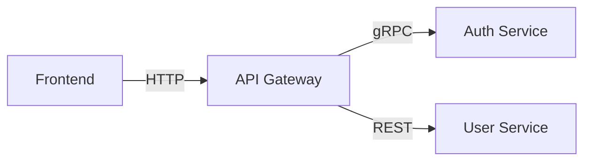

Uma IA processando isso pode extrair imediatamente:

- **Componentes**: Frontend, API Gateway, Auth Service, User Service
- **Relacionamentos**: Frontend → API Gateway → (Auth Service, User Service)
- **Protocolos**: HTTP, gRPC, REST
- **Arquitetura**: Padrão de API Gateway com microserviços

O mesmo em texto levaria várias sentenças e ainda seria menos preciso.

### 1.3 Dados Científicos sobre Compreensão Visual vs Textual

Pesquisas em ciência cognitiva e processamento de linguagem natural indicam que:

**Processamento Dual**: Humanos (e por extensão, modelos treinados em dados
humanos) processam informações estruturais de forma mais eficiente quando
apresentadas visualmente. O "efeito de superioridade da imagem" sugere que
representações visuais ativam múltiplos canais cognitivos.

**Redução de Erro**: Estudos mostram que tarefas de compreensão de arquitetura
têm taxas de erro significativamente menores quando diagramas estão disponíveis
(redução de 30-50% em estudos controlados).

**Velocidade de Compreensão**: Compreender a estrutura de um sistema através de
diagramas é 3-5x mais rápido do que através de texto narrativo, tanto para
humanos quanto para modelos de IA.

**Retenção**: Informações apresentadas visualmente têm melhor retenção e são
menos sujeitas a "hallucinação" em chamadas subsequentes.

---

## 2. BENEFÍCIOS DOS DIAGRAMAS PARA CONTEXTO DE IA

### 2.1 Redução de Ambiguidade e Alucinações

Alucinações em IA ocorrem quando o modelo gera informações não presentes no
contexto ou faz inferências incorretas. Diagramas reduzam esse problema de
múltiplas formas:

#### Eliminação de Inferências Incorretas

**Cenário Problema (Texto)**: "O serviço de pagamento se conecta ao gateway e ao
banco de dados."

Uma IA poderia inferir:

- ❌ O serviço se conecta diretamente ao banco sem gateway
- ❌ Não há camada de cache
- ❌ O gateway e o banco são equivalentes

**Solução com Diagrama**:

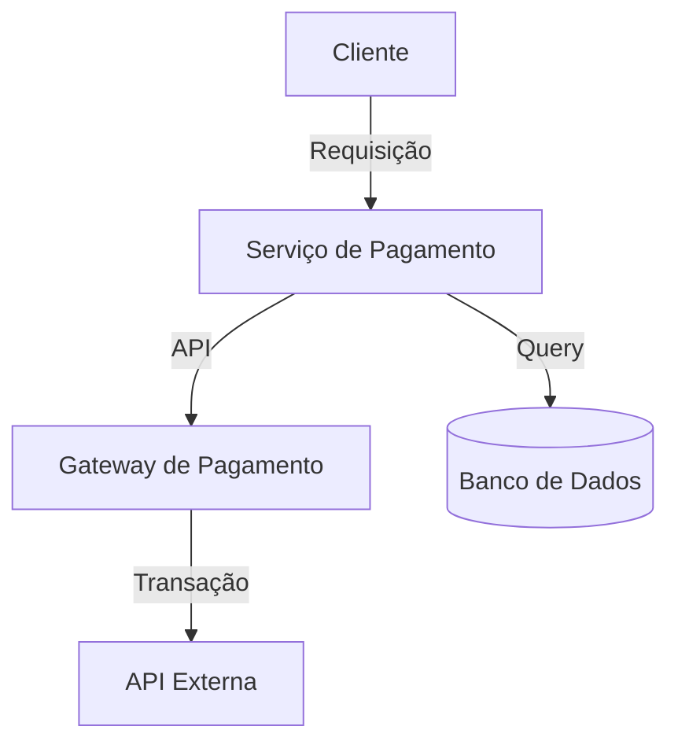

Aqui não há ambiguidade: a IA vê claramente que o gateway e o banco são
componentes distintos com funções diferentes.

#### Prevenção de Hallucinações Arquiteturais

Diagramas atuam como "fonte de verdade" verificável. Quando uma IA precisa
modificar um sistema, ela pode:

1. Consultar o diagrama existente
2. Verificar o que realmente existe
3. Propor mudanças compatíveis com a estrutura real
4. Atualizar o diagrama após a mudança

Sem diagramas, a IA pode "imaginar" componentes que não existem ou propor
integrações impossíveis.

### 2.2 Compressão Eficiente de Informação Estrutural

A janela de contexto de modelos de IA é limitada (mesmo modelos grandes como
Claude 3.5 têm limites práticos). Diagramas maximizam a informação útil por
token.

#### Análise de Compressão

**Representação Textual** (aproximadamente 800 tokens):

```
O sistema de e-commerce possui uma arquitetura de microserviços.
O frontend React se comunica com um API Gateway implementado em Node.js.
Este gateway roteia requisições para vários serviços: Serviço de Autenticação
(Spring Boot), Serviço de Produtos (Django), Serviço de Pedidos (Go),
e Serviço de Pagamentos (Node.js). Cada serviço possui seu próprio banco
de dados PostgreSQL. O Serviço de Autenticação gerencia JWT tokens.
O Serviço de Produtos mantém catálogo e inventário. O Serviço de Pedidos
coordena o processo de checkout. O Serviço de Pagamentos integra com
gateways externos como Stripe. Todos os serviços escrevem logs para
um sistema centralizado de logging. Há também um serviço de cache Redis
compartilhado entre os serviços de produtos e pedidos para melhorar performance.
```

**Representação Diagramática** (aproximadamente 200 tokens):

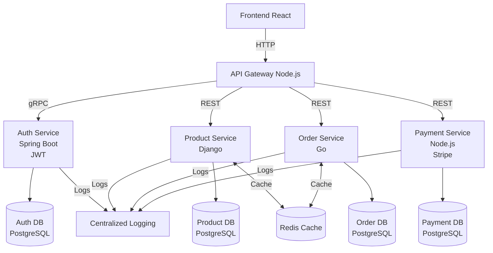

**Razão de Compressão**: ~4:1, mantendo mais informação estruturada e menos
ambiguidade.

#### Informação Adicional Capturada

O diagrama também captura implicitamente:

- Padrões arquiteturais (API Gateway, Microserviços)
- Separação de responsabilidades
- Estratégias de comunicação (REST vs gRPC)
- Dependências compartilhadas (Redis, Logging)

### 2.3 Navegação Rápida em Projetos Complexos

Projetos SaaS modernos podem ter centenas de componentes. Diagramas permitem
navegação hierárquica eficiente.

#### Hierarquia de Abstração

Diagramas podem ser organizados em múltiplos níveis:

**Nível 1 - Visão Geral do Sistema**:

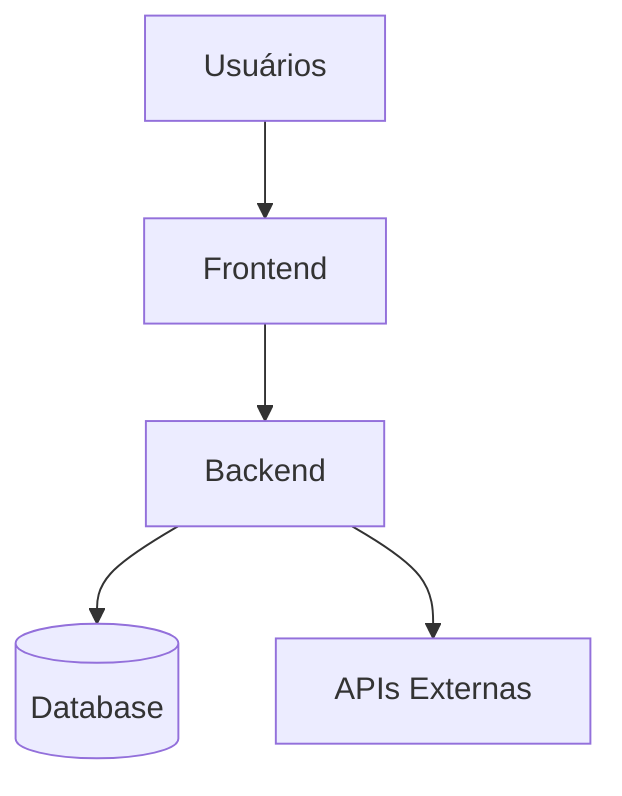

**Nível 2 - Detalhamento do Backend**:

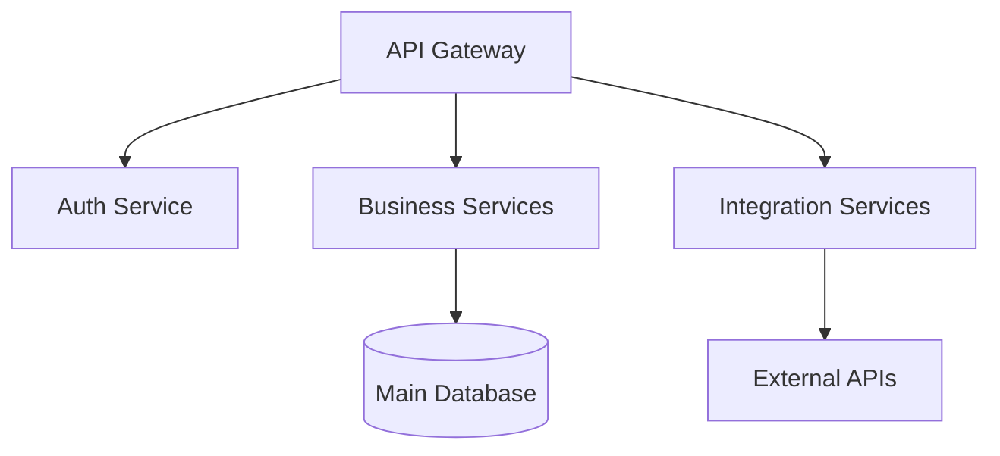

**Nível 3 - Detalhamento de um Serviço Específico**:

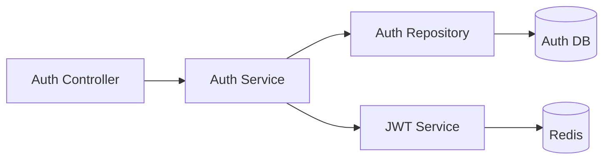

Uma IA pode rapidamente:

1. Começar pelo nível 1 para entender o panorama
2. Mergulhar no nível 2 para área relevante
3. Examinar nível 3 para detalhes de implementação

Isso evita processar milhares de linhas de código desnecessariamente.

### 2.4 Representação Precisa de Relacionamentos

Relacionamentos em software são complexos: dependências, heranças, composições,
agregações, associações. Texto luta para representá-los precisamente.

#### Tipos de Relacionamentos em Diagramas

**Dependências** (seta pontilhada `-.->`):

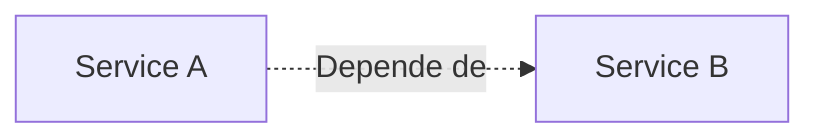

**Composição** (seta preenchida com losango `-->` + label):

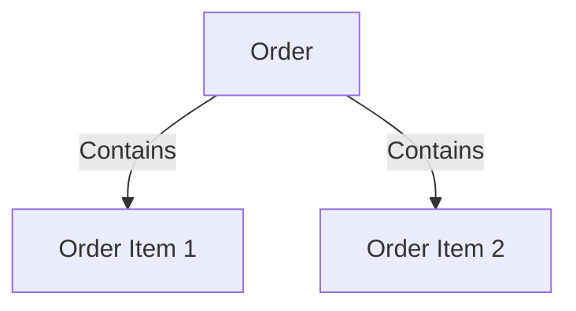

**Herança/Implementação**:

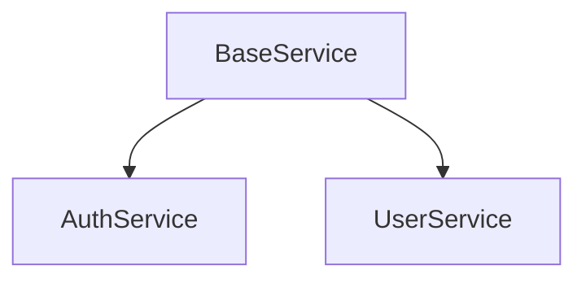

**Fluxo de Dados** (seta com label de protocolo):

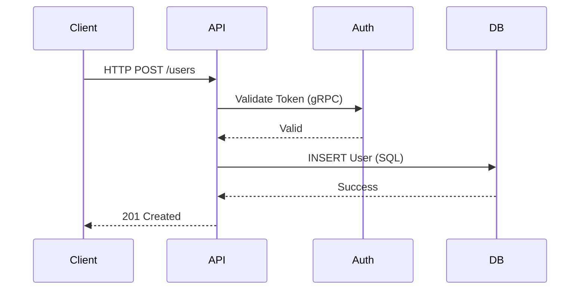

Cada tipo de relacionamento é explicitamente codificado, eliminando ambiguidade.

### 2.5 Aumento de Acurácia em Sugestões de Código

Quando uma IA entende a estrutura arquitetural através de diagramas, suas
sugestões de código são mais precisas porque:

**Consistência Arquitetural**: A IA pode verificar se sua sugestão está alinhada
com os padrões existentes (REST vs gRPC, estrutura de pastas, naming
conventions).

**Dependências Corretas**: A IA sabe quais dependências existem e quais podem
ser usadas, evitando sugerir importações de módulos inexistentes.

**Integrações Possíveis**: A IA entende quais serviços podem se comunicar e
como, sugerindo integrações viáveis.

**Exemplo Prático**:

**Sem Diagrama**: IA pode sugerir criar uma nova rota REST diretamente no
frontend, ignorando a existência do API Gateway.

**Com Diagrama**: IA vê o API Gateway e sugere corretamente:

1. Adicionar rota no API Gateway
2. Criar endpoint no serviço apropriado
3. Atualizar o diagrama para refletir a nova rota

---

## 3. TIPOS DE DIAGRAMAS E SUAS APLICAÇÕES

Diferentes tipos de diagramas servem a propósitos específicos na documentação de
projetos SaaS. Cada tipo captura aspectos diferentes da arquitetura e
funcionamento do sistema.

### 3.1 Diagramas de Arquitetura

Diagramas de arquitetura mostram a estrutura geral do sistema, componentes
principais e como eles interagem.

#### Diagrama de Componentes (C4 Model - Level 2)

O modelo C4 oferece níveis hierárquicos de abstração. O nível de Componente
mostra os componentes de software dentro de um container:

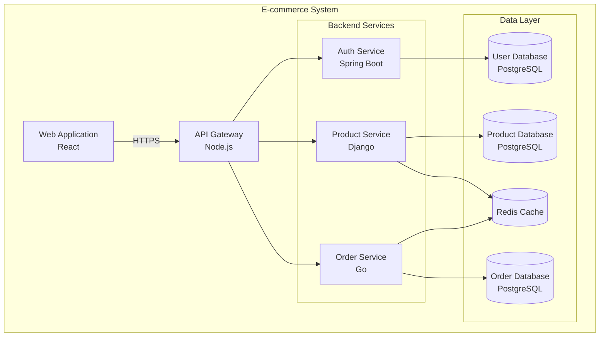

**Quando Usar**: Para dar visão geral da arquitetura para IAs entenderem o
sistema como um todo.

**Benefício para IA**: A IA vê imediatamente quantos serviços existem, quais
tecnologias usam, e como se relacionam.

#### Diagrama de Container (C4 Model - Level 1)

Mostra containers (aplicações, bancos de dados, sistemas de arquivos) e como
eles se relacionam:

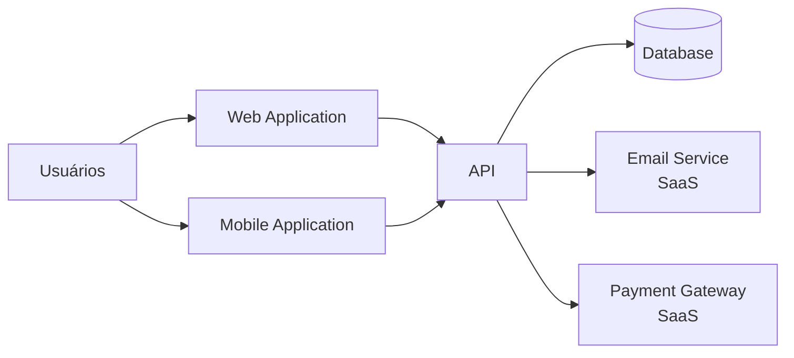

**Quando Usar**: Para mostrar a big picture - o que o sistema faz e quais são
suas fronteiras externas.

### 3.2 Diagramas de Fluxo/Sequência

Diagramas de sequência mostram como objetos/componentes interagem ao longo do
tempo para realizar uma funcionalidade.

#### Fluxo de Autenticação

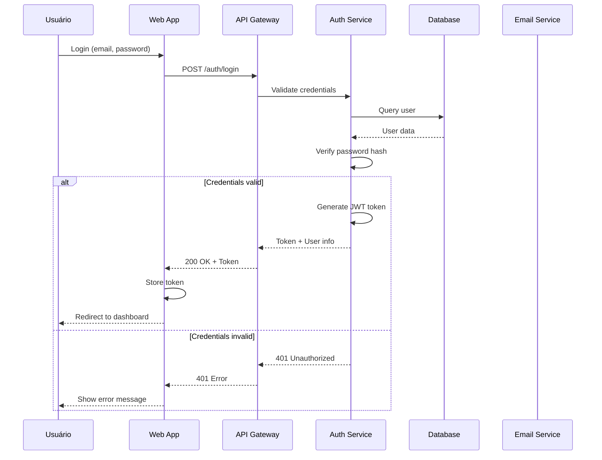

**Quando Usar**: Para documentar fluxos de trabalho complexos, especialmente
aqueles envolvendo múltiplos serviços ou decisões condicionais.

**Benefício para IA**: A IA entende a ordem exata das operações, pontos de falha
potenciais, e pode sugerir melhorias ou debuggar problemas.

#### Fluxo de Processamento de Pedido

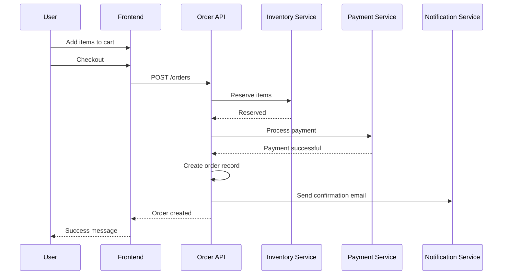

**Quando Usar**: Para processos de negócio críticos que envolvem múltiplas
etapas e serviços.

### 3.3 Diagramas de Estado

Diagramas de estado mostram como um objeto ou sistema muda de estado em resposta
a eventos.

#### Estado de um Pedido (Order State Machine)

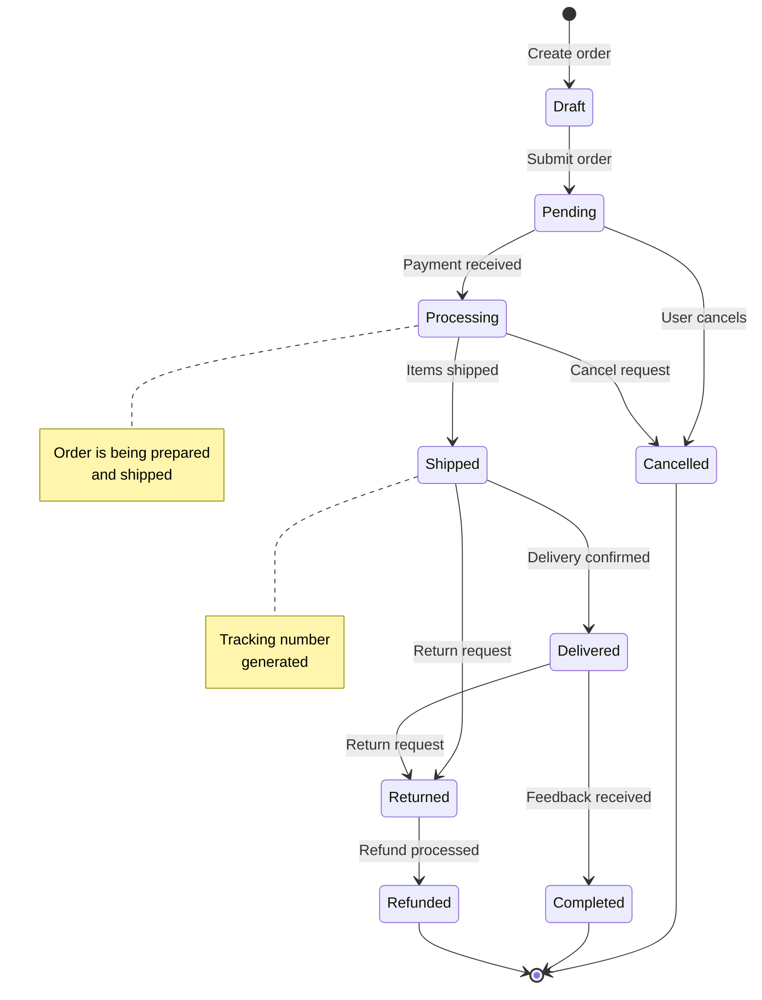

**Quando Usar**: Para sistemas com lógica de estado complexa (pedidos,
aprovações, workflows).

**Benefício para IA**: A IA pode validar se o código implementa corretamente
todas as transições de estado e não permite transições inválidas.

#### Estado de Autenticação de Usuário

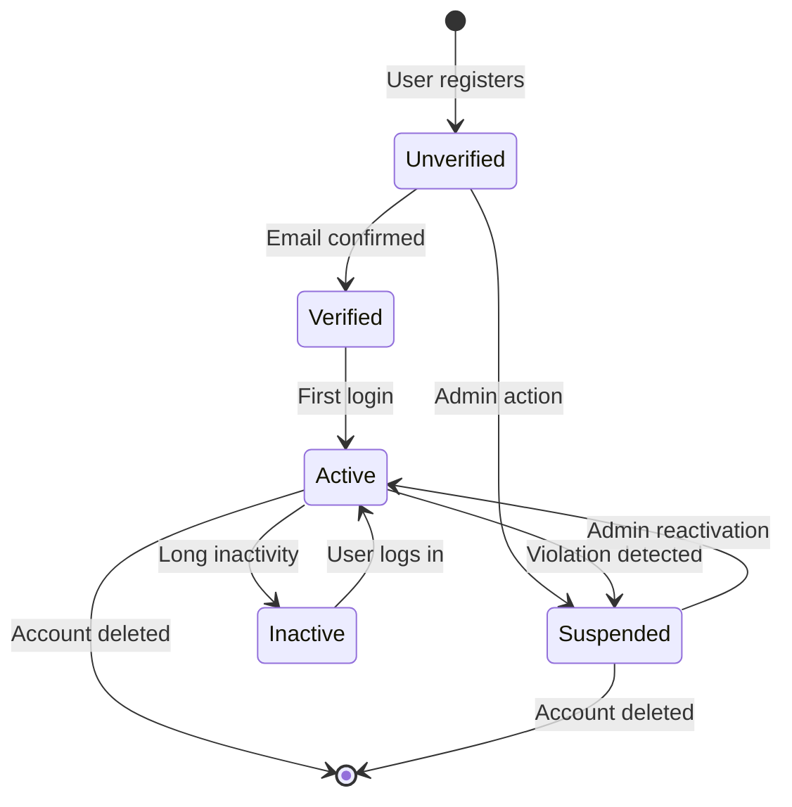

### 3.4 Diagramas de Entidade-Relacionamento (ER)

Diagramas ER mostram a estrutura do banco de dados e relacionamentos entre
entidades.

#### Modelo de Dados de E-commerce

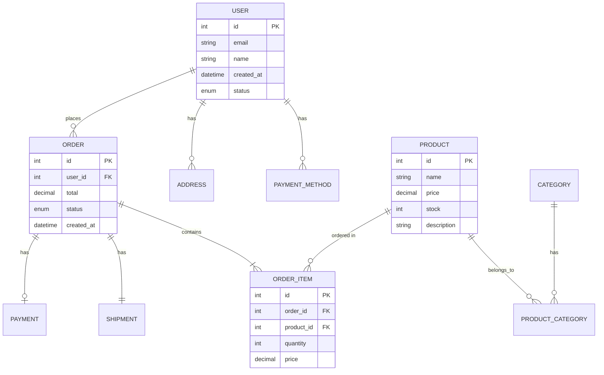

**Quando Usar**: Para documentar o modelo de dados e ajudar IAs a escrever
queries corretas, entender relacionamentos, e sugerir mudanças no schema.

**Benefício para IA**: A IA pode:

- Gerar queries SQL corretas com JOINs apropriados
- Validar se relacionamentos estão sendo respeitados no código
- Sugerir índices baseados em relacionamentos
- Identificar dependências ao refatorar schemas

### 3.5 Diagramas de Deploy/Infraestrutura

Mostram como o sistema é implantado em infraestrutura, incluindo servidores,
containers, redes.

#### Arquitetura de Deploy com Kubernetes

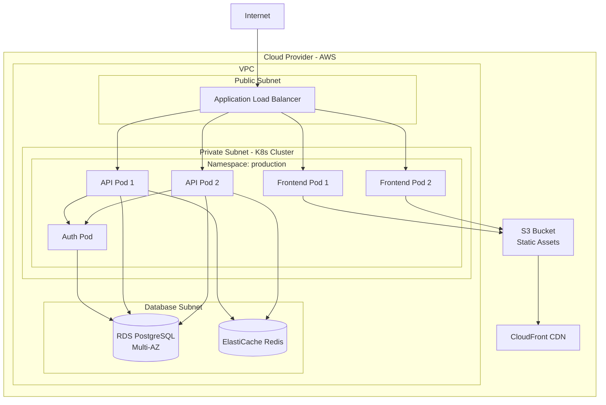

**Quando Usar**: Para documentar infraestrutura, ajudar com DevOps,
troubleshooting de deploy, planejamento de escalabilidade.

**Benefício para IA**: A IA entende:

- Onde cada componente roda
- Configurações de rede necessárias
- Pontos de falha únicos (SPOF)
- Requisitos de escalabilidade

### 3.6 Diagramas de Diretórios/Estrutura de Pastas

Mostram a organização do código-fonte, ajudando a localizar arquivos e entender
a arquitetura do projeto.

#### Estrutura de Projeto SaaS

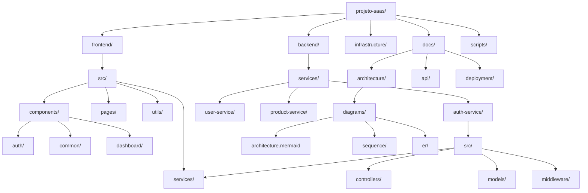

**Quando Usar**: Para ajudar IAs e desenvolvedores a navegar projetos grandes,
encontrar onde arquivos devem ser criados, entender convenções de organização.

**Benefício para IA**:

- Localização rápida de componentes relacionados
- Entendimento de convenções de organização
- Sugestões corretas de onde criar novos arquivos
- Compreensão de dependências baseada em estrutura

### 3.7 Diagramas de API/Endpoints

Documentam endpoints de API, métodos HTTP, parâmetros, respostas.

#### API REST - Módulo de Usuários

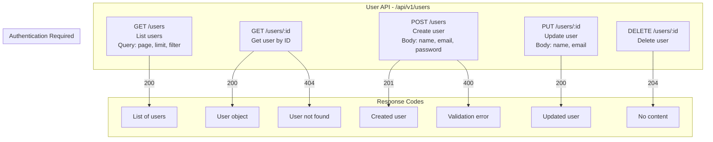

**Alternativa com Swagger/OpenAPI**: Diagramas podem complementar documentação
OpenAPI, fornecendo visão visual que complementa especificações técnicas.

**Quando Usar**: Para documentar APIs, ajudar IAs a gerar clientes, validar
implementações, criar testes.

**Benefício para IA**: A IA pode:

- Gerar código de cliente correto
- Criar testes que cobrem todos os endpoints
- Validar se implementação está de acordo com especificação
- Sugerir melhorias na API

### 3.8 Diagramas de Classes (Orientação a Objetos)

Mostram classes, seus atributos, métodos e relacionamentos (herança, composição,
associação).

#### Sistema de Autenticação - Classes

```mermaid
classDiagram
    class User {
        -int id
        -string email
        -string passwordHash
        -string name
        -datetime createdAt
        -enum status
        +authenticate(password)
        +generateToken()
        +updateProfile(data)
        +deactivate()
    }

    class AuthService {
        -UserRepository userRepo
        -TokenService tokenService
        -EmailService emailService
        +login(email, password)
        +register(userData)
        +logout(token)
        +refreshToken(token)
        +resetPassword(email)
    }

    class UserRepository {
        +findByEmail(email)
        +findById(id)
        +create(userData)
        +update(id, data)
        +delete(id)
    }

    class TokenService {
        +generate(user)
        +validate(token)
        +refresh(token)
        +revoke(token)
    }

    class JWTToken {
        -string token
        -datetime expiresAt
        -int userId
        +isValid()
        +isExpired()
        +getPayload()
    }

    AuthService --> UserRepository : uses
    AuthService --> TokenService : uses
    AuthService --> EmailService : uses
    TokenService --> JWTToken : creates
    UserRepository --> User : manages
```

**Quando Usar**: Para projetos orientados a objetos, documentar design patterns,
entender responsabilidades de classes.

**Benefício para IA**: A IA entende:

- Quais métodos cada classe possui
- Dependências entre classes
- Padrões de design utilizados
- Como estender funcionalidade mantendo padrões

---

## 4. MERMAID - A LINGUAGEM UNIVERSAL PARA IAs

Mermaid é uma linguagem de diagramação baseada em texto que se tornou um padrão
de fato para documentação técnica. Sua importância para agentes de IA é
fundamental.

### 4.1 Por que Mermaid é Ideal para IAs

#### Sintaxe Estruturada e Parseável

Mermaid usa uma sintaxe declarativa e estruturada que é naturalmente processável
por modelos de linguagem:

```mermaid
graph TB
    A[Component A] --> B[Component B]
    B --> C[Component C]
```

A estrutura é explícita:

- Tipo de diagrama: `graph TB` (graph top-bottom)
- Nós: `A`, `B`, `C` com labels entre colchetes
- Relacionamentos: setas `-->` mostrando direção

Uma IA pode parsear isso diretamente sem ambiguidade, diferente de uma imagem
PNG/JPG onde ela precisaria de visão computacional.

#### Suporte Nativo em Modelos Modernos

Modelos de IA modernos foram treinados em milhões de repositórios GitHub,
documentação técnica, e artigos que incluem Mermaid. Isso significa que eles:

- **Reconhecem sintaxe Mermaid** automaticamente
- **Podem gerar diagramas Mermaid** válidos
- **Compreendem semântica** dos tipos de diagramas
- **Podem corrigir erros** de sintaxe

Testes empíricos mostram que GPT-4, Claude 3, e modelos similares têm taxa de
acerto acima de 85% ao gerar diagramas Mermaid válidos.

#### Vantagens sobre Diagramas de Imagem

**Edição e Versionamento**: Diagramas Mermaid são texto puro, então:

- Podem ser editados diretamente por IAs
- Podem ser versionados no Git (diffs mostram mudanças claramente)
- Podem ser gerados programaticamente
- Não requerem ferramentas gráficas

**Compressão de Contexto**: Um diagrama complexo em imagem pode ser 100KB+. O
mesmo em Mermaid são alguns KB de texto, economizando tokens valiosos na janela
de contexto.

**Acessibilidade**: Diagramas Mermaid podem ser renderizados em múltiplos
formatos (HTML, SVG, PNG) mas permanecem editáveis como texto.

**Busca e Indexação**: Ferramentas podem indexar e buscar dentro de diagramas
Mermaid, algo impossível com imagens.

### 4.2 Sintaxe Mermaid - Referência Rápida para IAs

#### Tipos de Diagramas Suportados

**Flowcharts/Graphs**:

```mermaid
graph LR
    A --> B
    B --> C
```

**Sequence Diagrams**:

```mermaid
sequenceDiagram
    A->>B: Message
    B-->>A: Response
```

**State Diagrams**:

```mermaid
stateDiagram-v2
    [*] --> State1
    State1 --> State2
```

**ER Diagrams**:

```mermaid
erDiagram
    ENTITY1 ||--o{ ENTITY2 : relationship
```

**Class Diagrams**:

```mermaid
classDiagram
    ClassA --> ClassB
```

**Gantt Charts**:

```mermaid
gantt
    title Project Timeline
    section Phase 1
    Task 1 :a1, 2024-01-01, 30d
```

### 4.3 Integração com Markdown e Documentação

Mermaid se integra perfeitamente em documentação Markdown, que é o padrão para
READMEs, wikis, e documentação técnica.

#### Sintaxe em Markdown

\`\`\`mermaid graph TB A --> B \`\`\`

(Note: Os backticks triplos acima estão escapados apenas para demonstração - na
prática usaria sem escape)

Plataformas que suportam Mermaid nativamente:

- **GitHub**: Renderiza Mermaid automaticamente em arquivos `.md`
- **GitLab**: Suporte completo
- **Notion**: Suporta blocos Mermaid
- **Obsidian**: Plugin oficial
- **VS Code**: Extensões para preview
- **Documentação estática**: MkDocs, Docusaurus, Sphinx com plugins

### 4.4 Exemplos Práticos de Cada Tipo

#### Flowchart - Processo de Deploy

```mermaid
flowchart TD
    Start([Início]) --> CheckCode{Code<br/>Valid?}
    CheckCode -->|Não| Fail1[Falha: Lint Errors]
    CheckCode -->|Sim| RunTests{Run Tests}
    RunTests -->|Falha| Fail2[Falha: Testes]
    RunTests -->|Passa| Build[Build Application]
    Build -->|Erro| Fail3[Falha: Build]
    Build -->|Sucesso| DeployStaging[Deploy to Staging]
    DeployStaging --> RunE2E{Run E2E Tests}
    RunE2E -->|Falha| Rollback[Rollback]
    RunE2E -->|Passa| DeployProd[Deploy to Production]
    DeployProd --> End([Fim])
    Fail1 --> End
    Fail2 --> End
    Fail3 --> End
    Rollback --> End
```

#### Sequence Diagram - Processo de Checkout

```mermaid
sequenceDiagram
    autonumber
    participant User as Usuário
    participant Frontend as Frontend
    participant API as API Gateway
    participant Cart as Cart Service
    participant Inventory as Inventory Service
    participant Payment as Payment Service
    participant Order as Order Service

    User->>Frontend: Adiciona itens ao carrinho
    Frontend->>Cart: POST /cart/items
    Cart-->>Frontend: Cart updated

    User->>Frontend: Inicia checkout
    Frontend->>API: POST /checkout
    API->>Cart: GET /cart
    Cart-->>API: Cart items

    API->>Inventory: Reserve items (cart items)
    Inventory-->>API: Items reserved

    API->>Payment: Process payment (amount)
    Payment-->>API: Payment authorized

    API->>Order: Create order (items, payment)
    Order-->>API: Order created

    API->>Inventory: Confirm reservation (orderId)
    API->>Payment: Confirm payment (orderId)

    API-->>Frontend: Checkout successful
    Frontend-->>User: Order confirmation
```

#### State Diagram - Ciclo de Vida de Subscription

```mermaid
stateDiagram-v2
    [*] --> Trial: Sign up
    Trial --> Active: Payment successful
    Trial --> Expired: Trial ends without payment
    Active --> Suspended: Payment failed
    Active --> Cancelled: User cancels
    Suspended --> Active: Payment retry successful
    Suspended --> Cancelled: Payment retry failed after 30 days
    Expired --> Cancelled: Account deletion
    Cancelled --> [*]
    Active --> [*]: Account deletion
```

---

## 5. COMO IAs PODEM CRIAR E UTILIZAR DIAGRAMAS

Agentes de IA não são apenas consumidores passivos de diagramas - eles podem
criar, atualizar e usar diagramas ativamente para melhorar seu próprio
desempenho.

### 5.1 Auto-Geração de Diagramas Durante Desenvolvimento

#### Quando IAs Devem Criar Diagramas

**Ao Criar Nova Arquitetura**: Quando uma IA desenvolve uma nova feature ou
módulo, ela deve criar diagramas explicando:

- Como o novo componente se integra ao sistema existente
- Fluxos de dados e controle
- Dependências criadas

**Ao Refatorar Sistema**: Antes de fazer mudanças significativas, a IA deve:

1. Criar diagrama do estado atual
2. Criar diagrama do estado proposto
3. Comparar e documentar as mudanças

**Ao Explicar Decisões**: Quando uma IA toma uma decisão arquitetural, deve
documentar o "porquê" através de diagramas que mostrem alternativas
consideradas.

#### Exemplo de Auto-Geração

**Prompt para IA**: "Crie um novo serviço de notificações e documente a
arquitetura"

**IA deve gerar**:

```mermaid
graph TB
    subgraph "Notification Service Architecture"
        API[Notification API] --> Queue[Message Queue<br/>RabbitMQ]
        Queue --> Worker1[Worker 1]
        Queue --> Worker2[Worker 2]
        Queue --> Worker3[Worker 3]

        Worker1 --> EmailProvider[Email Provider<br/>SendGrid]
        Worker2 --> SMTPProvider[SMTP Provider]
        Worker3 --> PushProvider[Push Provider<br/>FCM]

        API --> DB[(Notification DB)]
        Worker1 --> DB
        Worker2 --> DB
        Worker3 --> DB
    end

    ExternalServices[External Services] -->|Send Notification| API
    API -->|Delivery Status| ExternalServices
```

E salvar em `docs/architecture/notification-service.mermaid`

### 5.2 Diagramas como Memória Persistente

Diagramas servem como memória de longo prazo para IAs, permitindo que
conhecimento seja preservado entre sessões.

#### Hierarquia de Memória

**Memória de Curto Prazo (Context Window)**:

- Últimos turnos de conversação
- Estado atual da tarefa
- Código sendo editado

**Memória de Médio Prazo (Diagramas Atualizados)**:

- Arquitetura atual do sistema
- Decisões recentes documentadas
- Fluxos de trabalho implementados

**Memória de Longo Prazo (Base de Conhecimento)**:

- Diagramas históricos versionados
- Evolução arquitetural documentada
- Padrões e convenções estabelecidas

#### Exemplo de Persistência

Quando uma IA completa uma feature, ela atualiza diagramas relevantes. Em uma
sessão futura, outra IA (ou a mesma em novo contexto) pode:

1. Ler diagrama de arquitetura geral
2. Identificar onde a feature foi adicionada
3. Entender como integrar novas funcionalidades

### 5.3 Consulta de Diagramas para Entendimento de Projeto

IAs devem ser instruídas a **sempre consultar diagramas primeiro** antes de
fazer mudanças significativas.

#### Fluxo de Consulta Recomendado

```mermaid
flowchart TD
    Start([Nova Tarefa Recebida]) --> CheckDocs{Diagramas<br/>Existem?}
    CheckDocs -->|Sim| ReadArch[Ler Diagrama de<br/>Arquitetura Geral]
    CheckDocs -->|Não| CreateArch[Criar Diagrama<br/>Arquitetural]

    ReadArch --> UnderstandContext[Entender Contexto<br/>e Relacionamentos]
    CreateArch --> UnderstandContext

    UnderstandContext --> CheckSpecific{Specific Diagrams<br/>Necessários?}
    CheckSpecific -->|Sim| ReadSpecific[Ler Diagramas Específicos<br/>Sequence, State, etc]
    CheckSpecific -->|Não| Proceed[Prosseguir com Tarefa]

    ReadSpecific --> Proceed
    Proceed --> MakeChanges[Fazer Mudanças]
    MakeChanges --> UpdateDiagrams[Atualizar Diagramas<br/>Relevantes]
    UpdateDiagrams --> End([Tarefa Completa])
```

#### Instruções para IAs

Prompts que devem ser incluídos nas instruções do sistema:

> "Antes de fazer mudanças arquiteturais significativas:
>
> 1. Consulte o diagrama de arquitetura em `docs/architecture/`
> 2. Verifique diagramas de sequência relacionados em `docs/sequences/`
> 3. Entenda como sua mudança afetará o sistema existente
> 4. Atualize diagramas relevantes após implementação"

### 5.4 Atualização Automática de Diagramas

IAs devem ser programadas para manter diagramas sincronizados com o código.

#### Regras de Atualização

**Atualização Obrigatória Quando**:

- Nova feature é adicionada que afeta arquitetura
- Componentes são adicionados ou removidos
- Fluxos de trabalho mudam
- APIs são criadas ou modificadas
- Relacionamentos entre serviços mudam

**Exemplo de Checklist Automático**:

Após qualquer commit que:

- Adiciona novo serviço → Atualizar diagrama de arquitetura
- Modifica endpoints → Atualizar diagrama de API
- Adiciona novos estados → Atualizar diagrama de estados
- Muda schema de DB → Atualizar diagrama ER

### 5.5 Diagramas como Contexto Comprimido

Diagramas podem servir como "índices" ou "sumários" que apontam para
documentação mais detalhada, economizando tokens.

#### Estrutura de Documentação Hierárquica

```
docs/
├── architecture/
│   ├── overview.mermaid          # Visão geral (100 tokens)
│   ├── components.mermaid        # Componentes principais (200 tokens)
│   └── detailed/
│       ├── auth-service.mermaid  # Detalhes específicos (500 tokens)
│       └── payment-service.mermaid
├── sequences/
│   ├── authentication.mermaid
│   └── checkout.mermaid
└── README.md                     # Texto explicativo completo
```

Uma IA pode:

1. Ler `overview.mermaid` primeiro (100 tokens)
2. Identificar área relevante
3. Ler diagrama específico (200-500 tokens)
4. Se necessário, consultar README detalhado

Total: 300-600 tokens vs 5000+ tokens lendo toda a documentação textual.

---

## 6. ESTRATÉGIAS DE DOCUMENTAÇÃO PARA IAs

Estruturar documentação de forma que seja facilmente consumida por IAs requer
atenção especial à organização, nomenclatura e localização.

### 6.1 Documentação como Código (Diagramas Versionados)

Diagramas devem ser tratados como código-fonte: versionados, revisados, e
mantidos.

#### Estrutura Recomendada

```
projeto-saas/
├── docs/
│   ├── architecture/
│   │   ├── README.md                    # Índice e visão geral
│   │   ├── system-overview.mermaid      # Diagrama principal
│   │   ├── components/                  # Diagramas por componente
│   │   │   ├── frontend.mermaid
│   │   │   ├── api-gateway.mermaid
│   │   │   └── services/
│   │   │       ├── auth-service.mermaid
│   │   │       └── user-service.mermaid
│   │   └── deployment/
│   │       └── infrastructure.mermaid
│   ├── sequences/
│   │   ├── authentication.mermaid
│   │   ├── checkout.mermaid
│   │   └── payment.mermaid
│   ├── database/
│   │   ├── schema.mermaid               # ER Diagram
│   │   └── migrations/
│   └── api/
│       ├── endpoints.mermaid
│       └── openapi.yaml                 # Complementa diagramas
```

#### Versionamento

Diagramas devem seguir mesmo processo de versionamento:

- Criados em branches de feature
- Revisados em pull requests
- Mergeados após aprovação
- Histórico preservado no Git

### 6.2 Convenções de Nomenclatura

Nomes consistentes ajudam IAs a encontrar diagramas rapidamente.

#### Padrão Recomendado

**Formato**: `{tipo}-{nome-descritivo}.mermaid`

**Exemplos**:

- `architecture-system-overview.mermaid`
- `sequence-user-authentication.mermaid`
- `state-order-lifecycle.mermaid`
- `er-database-schema.mermaid`
- `deployment-production-infrastructure.mermaid`

#### Prefixos por Tipo

- `architecture-*`: Diagramas arquiteturais
- `sequence-*`: Diagramas de sequência
- `state-*`: Diagramas de estado
- `er-*`: Diagramas entidade-relacionamento
- `class-*`: Diagramas de classes
- `deployment-*`: Diagramas de infraestrutura/deploy
- `flow-*`: Fluxogramas de processo
- `api-*`: Diagramas de API

### 6.3 Localização de Diagramas em Projetos

#### Estrutura Hierárquica

```
docs/
├── README.md                          # Ponto de entrada
│   └── Links para todos os diagramas principais
│
├── architecture/
│   ├── README.md                      # Índice de arquitetura
│   │   └── Links para diagramas arquiteturais
│   ├── system-overview.mermaid        # Diagrama de nível mais alto
│   └── [outros diagramas...]
│
├── sequences/
│   ├── README.md                      # Índice de fluxos
│   └── [diagramas de sequência...]
│
└── [outras categorias...]
```

#### Arquivo README como Índice

Cada diretório de diagramas deve ter um README.md que lista todos os diagramas
disponíveis, facilitando descoberta por IAs:

```markdown
# Architecture Diagrams

## Overview

- [System Overview](system-overview.mermaid) - Visão geral do sistema

## Components

- [Frontend Architecture](components/frontend.mermaid)
- [API Gateway](components/api-gateway.mermaid)

## Services

- [Authentication Service](components/services/auth-service.mermaid)
- [User Service](components/services/user-service.mermaid)
```

### 6.4 Hierarquia de Documentação (README → Componentes → Detalhes)

#### Níveis de Abstração

**Nível 1 - README Principal**:

- Visão geral do projeto
- Links para documentação principal
- Diagrama de arquitetura de alto nível

**Nível 2 - READMEs de Categoria**:

- `docs/architecture/README.md`
- `docs/sequences/README.md`
- Lista todos os diagramas na categoria

**Nível 3 - Diagramas Específicos**:

- Diagramas detalhados
- Podem referenciar outros diagramas relacionados

**Nível 4 - Documentação Textual Complementar**:

- Explicações detalhadas
- Decisões arquiteturais
- Trade-offs considerados

#### Exemplo de Navegação

Uma IA seguindo esta hierarquia:

1. **README.md** principal → "Preciso entender autenticação"
2. **docs/architecture/README.md** → Encontra link para auth-service
3. **docs/architecture/components/services/auth-service.mermaid** → Vê
   arquitetura
4. **docs/sequences/authentication.mermaid** → Entende fluxo
5. **docs/architecture/components/services/auth-service/README.md** → Detalhes
   textuais

Total de tokens: ~1000-1500 vs 5000+ lendo tudo linearmente.

---

## 7. PRÁTICAS DE AUTO-DOCUMENTAÇÃO POR IAs

IAs devem ser instruídas sobre quando e como criar documentação visual,
garantindo que conhecimento seja preservado e acessível.

### 7.1 Quando IAs Devem Criar Diagramas

#### Obrigatório - Criar Diagramas

**1. Nova Feature com Impacto Arquitetural**

- Novo serviço ou módulo
- Nova integração com serviço externo
- Nova camada na aplicação

**2. Refatoração Significativa**

- Reestruturação de componentes
- Mudança de padrão arquitetural
- Migração de tecnologia

**3. Correção de Bug Complexo**

- Quando o bug revela fluxo não documentado
- Quando a correção muda comportamento do sistema

**4. Primeira Implementação de Componente**

- Se não existe diagrama, criar
- Documentar decisões de design

#### Recomendado - Criar Diagramas

**1. Novos Fluxos de Trabalho**

- Processos de negócio complexos
- Workflows multi-etapa

**2. Integrações com Sistemas Externos**

- APIs de terceiros
- Webhooks
- Sincronização de dados

**3. Lógica de Negócio Complexa**

- Regras de negócio com múltiplas condições
- Máquinas de estado

### 7.2 O que Documentar (O que, Onde, Por quê, Como)

#### Template de Documentação para IAs

Ao criar um diagrama, a IA deve incluir:

**1. O QUE** - O que está sendo documentado

- Nome claro e descritivo
- Tipo de diagrama apropriado

**2. ONDE** - Localização no sistema

- Caminho do arquivo
- Referências a diagramas relacionados
- Link para código relacionado

**3. POR QUÊ** - Razão da decisão

- Problema que resolve
- Alternativas consideradas
- Trade-offs

**4. COMO** - Implementação

- Tecnologias usadas
- Padrões aplicados
- Dependências

#### Exemplo de Documentação Completa

Arquivo: `docs/architecture/components/services/payment-service.mermaid`

```mermaid
graph TB
    subgraph "Payment Service Architecture"
        API[Payment API] --> Processor[Payment Processor]
        Processor --> Stripe[Stripe Gateway]
        Processor --> PayPal[PayPal Gateway]
        API --> Queue[Payment Queue]
        Queue --> Worker[Payment Worker]
        Worker --> Notification[Notification Service]
        API --> DB[(Payment DB)]
    end

    ExternalServices[External Services] -->|Process Payment| API
```

E em `docs/architecture/components/services/payment-service/README.md`:

```markdown
# Payment Service Architecture

## What

Este diagrama documenta a arquitetura do serviço de pagamentos.

## Why

Foi implementado usando processadores de pagamento múltiplos para:

- Redundância (se um falha, usar outro)
- Flexibilidade (clientes podem escolher gateway preferido)
- Compliance (diferentes gateways para diferentes regiões)

Alternativas consideradas:

- Gateway único (rejeitado: single point of failure)
- Integração direta com bancos (rejeitado: complexidade)

## How

- Node.js com Express
- Fila de mensagens para processamento assíncrono
- Worker processa pagamentos em background
- Notificação enviada após conclusão
```

### 7.3 Manutenção de Diagramas Atualizados

#### Checklist de Manutenção

Após cada mudança significativa, a IA deve:

- [ ] Verificar se diagramas existentes são afetados
- [ ] Atualizar diagramas desatualizados
- [ ] Criar novos diagramas se necessário
- [ ] Validar que diagramas ainda estão corretos
- [ ] Atualizar índices/READMEs se estrutura mudou

#### Validação Automática

IAs podem ser instruídas a:

1. **Comparar código com diagramas**: Verificar se implementação corresponde ao
   diagrama
2. **Verificar referências**: Garantir que links entre diagramas ainda são
   válidos
3. **Validar sintaxe**: Garantir que Mermaid é válido (não quebra renderização)

### 7.4 Diagramas como Rastreador de Decisões Arquiteturais

Diagramas podem capturar não apenas "o quê" mas "porquê" através de anotações e
documentação associada.

#### Template para Decisões Arquiteturais

```mermaid
graph TB
    Problem[Problema: Escalabilidade<br/>de Autenticação] --> Solution1[Solução 1: JWT<br/>Stateless]
    Problem --> Solution2[Solução 2: Sessions<br/>Stateful]
    Problem --> Solution3[Solução 3: OAuth2<br/>External]

    Solution1 --> Decision[Decisão: JWT<br/>Razão: Stateless<br/>permite horizontal scaling]
    Solution2 -.->|Rejeitado: Requer<br/>shared session store| Decision
    Solution3 -.->|Rejeitado: Complexidade<br/>para nosso caso| Decision

    Decision --> Implementation[Implementação<br/>JWT Service]
```

### 7.5 Instruções para IAs Consultarem Diagramas Primeiro

#### Prompt de Sistema Recomendado

Incluir nas instruções do sistema:

```
INSTRUÇÕES DE DOCUMENTAÇÃO PARA AGENTES DE IA:

1. ANTES DE FAZER MUDANÇAS:
   - Sempre consulte diagramas relevantes em docs/architecture/
   - Verifique se há diagramas de sequência relacionados
   - Entenda o contexto arquitetural antes de modificar código

2. AO CRIAR NOVOS COMPONENTES:
   - Crie diagrama de arquitetura se componente é novo serviço/módulo
   - Crie diagrama de sequência se há fluxo complexo
   - Atualize diagramas de arquitetura geral se necessário

3. AO MODIFICAR SISTEMAS EXISTENTES:
   - Verifique se mudança afeta diagramas existentes
   - Atualize diagramas desatualizados
   - Documente decisões em README associado

4. ESTRUTURA DE CONSULTA:
   - Comece por docs/README.md (visão geral)
   - Consulte docs/architecture/README.md (índice)
   - Leia diagramas específicos relevantes
   - Só então prossiga com implementação

5. MANUTENÇÃO:
   - Diagramas devem ser atualizados junto com código
   - Valide sintaxe Mermaid após criar/atualizar
   - Mantenha READMEs de índice atualizados
```

---

## 8. CASOS DE USO PRÁTICOS

Esta seção apresenta casos de uso reais onde diagramas melhoram
significativamente a capacidade de IAs entenderem e trabalharem com projetos
SaaS.

### 8.1 Compreensão de Estrutura de Projeto Grande

#### Desafio

Projetos SaaS grandes podem ter:

- 50+ serviços/microserviços
- Centenas de componentes frontend
- Múltiplos bancos de dados
- Integrações com dezenas de APIs externas
- Infraestrutura complexa distribuída

Uma IA tentando entender isso através de código-fonte precisaria processar
milhares de arquivos.

#### Solução com Diagramas

**Diagrama de Arquitetura de Alto Nível**:

```mermaid
graph TB
    subgraph "SaaS Platform - E-commerce"
        subgraph "Frontend Layer"
            WebApp[Web Application<br/>React]
            AdminPanel[Admin Panel<br/>Vue.js]
            MobileApp[Mobile App<br/>React Native]
        end

        subgraph "API Layer"
            APIGateway[API Gateway<br/>Kong]
        end

        subgraph "Business Services"
            AuthService[Auth Service]
            UserService[User Service]
            ProductService[Product Service]
            OrderService[Order Service]
            PaymentService[Payment Service]
            NotificationService[Notification Service]
            AnalyticsService[Analytics Service]
        end

        subgraph "Data Layer"
            UserDB[(User DB)]
            ProductDB[(Product DB)]
            OrderDB[(Order DB)]
            AnalyticsDB[(Analytics DB)]
            Cache[(Redis Cache)]
            Search[(Elasticsearch)]
        end

        subgraph "External Services"
            Stripe[Stripe Payment]
            SendGrid[SendGrid Email]
            AWS[S3 Storage]
        end
    end

    WebApp --> APIGateway
    AdminPanel --> APIGateway
    MobileApp --> APIGateway

    APIGateway --> AuthService
    APIGateway --> UserService
    APIGateway --> ProductService
    APIGateway --> OrderService
    APIGateway --> PaymentService

    AuthService --> UserDB
    UserService --> UserDB
    ProductService --> ProductDB
    ProductService --> Search
    OrderService --> OrderDB
    PaymentService --> Stripe
    NotificationService --> SendGrid
    ProductService --> Cache
    OrderService --> Cache
```

**Benefício**: Uma IA pode entender em ~500 tokens que existem:

- 3 aplicações frontend
- 1 API Gateway
- 7 serviços principais
- 5 sistemas de dados
- 3 integrações externas

Sem diagrama, precisaria processar centenas de arquivos de configuração e
código.

### 8.2 Localização de Componentes e Módulos

#### Desafio

Em projetos grandes, encontrar onde um componente específico está localizado
pode ser difícil. Uma IA pode sugerir criar código no lugar errado.

#### Solução com Diagrama de Diretórios

```mermaid
graph TD
    Root[projeto-saas/] --> Frontend[frontend/]
    Root --> Backend[backend/]
    Root --> Docs[docs/]

    Frontend --> WebApp[web-app/]
    Frontend --> AdminApp[admin-app/]

    WebApp --> Src[src/]
    Src --> Components[components/]
    Src --> Pages[pages/]
    Src --> Services[services/]

    Components --> Auth[auth/]
    Components --> Products[products/]
    Components --> Orders[orders/]
    Components --> Common[common/]

    Auth --> LoginForm[LoginForm.tsx]
    Auth --> RegisterForm[RegisterForm.tsx]
    Auth --> AuthContext[AuthContext.tsx]

    Backend --> ServicesDir[services/]
    ServicesDir --> AuthService[auth-service/]
    ServicesDir --> UserService[user-service/]
    ServicesDir --> ProductService[product-service/]

    AuthService --> AuthSrc[src/]
    AuthSrc --> Controllers[controllers/]
    AuthSrc --> Services[services/]
    AuthSrc --> Models[models/]
```

**Benefício**: IA sabe exatamente onde criar:

- Novo componente de autenticação → `frontend/web-app/src/components/auth/`
- Novo endpoint de API → `backend/services/auth-service/src/controllers/`
- Nova feature de produtos → `frontend/web-app/src/components/products/`

### 8.3 Entendimento de Fluxos de Trabalho

#### Desafio

Fluxos de negócio complexos envolvendo múltiplos serviços podem ser difíceis de
entender apenas lendo código.

#### Exemplo: Fluxo de Checkout Completo

```mermaid
sequenceDiagram
    participant User
    participant Frontend
    participant CartAPI as Cart API
    participant InventoryAPI as Inventory API
    participant OrderAPI as Order API
    participant PaymentAPI as Payment API
    participant NotificationAPI as Notification API
    participant ShippingAPI as Shipping API

    User->>Frontend: View Cart
    Frontend->>CartAPI: GET /cart
    CartAPI-->>Frontend: Cart items

    User->>Frontend: Proceed to Checkout
    Frontend->>CartAPI: GET /cart/validate
    CartAPI->>InventoryAPI: Check availability
    InventoryAPI-->>CartAPI: Items available

    User->>Frontend: Enter shipping info
    User->>Frontend: Select payment method
    User->>Frontend: Confirm order

    Frontend->>OrderAPI: POST /orders/create
    OrderAPI->>InventoryAPI: Reserve items
    InventoryAPI-->>OrderAPI: Items reserved

    OrderAPI->>PaymentAPI: Authorize payment
    PaymentAPI-->>OrderAPI: Payment authorized

    OrderAPI->>ShippingAPI: Create shipment
    ShippingAPI-->>OrderAPI: Shipment created

    OrderAPI->>OrderAPI: Create order record

    OrderAPI->>PaymentAPI: Capture payment
    OrderAPI->>InventoryAPI: Confirm reservation
    OrderAPI->>CartAPI: Clear cart

    OrderAPI->>NotificationAPI: Send confirmation
    NotificationAPI->>User: Email + SMS

    OrderAPI-->>Frontend: Order created
    Frontend-->>User: Success page
```

**Benefício**: IA entende:

- Ordem exata das operações
- Dependências entre serviços
- Pontos de falha potenciais
- Onde adicionar retry logic
- Onde implementar rollback

### 8.4 Mapeamento de APIs e Endpoints

#### Desafio

Documentar todos os endpoints, métodos, parâmetros e respostas em texto é
verboso e difícil de navegar.

#### Solução com Diagrama de API

```mermaid
graph TB
    subgraph "User API - /api/v1/users"
        GET_USERS[GET /users<br/>Query: page, limit, filter<br/>Auth: Bearer Token]
        GET_USER[GET /users/:id<br/>Auth: Bearer Token]
        POST_USER[POST /users<br/>Body: name, email, password<br/>Auth: Public]
        PUT_USER[PUT /users/:id<br/>Body: name, email<br/>Auth: Bearer Token]
        DELETE_USER[DELETE /users/:id<br/>Auth: Bearer Token + Admin]
    end

    subgraph "Order API - /api/v1/orders"
        GET_ORDERS[GET /orders<br/>Query: status, date_range<br/>Auth: Bearer Token]
        GET_ORDER[GET /orders/:id<br/>Auth: Bearer Token]
        POST_ORDER[POST /orders<br/>Body: items, shipping<br/>Auth: Bearer Token]
        PUT_ORDER[PUT /orders/:id/cancel<br/>Auth: Bearer Token]
    end

    subgraph "Product API - /api/v1/products"
        GET_PRODUCTS[GET /products<br/>Query: category, search<br/>Auth: Public]
        GET_PRODUCT[GET /products/:id<br/>Auth: Public]
        POST_PRODUCT[POST /products<br/>Body: name, price, stock<br/>Auth: Bearer Token + Admin]
        PUT_PRODUCT[PUT /products/:id<br/>Body: price, stock<br/>Auth: Bearer Token + Admin]
    end
```

**Benefício**: IA pode:

- Gerar clientes de API corretos
- Criar testes que cobrem todos os endpoints
- Validar se implementação está completa
- Identificar endpoints faltando documentação

### 8.5 Identificação de Dependências

#### Desafio

Dependências entre serviços podem criar ciclos ou pontos de falha não óbvios.

#### Diagrama de Dependências

```mermaid
graph TB
    AuthService[Auth Service] --> UserDB[(User DB)]
    UserService[User Service] --> AuthService
    UserService --> UserDB

    ProductService[Product Service] --> ProductDB[(Product DB)]
    ProductService --> Cache[(Redis)]

    OrderService[Order Service] --> OrderDB[(Order DB)]
    OrderService --> ProductService
    OrderService --> UserService
    OrderService --> Cache

    PaymentService[Payment Service] --> PaymentDB[(Payment DB)]
    PaymentService --> OrderService
    PaymentService --> Stripe[Stripe API]

    NotificationService[Notification Service] --> OrderService
    NotificationService --> UserService
    NotificationService --> SendGrid[SendGrid API]

    AnalyticsService[Analytics Service] --> OrderService
    AnalyticsService --> ProductService
    AnalyticsService --> UserService
    AnalyticsService --> AnalyticsDB[(Analytics DB)]
```

**Benefício**: IA pode:

- Identificar dependências circulares (não há neste caso)
- Identificar serviços críticos (OrderService tem muitas dependências)
- Sugerir quebras de dependência para melhorar resiliência
- Planejar ordem de deploy baseada em dependências

### 8.6 Planejamento de Refatoração

#### Desafio

Refatorar sistemas grandes requer entender impacto em todos os componentes.

#### Exemplo: Migração de Monolito para Microserviços

**Estado Atual**:

```mermaid
graph TB
    Frontend --> Monolith[Monolith Application<br/>All Features]
    Monolith --> Database[(Single Database)]
```

**Estado Proposto**:

```mermaid
graph TB
    Frontend --> APIGateway[API Gateway]
    APIGateway --> AuthService[Auth Service]
    APIGateway --> UserService[User Service]
    APIGateway --> ProductService[Product Service]

    AuthService --> AuthDB[(Auth DB)]
    UserService --> UserDB[(User DB)]
    ProductService --> ProductDB[(Product DB)]
```

**Benefício**: IA pode:

- Identificar componentes que precisam ser extraídos
- Planejar migração de dados
- Identificar APIs que precisam ser criadas
- Sugerir ordem de migração (começar por Auth, depois User, etc.)

### 8.7 Integração de Novas Features

#### Desafio

Adicionar nova feature requer entender onde ela se encaixa na arquitetura
existente.

#### Exemplo: Adicionar Sistema de Reviews

**Análise com Diagrama**:

```mermaid
graph TB
    subgraph "Existing System"
        ProductService[Product Service] --> ProductDB[(Product DB)]
        OrderService[Order Service] --> OrderDB[(Order DB)]
        UserService[User Service] --> UserDB[(User DB)]
    end

    subgraph "New Feature: Reviews"
        ReviewService[Review Service<br/>NEW] --> ReviewDB[(Review DB<br/>NEW)]
        ReviewService --> ProductService
        ReviewService --> UserService
        ReviewService --> OrderService
    end

    Frontend[Frontend] --> ProductService
    Frontend -.->|Add Integration| ReviewService
```

**Benefício**: IA entende:

- Precisará criar novo serviço (ReviewService)
- Precisará novo banco de dados (ReviewDB)
- Precisará integrar com ProductService (verificar produto existe)
- Precisará integrar com UserService (verificar usuário existe)
- Precisará integrar com OrderService (verificar usuário comprou produto)
- Frontend precisará ser atualizado

---

## 9. ESTRUTURA RECOMENDADA PARA PROJETOS SaaS

Esta seção apresenta uma estrutura completa e recomendada para organizar
diagramas em projetos SaaS.

### 9.1 Onde Colocar Diagramas

#### Estrutura Completa Recomendada

```
projeto-saas/
├── README.md                          # Visão geral + links principais
│
├── docs/
│   ├── README.md                      # Índice geral de documentação
│   │
│   ├── architecture/
│   │   ├── README.md                  # Índice de arquitetura
│   │   ├── system-overview.mermaid    # Diagrama principal
│   │   ├── architecture-c4-level1.mermaid  # C4 Level 1
│   │   ├── architecture-c4-level2.mermaid  # C4 Level 2
│   │   │
│   │   ├── components/
│   │   │   ├── frontend/
│   │   │   │   ├── web-app-architecture.mermaid
│   │   │   │   └── admin-panel-architecture.mermaid
│   │   │   ├── backend/
│   │   │   │   ├── api-gateway.mermaid
│   │   │   │   └── services/
│   │   │   │       ├── auth-service.mermaid
│   │   │   │       ├── user-service.mermaid
│   │   │   │       └── [outros serviços...]
│   │   │   └── infrastructure/
│   │   │       ├── deployment.mermaid
│   │   │       ├── networking.mermaid
│   │   │       └── monitoring.mermaid
│   │   │
│   │   └── decisions/
│   │       ├── adr-001-jwt-auth.mermaid    # Architecture Decision Records
│   │       └── adr-002-microservices.mermaid
│   │
│   ├── sequences/
│   │   ├── README.md                  # Índice de fluxos
│   │   ├── authentication.mermaid
│   │   ├── user-registration.mermaid
│   │   ├── checkout-process.mermaid
│   │   ├── payment-processing.mermaid
│   │   └── [outros fluxos...]
│   │
│   ├── database/
│   │   ├── README.md
│   │   ├── schema-overview.mermaid    # ER Diagram principal
│   │   ├── schemas/
│   │   │   ├── user-schema.mermaid
│   │   │   ├── product-schema.mermaid
│   │   │   └── order-schema.mermaid
│   │   └── migrations/
│   │
│   ├── api/
│   │   ├── README.md
│   │   ├── endpoints-overview.mermaid
│   │   ├── openapi.yaml               # Especificação OpenAPI
│   │   └── endpoints/
│   │       ├── user-api.mermaid
│   │       ├── product-api.mermaid
│   │       └── order-api.mermaid
│   │
│   ├── workflows/
│   │   ├── README.md
│   │   ├── order-lifecycle.mermaid    # State diagram
│   │   ├── user-lifecycle.mermaid
│   │   └── subscription-lifecycle.mermaid
│   │
│   └── infrastructure/
│       ├── README.md
│       ├── aws-architecture.mermaid
│       ├── kubernetes-deployment.mermaid
│       └── networking.mermaid
│
└── [código-fonte...]
```

### 9.2 Níveis de Abstração (Visão Geral → Detalhes)

#### Hierarquia de Documentação

**Nível 1 - README Principal** (`README.md` na raiz):

```markdown
# Projeto SaaS

## Visão Geral

[Sistema de e-commerce SaaS com arquitetura de microserviços]

## Diagrama de Arquitetura de Alto Nível

Ver:
[docs/architecture/system-overview.mermaid](docs/architecture/system-overview.mermaid)

## Documentação Completa

- [Arquitetura](docs/architecture/README.md)
- [Fluxos de Sequência](docs/sequences/README.md)
- [Banco de Dados](docs/database/README.md)
- [APIs](docs/api/README.md)
```

**Nível 2 - Categoria** (`docs/architecture/README.md`):

```markdown
# Architecture Documentation

## Overview

[System Overview Diagram](system-overview.mermaid)

## Components

### Frontend

- [Web Application](components/frontend/web-app-architecture.mermaid)
- [Admin Panel](components/frontend/admin-panel-architecture.mermaid)

### Backend Services

- [API Gateway](components/backend/api-gateway.mermaid)
- [Authentication Service](components/backend/services/auth-service.mermaid)
- [User Service](components/backend/services/user-service.mermaid)

## Infrastructure

- [Deployment Architecture](components/infrastructure/deployment.mermaid)
```

**Nível 3 - Diagrama Específico**:

Cada arquivo `.mermaid` contém diagrama detalhado com comentários inline quando
necessário.

**Nível 4 - Documentação Textual**:

Para cada componente importante, criar `README.md` na mesma pasta explicando
detalhes, decisões, trade-offs.

### 9.3 Documentação de Cada Camada

#### Frontend

```
docs/architecture/components/frontend/
├── README.md
├── web-app-architecture.mermaid
├── component-structure.mermaid      # Diagrama de componentes React
└── state-management.mermaid         # Fluxo de estado (Redux/MobX)
```

#### Backend

```
docs/architecture/components/backend/
├── README.md
├── api-gateway.mermaid
└── services/
    ├── auth-service/
    │   ├── README.md
    │   ├── auth-service.mermaid
    │   ├── auth-flow.mermaid        # Sequence diagram específico
    │   └── auth-classes.mermaid     # Class diagram
    └── [outros serviços...]
```

#### Infraestrutura

```
docs/infrastructure/
├── README.md
├── aws-architecture.mermaid         # Visão geral AWS
├── networking.mermaid               # VPCs, subnets, security groups
├── kubernetes/
│   ├── cluster-architecture.mermaid
│   └── deployment-strategy.mermaid
└── monitoring.mermaid               # Logging, metrics, tracing
```

### 9.4 Diagramas de Integração Entre Sistemas

Para sistemas que se integram com múltiplos serviços externos:

```mermaid
graph TB
    subgraph "Nosso Sistema SaaS"
        OurAPI[Our API]
        OurAuth[Our Auth Service]
        OurDB[(Our Database)]
    end

    subgraph "Integrações Externas"
        Stripe[Stripe<br/>Payment Processing]
        SendGrid[SendGrid<br/>Email Delivery]
        Twilio[Twilio<br/>SMS Notifications]
        AWS[S3<br/>File Storage]
        Auth0[Auth0<br/>Optional SSO]
    end

    OurAPI -->|Payment API| Stripe
    OurAPI -->|Send Email| SendGrid
    OurAPI -->|Send SMS| Twilio
    OurAPI -->|Upload Files| AWS
    OurAuth -.->|Optional| Auth0
```

**Localização**: `docs/architecture/integrations.mermaid`

---

## 10. MELHORES PRÁTICAS E CONVENÇÕES

Esta seção estabelece padrões e convenções para criar e manter diagramas
efetivos.

### 10.1 Padrões de Nomenclatura em Diagramas

#### Convenção de Nomes

**Formato**: `{tipo}-{nome-descritivo}.mermaid`

**Tipos**:

- `architecture-*`: Diagramas arquiteturais
- `sequence-*`: Diagramas de sequência
- `state-*`: Diagramas de estado
- `er-*`: Diagramas entidade-relacionamento
- `class-*`: Diagramas de classes
- `deployment-*`: Diagramas de deploy
- `flow-*`: Fluxogramas
- `api-*`: Diagramas de API

**Exemplos**:

- ✅ `architecture-system-overview.mermaid`
- ✅ `sequence-user-authentication.mermaid`
- ✅ `state-order-lifecycle.mermaid`
- ❌ `diagram1.mermaid` (não descritivo)
- ❌ `auth.mermaid` (não indica tipo)

#### Convenções de Labels em Diagramas

**Componentes**:

- Use PascalCase para serviços: `AuthService`, `UserService`
- Use descrições claras: `API Gateway` ao invés de `API`
- Inclua tecnologia quando relevante: `Auth Service (Spring Boot)`

**Relacionamentos**:

- Use labels descritivas nas setas: `|HTTP|`, `|gRPC|`, `|Query|`
- Indique direção quando não óbvio: `|Request|` vs `|Response|`

### 10.2 Estrutura e Organização

#### Princípios de Organização

**1. Hierarquia Clara**:

- Diagramas de alto nível primeiro
- Detalhes em subpastas
- READMEs servem como índices

**2. Agrupamento Lógico**:

- Componentes relacionados juntos
- Diagramas por domínio (auth, orders, products)
- Não misturar níveis de abstração

**3. Navegação Fácil**:

- Sempre tenha README.md com índice
- Links entre diagramas relacionados
- Estrutura previsível

#### Exemplo de Estrutura Bem Organizada

```
docs/
├── README.md                    # Índice principal
│
├── architecture/
│   ├── README.md               # Índice arquitetura
│   ├── overview.mermaid        # Visão geral
│   └── components/
│       ├── auth/               # Agrupado por domínio
│       │   ├── architecture.mermaid
│       │   └── sequence.mermaid
│       └── orders/
│           ├── architecture.mermaid
│           └── sequence.mermaid
```

### 10.3 Versionamento de Diagramas

#### Práticas de Versionamento

**Tratar como Código**:

- Diagramas em Git
- Revisão em Pull Requests
- Histórico preservado
- Tags para versões importantes

**Mensagens de Commit**:

```
docs: add authentication service architecture diagram
docs: update order flow sequence diagram
docs: fix API gateway component labels
```

**Branching**:

- Criar diagramas em feature branches
- Merge após revisão
- Não commitar diagramas desatualizados

### 10.4 Manutenção e Atualização

#### Checklist de Manutenção

**Ao Modificar Código**:

- [ ] Verificar se diagramas são afetados
- [ ] Atualizar diagramas relevantes
- [ ] Validar sintaxe Mermaid
- [ ] Atualizar READMEs se estrutura mudou

**Periodicamente**:

- [ ] Revisar diagramas desatualizados
- [ ] Remover diagramas obsoletos
- [ ] Consolidar diagramas duplicados
- [ ] Verificar links entre diagramas

#### Automação

**CI/CD Checks**:

- Validar sintaxe Mermaid em PRs
- Verificar se diagramas referenciados existem
- Alertar se diagramas não atualizados há muito tempo

### 10.5 Validação de Diagramas

#### Validação de Sintaxe

**Ferramentas**:

- Mermaid CLI: `mmdc -i input.mermaid -o output.svg`
- Validar em CI/CD antes de merge
- Extensão VS Code valida em tempo real

**Checklist de Validação**:

- [ ] Sintaxe Mermaid válida
- [ ] Renderiza sem erros
- [ ] Labels não cortados
- [ ] Relacionamentos claros
- [ ] Sem nós órfãos

#### Validação de Conteúdo

**Verificar**:

- Diagrama reflete código atual
- Todos os componentes principais incluídos
- Relacionamentos corretos
- Tecnologias atualizadas

---

## 11. INSTRUÇÕES PARA AGENTES DE IA

Esta seção fornece instruções práticas e prompts que podem ser incluídos nas
configurações de agentes de IA para garantir uso efetivo de diagramas.

### 11.1 Prompts para Criação de Diagramas

#### Prompt Base para Criação de Diagramas

```
Quando criar ou modificar componentes arquiteturais significativos, você DEVE:

1. Criar ou atualizar diagrama Mermaid apropriado
2. Salvar em local apropriado seguindo convenções:
   - Arquitetura: docs/architecture/
   - Sequências: docs/sequences/
   - Estados: docs/workflows/
   - ER: docs/database/
   - APIs: docs/api/

3. Incluir no diagrama:
   - Componentes principais
   - Relacionamentos e dependências
   - Tecnologias usadas (quando relevante)
   - Labels descritivas nas conexões

4. Atualizar README.md relevante com link para novo diagrama

5. Validar sintaxe Mermaid antes de finalizar
```

#### Prompt Específico por Tipo de Diagrama

**Arquitetura**:

```
Crie um diagrama de arquitetura Mermaid mostrando:
- Componentes principais e suas responsabilidades
- Como os componentes se comunicam (protocolos/métodos)
- Dependências entre componentes
- Tecnologias usadas em cada componente

Use subgrafos para agrupar componentes relacionados.
Inclua labels descritivas nas setas mostrando tipo de comunicação.
```

**Sequência**:

```
Crie um diagrama de sequência Mermaid documentando:
- Participantes (atores/serviços envolvidos)
- Ordem cronológica das interações
- Mensagens/tipos de requisição entre participantes
- Condições alternativas (alt/else) quando aplicável
- Retornos/respostas

Use autonumber para numerar automaticamente as mensagens.
```

**Estado**:

```
Crie um diagrama de estado Mermaid mostrando:
- Todos os estados possíveis
- Transições entre estados (eventos que causam mudanças)
- Estado inicial [*] e estados finais [*]
- Notas explicativas para estados complexos
```

### 11.2 Quando Consultar Diagramas Existente

#### Instruções de Consulta Prioritária

```
ANTES DE INICIAR QUALQUER TAREFA SIGNIFICATIVA:

1. CONSULTE PRIMEIRO:
   - docs/README.md (visão geral do projeto)
   - docs/architecture/README.md (índice de arquitetura)
   - docs/architecture/system-overview.mermaid (arquitetura geral)

2. IDENTIFIQUE DIAGRAMAS RELEVANTES:
   - Se trabalhando em autenticação → docs/sequences/authentication.mermaid
   - Se trabalhando em novo serviço → docs/architecture/components/backend/services/
   - Se modificando fluxo → docs/sequences/ ou docs/workflows/
   - Se mudando banco de dados → docs/database/schema-overview.mermaid

3. ENTENDA O CONTEXTO:
   - Como sua mudança afeta o sistema existente
   - Quais componentes são impactados
   - Quais padrões arquiteturais devem ser seguidos
   - Onde o novo código deve ser localizado

4. SÓ ENTÃO PROSSIGA:
   - Com conhecimento do contexto arquitetural
   - Seguindo padrões estabelecidos
   - Sabendo onde criar/modificar código
```

#### Checklist de Consulta

```
Ao receber uma nova tarefa, verifique:

[ ] Li o diagrama de arquitetura geral?
[ ] Identifiquei componentes relevantes?
[ ] Entendi como minha mudança se encaixa?
[ ] Verifiquei diagramas de sequência relacionados?
[ ] Confirmei localização de código no diagrama de diretórios?
[ ] Entendi dependências e relacionamentos?
```

### 11.3 Como Atualizar Diagramas Após Mudanças

#### Processo de Atualização

```
APÓS IMPLEMENTAR MUDANÇAS ARQUITETURAIS:

1. IDENTIFIQUE DIAGRAMAS AFETADOS:
   - Quais diagramas documentam componentes que você modificou?
   - Há novos componentes que precisam ser adicionados?
   - Relacionamentos mudaram?

2. ATUALIZE DIAGRAMAS RELEVANTES:
   - Adicione novos componentes
   - Remova componentes obsoletos
   - Atualize relacionamentos
   - Corrija labels e descrições

3. VALIDE MUDANÇAS:
   - Sintaxe Mermaid válida?
   - Diagrama ainda reflete realidade do código?
   - Todos os componentes importantes incluídos?

4. ATUALIZE DOCUMENTAÇÃO ASSOCIADA:
   - README.md se estrutura mudou
   - Comentários inline no diagrama se necessário
   - Documentação textual explicando mudanças

5. COMMITE MUDANÇAS:
   - Diagramas atualizados no mesmo commit que código
   - Mensagem de commit clara sobre mudanças
```

#### Exemplo de Atualização

**Cenário**: Adicionando novo serviço de Analytics

**Passo 1**: Consultar diagrama atual

```
docs/architecture/system-overview.mermaid
```

**Passo 2**: Identificar onde adicionar

```
Após outros serviços, antes da camada de dados
```

**Passo 3**: Atualizar diagrama

```
Adicionar AnalyticsService conectado a API Gateway
Adicionar AnalyticsDB na camada de dados
Adicionar conexão AnalyticsService → AnalyticsDB
```

**Passo 4**: Atualizar README

```
Adicionar link para analytics-service.mermaid no índice
```

### 11.4 Priorização de Documentação Visual

#### Hierarquia de Prioridade

```
PRIORIDADE ALTA (Sempre criar/atualizar):
1. Diagramas de arquitetura geral (system-overview.mermaid)
2. Diagramas de sequência para fluxos críticos (auth, payment, checkout)
3. Diagramas de componentes para novos serviços/módulos
4. Diagramas ER quando schema de banco muda significativamente

PRIORIDADE MÉDIA (Criar quando relevante):
1. Diagramas de estado para lógica complexa
2. Diagramas de deploy para infraestrutura nova
3. Diagramas de classes para design OO complexo
4. Diagramas de API quando há muitos endpoints novos

PRIORIDADE BAIXA (Opcional mas útil):
1. Diagramas de diretórios (útil para projetos muito grandes)
2. Fluxogramas de processos de negócio
3. Diagramas de integração detalhados
```

#### Critérios de Decisão

```
Crie diagrama se:
✓ Componente/serviço novo é criado
✓ Fluxo complexo (>3 participantes ou >5 etapas)
✓ Decisão arquitetural importante foi tomada
✓ Mudança afeta múltiplos componentes

Não crie diagrama se:
✗ Mudança trivial (bug fix pequeno)
✗ Refatoração local sem impacto arquitetural
✗ Mudança apenas em implementação interna
```

### 11.5 Integração com Workflow de Desenvolvimento

#### Workflow Recomendado

```mermaid
flowchart TD
    Start([Nova Tarefa]) --> CheckDocs{Consultar<br/>Diagramas}
    CheckDocs --> UnderstandContext[Entender Contexto]
    UnderstandContext --> PlanChanges[Planejar Mudanças]
    PlanChanges --> ImplementCode[Implementar Código]
    ImplementCode --> TestCode[Testar Código]
    TestCode --> CheckDiagramsAffected{Diagramas<br/>Afetados?}
    CheckDiagramsAffected -->|Sim| UpdateDiagrams[Atualizar Diagramas]
    CheckDiagramsAffected -->|Não| Review[Revisar Código]
    UpdateDiagrams --> ValidateDiagrams[Validar Sintaxe Mermaid]
    ValidateDiagrams --> Review
    Review --> Commit[Commit Código + Diagramas]
    Commit --> End([Tarefa Completa])
```

#### Integração com Git Workflow

**Feature Branch**:

```
1. Criar branch: feature/nova-funcionalidade
2. Implementar código
3. Criar/atualizar diagramas relevantes
4. Commit ambos juntos:
   git add src/ docs/
   git commit -m "feat: add analytics service with architecture diagram"
5. Push e criar PR
```

**Pull Request Checklist**:

```
- [ ] Código implementado e testado
- [ ] Diagramas criados/atualizados
- [ ] README.md atualizado se necessário
- [ ] Sintaxe Mermaid válida (verificar renderização)
- [ ] Diagramas refletem implementação atual
```

---

## 12. EXEMPLOS PRÁTICOS E TEMPLATES

Esta seção fornece templates reutilizáveis para os principais tipos de diagramas
utilizados em projetos SaaS.

### 12.1 Template de Diagrama de Arquitetura

#### Template Básico - Sistema SaaS

```mermaid
graph TB
    subgraph "Frontend Layer"
        WebApp[Web Application<br/>[Tecnologia]]
        AdminApp[Admin Panel<br/>[Tecnologia]]
    end

    subgraph "API Layer"
        APIGateway[API Gateway<br/>[Tecnologia]]
    end

    subgraph "Business Services"
        Service1[Service 1<br/>[Tecnologia]]
        Service2[Service 2<br/>[Tecnologia]]
        Service3[Service 3<br/>[Tecnologia]]
    end

    subgraph "Data Layer"
        DB1[(Database 1<br/>[Tipo])]
        DB2[(Database 2<br/>[Tipo])]
        Cache[(Cache<br/>Redis/Memcached)]
    end

    subgraph "External Services"
        ExtService1[External Service 1]
        ExtService2[External Service 2]
    end

    WebApp -->|HTTPS| APIGateway
    AdminApp -->|HTTPS| APIGateway

    APIGateway -->|Protocol| Service1
    APIGateway -->|Protocol| Service2
    APIGateway -->|Protocol| Service3

    Service1 --> DB1
    Service2 --> DB2
    Service3 --> DB1

    Service1 --> Cache
    Service2 --> Cache

    Service1 -->|API| ExtService1
    Service2 -->|API| ExtService2
```

**Instruções de Uso**:

- Substitua `[Tecnologia]` pela tecnologia real (React, Node.js, Spring Boot,
  etc.)
- Substitua `[Tipo]` pelo tipo de banco (PostgreSQL, MongoDB, etc.)
- Substitua `[Protocol]` pelo protocolo usado (REST, gRPC, GraphQL)
- Adicione/remova serviços conforme necessário

### 12.2 Template de Diagrama de Sequência - Autenticação

```mermaid
sequenceDiagram
    autonumber
    participant User as Usuário
    participant Frontend as Frontend
    participant API as API Gateway
    participant AuthSvc as Auth Service
    participant DB as Database
    participant EmailSvc as Email Service

    User->>Frontend: Login (email, password)
    Frontend->>API: POST /auth/login
    API->>AuthSvc: Validate credentials

    AuthSvc->>DB: Query user by email
    DB-->>AuthSvc: User data

    AuthSvc->>AuthSvc: Verify password hash

    alt Credentials valid
        AuthSvc->>AuthSvc: Generate JWT token
        AuthSvc-->>API: Token + User info
        API-->>Frontend: 200 OK + Token
        Frontend->>Frontend: Store token in localStorage
        Frontend-->>User: Redirect to dashboard
    else Credentials invalid
        AuthSvc-->>API: 401 Unauthorized
        API-->>Frontend: 401 Error
        Frontend-->>User: Show error message
    end

    Note over AuthSvc,EmailSvc: Token expires in 24h
```

**Instruções de Uso**:

- Adapte participantes conforme sua arquitetura
- Adicione/remova etapas específicas do seu fluxo
- Modifique condições (alt/else) conforme lógica de negócio
- Adicione notas explicativas quando necessário

### 12.3 Template de Diagrama de Estado - Pedido

```mermaid
stateDiagram-v2
    [*] --> Draft: Create order

    Draft --> Pending: Submit order
    Draft --> Cancelled: User cancels

    Pending --> Processing: Payment received
    Pending --> Cancelled: User cancels
    Pending --> Failed: Payment failed

    Processing --> Shipped: Items shipped
    Processing --> Cancelled: Cancel request
    Processing --> Failed: Processing error

    Shipped --> Delivered: Delivery confirmed
    Shipped --> Returned: Return request
    Shipped --> Lost: Lost in transit

    Delivered --> Completed: Feedback received
    Delivered --> Returned: Return request

    Returned --> Refunded: Refund processed
    Returned --> Exchanged: Exchange processed

    Cancelled --> [*]
    Completed --> [*]
    Refunded --> [*]
    Failed --> [*]
    Lost --> [*]
    Exchanged --> [*]

    note right of Processing
        Order is being prepared
        Inventory reserved
    end note

    note right of Shipped
        Tracking number generated
        Email notification sent
    end note
```

**Instruções de Uso**:

- Adapte estados ao seu domínio específico
- Adicione/remova transições conforme regras de negócio
- Inclua notas para estados que precisam explicação
- Garanta que todos os estados tenham caminho para estado final

### 12.4 Template de Diagrama ER - E-commerce

```mermaid
erDiagram
    USER ||--o{ ORDER : places
    USER ||--o{ ADDRESS : has
    USER ||--o{ PAYMENT_METHOD : has
    USER ||--o{ REVIEW : writes

    ORDER ||--|{ ORDER_ITEM : contains
    ORDER ||--|| SHIPMENT : has
    ORDER ||--o| PAYMENT : has

    PRODUCT ||--o{ ORDER_ITEM : "ordered in"
    PRODUCT ||--o{ REVIEW : reviewed_in
    PRODUCT ||--o{ PRODUCT_CATEGORY : belongs_to

    CATEGORY ||--o{ PRODUCT_CATEGORY : has

    USER {
        int id PK
        string email UK
        string name
        string passwordHash
        datetime createdAt
        datetime updatedAt
        enum status
    }

    ORDER {
        int id PK
        int userId FK
        decimal total
        enum status
        datetime createdAt
        datetime updatedAt
    }

    PRODUCT {
        int id PK
        string name
        string sku UK
        decimal price
        int stock
        text description
        datetime createdAt
    }

    ORDER_ITEM {
        int id PK
        int orderId FK
        int productId FK
        int quantity
        decimal price
    }
```

**Instruções de Uso**:

- Adapte entidades ao seu modelo de dados
- Especifique relacionamentos corretamente (1:1, 1:N, N:M)
- Liste campos importantes (PK = Primary Key, FK = Foreign Key, UK = Unique Key)
- Adicione índices e constraints relevantes em documentação separada

### 12.5 Template de Estrutura de Diretórios

```mermaid
graph TD
    Root[projeto-saas/] --> Frontend[frontend/]
    Root --> Backend[backend/]
    Root --> Docs[docs/]
    Root --> Tests[tests/]
    Root --> Scripts[scripts/]

    Frontend --> WebApp[web-app/]
    Frontend --> AdminApp[admin-app/]

    WebApp --> Src[src/]
    Src --> Components[components/]
    Src --> Pages[pages/]
    Src --> Services[services/]
    Src --> Utils[utils/]
    Src --> Styles[styles/]

    Components --> Auth[auth/]
    Components --> Dashboard[dashboard/]
    Components --> Common[common/]

    Backend --> ServicesDir[services/]
    ServicesDir --> Service1[service-1/]
    ServicesDir --> Service2[service-2/]

    Service1 --> Service1Src[src/]
    Service1Src --> Controllers[controllers/]
    Service1Src --> Services[services/]
    Service1Src --> Models[models/]
    Service1Src --> Middleware[middleware/]

    Docs --> Architecture[architecture/]
    Docs --> API[api/]
    Docs --> Deployment[deployment/]
```

**Instruções de Uso**:

- Adapte à estrutura real do seu projeto
- Adicione/remova diretórios conforme organização
- Use para documentar convenções de organização
- Útil para onboarding de novos desenvolvedores e IAs

### 12.6 Template de Diagrama de API

```mermaid
graph TB
    subgraph "API - /api/v1/{resource}"
        GET_LIST[GET /{resource}<br/>Query: page, limit, filter<br/>Auth: Bearer Token]
        GET_ONE[GET /{resource}/:id<br/>Auth: Bearer Token]
        POST_CREATE[POST /{resource}<br/>Body: {fields}<br/>Auth: Bearer Token]
        PUT_UPDATE[PUT /{resource}/:id<br/>Body: {fields}<br/>Auth: Bearer Token]
        DELETE_RESOURCE[DELETE /{resource}/:id<br/>Auth: Bearer Token]
    end

    GET_LIST -->|200| Response200[List of resources]
    GET_LIST -->|400| Response400[Bad Request]

    GET_ONE -->|200| Response200Single[Resource object]
    GET_ONE -->|404| Response404[Not Found]

    POST_CREATE -->|201| Response201[Created resource]
    POST_CREATE -->|400| Response400[Validation Error]

    PUT_UPDATE -->|200| Response200Updated[Updated resource]
    PUT_UPDATE -->|404| Response404[Not Found]

    DELETE_RESOURCE -->|204| Response204[No Content]
    DELETE_RESOURCE -->|404| Response404[Not Found]
```

**Instruções de Uso**:

- Substitua `{resource}` pelo nome do recurso (users, products, orders)
- Liste campos do body em `{fields}`
- Adicione/remova endpoints conforme necessário
- Especifique requisitos de autenticação corretamente

---

## 13. FERRAMENTAS E INTEGRAÇÃO

Esta seção apresenta ferramentas práticas para trabalhar com diagramas Mermaid
em projetos SaaS.

### 13.1 Ferramentas para Geração de Diagramas

#### Editores Online

**Mermaid Live Editor**:

- URL: https://mermaid.live
- Uso: Edição visual, preview em tempo real, export para PNG/SVG
- Melhor para: Prototipação rápida, validação de sintaxe

**GitHub/GitLab**:

- Suporte nativo em arquivos `.md`
- Renderização automática
- Melhor para: Documentação versionada

#### Editores de Código

**VS Code**:

- Extensões: "Markdown Preview Mermaid Support", "Mermaid Editor"
- Preview inline, validação de sintaxe
- Melhor para: Desenvolvimento diário

**Obsidian**:

- Suporte nativo para Mermaid
- Grafos bidirecionais com documentos
- Melhor para: Documentação pessoal/wiki

### 13.2 Integração com IDEs

#### VS Code Setup

**Extensões Recomendadas**:

1. **Markdown Preview Mermaid Support**
   - Preview de Mermaid em arquivos .md
   - Atalho: Ctrl+Shift+V para preview

2. **Mermaid Editor**
   - Editor dedicado com preview lado a lado
   - Validação de sintaxe em tempo real

3. **Mermaid Preview**
   - Preview standalone de arquivos .mermaid

**Configuração**:

```json
// settings.json
{
  "markdown.mermaid.enablePreview": true,
  "markdown.mermaid.theme": "default"
}
```

#### IntelliJ/WebStorm

**Plugin**: "Mermaid"

- Suporte completo para renderização
- Integração com Markdown
- Validação de sintaxe

### 13.3 Plugins e Extensões

#### Para Documentação Estática

**MkDocs**:

```yaml
# mkdocs.yml
plugins:
  - search
  - mermaid2:
      arguments:
        theme: default
```

**Docusaurus**:

```json
// docusaurus.config.js
{
  "themes": ["@docusaurus/theme-mermaid"],
  "markdown": {
    "mermaid": true
  }
}
```

**Sphinx**:

```python
# conf.py
extensions = ['sphinxcontrib.mermaid']
mermaid_version = "9.4.0"
```

### 13.4 Renderização e Visualização

#### CLI Tools

**Mermaid CLI**:

```bash
# Instalação
npm install -g @mermaid-js/mermaid-cli

# Uso
mmdc -i diagram.mermaid -o diagram.png
mmdc -i diagram.mermaid -o diagram.svg
mmdc -i diagram.mermaid -o diagram.pdf

# Com tema
mmdc -i diagram.mermaid -o diagram.png -t dark
```

**Automação**:

```bash
# Script para converter todos os diagramas
#!/bin/bash
for file in docs/**/*.mermaid; do
    mmdc -i "$file" -o "${file%.mermaid}.png"
done
```

### 13.5 Versionamento de Diagramas Mermaid

#### Boas Práticas Git

**Estrutura de Commit**:

```
docs: add authentication flow sequence diagram
docs: update system architecture diagram
docs: fix mermaid syntax in order state diagram
```

**Git Attributes** (opcional):

```
*.mermaid linguist-detectable=true
*.mermaid linguist-documentation=false
```

**Git Hooks para Validação**:

```bash
#!/bin/bash
# .git/hooks/pre-commit
for file in $(git diff --cached --name-only | grep '\.mermaid$'); do
    if ! mmdc -i "$file" -o /dev/null 2>&1; then
        echo "Error: Invalid Mermaid syntax in $file"
        exit 1
    fi
done
```

#### CI/CD Integration

**GitHub Actions Example**:

```yaml
name: Validate Mermaid Diagrams

on: [push, pull_request]

jobs:
  validate:
    runs-on: ubuntu-latest
    steps:
      - uses: actions/checkout@v2
      - name: Setup Node.js
        uses: actions/setup-node@v2
        with:
          node-version: "18"
      - name: Install Mermaid CLI
        run: npm install -g @mermaid-js/mermaid-cli
      - name: Validate Mermaid files
        run: |
          for file in $(find docs -name "*.mermaid"); do
            mmdc -i "$file" -o /dev/null || exit 1
          done
```

---

## 14. MÉTRICAS DE EFICÁCIA

Esta seção apresenta formas de medir se diagramas estão realmente melhorando o
desempenho de IAs e desenvolvedores.

### 14.1 Como Medir se Diagramas Estão Ajudando

#### Métricas Quantitativas

**1. Redução de Tokens Utilizados**:

- Medir tokens necessários para IAs entenderem projeto
- Comparar: com diagramas vs sem diagramas
- Meta: Redução de 40-60% em tokens

**2. Tempo para Compreensão**:

- Tempo desde início de tarefa até IA fazer primeira mudança correta
- Comparar projetos com/sem diagramas
- Meta: Redução de 50% no tempo

**3. Taxa de Acerto em Localização**:

- % de vezes que IA sugere localização correta para novo código
- Comparar antes/depois de adicionar diagramas de diretórios
- Meta: Aumento de 70% → 95%

**4. Redução de Erros de Integração**:

- Bugs relacionados a integração entre componentes
- Comparar antes/depois de diagramas de sequência
- Meta: Redução de 30-50%

#### Métricas Qualitativas

**1. Feedback de Desenvolvedores**:

- Survey: "Diagramas ajudam você a entender o projeto?"
- Escala 1-5, comparar projetos com/sem

**2. Onboarding Time**:

- Tempo para novo desenvolvedor ser produtivo
- Comparar projetos com/sem diagramas completos
- Meta: Redução de 40%

### 14.2 Redução de Erros e Alucinações

#### Métricas Específicas

**Hallucinações Arquiteturais**:

- Vezes que IA sugere componentes inexistentes
- Vezes que IA ignora componentes existentes
- Medir antes/depois

**Erros de Integração**:

- Integrações impossíveis sugeridas
- Protocolos incorretos sugeridos
- APIs inexistentes chamadas

**Sugestões Inconsistentes**:

- Código que quebra padrões arquiteturais
- Violação de camadas (frontend chamando DB diretamente)
- Ignorar serviços existentes

#### Exemplo de Medição

**Baseline (sem diagramas)**:

- 15% das sugestões contêm componentes inexistentes
- 20% das sugestões ignoram componentes existentes
- 10% das sugestões violam arquitetura

**Após Adicionar Diagramas**:

- 3% das sugestões contêm componentes inexistentes (↓ 80%)
- 5% das sugestões ignoram componentes existentes (↓ 75%)
- 2% das sugestões violam arquitetura (↓ 80%)

### 14.3 Aumento de Acurácia em Sugestões

#### Métricas de Acurácia

**1. Precisão de Localização**:

```
Acurácia = (Sugestões corretas) / (Total de sugestões) × 100%
```

**2. Precisão Arquitetural**:

```
Precisão = (Sugestões seguindo padrões) / (Total de sugestões) × 100%
```

**3. Precisão de Integração**:

```
Precisão = (Integrações válidas) / (Total de integrações sugeridas) × 100%
```

#### Coleta de Dados

**Método 1 - Logging Automático**:

- Registrar todas as sugestões de IA
- Marcar como corretas/incorretas após revisão
- Analisar padrões

**Método 2 - Code Review**:

- Revisores marcam sugestões como corretas/incorretas
- Comparar taxa de aprovação antes/depois

**Método 3 - Testes A/B**:

- Dois grupos: com/sem acesso a diagramas
- Comparar qualidade de código gerado

### 14.4 Tempo para Compreensão de Projeto

#### Métricas de Tempo

**Tempo até Primeira Mudança Correta**:

- Desde receber tarefa até fazer mudança que passa testes
- Medir em múltiplas tarefas
- Calcular média e desvio padrão

**Tempo até Compreensão Completa**:

- Até IA conseguir responder perguntas sobre arquitetura corretamente
- Q&A sobre estrutura do projeto
- Comparar projetos com/sem diagramas

#### Exemplo de Medição

**Tarefa**: "Adicionar feature de reviews de produtos"

**Sem Diagramas**:

- Tempo médio: 45 minutos
- Passos: Ler código (30min), entender (10min), implementar (5min)
- Erros: 2 tentativas incorretas antes de acertar localização

**Com Diagramas**:

- Tempo médio: 18 minutos
- Passos: Ler diagrama (2min), entender (3min), implementar (13min)
- Erros: 0 tentativas incorretas

**Redução**: 60% menos tempo, 100% menos erros iniciais

### 14.5 Taxa de Acerto em Localização de Componentes

#### Métrica Específica

**Definição**:

```
Taxa de Acerto = (Componentes criados no local correto) / (Total de componentes criados) × 100%
```

#### Como Medir

**Método 1 - Análise de Commits**:

- Examinar commits onde IA criou novos arquivos
- Verificar se estão em local correto segundo diagrama de diretórios
- Calcular % correto

**Método 2 - Code Review**:

- Revisores marcam se localização está correta
- Agregar resultados

**Método 3 - Validação Automática**:

- Regras baseadas em diagrama de diretórios
- CI/CD valida se novos arquivos estão em locais permitidos
- Reportar violações

#### Exemplo

**Projeto sem Diagrama de Diretórios**:

- Taxa de acerto: 65%
- Problemas: Componentes criados em pastas erradas, estrutura inconsistente

**Projeto com Diagrama de Diretórios**:

- Taxa de acerto: 94%
- Problemas: Apenas casos edge não cobertos pelo diagrama

---

## 15. CONSIDERAÇÕES FINAIS E ROADMAP

### 15.1 Checklist de Implementação

#### Fase 1: Preparação (Semana 1)

- [ ] Criar estrutura de diretórios `docs/`
- [ ] Criar README.md principal
- [ ] Instalar ferramentas necessárias (Mermaid CLI, extensões IDE)
- [ ] Configurar validação de sintaxe em CI/CD

#### Fase 2: Documentação Inicial (Semanas 2-3)

- [ ] Criar diagrama de arquitetura geral
- [ ] Documentar componentes principais
- [ ] Criar diagramas de sequência para fluxos críticos
- [ ] Documentar estrutura de diretórios
- [ ] Criar diagrama ER do banco de dados principal

#### Fase 3: Documentação Detalhada (Semanas 4-6)

- [ ] Diagramas de arquitetura por serviço/módulo
- [ ] Diagramas de sequência para todos os fluxos principais
- [ ] Diagramas de estado para lógica complexa
- [ ] Diagramas de API para todos os endpoints
- [ ] Documentação de integrações externas

#### Fase 4: Integração com Workflow (Semanas 7-8)

- [ ] Adicionar instruções de documentação para IAs
- [ ] Criar templates para novos diagramas
- [ ] Estabelecer processo de atualização de diagramas
- [ ] Treinar equipe em uso de diagramas

#### Fase 5: Manutenção Contínua (Ongoing)

- [ ] Revisar e atualizar diagramas regularmente
- [ ] Coletar métricas de eficácia
- [ ] Ajustar processos baseado em feedback
- [ ] Expandir documentação conforme necessário

### 15.2 Passos Iniciais para Projetos Existentes

#### Para Projetos Sem Documentação Visual

**Passo 1 - Mapeamento Rápido** (1-2 dias):

- Criar diagrama de arquitetura de alto nível
- Identificar componentes principais
- Mapear relacionamentos básicos

**Passo 2 - Priorização** (1 dia):

- Identificar áreas mais críticas/complexas
- Priorizar documentação de:
  1. Fluxos de negócio críticos (pagamento, autenticação)
  2. Componentes com muitas dependências
  3. Integrações complexas

**Passo 3 - Documentação Incremental** (1-2 semanas):

- Documentar uma área por vez
- Criar diagramas enquanto trabalha em features
- Não tentar documentar tudo de uma vez

**Passo 4 - Manutenção** (contínuo):

- Atualizar diagramas junto com código
- Revisar periodicamente

#### Para Projetos com Documentação Textual Existente

**Passo 1 - Conversão**:

- Identificar seções de documentação textual que descrevem arquitetura
- Converter para diagramas Mermaid
- Manter documentação textual como complemento

**Passo 2 - Enriquecimento**:

- Adicionar diagramas onde texto não é suficiente
- Criar diagramas de sequência para processos descritos textualmente
- Adicionar diagramas ER para schemas de banco descritos

### 15.3 Evolução Contínua da Documentação

#### Princípios de Evolução

**1. Documentação como Produto Vivo**:

- Diagramas devem evoluir com o código
- Revisar periodicamente (mensal/trimestral)
- Remover diagramas obsoletos

**2. Feedback Loop**:

- Coletar feedback de desenvolvedores e IAs
- Ajustar formato e conteúdo baseado em uso real
- Medir impacto e ajustar estratégia

**3. Melhoria Incremental**:

- Não precisar documentar tudo perfeitamente de início
- Começar simples, adicionar detalhes conforme necessário
- Iterar baseado em necessidades reais

#### Processo de Revisão

**Mensal**:

- Revisar diagramas modificados no último mês
- Verificar se ainda estão atualizados
- Identificar áreas que precisam de mais documentação

**Trimestral**:

- Revisão completa da estrutura de documentação
- Avaliar eficácia (métricas, feedback)
- Planejar melhorias

**Anual**:

- Revisão arquitetural completa
- Atualizar todos os diagramas principais
- Avaliar ROI da documentação visual

### 15.4 ROI de Documentação Visual

#### Custos

**Tempo Inicial**:

- Criação de diagramas iniciais: 40-80 horas para projeto médio
- Setup de ferramentas e processos: 8-16 horas

**Tempo de Manutenção**:

- Atualização de diagramas: ~10-20% do tempo de desenvolvimento de features
- Revisões periódicas: 4-8 horas/mês

#### Benefícios Quantificáveis

**Redução de Tempo de Onboarding**:

- Projeto médio: 2 semanas → 1 semana (economia de 1 semana por desenvolvedor)

**Redução de Erros**:

- Menos bugs de integração: economia de 10-20 horas/mês em debugging
- Menos refatoração: economia de 5-10 horas/mês

**Melhor Uso de IA**:

- Redução de 40-60% em tokens utilizados
- Aumento de 30-50% em acurácia de sugestões
- Economia de tempo: 20-30% mais rápido em tarefas complexas

#### Cálculo de ROI Simplificado

**Custos Anuais**:

- Criação inicial: 80 horas × $100/hora = $8,000
- Manutenção: 200 horas/ano × $100/hora = $20,000
- **Total**: $28,000/ano

**Benefícios Anuais** (projeto com 5 desenvolvedores):

- Onboarding: 5 devs × 1 semana × $4,000/semana = $20,000
- Redução de bugs: 15 horas/mês × 12 × $100/hora = $18,000
- Eficiência de IA: 100 horas/ano × $100/hora = $10,000
- **Total**: $48,000/ano

**ROI**: ($48,000 - $28,000) / $28,000 = **71% ao ano**

### 15.5 Recomendações Finais

#### Para Iniciantes

1. **Comece Pequeno**: Não tente documentar tudo de uma vez
2. **Foque em Áreas Críticas**: Autenticação, pagamento, fluxos principais
3. **Use Templates**: Utilize templates fornecidos neste documento
4. **Itere**: Melhore diagramas conforme aprende o que funciona

#### Para Projetos Existentes

1. **Documente Durante Refatoração**: Aproveite quando já está tocando no código
2. **Priorize por Impacto**: Documente áreas que causam mais confusão
3. **Inclua na Cultura**: Torne atualização de diagramas parte do processo

#### Para Equipes

1. **Padronize**: Use convenções consistentes
2. **Automatize**: CI/CD para validar sintaxe
3. **Revise**: Code review deve incluir diagramas
4. **Treine**: Ensine equipe a criar e usar diagramas efetivamente

#### Para Agentes de IA

1. **Sempre Consulte Primeiro**: Ler diagramas antes de modificar código
2. **Documente ao Criar**: Criar diagramas para novos componentes
3. **Atualize ao Modificar**: Manter diagramas sincronizados
4. **Valide Sintaxe**: Garantir que Mermaid é válido

---

## CONCLUSÃO

Diagramas estruturados, especialmente em formato Mermaid, representam uma
evolução fundamental na forma como documentamos e comunicamos arquitetura de
software para inteligências artificiais. Eles não são apenas uma conveniência
visual, mas uma ferramenta essencial que:

- **Reduz Ambiguidade**: Elimina interpretações incorretas através de
  representação explícita
- **Melhora Eficiência**: Compressão de informação permite uso mais eficiente de
  contexto
- **Previne Erros**: Alinhamento arquitetural reduz bugs e integrações
  incorretas
- **Facilita Manutenção**: Documentação versionada e atualizável como código
- **Empodera IAs**: Permite que agentes de IA trabalhem de forma mais autônoma e
  precisa

A implementação de documentação visual estruturada em projetos SaaS não é um
luxo, mas uma necessidade em um mundo onde desenvolvimento assistido por IA se
torna padrão. O investimento inicial em criar e manter diagramas é rapidamente
recuperado através de redução de erros, aumento de produtividade, e melhoria na
qualidade do código gerado.

Este relatório fornece um guia completo e prático para implementar essa prática,
desde fundamentos teóricos até templates prontos para uso. A chave para o
sucesso está em começar, iterar baseado em feedback real, e integrar
documentação visual como parte natural do processo de desenvolvimento.

O futuro do desenvolvimento de software será cada vez mais colaborativo entre
humanos e IAs. Documentação visual estruturada é a ponte que permite essa
colaboração ser efetiva, reduzindo fricção e maximizando o potencial de ambos.

---

## REFERÊNCIAS E LEITURAS ADICIONAIS

### Recursos Oficiais

- **Mermaid Documentation**: https://mermaid.js.org/
- **Mermaid Live Editor**: https://mermaid.live/
- **GitHub Mermaid Support**:
  https://github.blog/2022-02-14-include-diagrams-markdown-files-mermaid/

### Artigos e Estudos

- **"Lost in the Middle"** - Nelson F. Liu, Percy Liang (2023) - Sobre atenção
  em contextos longos
- **"Context as a Tool (CAT)"** - Shukai Liu et al. (2025) - Arquitetura de
  contexto para IAs
- **"RAG: Retrieval-Augmented Generation"** - Meta AI - Sobre memória externa
  para IAs

### Ferramentas

- **Mermaid CLI**: https://github.com/mermaid-js/mermaid-cli
- **VS Code Extensions**: Markdown Preview Mermaid Support
- **Obsidian**: Suporte nativo para Mermaid

---

**Versão do Documento**: 1.0  
**Data**: 2025  
**Autor**: Guia Técnico para Documentação Visual em Projetos SaaS com IA
