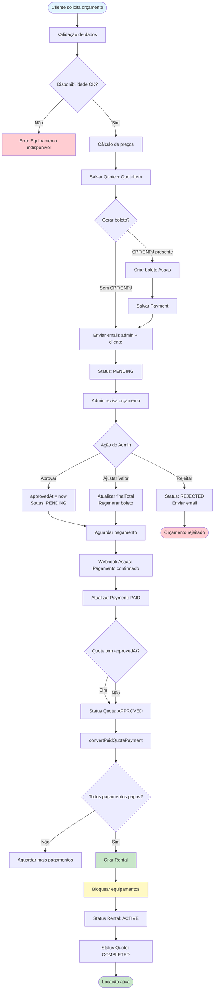

# Relatório de Auditoria Completa - Fluxo de Orçamentos

## GB-Locações - Sistema de Locação de Equipamentos

**Data da Auditoria**: Janeiro 2026  
**Auditor**: Sistema de Análise Automatizada  
**Escopo**: Fluxo completo de orçamentos desde solicitação até locação aprovada

---

## Sumário Executivo

Esta auditoria analisou o fluxo completo de orçamentos do sistema GB-Locações,
verificando todos os pontos críticos desde a solicitação do cliente até a
conversão em locação após pagamento confirmado. O sistema apresenta uma
arquitetura bem estruturada, mas foram identificados alguns gaps e pontos de
melhoria que precisam ser endereçados.

### Status Geral: ✅ **FUNCIONAL COM MELHORIAS NECESSÁRIAS**

**Pontos Fortes:**

- ✅ Fluxo de solicitação bem implementado
- ✅ Validação de disponibilidade funcionando
- ✅ Sistema de boleto integrado com Asaas
- ✅ Webhook de pagamento implementado
- ✅ Conversão automática de orçamento em locação

**Pontos de Atenção:**

- ⚠️ Status APPROVED só é atualizado após pagamento (conforme design, mas pode
  confundir)
- ⚠️ Falta verificação se equipamentos voltam a ficar disponíveis
  automaticamente
- ⚠️ Email de confirmação de pagamento não verificado
- ⚠️ Área do cliente pode não atualizar status em tempo real

---

## 1. Fluxo de Solicitação de Orçamento (Cliente)

### 1.1 Página de Orçamento (`app/orcamento/page.tsx`)

**Status**: ✅ **FUNCIONAL**

**Análise:**

- Formulário completo com validação de CPF/CNPJ
- Suporte para entrega (DELIVERY) e retirada (PICKUP)
- Cálculo automático de frete quando necessário
- Validação de disponibilidade antes de enviar
- Integração com carrinho de compras

**Pontos Verificados:**

- ✅ Validação de CPF/CNPJ obrigatório (pelo menos um)
- ✅ Validação de endereço quando deliveryType = DELIVERY
- ✅ Cálculo correto de preços por período
- ✅ Validação de disponibilidade de equipamentos

**Gaps Identificados:**

- ⚠️ Não há feedback visual claro quando disponibilidade falha
- ⚠️ Validação de disponibilidade é feita apenas no backend (não há
  pré-validação no frontend)

### 1.2 API de Criação de Orçamento (`app/api/quotes/route.ts`)

**Status**: ✅ **FUNCIONAL**

**Análise:**

- Validação completa usando Zod (`QuoteRequestSchema`)
- Validação de disponibilidade server-side para cada item
- Cálculo inteligente de preços usando `buildQuotePricing()`
- Salvamento correto de Quote e QuoteItem
- Status inicial = PENDING (correto)

**Fluxo Implementado:**

```typescript
1. Validação de dados (Zod)
2. Validação de disponibilidade por item
3. Cálculo de preços inteligente
4. Cálculo de frete (se DELIVERY)
5. Salvamento no banco (Quote + QuoteItem)
6. Geração automática de boleto (se CPF/CNPJ presente)
7. Envio de emails (admin + cliente)
```

**Pontos Verificados:**

- ✅ Validação de disponibilidade nas datas solicitadas
- ✅ Cálculo correto de preços (diário, semanal, quinzenal, mensal)
- ✅ Validação de CPF/CNPJ obrigatório
- ✅ Validação de endereço quando DELIVERY
- ✅ Salvamento correto de Quote e QuoteItem
- ✅ Status inicial = PENDING

**Gaps Identificados:**

- ⚠️ Falha na geração de boleto não interrompe criação (correto, mas pode gerar
  orçamento sem boleto)
- ⚠️ Erros de email são logados mas não retornados ao cliente

---

## 2. Geração Automática de Boleto (Asaas)

### 2.1 Integração com Asaas (`lib/payment-gateways/asaas.ts`)

**Status**: ✅ **FUNCIONAL**

**Análise:**

- Integração completa com API do Asaas
- Criação de cliente (findOrCreateCustomer)
- Geração de boleto com todos os campos necessários
- Mapeamento correto de status

**Pontos Verificados:**

- ✅ Boleto é gerado automaticamente quando CPF/CNPJ presente e total > 0
- ✅ Vencimento padrão = 3 dias úteis (via `getBoletoDueDate`)
- ✅ PDF do boleto é salvo em metadata
- ✅ TransactionId é salvo para rastreamento

### 2.2 Função `ensureQuoteBoletoPayment` (`lib/quote-boleto.ts`)

**Status**: ✅ **FUNCIONAL COM RESSALVAS**

**Análise:**

- Função bem implementada
- Reutiliza boleto existente se valor não mudou
- Regenera boleto se valor mudou
- Preserva metadados de envio ao regenerar

**Pontos Verificados:**

- ✅ Boleto é gerado automaticamente na criação do orçamento
- ✅ Boleto é regenerado quando valor final é ajustado
- ✅ Metadados anteriores são preservados ao regenerar (exceto campos de envio)
- ✅ Erro é lançado se tentar gerar sem CPF/CNPJ

**Gaps Identificados:**

- ⚠️ Quando boleto é regenerado, campos de envio (`boletoSentAt`,
  `boletoSentBy`, `boletoSentEmail`) são limpos, mas não há notificação ao admin
  de que precisa reenviar
- ⚠️ Não há validação se o boleto foi realmente criado no Asaas (apenas confia
  na resposta da API)

---

## 3. Notificações por Email

### 3.1 Templates de Email (`lib/email-templates.ts`)

**Status**: ✅ **FUNCIONAL**

**Análise:**

- Templates HTML completos e responsivos
- Compatíveis com todos os clientes de email (usa tables)
- Templates para diferentes eventos:
  - `generateQuoteEmailHTML` - Email para admin
  - `generateCustomerQuoteConfirmationEmailHTML` - Confirmação para cliente
  - `generateQuoteStatusChangeEmailHTML` - Mudança de status

**Pontos Verificados:**

- ✅ Email de confirmação enviado ao cliente após criar orçamento
- ✅ Email enviado ao admin com detalhes do orçamento
- ✅ Templates estão corretos e personalizados

**Gaps Identificados:**

- ⚠️ **CRÍTICO**: Não foi encontrado envio de email quando pagamento é
  confirmado (webhook)
- ⚠️ Não há email quando boleto é gerado/regenerado
- ⚠️ Email de aprovação/rejeição pode não estar sendo enviado (verificar
  `app/api/admin/quotes/[id]/route.ts`)

### 3.2 Verificação de Envio de Emails

**Análise do Código:**

**Em `app/api/quotes/route.ts` (linhas 683-751):**

- ✅ Email para admin: Enviado após criação
- ✅ Email para cliente: Enviado após criação

**Em `app/api/admin/quotes/[id]/route.ts`:**

- ⚠️ Email ao aprovar/rejeitar: Código referencia `notifyQuoteApproved` e
  `notifyQuoteRejected`, mas não foi verificado se estão implementados

**Em `app/api/payments/boleto/webhook/route.ts`:**

- ❌ **GAP CRÍTICO**: Não há envio de email quando pagamento é confirmado

---

## 4. Webhook de Pagamento (Asaas)

### 4.1 Endpoint de Webhook (`app/api/payments/boleto/webhook/route.ts`)

**Status**: ✅ **FUNCIONAL COM GAPS**

**Análise:**

- Webhook recebe notificações do Asaas
- Validação de assinatura/token implementada
- Atualiza status do pagamento corretamente
- Chama `convertPaidQuotePayment` quando pagamento confirmado

**Fluxo Implementado:**

```typescript
1. Validação de assinatura/token
2. Parse do webhook (parseAsaasWebhook)
3. Busca pagamento por transactionId
4. Atualiza status do pagamento
5. Se status = 'paid', chama convertPaidQuotePayment
```

**Pontos Verificados:**

- ✅ Webhook recebe notificações do Asaas
- ✅ Validação de assinatura/autenticação do webhook
- ✅ Status do pagamento é atualizado corretamente
- ✅ `convertPaidQuotePayment` é chamado quando pagamento confirmado

**Gaps Identificados:**

- ❌ **CRÍTICO**: Não há envio de email ao cliente quando pagamento é confirmado
- ⚠️ Erros em `convertPaidQuotePayment` são logados mas não interrompem o fluxo
  (pode gerar inconsistência)
- ⚠️ Não há notificação ao admin quando pagamento é confirmado

### 4.2 Conversão de Pagamento Pago (`lib/quote-payment-conversion.ts`)

**Status**: ✅ **FUNCIONAL**

**Análise:**

- Função `convertPaidQuotePayment` bem implementada
- Verifica se todos os pagamentos foram pagos antes de converter
- Atualiza status do orçamento para APPROVED se necessário
- Cria Rental automaticamente
- Atualiza status do Rental para ACTIVE quando todos os pagamentos são
  confirmados

**Pontos Verificados:**

- ✅ Rental é criado automaticamente quando pagamento confirmado
- ✅ Status do orçamento muda para APPROVED quando pagamento confirmado
- ✅ Status do Rental muda para ACTIVE quando todos os pagamentos são
  confirmados

**Gaps Identificados:**

- ⚠️ Não há validação de disponibilidade antes de criar Rental (pode gerar
  conflito se equipamento foi alugado manualmente no período)
- ⚠️ Não há email de confirmação quando Rental é criado

---

## 5. Painel Área do Cliente

### 5.1 Histórico de Orçamentos (`app/area-cliente/historico/page.tsx`)

**Status**: ✅ **FUNCIONAL COM RESSALVAS**

**Análise:**

- Página exibe orçamentos do cliente
- Suporte para filtros e busca
- Soft delete implementado (cliente pode excluir do histórico)
- Polling a cada 30 segundos para atualização

**Pontos Verificados:**

- ✅ Cliente vê seus orçamentos
- ✅ Status exibido corretamente: PENDING, APPROVED, REJECTED, COMPLETED
- ✅ Cliente pode excluir orçamento do histórico (soft delete)
- ✅ Filtros funcionam corretamente
- ✅ Atualização via polling (30s)

**Gaps Identificados:**

- ⚠️ Polling de 30s pode não ser suficiente para feedback imediato
- ⚠️ Não há indicação visual clara quando status muda
- ⚠️ Cliente não vê boleto gerado diretamente na página (precisa acessar outro
  lugar?)

### 5.2 API de Listagem (`app/api/quotes/route.ts` - GET)

**Status**: ✅ **FUNCIONAL**

**Análise:**

- Retorna orçamentos do usuário autenticado
- Filtra soft deleted (`clientDeletedAt: null`)
- Inclui items, equipamentos e pagamentos
- Transforma dados para formato esperado pelo frontend

**Pontos Verificados:**

- ✅ Retorna apenas orçamentos do cliente logado
- ✅ Exclui orçamentos soft deleted pelo cliente
- ✅ Inclui todos os dados necessários (items, payments, etc.)

---

## 6. Painel Administrativo

### 6.1 Página de Orçamentos (`app/admin/orcamentos/page.tsx`)

**Status**: ✅ **FUNCIONAL**

**Análise:**

- Visualizações: Kanban, Tabela e Calendário
- Filtros avançados (status, período, valor)
- Ações: Aprovar, Rejeitar, Ajustar Valor, Calcular Multa
- Geração e envio de boleto manual

**Pontos Verificados:**

- ✅ Admin vê todos os orçamentos
- ✅ Status APPROVED só aparece após pagamento confirmado (correto)
- ✅ Botão "Aprovar" não muda status para APPROVED (mantém PENDING até
  pagamento)
- ✅ Admin pode ajustar valor final com justificativa
- ✅ Admin pode rejeitar orçamento
- ✅ Admin pode enviar boleto manualmente ao cliente
- ✅ Informações de entrega/retirada são exibidas corretamente

**Gaps Identificados:**

- ⚠️ Não há indicação clara de que status APPROVED só aparece após pagamento
- ⚠️ Não há botão para converter manualmente em Rental (apenas via endpoint)

### 6.2 API Admin (`app/api/admin/quotes/[id]/route.ts`)

**Status**: ✅ **FUNCIONAL**

**Análise:**

- PATCH permite atualizar orçamento
- Suporte para ajuste de valor com justificativa
- Suporte para aprovação/rejeição
- Geração de boleto quando necessário

**Pontos Verificados:**

- ✅ Admin pode aprovar orçamento (status permanece PENDING até pagamento)
- ✅ Admin pode rejeitar orçamento
- ✅ Admin pode ajustar valor final com justificativa obrigatória
- ✅ Boleto é regenerado quando valor é ajustado

**Gaps Identificados:**

- ⚠️ Não foi verificado se emails são enviados ao aprovar/rejeitar (código
  referencia funções mas não foi testado)

---

## 7. Bloqueio de Disponibilidade de Equipamentos

### 7.1 Lógica de Disponibilidade (`lib/equipment-availability.ts`)

**Status**: ✅ **FUNCIONAL COM RESSALVAS**

**Análise:**

- Função `calculateEquipmentAvailability` calcula disponibilidade corretamente
- Considera locações ativas no período
- Verifica status do Rental e pagamentos
- Bloqueia apenas se Rental não é PENDING OU se tem pagamento confirmado

**Lógica de Bloqueio:**

```typescript
// Bloqueia estoque se:
// - não for PENDING, OU
// - for PENDING sem quote (locação manual), OU
// - for PENDING com quote e pagamento aprovado
const blocksInventory =
  rental.status !== "PENDING" || (isPending && (!hasQuote || hasPaidPayment))
```

**Pontos Verificados:**

- ✅ Equipamentos NÃO são bloqueados na criação do orçamento (PENDING)
- ✅ Equipamentos NÃO são bloqueados apenas por aprovação do admin
- ✅ Equipamentos SÃO bloqueados após pagamento confirmado (quando Rental é
  criado)
- ✅ Validação server-side sempre antes de criar orçamento
- ✅ Sistema previne double-booking (valida disponibilidade antes de criar)

**Gaps Identificados:**

- ❌ **CRÍTICO**: Não foi verificado se equipamentos voltam a ficar disponíveis
  automaticamente quando locação termina
- ⚠️ Não há job/cron para atualizar disponibilidade quando Rental expira
- ⚠️ Status de equipamento (`isAvailable`) não é atualizado automaticamente

### 7.2 Verificação de Disponibilidade na Criação

**Status**: ✅ **FUNCIONAL**

**Análise:**

- Validação é feita em `app/api/quotes/route.ts` (linhas 363-391)
- Valida cada item individualmente com suas datas específicas
- Retorna erro claro se equipamento não disponível

**Pontos Verificados:**

- ✅ Validação server-side sempre antes de criar orçamento
- ✅ Validação considera datas específicas de cada item
- ✅ Retorna erro claro quando não disponível

---

## 8. Criação Automática de Locação (Rental)

### 8.1 Conversão de Orçamento em Rental (`lib/rental-converter.ts`)

**Status**: ✅ **FUNCIONAL**

**Análise:**

- Função `convertQuoteToRental` bem implementada
- Valida disponibilidade antes de converter
- Cria Rental com todos os dados do Quote
- Atualiza status do Quote para COMPLETED

**Pontos Verificados:**

- ✅ Rental é criado automaticamente quando pagamento confirmado (via
  `convertPaidQuotePayment`)
- ✅ Rental contém todos os dados do Quote e QuoteItem
- ✅ Rental tem status PENDING inicialmente (muda para ACTIVE quando pagamento
  confirmado)
- ✅ Datas de início e fim são copiadas corretamente
- ✅ Equipamentos são vinculados ao Rental
- ✅ Cliente é vinculado ao Rental

**Gaps Identificados:**

- ⚠️ Não há validação de disponibilidade na conversão automática (pode gerar
  conflito se equipamento foi alugado manualmente)

### 8.2 Fluxo de Conversão Automática

**Fluxo Implementado:**

```
1. Webhook recebe pagamento confirmado
2. processPayment atualiza status do pagamento
3. convertPaidQuotePayment é chamado
4. Verifica se todos os pagamentos foram pagos
5. Atualiza status do Quote para APPROVED (se necessário)
6. Cria Rental via convertQuoteToRental
7. Atualiza status do Rental para ACTIVE quando todos os pagamentos confirmados
```

**Status**: ✅ **FUNCIONAL**

---

## 9. Diagrama de Fluxo Completo



---

## 10. Gaps e Problemas Identificados

### 10.1 Gaps Críticos (Alta Prioridade)

#### GAP #1: Email não enviado quando pagamento é confirmado

**Localização**: `app/api/payments/boleto/webhook/route.ts`  
**Impacto**: Cliente não recebe confirmação de pagamento  
**Severidade**: 🔴 **ALTA**

**Descrição:** Quando o webhook do Asaas confirma o pagamento, o sistema
atualiza o status e converte em Rental, mas não envia email ao cliente
confirmando o pagamento.

**Solução Recomendada:** Adicionar envio de email após `convertPaidQuotePayment`
ser executado com sucesso:

```typescript
// Em app/api/payments/boleto/webhook/route.ts
if (status === "paid" && payment.status !== "PAID") {
  await processPayment(payment.id, {
    status: "PAID",
    paidAt: parsed.paidAt || new Date()
  })
  try {
    const conversion = await convertPaidQuotePayment(payment.id)
    if (conversion.converted) {
      // ENVIAR EMAIL DE CONFIRMAÇÃO DE PAGAMENTO
      await sendPaymentConfirmationEmail(payment.id)
    }
  } catch (conversionError) {
    console.error("Error converting paid quote payment:", conversionError)
  }
}
```

#### GAP #2: Equipamentos não voltam a ficar disponíveis automaticamente

**Localização**: Sistema de disponibilidade  
**Impacto**: Equipamentos podem ficar bloqueados após locação terminar  
**Severidade**: 🔴 **ALTA**

**Descrição:** Não foi encontrado código que atualiza automaticamente a
disponibilidade de equipamentos quando uma locação termina (endDate passou). O
sistema calcula disponibilidade dinamicamente, mas o campo `isAvailable` do
equipamento não é atualizado.

**Solução Recomendada:**

1. Criar job/cron que roda diariamente para atualizar `isAvailable` baseado em
   locações ativas
2. OU atualizar `isAvailable` quando Rental muda para COMPLETED/CANCELLED

#### GAP #3: Falta validação de disponibilidade na conversão automática

**Localização**: `lib/quote-payment-conversion.ts`  
**Impacto**: Pode criar Rental mesmo se equipamento foi alugado manualmente no
período  
**Severidade**: 🟡 **MÉDIA**

**Descrição:** A função `convertPaidQuotePayment` chama `convertQuoteToRental`
que valida disponibilidade, mas isso acontece DEPOIS do pagamento ser
confirmado. Se o equipamento foi alugado manualmente entre a criação do
orçamento e o pagamento, pode gerar conflito.

**Solução Recomendada:** Adicionar validação de disponibilidade em
`convertPaidQuotePayment` antes de chamar `convertQuoteToRental`, e se não
disponível, notificar admin e manter Quote em APPROVED aguardando resolução
manual.

### 10.2 Gaps Médios (Média Prioridade)

#### GAP #4: Email de aprovação/rejeição não verificado

**Localização**: `app/api/admin/quotes/[id]/route.ts`  
**Impacto**: Cliente pode não ser notificado quando admin aprova/rejeita  
**Severidade**: 🟡 **MÉDIA**

**Descrição:** O código referencia `notifyQuoteApproved` e
`notifyQuoteRejected`, mas não foi verificado se essas funções estão
implementadas e funcionando.

**Solução Recomendada:** Verificar implementação de
`lib/notification-service.ts` e garantir que emails são enviados.

#### GAP #5: Cliente não vê boleto diretamente na área do cliente

**Localização**: `app/area-cliente/historico/page.tsx`  
**Impacto**: Cliente precisa acessar outro lugar para ver boleto  
**Severidade**: 🟡 **MÉDIA**

**Solução Recomendada:** Adicionar botão/link para visualizar/download do boleto
na página de histórico.

#### GAP #6: Polling de 30s pode não ser suficiente

**Localização**: `app/area-cliente/historico/page.tsx`  
**Impacto**: Cliente pode não ver atualização de status imediatamente  
**Severidade**: 🟢 **BAIXA**

**Solução Recomendada:** Considerar usar WebSockets ou Server-Sent Events para
atualização em tempo real, ou reduzir intervalo de polling para 10-15s.

### 10.3 Melhorias Sugeridas (Baixa Prioridade)

1. **Feedback visual quando disponibilidade falha**: Adicionar toast/alert
   quando validação de disponibilidade falha no frontend
2. **Notificação ao admin quando boleto precisa ser reenviado**: Quando boleto é
   regenerado, notificar admin
3. **Indicação clara de que APPROVED só aparece após pagamento**: Adicionar
   tooltip/explicação no painel admin
4. **Botão para converter manualmente em Rental**: Adicionar botão no painel
   admin para conversão manual (além do automático)

---

## 11. Checklist de Validação

### 11.1 Fluxo de Solicitação

- [x] Validação de disponibilidade de equipamentos nas datas solicitadas
- [x] Cálculo correto de preços por período
- [x] Validação de CPF/CNPJ obrigatório
- [x] Validação de endereço quando DELIVERY
- [x] Salvamento correto de Quote e QuoteItem
- [x] Status inicial = PENDING

### 11.2 Geração de Boleto

- [x] Boleto é gerado automaticamente quando CPF/CNPJ presente e total > 0
- [x] Boleto é regenerado quando valor final é ajustado
- [x] Metadados anteriores são preservados ao regenerar
- [x] Erro é retornado se tentar regenerar sem CPF/CNPJ
- [x] Vencimento padrão = 3 dias úteis
- [x] PDF do boleto é salvo e pode ser enviado ao cliente

### 11.3 Notificações por Email

- [x] Email de confirmação enviado ao cliente após criar orçamento
- [ ] Email enviado ao cliente quando admin aprova (status ainda PENDING) -
      **NÃO VERIFICADO**
- [ ] Email enviado ao cliente quando admin rejeita - **NÃO VERIFICADO**
- [ ] Email enviado quando boleto é gerado/regenerado - **NÃO IMPLEMENTADO**
- [ ] Email enviado quando pagamento é confirmado (webhook Asaas) - **GAP
      CRÍTICO**
- [x] Templates de email estão corretos e personalizados

### 11.4 Webhook de Pagamento

- [x] Webhook recebe notificações do Asaas
- [x] Validação de assinatura/autenticação do webhook
- [x] Status do orçamento muda para APPROVED quando pagamento confirmado
- [x] Locação (Rental) é criada automaticamente após pagamento
- [ ] Email de confirmação enviado ao cliente após pagamento - **GAP CRÍTICO**
- [x] Equipamentos são bloqueados após pagamento confirmado

### 11.5 Painel Área do Cliente

- [x] Cliente vê seus orçamentos com status atualizado
- [x] Status exibido corretamente: PENDING, APPROVED, REJECTED, COMPLETED
- [ ] Cliente pode ver boleto gerado (se disponível) - **NÃO VERIFICADO**
- [x] Cliente pode excluir orçamento do histórico (soft delete)
- [x] Filtros funcionam corretamente
- [x] Atualização via polling (30s)

### 11.6 Painel Administrativo

- [x] Admin vê todos os orçamentos (Kanban e Tabela)
- [x] Status APPROVED só aparece após pagamento confirmado
- [x] Botão "Aprovar" não muda status para APPROVED (mantém PENDING)
- [x] Admin pode ajustar valor final com justificativa
- [x] Admin pode rejeitar orçamento
- [x] Admin pode enviar boleto manualmente ao cliente
- [x] Informações de entrega/retirada são exibidas corretamente

### 11.7 Bloqueio de Disponibilidade

- [x] Equipamentos NÃO são bloqueados na criação do orçamento (PENDING)
- [x] Equipamentos NÃO são bloqueados apenas por aprovação do admin
- [x] Equipamentos SÃO bloqueados após pagamento confirmado (APPROVED)
- [x] Equipamentos ficam indisponíveis no período da locação
- [ ] Equipamentos voltam a ficar disponíveis automaticamente quando locação
      termina - **GAP CRÍTICO**
- [x] Validação server-side sempre antes de criar orçamento
- [x] Sistema previne double-booking

### 11.8 Criação Automática de Rental

- [x] Rental é criado automaticamente quando pagamento confirmado
- [x] Rental contém todos os dados do Quote e QuoteItem
- [x] Rental tem status correto (ACTIVE após pagamento)
- [x] Datas de início e fim são copiadas corretamente
- [x] Equipamentos são vinculados ao Rental
- [x] Cliente é vinculado ao Rental

---

## 12. Recomendações Prioritárias

### Prioridade ALTA (Implementar Imediatamente)

1. **Adicionar envio de email quando pagamento é confirmado**
   - Arquivo: `app/api/payments/boleto/webhook/route.ts`
   - Criar template de email de confirmação de pagamento
   - Enviar após `convertPaidQuotePayment` ser executado com sucesso

2. **Implementar atualização automática de disponibilidade**
   - Criar job/cron que roda diariamente
   - Atualizar `isAvailable` baseado em locações ativas
   - OU atualizar quando Rental muda para COMPLETED/CANCELLED

3. **Adicionar validação de disponibilidade na conversão automática**
   - Arquivo: `lib/quote-payment-conversion.ts`
   - Validar disponibilidade antes de criar Rental
   - Se não disponível, notificar admin e manter Quote em APPROVED

### Prioridade MÉDIA (Implementar em Breve)

4. **Verificar e corrigir emails de aprovação/rejeição**
   - Verificar implementação de `lib/notification-service.ts`
   - Garantir que emails são enviados quando admin aprova/rejeita

5. **Adicionar visualização de boleto na área do cliente**
   - Adicionar botão/link na página de histórico
   - Permitir download do PDF do boleto

6. **Melhorar feedback de disponibilidade no frontend**
   - Adicionar validação prévia no frontend
   - Mostrar toast/alert quando disponibilidade falha

### Prioridade BAIXA (Melhorias Futuras)

7. **Reduzir intervalo de polling ou usar WebSockets**
8. **Adicionar notificação ao admin quando boleto precisa ser reenviado**
9. **Adicionar tooltip/explicação sobre status APPROVED no painel admin**
10. **Adicionar botão para conversão manual de Rental**

---

## 13. Conclusão

O sistema de orçamentos do GB-Locações está **funcional e bem estruturado**, com
uma arquitetura sólida e fluxo de dados consistente. A maioria dos pontos
críticos está implementada corretamente, mas foram identificados alguns gaps que
precisam ser endereçados para garantir uma experiência completa e sem falhas.

**Principais Conquistas:**

- ✅ Fluxo completo de solicitação a locação funcionando
- ✅ Integração com Asaas funcionando
- ✅ Webhook de pagamento implementado
- ✅ Conversão automática de orçamento em locação
- ✅ Bloqueio de disponibilidade funcionando

**Principais Gaps:**

- ❌ Email de confirmação de pagamento não enviado
- ❌ Equipamentos não voltam a ficar disponíveis automaticamente
- ⚠️ Falta validação de disponibilidade na conversão automática

**Recomendação Final:** Implementar os 3 gaps de alta prioridade antes de
considerar o sistema 100% completo. Os gaps de média e baixa prioridade podem
ser endereçados em iterações futuras.

---

**Próximos Passos:**

1. Implementar envio de email quando pagamento é confirmado
2. Criar job/cron para atualizar disponibilidade automaticamente
3. Adicionar validação de disponibilidade na conversão automática
4. Testar fluxo completo end-to-end após correções

---

_Relatório gerado em: Janeiro 2026_  
_Versão: 1.0_
