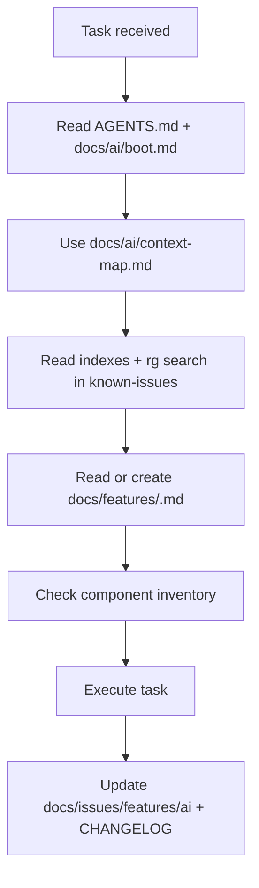

# Relatorio tecnico: Sistema de documentacao e contexto para IAs - GB-Locacoes

> Status: atualizado Data: 2026-01-20 Objetivo: descrever o sistema atual de
> contexto, explicar como a IA absorve e gera contexto, e propor um plano de
> melhoria para precisao, assertividade e eficiencia.

---

## 1. Escopo e principios

- Foco: orientacao de IA para desenvolvimento no projeto.
- Fonte da verdade: documentacao oficial do repositorio.
- Regra central: fazer somente o que foi solicitado.
- Objetivo operacional: reduzir alucinacao, retrabalho e risco de regressao.

## 2. Sistema atual (as-is)

### 2.1 Fontes primarias e ordem de leitura

1. `AGENTS.md` (regras globais e fluxo obrigatorio).
2. `.cursor/rules/gb-locacoes.mdc` (regras automaticas do Cursor).
3. `docs/ai/boot.md` (ordem minima obrigatoria).
4. `docs/ai/context-map.md` (mapa tarefa -> docs).
5. `docs/issues/known-issues.index.md` + `rg -n` em
   `docs/issues/known-issues.md`.
6. `docs/features/<component-or-page>.md` (ou criar via template).
7. `docs/COMPONENT_INVENTORY.md` + `components/` e `components/ui/`.
8. `docs/internal/documentation-security-guidelines.md` (ao editar docs).

### 2.2 Estrutura de documentacao

- `docs/ai/`: boot, contexto, protocolos de precisao.
- `docs/features/`: documentacao de features e templates.
- `docs/issues/`: problemas conhecidos e index de busca.
- `docs/architecture/`: arquitetura, seguranca e diagramas.
- `docs/guides/`: guias especificos e troubleshooting.
- `docs/internal/`: decisoes internas e analises tecnicas.
- `CHANGELOG.md`: rastreio de mudancas com data real.

### 2.3 Fluxo atual de absorcao de contexto

1. Identificar tipo de tarefa (bugfix, feature, admin, etc).
2. Ler `docs/ai/boot.md` e `docs/ai/context-map.md`.
3. Consultar indices (features, issues) antes de arquivos grandes.
4. Usar `rg -n` para abrir apenas secoes relevantes.
5. Ler doc de feature ou criar se nao existir.
6. Checar inventario de componentes para evitar duplicacao.
7. Confirmar restricoes criticas e requisitos do usuario.

### 2.4 Fluxo atual de geracao de contexto

1. Bugfix: atualizar `docs/issues/known-issues.md` com causa raiz, solucao,
   arquivos e validacao.
2. Tema recorrente: atualizar `docs/issues/known-issues.index.md`.
3. Feature/componente: criar ou atualizar `docs/features/<feature>.md`.
4. Mudanca de processo: atualizar `docs/ai/`.
5. Sempre atualizar `CHANGELOG.md` com data real via `git log`.
6. Nunca expor credenciais (usar placeholders).

### 2.5 Controles anti-alucinacao ativos

- Documentacao > inferencia.
- Escopo estrito: nao melhorar sem pedido.
- Nao alterar visual sem solicitacao.
- Datas reais em changelog.
- Placeholder obrigatorio para credenciais.

### 2.6 Fluxo resumido (mermaid)

## 3. Diagnostico: pontos fortes e riscos

### Pontos fortes

- Ordem de leitura obrigatoria reduz ambiguidade.
- Indices evitam leitura total de arquivos grandes.
- `known-issues` captura causa raiz e validacao.
- Template de feature aumenta consistencia.
- Diretrizes de seguranca evitam exposicao de credenciais.

### Riscos e lacunas

- Atualizacao manual de indices pode ficar desatualizada.
- Dependencias entre docs nao sao explicitadas.
- Ausencia de metadados de versao e data por documento.
- Validacao automatica de links/indices/diagramas nao existe.
- Prompt nao usa schema formal (risco de variacao de output).
- Nao ha politica explicita de janela de contexto/token budget.
- Busca semantica inexistente (apenas texto).
- Poucas metricas de precisao e fidelidade.

## 4. Estrategias externas e como aplicar no GB-Locacoes

| Estrategia                                         | Fonte                                     | Como aplicar no projeto                                                                      | Efeito esperado                      |
| -------------------------------------------------- | ----------------------------------------- | -------------------------------------------------------------------------------------------- | ------------------------------------ |
| Diagramas Mermaid como contexto comprimido         | `RELATORIO_DIAGRAMAS_CONTEXTO_IA_SAAS.md` | Criar diagramas em `docs/architecture/` para fluxos criticos e usa-los como entrada primaria | Menos tokens e menos ambiguidade     |
| Consultar diagramas antes de mudar arquitetura     | `RELATORIO_DIAGRAMAS_CONTEXTO_IA_SAAS.md` | Adicionar regra no fluxo de IA e checklist                                                   | Menos regressao e melhor alinhamento |
| Janela de contexto com posicionamento (inicio/fim) | `RELATORIO_JANELA_CONTEXTO_IA_SAAS.md`    | Repetir objetivos e restricoes no inicio e fim do contexto                                   | Mitiga "lost in the middle"          |
| Memoria em camadas (short/medium/long)             | `RELATORIO_JANELA_CONTEXTO_IA_SAAS.md`    | Resumos de sessao + docs persistentes + RAG futuro                                           | Melhor continuidade e menor custo    |
| Tags de contexto (source, reliability, date)       | `RELATORIO_JANELA_CONTEXTO_IA_SAAS.md`    | Adotar tags ou frontmatter padronizado                                                       | Mais rastreabilidade                 |
| Prompts hibridos com schema                        | `RELATORIO_PROMPTS_HIBRIDOS_IA_SAAS.md`   | Criar templates JSON/YAML para tarefas comuns                                                | Saidas previsiveis e validaveis      |
| Validacao automatica de docs                       | Todos                                     | Scripts para checar indices, links, mermaid e schema                                         | Menos drift e mais confianca         |
| Metricas de precisao e fidelidade                  | Todos                                     | Medir conformidade de schema e tempo ate 1a mudanca correta                                  | Feedback objetivo                    |

## 5. Plano de melhoria (fases)

### Fase 0 (imediata, 0-2 semanas)

- Padronizar este relatorio e referencias.
- Criar `docs/features/ai-context-system.md` (feature doc do sistema).
- Definir "context capsule" (objetivo, restricoes, fontes, riscos) em
  `docs/ai/context-capsule-template.md`.
- Criar checklist de absorcao/geracao de contexto para IAs em
  `docs/ai/context-intake-output-checklist.md`.

**Done when:**

- Doc criado e indexado.
- Context capsule template e checklist publicados em `docs/ai/`.

### Fase 1 (curto prazo, 2-4 semanas)

- Criar diagramas base para fluxos criticos (orcamento, admin, auth).
- Adicionar templates de diagramas e checklist de manutencao em
  `docs/architecture/diagrams/templates/` e
  `docs/architecture/diagrams/checklist.md`.
- Criar templates de prompts hibridos para tarefas comuns em
  `docs/ai/prompt-templates/`.
- Iniciar script simples de validacao de indices e links em
  `scripts/validate-docs-indexes.js` (comando `pnpm docs:validate`).

**Done when:**

- Diagramas minimos existem.
- Templates e checklists versionados.

### Fase 2 (medio prazo, 1-2 meses)

- Adicionar metadados (frontmatter) com dependencias e `last_updated`.
- Validacao de schema em CI para prompts e docs.
- Resumos de sessao (medium-term memory) em `docs/internal/ai-summaries/`.

**Done when:**

- Frontmatter aplicado nos docs criticos.
- CI falha quando schema ou links quebram.

### Fase 3 (longo prazo, 3+ meses)

- RAG/semantic search sobre docs e codigo.
- Dashboard de metricas de qualidade.
- Automacao de atualizacao de indices.

**Done when:**

- Recuperacao semantica funcionando para docs.
- Metricas ativas e acompanhadas.

## 6. Operacao de contexto: absorcao e geracao

### 6.1 Regras de selecao (contexto util)

Use criterios do `docs/ai/context-precision-protocol.md`:

- prioridade, confiabilidade, recencia, impacto.
- ordenar contexto por score e cortar o excesso.

### 6.2 Posicionamento para reduzir "lost in the middle"

- Inicio: objetivo, restricoes, regras criticas.
- Meio: detalhes e exemplos.
- Fim: checklist de validacao e lembretes.

### 6.3 Token budget sugerido

- 15% regras e restricoes.
- 55% contexto especifico da tarefa.
- 20% referencias e exemplos.
- 10% checklist de validacao.

### 6.4 Quando parar e pedir confirmacao

- Doc de feature inexistente ou conflito entre fontes.
- Mudanca com impacto amplo sem evidencia.
- Falta de fonte para regra de negocio.

### 6.5 Geracao de contexto (saida)

- Registrar decisao e fonte em docs.
- Atualizar indices quando o tema for recorrente.
- Sempre atualizar CHANGELOG com data real.

## 7. Metricas e validacao

- Schema compliance: % de saidas validas.
- Fidelidade ao contexto: % de afirmacoes com fonte.
- Tempo ate primeira mudanca correta.
- Taxa de retrabalho por tarefa.
- Cobertura de indices: % de docs referenciados.
- Freshness: dias desde `last_updated` em docs criticos.

## 8. Referencias

- `AGENTS.md`
- `docs/ai/boot.md`
- `docs/ai/context-map.md`
- `docs/ai/context-precision-protocol.md`
- `docs/ai/context-capsule-template.md`
- `docs/ai/context-intake-output-checklist.md`
- `docs/ai/prompt-templates/README.md`
- `docs/internal/documentation-security-guidelines.md`
- `docs/features/ai-context-system.md`
- `docs/architecture/diagrams/README.md`
- `RELATORIO_DIAGRAMAS_CONTEXTO_IA_SAAS.md`
- `RELATORIO_JANELA_CONTEXTO_IA_SAAS.md`
- `RELATORIO_PROMPTS_HIBRIDOS_IA_SAAS.md`
